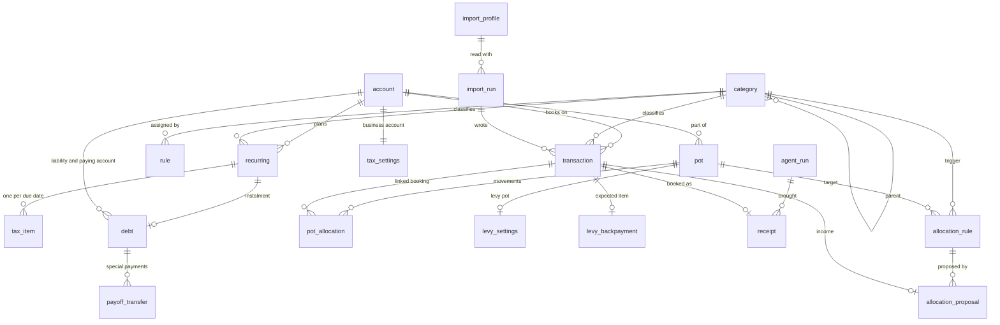
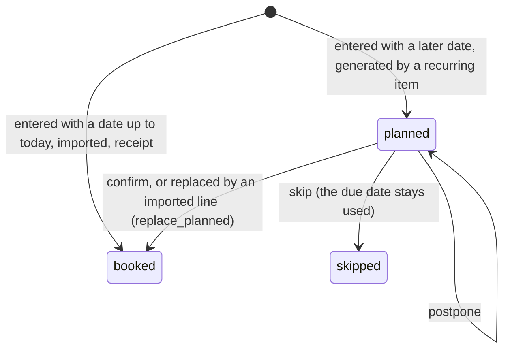
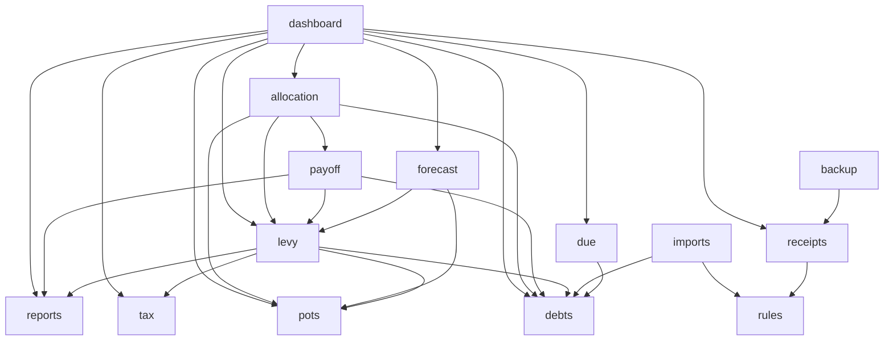
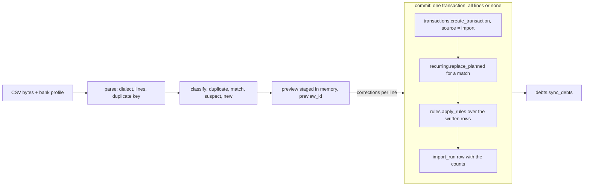
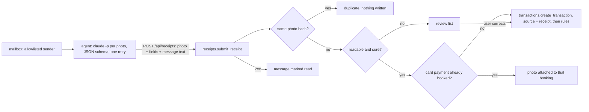
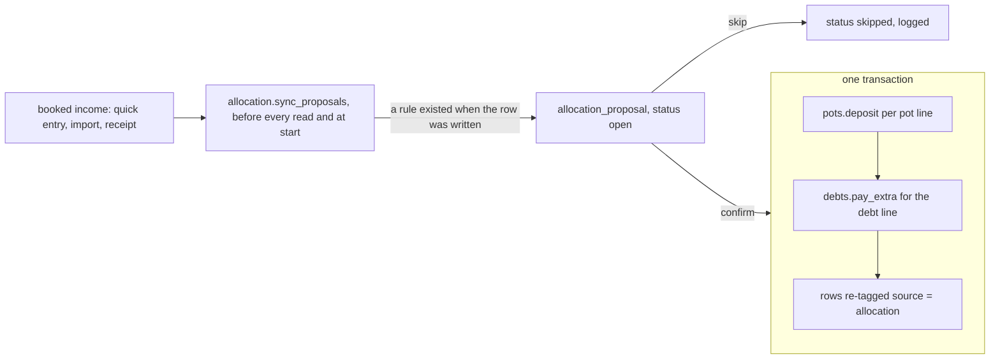

# Architecture

z-finance is a single local process: a FastAPI app that serves a JSON API under `/api` and the
built React single-page app for every other path. Data lives in one SQLite file in the user's
data directory. There is no login and no outbound network traffic (UC NF2); the API is kept
separate from the UI so authentication or a server deployment can be added later without
changing the data model (NF4).

```
browser ──HTTP──> uvicorn 127.0.0.1:8765
                    └─ FastAPI (zfinance.app.create_app)
                         ├─ /api/health                  zfinance.api.health
                         ├─ /api/<feature>/...           zfinance.domain.<feature>.api  (auto-discovered)
                         └─ /* (everything else)         zfinance.spa -> backend/zfinance/web/ (Vite build)
                                     │
                         sqlite3 ────┴──> <data dir>/z-finance.sqlite3
```

Development runs two processes (`just dev`): the backend with `--reload` on :8765 and the Vite
dev server on :5173, which proxies `/api` to the backend. Production is one process.

## Repository layout

```
backend/zfinance/
  app.py            app factory: lifespan (data dir + migrations), routers, SPA
  cli.py            `z-finance` console script (host/port, --allow-network, browser, --reload)
  config.py         Settings, data-directory resolution, env variables
  db.py             connect(), transaction(), get_connection dependency
  migrator.py       SQL migration runner
  migrations/       NNN_<slug>.sql, one file per feature step
  money.py          integer-cent conversion
  app_settings.py   get/set rows of the app_setting key/value table
  api/              cross-cutting routes (health)
  i18n/             gettext catalogs, localized error handler, /api/i18n/language
  domain/<feature>/ one package per feature: service.py, api.py
  web/              SPA bundle written by `npm run build` (git-ignored)
frontend/
  src/main.tsx      entry: RouterProvider
  src/app/          shell: router, Layout (sidebar + header), feature registry, fallback pages
  src/api/client.ts fetch wrapper, ApiError, formatCents
  src/i18n/         Lingui setup, LocaleProvider (active language), useLocale
  src/help/         help button + panel, manual view, embedded chapters; site/ = Pages entry
  src/locales/      messages.pot + de.po (Lingui catalogs)
  src/features/<feature>/route.tsx   one folder per feature
  src/styles/       design tokens (tokens.css) and base element styles (base.css)
  src/ui/           shared components (Card, Button, Field, Table, MoneyCell, …), see "UI system"
  src/components/charts/  reusable charts (Chart, SplitBar), see "UI system"
agent/              the optional receipt agent (its own package, talks to /api/receipts)
tests/              pytest, one file per feature: tests/test_<feature>.py
tests/e2e/          browser acceptance run against the running program, one module per use case;
                    marker `e2e`, deselected in the normal test run (docs/qa/acceptance-1.0.md)
tools/              commit gates run by pre-commit and CI; their tests in tools/tests/;
                    demo_data.py + screenshots.py generate the manual's screenshots;
                    live_app.py starts the program and a Chromium for both of them
packaging/          the Windows program: launcher, PyInstaller spec, Inno Setup script, build script
docs/               requirements (German), specs, decisions, QA protocols;
                    manual/<lang>/<chapter>.md (help source), assets/screenshots/<lang>/ (its pictures)
.github/workflows/  ci.yml (gates, tests, build), pages.yml (manual site), release.yml (installer)
```

## Domain model

Twenty-two tables plus the migration runner's `schema_migrations`, each owned by one package
(`domain/<owner>`; the migration blocks are in "Migrations"). Every amount is an integer number of
euro cents, income positive, expense negative. `area` (`private` | `business`) is an enum column,
not a table. A booking is always created through the transactions service and a planned item
through the recurring service; the features that create rows then tag them with their own reference
(`recurring`, `imports`, `receipts` and `allocation` set `source` and their column on the rows they
wrote).

| Table                                            | Owner        | What it holds                                                                                                                                                                              |
| ------------------------------------------------ | ------------ | ------------------------------------------------------------------------------------------------------------------------------------------------------------------------------------------ |
| `app_setting`                                    | core         | key/value settings, keys namespaced by feature (`ui.language`, `debts.payoff_budget_cents`)                                                                                                |
| `account`                                        | accounts     | name, area, type (`giro`/`savings`/`cash`/`card`/`liability`), opening balance and date, reserve floor, `archived_at`                                                                      |
| `category`                                       | accounts     | name, kind (`income`/`expense`/`transfer`), area, parent (one level)                                                                                                                       |
| `transaction`                                    | transactions | the ledger: date, signed amount, account, category, text, counterparty, memo, status, source, transfer group, `recurring_id`, `due_date`, `manually_moved`, `import_hash`, `import_run_id` |
| `recurring`                                      | recurring    | description, amount, account, category, transfer target, `pot_id`, interval (weekly/monthly/quarterly/yearly), day, start, end, active                                                     |
| `rule`                                           | rules        | contains/regex pattern → category, counterparty, priority, `invalid_reason`                                                                                                                |
| `import_profile`, `import_run`                   | imports      | how one bank writes its CSV (delimiter, encoding, date format, decimal separator, column map, skipped lines); the counts and errors of one import                                          |
| `debt`                                           | debts        | creditor, liability account, total, instalment, interval, first due, paying account, recurring item, `closed_at`                                                                           |
| `tax_settings`, `tax_item`                       | tax          | business account, prepayment amounts and due-date lists; one row per due date and recurring item                                                                                           |
| `pot`, `pot_allocation`                          | pots         | a virtual part of one account (target, plan, emergency rank, locked, levy-pot flag); its movements                                                                                         |
| `agent_run`, `receipt`                           | receipts     | one run of the receipt agent; a receipt photo with its extracted values, hash, status (`booked`/`review`/`duplicate`)                                                                      |
| `levy_settings`, `levy_backpayment`              | levy         | rate, base, back-payment due date, levy pot and account; one row per year for the expected back-payment                                                                                    |
| `payoff_plan`, `payoff_month`, `payoff_transfer` | payoff       | strategy, manual order and baseline; the baseline per month; the planned special payments the plan keeps in line                                                                           |
| `allocation_rule`, `allocation_proposal`         | allocation   | trigger, targets and fallback; a proposal with its lines and status (`open`/`confirmed`/`skipped`)                                                                                         |



Links that carry no foreign key on purpose (adding one to a merged table would be a rebuild, see
"Migrations"): `transaction.recurring_id`, `recurring.pot_id`, and `transfer_group_id` — a uuid that
the two legs of a transfer share, also stored in `pot_allocation` and `payoff_transfer`.

A booking has one of three states, and only `booked` counts towards a balance:



## The core rule

`levy.free_amount(conn, as_of)` is the one "free" number of z-finance. The dashboard, the forecast's
second line, the allocation and the payoff plan all read it; none of them computes it again.

```
free_amount(as_of) =   Σ pots.free_balance          over the payment accounts (active, not liabilities)
                     + Σ planned rows               of those accounts up to as_of
                     − Σ reserve floors             of those accounts
                     − levy_gap

levy_gap           =   Σ over the open years of  max(0, levy_target − (levy_pot + prepayments_ytd))
levy_target        =   levy_rate × booked business income of the year   (or × profit)
```

The invariant is about **when** the gap arises: with the _booking_ of an income, not with the
confirmation of the transfer that moves the money. An income of 10,000 € at a rate of 30 % raises
`free_amount` by 7,000 €, never by 10,000 € (UC NF5). `tests/test_free_amount_invariant.py` pins it
(`test_free_amount_is_net_of_levy_gap`, hand-computed) together with the terms of the formula and
the cancelling of transfers between payment accounts.

What follows for a feature:

- **Never derive a "free" or "available" figure from balances.** Call `levy.free_amount` or
  `levy.free_amount_breakdown` (the terms, for display). The forecast subtracts the same gap from its
  curve (`levy.levy_status`), the payoff plan takes the levy share out of the monthly amount.
- **Never subtract the levy share a second time.** An allocation proposal is deliberately not a planned
  booking, so `free_amount` cannot see it; its levy line is the share `levy_gap` already reserved
  (`tests/test_allocation.py`: 4,000 € at 30 % raise the free amount by 2,800 €, before and after the
  proposal exists).
- **Planned income does not count** until it is booked, and then net of the levy. The back-payment
  items and the part of a pot's planned purchase that the pot already holds are not counted either
  (pot money and gap cover them).

Details of the pieces are in "Levy reserve and free amount", "Savings pots" and "Forecast".

## Engine dependencies

The engines are plain packages that call each other's service functions. The few places that read
another package's table directly are named in their sections: the ledger queries of `accounts`, the
reports over `transaction`, and `backup`, which reads every table. The graph below is the direct dependencies between them; it has no cycle, and
`tests/test_docs_final.py` checks both that it is acyclic and that every arrow is a real import.
The three foundations — `accounts`, `transactions`, `recurring` — are used by almost every engine
(bookings are only ever written through `transactions`, planned items through `recurring`) and are
left out of the arrows.



Reading order for a newcomer, from the bottom: `accounts` (balance, bookability) → `transactions`
(the ledger) → `recurring` (planned items) → `debts`, `pots`, `tax` (masters that keep recurring
items in line) → `levy` (the core rule) → `forecast`, `payoff` → `allocation` → `dashboard`.

## Data flows

**CSV import** (`domain/imports`). The file is parsed and classified twice — once for the preview, once
against the then-current ledger at commit — so a ledger that changed in between cannot slip through.



**Receipt agent** (`agent/`, `domain/receipts`). The agent is a separate program that only knows the
HTTP API; a message is marked read after every photo of it got a 2xx answer.



**Allocation** (`domain/allocation`). Three writers can book an income (quick entry, CSV import,
receipt agent) and none of them knows the allocation: proposals are synchronised lazily.



The levy line of a proposal is not a booking of its own: `levy_gap` has reserved that share since the
income was booked (see "The core rule").

## Backend conventions

**Data directory.** `config.resolve_data_dir()`: a non-blank `ZFINANCE_DATA_DIR` wins,
otherwise `platformdirs.user_data_dir("z-finance", appauthor=False)` —
`%LOCALAPPDATA%\z-finance` on Windows, `~/.local/share/z-finance` on Linux. The app creates it at
startup. Anything a feature stores on disk (receipt images, backups) goes below this directory,
never into the program or repository folder. `just dev` points it at `./data` (git-ignored).

**Money.** Every amount is a signed `int` of euro cents: `INTEGER` columns, `*_cents` field names
in the API, income positive, expense negative. `money.to_cents()` converts exact decimal input and
refuses floats and sub-cent values; `money.from_cents()` goes back to `Decimal`. Floats never
carry money, in Python or in TypeScript (`formatCents` formats for display only).

**Dates.** ISO-8601 `TEXT`: `YYYY-MM-DD` for business dates, UTC timestamps for audit fields.

**Database access.** `db.connect()` opens a connection in autocommit mode with `Row` rows and
foreign keys on. Endpoints get one via `Depends(get_connection)`; services receive it as their
first argument and never open their own. Several writes that belong together run inside
`with transaction(conn):`. Keep business rules in plain functions over plain data where possible
(forecast, recurring generation, import parsing) so they are tested without HTTP.

**Docstrings.** Every public module, class, method and function has a docstring; ruff's `D1` rules
are part of `just lint` and the commit gates. Two exceptions, both in `pyproject.toml`: `__init__`
and other dunder methods (the class docstring documents construction), and test modules (a test's
name and its `Oracle:` line say what it checks). A docstring says what a caller may rely on — an
`Invariants:` block only for guarantees that hold on every path.

**Settings.** App-wide preferences go in the `app_setting` key/value table (migration 001) via
`app_settings.get_setting/set_setting`, with keys namespaced by feature (`ui.language`,
`debts.payoff_budget_cents`). A feature with structured settings of its own may use its own table.

### Migrations

`migrator.migrate()` runs at every start. It applies `backend/zfinance/migrations/NNN_<slug>.sql`
in number order, each file in one transaction together with its row in `schema_migrations`, and
skips files already recorded there. A file with a malformed name or a number used twice stops the
start before anything is applied. `GET /api/health` reports the highest applied number as
`schema_version` (0 = empty database).

Rules for migration files:

- Plain SQLite DDL/DML, no `BEGIN`/`COMMIT` (the runner owns the transaction).
- Never edit a file that has been merged; change the schema with a new file.
- Each feature owns a block of ten numbers. The first file of a feature takes the block's first
  number; later changes to that feature take the next free number inside its block.
- SQLite cannot drop or alter most constraints in place; such a change is a table rebuild
  (`CREATE TABLE new … ; INSERT INTO new SELECT … ; DROP TABLE old ; ALTER TABLE new RENAME TO old`).

| Block | Feature (task)              | First file             | Creates (and adds)                                               |
| ----- | --------------------------- | ---------------------- | ---------------------------------------------------------------- |
| 000   | core                        | `001_core.sql`         | `app_setting`                                                    |
| 010   | accounts, categories (-007) | `010_accounts.sql`     | `account`, `category`                                            |
| 020   | transactions (-008)         | `020_transactions.sql` | `transaction`                                                    |
| 030   | recurring items (-009)      | `030_recurring.sql`    | `recurring`; adds `transaction.due_date`, `manually_moved`       |
| 040   | rules (-010)                | `040_rules.sql`        | `rule`                                                           |
| 050   | CSV import (-012)           | `050_import.sql`       | `import_profile`, `import_run`; adds `transaction.import_run_id` |
| 060   | debts (-013)                | `060_debts.sql`        | `debt`                                                           |
| 070   | tax plan (-014)             | `070_tax.sql`          | `tax_settings`, `tax_item`                                       |
| 080   | savings pots (-015)         | `080_pots.sql`         | `pot`, `pot_allocation`                                          |
| 090   | receipts (-016)             | `090_receipts.sql`     | `agent_run`, `receipt`                                           |
| 100   | levy reserve (-019)         | `100_levy.sql`         | `levy_settings`, `levy_backpayment`                              |
| 110   | payoff plan (-021)          | `110_payoff.sql`       | `payoff_plan`, `payoff_month`, `payoff_transfer`                 |
| 120   | allocation rules (-025)     | `120_allocation.sql`   | `allocation_rule`, `allocation_proposal`                         |

A new feature outside this table takes the next free block (130, 140, …).

**Order.** Files apply in number order, so a table references only tables of its own or a lower
block (`allocation_rule` → `pot` → `account`). The one column that points up is the one a later
block adds itself: `transaction.import_run_id` references `import_run`, created in the same file.
A later block that needs a column on an earlier table adds it in its own file (`ALTER TABLE … ADD
COLUMN`, as 030 and 050 do to `transaction`), never by editing the merged file. A link that would
need a foreign key on a table that is already merged stays without one (`transaction.recurring_id`,
`recurring.pot_id`): SQLite adds a constraint only by rebuilding the table.

### Feature routers

`app.discover_feature_routers()` imports `zfinance.domain.<feature>.api` for every package under
`domain/` and includes its module-level `router`. Nothing central is edited to add a feature, so
parallel feature branches do not conflict. Each router carries its own prefix:

```python
router = APIRouter(prefix="/api/accounts", tags=["accounts"])
```

### SPA serving

`npm run build` writes the bundle to `backend/zfinance/web/`. `spa.register_spa()` adds one
catch-all GET route after all API routers: existing bundle files are served as files, any other
non-API path returns `index.html` (client-side routes survive a reload), `/api/...` never falls
through (JSON 404), and a missing bundle answers 503 with a build hint.

### Local-only guard

The server has no login; the loopback interface is the boundary. `local_guard.LocalOnlyMiddleware`
answers 403 when `Host` is not a loopback name or the configured bind host (DNS rebinding), and
when a state-changing request carries a foreign `Origin` (cross-site form posts, e.g. to a future
restore or import upload). Tests use `base_url="http://127.0.0.1:8765"` (see `tests/conftest.py`).
The guard is not authentication, so `cli.parse_args` refuses a non-loopback `--host` (exit code 2)
unless `--allow-network` is passed too (see "Known risks").

### Time windows

This is the one rule for each "N months ahead" window. Code and tests point here.

- **Day windows are half-open**: `[today, add_months(today, N))`. The first day is in. The same
  calendar day N months later is out. `add_months` clamps to the end of a short month. The last day
  of the window is `add_months(today, N) - 1 day`.
- **Recurring generation** (`recurring.generate`) makes a row for each due date in that window. It
  gives the last day to the inclusive helper `schedule.due_dates`.
- **Forecast** (`forecast.horizon_end`) returns that last day. The 3, 6 and 12-month curves end one
  day before `today + N months`, so they cover the same days as the generation. An item on the
  excluded day is in no curve. The generation makes it on a later day, and then the curve of that
  day shows it. `_levy_steps` and the daily sums use the last day as an inclusive bound.
- **Payoff plan** counts months, not days. Special payments sit on the 1st of the 12 months after
  today: always 12 slices, each after today. On the 1st of a month, the last slice falls on
  `today + 12 months`. That is one day after the forecast window. This is on purpose: the plan
  keeps its 12 slices, and the forecast does not show the last one yet.
- **Due items** look `due.HORIZON_DAYS` (14) days ahead and include the last day. This is a short
  look-ahead list. It does not have to match the generation.

### Backup and restore

`zfinance.domain.backup` is schema-driven: it reads the table list from the database
(`PRAGMA table_list`, ordinary tables except `schema_migrations`), so tables added by later
feature migrations are backed up without touching it. A feature never registers its tables.

- **Snapshot** = folder `<data dir>/backups/<UTC yyyymmddThhmmssmmmZ>-<auto|manual>/` with
  `export.json`, `z-finance.sqlite3` and, when the database has receipts, `receipts/<year>/<id>.<ext>`
  (see "Receipt photos" below). The SQLite copy is taken with `Connection.backup()` (a
  file copy would lose the WAL content) and the JSON is read from that copy, so both describe the
  same state. The app writes an `-auto` snapshot at every start (`run_startup_backup`, called from
  the lifespan after `init_storage`; a failure is logged and never stops the start) and keeps the
  newest 10; `-manual` snapshots (Backup page) and foreign entries in `backups/` are never
  deleted.
- **Export** (`format_version` 1): `schema_version`, the applied `migrations`, and per table
  `columns`, `rows`, `row_count`, `sha256`. BLOBs are `{"$blob": <base64>}`, generated columns are
  skipped. Files a feature stores next to the database (the receipt photos) are not in it; the
  archive carries them.
- **Restore** (`POST /api/backup/restore`, raw JSON body, or a ZIP archive, see below) checks the export against its own
  checksums, builds an in-memory staging database with exactly the exported schema (the shipped
  migration files of the exported set), loads and verifies the rows there (row counts, checksums,
  foreign keys), migrates it forward to the current schema and only then copies it over the
  target with `Connection.backup()`. Older exports thus pass through the normal migrator; a
  newer schema version is refused; any refusal or error leaves the database untouched.
- **Empty target**: every table except `app_setting` holds only rows the migrations themselves
  create. `app_setting` rows never block a restore and are replaced by the exported ones. A
  migration that seeds rows is fine; user data is what blocks.

- **Receipt photos** (`domain/backup/files.py`). A snapshot holds the photos that the `receipt`
  rows of its own database copy name, taken after the copy. They are **hard-linked** to the live
  files, so the start backup costs one directory operation per photo and no bytes; that is sound
  because a photo is write-once (`receipts.service` only creates and deletes files). Where linking
  fails the photo is copied. Paths come from the rows, are matched against `receipts/<year>/<id>.<ext>`
  and resolved with `receipts.service._inside_receipts`; a row pointing elsewhere is skipped.
  `GET /api/backup/{name}/archive` returns a ZIP of `export.json` plus those photos; the restore
  takes `application/zip` next to `application/json`. The archive is untrusted input: an entry is
  accepted only if its whole name is `export.json` or `receipts/<4 digits>/<id>.(jpg|png|webp)`
  (`..`, absolute paths, drive letters, backslashes, other names, symlinks, duplicates and encrypted
  entries refuse the archive); the path is rebuilt from the name and resolved through
  `_inside_receipts` in a staging folder and again at the final place; a photo must be named by a
  `receipt` row of the export, hash to its `image_hash` and show the magic bytes of its extension.
  Limits: upload 4 GiB, 50 000 photos, 10 MiB per photo, 4 GiB of photos in total, 256 MiB
  `export.json`, checked on the bytes read. The photos are placed just before the database is
  switched and removed again if that step fails. An `export.json` upload (no photos) and an archive
  without photos restore as before.

Known risks: export and restore keep the whole database in memory (fine for a personal ledger);
the hard-link copy of a start snapshot is O(photos), but on a file system without hard links it
degrades to a full copy of all photos per start; a snapshot's photos share their disk space with
the live ones, so they do not survive the loss of the disk (download the ZIP);
every start writes a snapshot, so ten starts on an emptied database rotate out all older automatic
snapshots — copy backups you care about out of `backups/`; the check "target is empty" and the
final copy are not one atomic step (single-user app).

### Accounts and categories

`zfinance.domain.accounts` (UC-ZF-001, migration `010_accounts.sql`) owns the tables `account`
and `category` and the settings keys `accounts.total_reserve_floor_cents` and
`accounts.first_run_done`. Routes: `/api/accounts` (with `/settings`, `/setup`,
`/{id}/balance`, `/{id}/archive`, `/{id}/unarchive`) and `/api/categories`; `api.py` has one
router per resource, combined into the module-level `router`.

- **Balance.** `service.balance_at(conn, account_id, on_date)` = opening balance + booked amounts
  up to that day; before the opening date it is 0. This is the one balance function every later
  feature (dashboard, forecast, payoff) calls.
- **Ledger extension point.** Everything that depends on bookings goes through
  `domain/accounts/ledger.py`: `booked_sum_until`, `earliest_booking_date`,
  `account_booking_counts`, `category_booking_counts`, `move_category_bookings` — plain queries
  on the `transaction` table (see "Transactions"); only `booked` rows count towards a balance. The
  service calls them as `ledger.<name>(...)`, so tests can still substitute a fake with
  `monkeypatch` (`tests/test_accounts.py`, `FakeLedger`).
- **Bookability.** `service.ensure_bookable(conn, account_id, date)` refuses archived accounts
  and dates before the opening date (UC 1a/1b); -008 calls it before every insert or date change.
  `list_accounts(conn)` returns active accounts only — the list booking forms offer.
- **Default categories** are data in `service._DEFAULT_SETS` (per language, not a gettext
  catalog), offered by `GET /api/accounts/setup?language=` while `accounts.first_run_done` is
  unset and no category exists; `POST /api/accounts/setup` stores the edited list and sets the
  flag in one transaction. Adopted rows never change with the UI language.

Known risk: the account list calls `balance_at` once per account (one indexed sum query each).
Fine for a handful of accounts; batch it if that ever changes.

### Transactions

`zfinance.domain.transactions` (UC-ZF-002, migration `020_transactions.sql`) owns the table
`transaction` — the ledger every later feature writes into. Its columns are a contract for the
following tasks: `date`, `amount_cents` (signed, never 0), `account_id`, `category_id`
(nullable), `text`, `counterparty`, `memo`, `status` (`booked` | `planned` | `skipped`), `source`
(`manual` | `import` | `recurring` | `receipt` | `allocation`), `transfer_group_id`,
`recurring_id` (foreign key added by -009), `import_hash` (unique when set), `created_at`. A later
feature inserts with its own `source`; the service functions here write `manual` rows.

- **Bookability.** Every insert and every change of date or account calls
  `accounts.service.ensure_bookable` (archived account, date before the opening date).
- **Status.** A manual booking dated after today is `planned`, otherwise `booked`, derived again
  on every save; `skipped` rows and other sources keep their status. Only `booked` counts towards
  a balance.
- **Transfer** = two rows with one `transfer_group_id` (uuid4 hex): `-amount` on the source,
  `+amount` on the target account, so the total over all accounts is unchanged (also owner
  draw/contribution between business and private, UC TBD-6). `update_transaction` on one leg
  rewrites both, `delete_transaction` removes both; `create_transfer`/`update_transfer` work on the
  pair.
- **Suggestions.** `suggest(conn, text)`: latest non-transfer booking per text
  (case-insensitive), ranked exact > prefix > contains, at most 8.
- Routes: `/api/transactions` (list, create, `/{id}` get/put/delete), `/api/transactions/transfers`
  (post, `/{group_id}` put), `/api/transactions/suggest?q=`.
- **Frontend.** `features/entry` (route `entry`): form + latest bookings. The global shortcut
  Alt+N is the one hook in `app/Layout.tsx` (`useQuickEntryShortcut` from
  `features/entry/shortcut.ts`); the form remembers the last account in `localStorage`.

Known risk: `suggest` reads the latest row of every distinct text and ranks in Python — linear in
the number of distinct texts, fine for a personal ledger; revisit above ~50k distinct texts.

### Recurring items

`zfinance.domain.recurring` (UC-ZF-003, migration `030_recurring.sql`) owns the table `recurring`
and the `transaction` columns `due_date` and `manually_moved`. `schedule.py` computes due dates
as plain functions (weekly on a weekday; monthly/quarterly/yearly on a day counted from the start
month; days 29–31 clamp to the month's last day); `service.py` holds the engine.

- **Generation.** `generate_planned(conn, today=, horizon_months=12)` creates one planned row per
  missing due date in the half-open window `[today, today + 12 months)` (never before the start or
  the account's opening date) through the transactions service, then tags it `source='recurring'`,
  `recurring_id`, `due_date`. A transfer item becomes a transfer pair via `create_transfer`. It
  runs at every start (`run_startup_generation`, after the startup backup; logs and never raises),
  after creating/resuming/editing an item, and on `POST /api/recurring/generate`. The window's end
  is exclusive so that a due date falling on today is not generated a second time a year ahead
  (T-2026-CU-9130-047); a due date on `today + 12 months` itself is generated by the first run on
  a later day (there is no daily timer: the next app start, item edit or generate call), so the
  12-month forecast, whose window is the same (see "Time windows"), never expects one.
- **Key.** Unique `(recurring_id, due_date)` over plain rows and outgoing transfer legs. A due date
  with any row carrying its key — planned, booked, skipped, moved or replaced — is never
  generated again; that is what makes the engine idempotent.
- **Moved rows** (`manually_moved = 1` from `PUT /api/recurring/items/{id}`, or `date != due_date`)
  are never rewritten by generation or by editing the item. Pausing (`/deactivate`) deletes all
  planned rows of the item, an end date deletes the later ones, delete removes the item and its
  planned rows and unlinks booked ones (`recurring_id` has no foreign key: adding one would need a
  rebuild of `transaction`).
- **Import contract.** `replace_planned(conn, planned_id, real_txn_id)` replaces a planned row by
  a real booking: the booking inherits `recurring_id` + `due_date` (the due date counts as done),
  a transfer leg's partner is booked mirrored. The CSV import (UC-ZF-005) calls exactly this.
- **Expected one-off items** are manual bookings dated after today (`status='planned'`, no
  `recurring_id`): `GET/POST /api/recurring/expected`, edit/delete via `/api/transactions/{id}`.
- **Frontend.** `features/recurring` (route `recurring`): form, list with the selected item's
  occurrences (Move), expected items.

Known risks: the start run is synchronous (bounded by items × 12 months, milliseconds for a
personal ledger); `list_items` returns every occurrence of an item without paging.

### Rules and monthly report

`zfinance.domain.rules` and `zfinance.domain.reports` (UC-ZF-007, migration `040_rules.sql`) own
the table `rule` and read `transaction`; routes `/api/rules` (with `/preview`, `/apply`, `/draft`)
and `/api/reports/month` (with `/bookings`, `/export.csv`); frontend `features/month`.

- **Rule engine.** `rules.service.apply_rules(conn, transactions=None, *, only_uncategorized=True)`
  gives every non-transfer booking without category the category of the winning rule: highest
  `priority`, among equals the lowest id. `transactions` limits the run to those bookings (the CSV
  import, -012, passes the rows it wrote); the `UPDATE` repeats the "uncategorised, not a transfer"
  condition, so a stale list cannot overwrite a category. A rule matches the booking's `text` or
  `counterparty`; `contains` is a Unicode-casefolded substring, `regex` a case-insensitive search.
  A rule's `counterparty` is filled into matched bookings that have none.
- **Regex safety.** Python's `re` cannot be interrupted, so regular expressions run on the
  `regex` package (`search(..., timeout=)` raises `TimeoutError`). On save a pattern must compile,
  be ≤ 200 characters, keep the product of its counted repeats ≤ 10 000 (compiling nested `{n}`
  repeats does not return otherwise) and survive four probe texts within the time limit. While
  matching, the first timeout of a rule marks it `invalid_reason = 'timeout'` and skips it; a
  pattern that no longer compiles is marked `syntax`. Invalid rules stay listed and are never
  applied or deleted; saving a valid pattern clears the mark. Deleting a category deletes its
  rules (`ON DELETE CASCADE`); a move target does not inherit them.
- **Report.** `reports.service.month_report(conn, "YYYY-MM", area)` (area `private`, `business`
  or `all`; a booking's area is its account's area) reads `booked` rows only, one aggregate query
  over the month and the six months before. Lines are (flow, category) with amount, previous
  month and six-month average (divisor always 6, half away from zero); totals come from raw sums.
  Transfer legs are neither income nor expense; a leg whose partner account lies in another area
  is a _movement_ of the area, reported beside the balance, and nothing is a movement in `all`.
  `bookings(...)` serves both the drilldown of a line (sums to its amount) and the uncategorised
  list (`category_id=None`). `export.month_csv` writes the machine-readable CSV (`.` decimals,
  UTF-8 without BOM, English header, formula-looking text cells prefixed with `'`).
- **Frontend.** `features/month` (route `month`): pickers, figures, the two category tables,
  drilldown, uncategorised list (assigns through `PUT /api/transactions/{id}`, then offers the rule
  dialog with a live hit count), rules list, export link.

Known risks: `apply_rules` is O(bookings × rules) in Python with one regex search per pair —
fine for a personal ledger, revisit above ~100k uncategorised bookings; imported transfers that
arrive as two independent bookings (no `transfer_group_id`) count as income and expense until the
import pairs them; the six-month average of a young ledger is understated by design.

### Debts

`zfinance.domain.debts` (UC-ZF-010, migration `060_debts.sql`) owns the table `debt` and the
settings key `debts.payoff_budget_cents` (`payoff_budget`/`set_payoff_budget`, read by -019,
-025, -026). It writes no booking of its own:

- **Debt = liability account + recurring transfer.** `create_debt` creates an account of type
  `liability` (name = creditor, opening balance −(total − repaid), opening date today) and, with a
  fixed instalment, a recurring transfer paying account → liability account (monthly, quarterly
  or yearly on the first due date's day). The remaining amount is −balance of that account over
  all booked rows; it is never stored.
- **Projection.** `payoff_plan` (pure): open due dates from the earliest planned instalment (else
  the next due date from today), skipping booked/skipped ones; count = ⌈remaining ÷ instalment⌉,
  end = the count-th open date, last instalment = the remainder. Without an instalment,
  `required_monthly_cents` gives the rate to a wished `target_end`.
- **Recurring item from master data** (the pattern of the tax plan -014 and the pots -015):
  `_installment_fields` derives the `RecurringFields` from the debt row (end = projected end),
  `_sync_one` makes the stored item equal through the recurring service (create, update, pause,
  delete) and sets the planned last instalment to the remainder via `update_transaction`. The debt
  is the source: edits of its recurring item on the recurring screen are reverted.
- **Sync.** `sync_debts` closes a debt at remaining ≤ 0 (`closed_at`, recurring item paused, so
  every planned instalment disappears from forecast and due list), reopens it above 0 and keeps
  the item in line. It runs after every debt write, on `GET /api/debts`, and at start
  (`run_startup_sync`, after the recurring generation; logs, never raises). Confirmation (-011)
  and import (-012) may call it after booking an instalment.
- **Special payment** = `create_transfer` paying account → liability, dated today or earlier,
  capped at the remaining amount (`capped` in the answer). A raised total is a booking of the
  difference on the liability account (history stays).
- Routes: `/api/debts` (overview with sums per area), `/{id}` get/put/delete, `/{id}/history`,
  `/{id}/payments`, `/settings`. **Frontend:** `features/debts` (route `debts`).

Known risks: `GET /api/debts` writes (it syncs first) and runs one projection query set per debt —
fine for a handful of debts; an instalment moved by hand with another amount is not reflected in
the projection (all but the last instalment are assumed full).

### Receipts

`zfinance.domain.receipts` (UC-ZF-013 API part, migration `090_receipts.sql`) owns the tables
`receipt` and `agent_run` and the settings keys `receipts.confidence_threshold` (default 0.8) and
`receipts.accounts` (`{area: {cash|card: account id}}`); routes `/api/receipts` (with `/settings`,
`/runs`, `/{id}`, `/{id}/photo`, `/{id}/book`), frontend `features/receipts`. The receipt agent
(mailbox, `claude -p`, schedule, sender allowlist) is a separate program that talks to this API.

- **Upload.** `POST /api/receipts` is `multipart/form-data` (`python-multipart`), parsed by hand
  with `request.form(max_files=1, max_fields=20, max_part_size=32 kB)` after a `Content-Length`
  check, so an oversized body is refused before it is read; the photo is read up to 10 MB + 1 byte.
  Its type comes from the magic bytes (JPEG, PNG, WebP), never from the declared type or name.
- **Storage.** `<data dir>/receipts/<upload year>/<receipt id>.<ext>`, built from server values
  only; `_inside_receipts` resolves every stored path and refuses anything outside
  `<data dir>/receipts` on write, read and delete. The file is written inside the database
  transaction and removed if it fails. Photos are served only by receipt id (`/{id}/photo`, stored
  media type, `nosniff`).
- **Outcome** (`submit_receipt`): same photo hash → `duplicate`, nothing written; unsure (unreadable,
  missing date/total/merchant, not EUR, confidence below the threshold, no account, account refuses
  the date) → `review` with a reason; same date/total/merchant as a `booked`/`review` receipt →
  `duplicate` with `duplicate_of`; card or unknown payment with a booked or planned expense without receipt of the
  same amount within ±3 days in the area → attached to it; else a booking through
  `transactions.create_transaction`, tagged `source='receipt'`, category from the message hint,
  the suggestion, else `rules.apply_rules`. `book_receipt` books a review item the same way.
- **Accounts.** The mapped account per area and payment method, else the only active `cash`
  account (cash) or the only `card`, then `giro`, account of the area; none or several → review.

- **Agent.** `agent/` is the receipt agent, package `zfinance_agent` in the uv workspace (not part
  of the app or the installer). It never imports `zfinance`: per run it opens an agent run, reads
  `UNSEEN UNFLAGGED` IMAP messages from allowlisted senders, runs `claude -p` with a fixed prompt
  and JSON schema per photo, posts each photo with the message text as `hints`, and marks the
  message `\Seen` only after every photo got a 2xx (API down → stop, message stays unread; the
  photo hash makes a repeated upload a duplicate). Details: `agent/README.md`.

Known risks: a booking deleted after it got a receipt leaves the receipt `booked`
without `transaction_id` (foreign key `SET NULL`); the duplicate key compares the merchant text
exactly (casefolded), so an agent that spells a merchant differently twice books twice.

### Due items

`zfinance.domain.due` (UC-ZF-004, no migration) is the weekly review of planned rows. It owns no
table and writes no `transaction` row itself; every change goes through the transactions, recurring
and debts services. Routes: `/api/due` (list) and `/api/due/{id}/confirm|skip|postpone`; `{id}` is
the booking id of the listed item (a transfer: its outgoing leg).

- **List.** `list_due(conn, today=)`: planned rows dated up to `today + 14` days, oldest first, so
  overdue ones lead; one entry per occurrence. `days_overdue` and `long_overdue` (> 30 days, the
  UC-ZF-004 highlight) are computed here, `confirm_date` is the date a plain confirm books on. A
  row that `replace_planned` swapped (CSV import) is no longer planned and drops out.
- **Confirm.** `confirm` creates a booking with the item's account, category, text and memo
  through `transactions.create_transaction`, then `recurring.replace_planned` swaps it in, in one
  transaction: the booking inherits `recurring_id` + `due_date` (so the due date stays done and the
  recurring item is never written), a transfer's other leg is booked mirrored. The amount is
  positive and keeps the item's sign; the date is at most today (a later booking would be stored
  as planned again by the transactions service), and defaults to `min(planned date, today)`. The
  planned row's id ends with the confirmation; the booking gets a new one.
- **Skip.** `transactions.skip_planned(conn, id)` (added for this feature) sets `planned` →
  `skipped` — both legs of a transfer in one transaction, anything not planned is a `Conflict` —
  and keeps `recurring_id` + `due_date`, so the engine never creates that due date again. A skipped
  row counts towards no balance and is not listed; saving it again keeps it skipped.
- **Debts.** `confirm` and `skip` call `debts.sync_debts` inside their transaction: confirming the
  last instalment of a debt closes it and drops its planned instalments, a skipped instalment
  counts as done (the debt's end moves one due date later).
- **Postpone.** New date after today; a recurring occurrence moves through `recurring.move_item`
  (sets `manually_moved`), an expected one-off item through `transactions.update_transaction`.
- **Frontend.** `features/due` (route `due`): one table, amount and booking date editable in the
  row; Enter in a field or on the row confirms and focus moves to the next row.

Known risks: `list_due` looks up the other leg's account per transfer row and has no paging for
the overdue backlog — a handful of rows for a personal ledger; page the overdue part if years of
items are ever left unconfirmed.

### Tax plan

`zfinance.domain.tax` (UC-ZF-008, migration `070_tax.sql`) owns the tables `tax_settings` (one row:
business account, an amount per due date for income-tax prepayment and SVS, the due-date lists)
and `tax_item` (one row per due date and recurring item). There is no VAT anywhere (small
business, TBD-2); `tests/test_tax_plan.py` pins that over the OpenAPI schema and every column. It
writes no booking of its own and does not extend the recurring engine:

- **One yearly recurring item per due date** (interval `yearly`, `day_of_month` from the date;
  due dates are `MM-DD`, day 31 = the last day of the month, so SVS at the end of Feb/May/Aug/Nov
  is `02-31`…). Four ESt-VZ and four SVS items give four planned rows per kind in the 12-month
  horizon. Text, business account and the category Tax/Steuer/SVS (reused or created in the UI
  language) come from the settings.
- **Save = sync** (`save_settings`, one transaction; the pattern of `domain/debts`): a first amount
  creates the items, a cleared amount or a removed date ends them, an added date creates one.
  The settings are the source: an edit of such an item on the recurring screen is reverted by the
  next save.
- **Amount change.** `n` = the first occurrence of the due date on or after today with no
  confirmed (booked/skipped) row. The old item ends on `n − 1 day` through `update_recurring`
  (its future unmoved planned rows go; confirmed, overdue and earlier rows stay), a new item starts
  on `n`. An item that starts on or after `n` has no history before it and is deleted instead. A
  superseded item keeps its `tax_item` row with `retired_at`.
- **Contract for the levy reserve (-019).** `prepayments_ytd(conn, year)` = booked rows of every
  recurring item the plan ever owned, booking date in `year`, as positive cents; back-payments and
  payments never linked to a plan item do not count. `tax_plan_missing(conn)` is the flag for the
  dashboard hint. Read both through the functions.
- Routes: `GET/PUT /api/settings/tax`. **Frontend:** `features/settings-tax` (route `tax`, nav
  "Taxes & levies").

The recurring engine's window is half-open (`[today, today + 12 months)`, see Recurring items), so
on a due date's own day each item holds that date once and the plan shows four rows per kind on
every day, the due dates included (UC-ZF-008 AK1, T-2026-CU-9130-047).

Known risks: a future planned item moved by hand is reset
by an amount change; a payment that the import does not match to its planned item (amount off by
more than 5 %) is not counted in `prepayments_ytd` until it is linked.

### Savings pots

`zfinance.domain.pots` (UC-ZF-011, migration `080_pots.sql`) owns the tables `pot` and
`pot_allocation` and the link `recurring.pot_id` (column of 030, no foreign key: adding one needs a
rebuild of `recurring`, whose `DROP TABLE` would fire `debt.recurring_id ON DELETE SET NULL`). A
pot is a virtual part of one account and writes bookings only through -008 and -009:

- **Balances.** `pot_balance(conn, pot_id, on_date)` = Σ allocations up to the day;
  `free_balance(conn, account_id, on_date)` = `accounts.balance_at` − Σ pot balances of the account.
  `free_balance` is the contract for -019, -025 and -026; it is a pure read and can be negative
  (an expense not assigned to a pot).
- **Allocations** (`deposit`, `withdraw`, `transfer_in`/`transfer_out` pairs, `emergency`) are
  dated today or earlier. A deposit from the free balance is refused above it (checked on its day
  and today); a deposit from another account is a transfer whose incoming leg the allocation links.
  `move` changes no booking. `assign_expense` links a booked expense on the pot's account and
  covers it up to the pot's balance, reporting the rest from the free balance. Deleting a linked
  booking deletes its allocation.
- **Plan.** `monthly_rate` = ⌈(target − balance) ÷ months to the target month⌉; `plan_status`
  compares the balance with a line linear in days from `plan_start` (creation or last target
  change; base = balance that day) to the target date. Pure functions, no database.
- **Savings plan** = monthly recurring transfer into the pot's account tagged with `pot_id`
  (`set_savings_plan`, amount default = the monthly rate, ends on the target date). Its booked
  incoming legs count at once (a join in the balance query) and are turned into allocation rows by
  `collect_deposits`, which runs before every pot read and write, so they survive a deletion of
  the recurring item. Confirmation (-011) and import (-012) need no hook.
- **Planned expense** (`plan_expense`): one planned booking of −target on the target date (a
  manual planned row the forecast reads), created, rewritten or deleted by `_sync_planned_expense`
  on every pot write; assigning an expense clears the flag.
- **Emergency order.** Open, unlocked pots have a rank unique per account (index
  `pot_account_rank`); locking, closing and deleting close up the order, `set_ranks` sets it.
  `emergency_split` (pure) empties rank 1 before rank 2 and never takes a locked pot;
  `emergency_proposal` adds per pot the new balance and the target date moved by
  ⌈taken ÷ rate⌉ months (savings plan amount, else the required rate); `confirm_emergency` books
  the (possibly edited) lines as `emergency` and applies the new dates. A locked pot gives money
  only through `withdraw(..., confirm_locked=True)`, logged as `emergency`.
- `is_levy_pot` is a flag only; the levy logic belongs to -019.
- Routes: `/api/pots` (overview with per-account split; create), `/ranks`, `/transfers`,
  `/free-balance`, `/emergency` (GET proposal, POST confirm), `/{id}` get/put/delete,
  `/{id}/allocations`, `/deposits`, `/withdrawals`, `/expenses`, `/close`, `/savings-plan`
  (put/delete).
- **Frontend.** `features/pots` (route `pots`, group Planning): per account a block with the four
  figures of `AccountPotsOut` (`KpiTile`), the emergency order list and one `PotCard` per open pot;
  every figure comes from `GET /api/pots`, which is reloaded after each change — the screen does no
  balance arithmetic. Actions are the design system's in-flow `Dialog`s above the cards
  (`PotDialogs`, `PotForm`, `EmergencyDialog`); an amount the backend refuses is shown at its field.
  The emergency order (`OrderList`) uses native HTML5 drag and drop (no library) with Up/Down
  buttons as the keyboard alternative; both call `draft.reorder` and one `PUT /ranks`. A locked pot
  is taken from only through `withdraw(confirm_locked)`; the emergency dialog never lists it
  (`confirm_emergency` refuses it). The form applies a chosen rank after the create with a second
  call (`PUT /ranks`).

Known risks: reads write (`collect_deposits` before every pot read, like the debts sync);
`overview` runs a few balance queries per pot — fine for dozens of pots; a deposit transfer
deleted after the pot's money was spent leaves a negative pot balance, shown as is; on the screen,
the expense picker offers the account's latest 100 bookings (the API has no "not yet assigned"
filter, an assigned one is answered with the backend message), the order list and cards are not
paged, and HTML5 drag and drop does not work on touch screens (the arrow buttons do).

### Levy reserve and free amount

`zfinance.domain.levy` (UC-ZF-015, migration `100_levy.sql`) owns the tables `levy_settings` (one
row: rate in basis points, base `income`|`profit`, due date `MM-DD` of the back-payment, levy pot,
account) and `levy_backpayment` (one row per year). It reads the monthly report (-010), the tax
plan (-014), the pots (-015), the debts (-013) and the recurring items (-009) through their service
functions and writes bookings only through -008/-009. The screen is `features/levy` (task -023).

- **Core rule** (the formula and its consequences: "The core rule"). `free_amount(conn, as_of)` is the one "free" number (dashboard, forecast,
  allocation -025, payoff plan -021/-026): Σ `pots.free_balance` of the payment accounts (active,
  not liabilities; every pot, the levy pot included, is already out) + planned rows of those
  accounts up to `as_of` − their reserve floors − `levy_gap`. Transfer pairs between payment
  accounts cancel; planned income is not counted (it counts once booked, then net of the levy),
  nor are the back-payment items (covered by pot + gap) or the part of a pot's planned purchase the
  pot holds. The gap rises with the _booking_ of an income: 10,000 € at 30 % raise `free_amount`
  by 7,000 € (`tests/test_free_amount_invariant.py`). `free_amount_breakdown` returns the terms.
- **Target / actual / gap.** Target = rate × base, half up; base = booked business income of the
  year from `reports.month_report` (area `business`), or its balance for `profit`, floored at 0.
  Actual = levy pot + `tax.prepayments_ytd`. The levy pot is `levy_pot_id` if open, else the open
  pot flagged `is_levy_pot` (lowest id if several, `levy_pot_ambiguous`). Open years = the current
  one plus the previous one until its back-payment is done; the pot goes to the older year first.
- **Back-payment.** `sync_backpayments` keeps one expected item "Levy back-payment <year>" of
  −(target − prepayments) on the due date of the following year (`recurring.create_expected`,
  `transactions.update_transaction`/`delete_transaction`; ≤ 0 removes it). An item confirmed,
  skipped or deleted outside the engine settles its year; `archive_backpayment` (UC 3a) keeps the
  estimate. Runs after saving the settings, on `GET /api/levy/status` and at start
  (`run_startup_backpayment_sync`, after the debts sync; logs, never raises).
- **Required revenue.** (fixed costs + instalments + payoff budget + pot rates + reserve build-up)
  ÷ (1 − rate), per month, split by block; fixed costs leave out the tax plan's items and pot
  rates the levy pot's savings plan (the division is what covers the levy).
- Routes: `/api/levy/settings` (get/put), `/status`, `/free-amount?as_of=`, `/required-revenue`,
  `/charts/income`, `/charts/expenses?area=`, `/backpayments/{year}/archive`.
- **Frontend.** `features/levy` (route `levy`, group `plan`): `LevyPage` reads status (first: it
  syncs the back-payment items), then free amount, required revenue and both charts in parallel;
  saving the settings reads all of it again and keeps the old figures dimmed meanwhile — no copy
  of the formulas on the client. `chartData.ts` maps the API months to `Chart` props (pure);
  the expense chart keeps one colour slot per category across the area filter (`extendSlots`),
  and its remaining-debt curve is a panel of its own, because a stock and a monthly flow never
  share an axis.

Known risks: `free_amount` runs one `free_balance` per payment account plus up to 24
`month_report` calls (12 per open year, each a seven-month aggregate) — milliseconds for a
personal ledger, but it is called per request, so cache it per request if a screen calls it many
times; the charts call `month_report` 12 times and `balance_at` once per liability account and
month. Business income counts whole months, so a booked row dated after today (no feature writes
one) would count early. After an archived year, the real assessment entered as a planned expense
is subtracted in full while the pot money for it is also out (counted twice until paid).

### Forecast

`zfinance.domain.forecast` (UC-ZF-006, no migration) owns no table and writes nothing; it reads the
accounts (-007), the ledger (-008/-009), the levy engine (-019) and the pots (-015) through their
service functions. The screen is `frontend/src/features/forecast/` (below).

- **View** (`service.View`): `account_id` → one account, else `area` → the area's accounts, else
  total. Only active accounts that are not liabilities; a liability account as view is refused
  (UC 2c). Transfers need no special case: a leg counts on its account, so a pair inside the view
  cancels (2a), an instalment leaves only the paying leg (2c), a pot's savings plan is a transfer
  and its planned purchase (`pot.planned_transaction_id`) a planned row on the target date (2d).
- **Curve** = `accounts.balance_at(today)` + rows still to come: planned rows on their date,
  overdue ones on today (2b, `overdue_count`), booked rows dated after today. One `GROUP BY` query
  gives the daily sums; `curve()` is a pure running sum over the days of the horizon.
- **Available after levies** = curve − levy gap, in the views that carry the levy (total always,
  an account/area view if it holds the account the back-payment sync uses). Year gaps come from
  `levy.levy_status` on today, every 1 January and every back-payment due date in the horizon
  (plus every first of a month only if rows are booked or allocated after today). The planned
  "Levy back-payment <year>" counts in the curve on its date and from then on that year's gap is
  no longer subtracted — the item is never taken on top of its gap (the `free_amount` rule).
- **Reserve**: account floor, Σ floors of the area, or `accounts.total_reserve_floor` in the total
  view (TBD-5); 0 = not set, no breach (3a). Minimum, first breach and `shortfall_cents` refer to
  the available line.
- `what_if(items)` adds hypothetical items in memory (1a); `items_at(day)` lists the rows acting on
  a day (their sum is that day's change); `emergency_suggestion` passes the shortfall to
  `pots.emergency_proposal` account by account (3b; locked pots never).
- Routes: `GET /api/forecast` (syncs the levy back-payment items first, like `/api/levy/status`),
  `POST /api/forecast/what-if`, `GET /api/forecast/items?date=`, `GET /api/forecast/emergency`.

Known risks: the levy line costs one `levy_status` (up to 24 `month_report` calls) per evaluation
date — about 4 dates for 12 months, ~0.4 s at 10,000 bookings (AK5 < 1 s); rows booked after today
switch it to every month boundary (~1.7 s measured), which no feature produces today. The gap is
today's knowledge carried forward: the levy share of _planned_ income is not reserved (the gap
rises with the booking, core rule), so after a planned income the line after levies is too high by
that share; a planned tax prepayment lowers the curve without lowering the gap until it is booked,
so the line is too low by it (as in `free_amount`). The emergency proposal moves pot money to
the free balance and pushes the pots' target dates; it does not raise the account balance.

**Screen** (`features/forecast`, route `/forecast`, UC-ZF-006). `ForecastPage` holds the view
(total, area or one payment account), the horizon, the what-if list and the chosen day, and loads
the curve first (`/api/forecast`, or `POST /what-if` while what-if items exist) and the emergency
proposal after it, because each request syncs the levy back-payment items. The what-if list is
component state only: a reload or leaving the page drops it, and the one write it can cause is
"Add as expected item" (`POST /api/recurring/expected`, dates after today). A day's items are
`GET /api/forecast/items?date=` plus the what-if items of that day merged on the client (the API
lists stored rows only). The breach and the lowest point come from the API and refer to the
available line; the chart only draws them (`chartData.ts`). The withdrawal button sends the
proposal lines to `POST /api/pots/emergency`. The curve is the shared `Chart` with one category
per day; it gained optional `onSelect`/`selected` (click, or Enter after the arrow keys, Shift =
a week), `marks` (a ring and label on a line), `ChartLine.dashed` and `readHint`.

### Payoff plan

`zfinance.domain.payoff` (UC-ZF-012, migration `110_payoff.sql`) owns the tables `payoff_plan`
(one row: strategy, own order, baseline end month and available amount), `payoff_month` (baseline
per month) and `payoff_transfer` (the planned special payments it keeps in line), and the settings
key `payoff.income_override_cents`. `plan.py` is pure (order, simulation, progress); `service.py`
reads the debts (-013), the monthly report (-010) and the levy engine (-019) and writes bookings only
through `transactions` (-008). Route `features/payoff` (`/payoff`), API `/api/payoff`.

- **Available amount** = Ø income of the last 3 complete months (report area `all`, or the
  override) − `levy.revenue_blocks` fixed costs, instalments and pot rates − levy share. The levy
  share is `levy.reserve_target` of the months' levy base ÷ 3 (an override is scaled by that share
  of the income), so the amount is net of the levies like `free_amount` (core rule).
- **Budget** is `debts.payoff_budget` — by the -013/-019 contract the amount _on top of_ the
  instalments. UC AK1's "600 €" is instalments + budget; there is no second copy.
- **Plan** (`plan.simulate`, months from the month after today): each month every debt gets its due
  instalment, the budget goes to the first open debt of the order (snowball: smallest remaining;
  avalanche: highest `interest_rate_pct`; manual: the stored order, the rest snowball). A paid-off
  debt's instalment keeps flowing into the plan on its old due dates, so the monthly total stays
  constant. Instalments and special payments still planned before the first plan month count as paid.
- **Special payments** = one planned transfer paying account → liability account per month and
  debt (1st of the month, 12 months ahead). The recurring engine cannot move its target, so these
  are single `create_transfer` pairs, linked by `transfer_group_id` (kept by `replace_planned`, so
  confirmation -011 and import -012 need no hook). `sync_plan` runs on every read, after a save and
  at start (`run_startup_sync`, after the levy sync; logs, never raises): it updates, creates or
  deletes planned pairs from the plan's first month on; booked, skipped and current-month ones stay.
- **Baseline.** A save writes `payoff_month` (planned instalments + special payments) from the
  first plan month on and the debt-free month; later syncs never touch it. The status compares it
  with booked incoming transfer legs on the debts' liability accounts per month: catch-up = Σ
  (planned − booked) over completed months, "behind" when > 0, and the shift of the debt-free month.
- **What-if** computes the plan with budget + delta and writes nothing (the status read writes: sync
  and `payoff_month.actual_cents`).

Known risks: the status read runs the availability (6 `month_report` aggregates, `revenue_blocks`),
one `get_debt` per debt and up to 600 plan months — milliseconds for a handful of debts, but it
writes (sync) on every GET, like the debts overview; interest is not modelled (the order only uses
it), and a quarterly or yearly instalment makes the monthly total uneven between due months.

### Allocation rules

`zfinance.domain.allocation` (UC-ZF-014, migration `120_allocation.sql`) owns the tables
`allocation_rule` and `allocation_proposal` and writes bookings only through -008/-013/-015.
`lines.py` is pure (validation of a rule, the lines of a proposal, the edits of a confirmation);
`service.py` reads the levy engine (-019), the payoff order (-021), the pots (-015) and the debts
(-013). Route `features/allocation` (`/allocation`), API `/api/allocation`.

- **Core rule.** An open proposal is deliberately **not** a planned booking, so `free_amount` — which
  reads balances, planned rows, reserve floors and `levy_gap` — cannot see it. The levy share is
  already reserved by `levy_gap` from the booking on, and nothing is subtracted twice (UC AK6: a
  4,000 € income at 30 % raises the free amount by 2,800 €, before and after the proposal exists).
  The levy line is `levy.reserve_target(rate, income)`; this feature never computes the levy itself.
- **Proposal.** `sync_proposals` creates the missing proposals for booked income rows (not a transfer
  leg) and runs before every allocation read and at start (`run_startup_proposal_sync`; logs, never
  raises) — so the three writers of an income (quick entry, CSV import, receipt agent) need no hook,
  the idiom of `pots.collect_deposits` and `payoff.sync_plan`. It is idempotent (unique index on
  `allocation_proposal.transaction_id`) and only matches rules that already existed when the row was
  written (`created_at`), so a new rule never proposes the past. Of several matching rules the one
  with a category wins, then the lowest id.
- **Lines.** The levy line first (business income, rate > 0, a levy pot exists), then the rule's
  targets in their order: `debt_plan` (the first debt of `payoff.debt_order`, a pure read), `pot` or
  `reserve`. Each target is a percentage of the gross income (half up) or a fixed amount; Σ of the
  percentages ≤ 100 % is checked on save. A line the income no longer carries is `capped` — nothing
  is scaled by an invented factor. Without an open debt the share goes to the rule's fallback: a
  named pot, the highest-ranked open pot of the account, or the total reserve (UC AK4, 3b).
- **Confirmation** books every line in one `transaction(conn)` through the owning service —
  `pots.deposit` (a transfer from the income's account, or a deposit from the free balance when the
  pot sits on that account) and `debts.pay_extra` — re-tags the rows it wrote `source='allocation'`
  and stores their `transfer_group_id`s. The levy line cannot be confirmed below its floor (AK7),
  the total cannot exceed the income, and a proposal that is not `open` raises 409, so confirming
  twice books once. A `reserve` line books nothing; the money stays on the account.
- **Waiting, rejecting, reversing.** `days_open` ≥ 7 highlights a proposal (AK5) and still books
  nothing; `skip_proposal` logs it as `skipped` and the month's count is in the overview (UC 4a). A
  confirmed proposal whose income was deleted (`transaction_id` is `NULL`) and whose transfer groups
  still exist is listed as a reversal suggestion (UC 2a) — undoing is the user's deletion of those
  transfers, and the suggestion clears itself.
- **Reserve warning** (UC 3a): Σ of the bookable lines against `levy.free_amount(month end)`, the
  levy line excluded because it is already reserved; above it the proposal carries `reserve_warning`
  and the reduced total the free amount carries.
- Routes: `GET /api/allocation` (rules, open proposals, reversals, pots, free amount; syncs first),
  `/rules` (get, post, put, delete), `/proposals/{id}/confirm`, `/proposals/{id}/skip`.

Known risks: the proposal read resolves the debt target through `payoff.debt_order`, which computes
the availability (six `month_report` aggregates) once per read — milliseconds for a personal ledger,
but it is the one non-trivial cost of the page; the re-tag of the written rows uses "every row above
the id before the block", which is sound for this single-user, single-connection app and would need
the services to return their ids otherwise; a levy rate raised after a rule was saved can make the
shares exceed the income, and the last lines are then capped rather than the rule being refused.

### CSV import

`zfinance.domain.imports` (UC-ZF-005, migration `050_import.sql`) owns the tables
`import_profile` and `import_run`, the `transaction` column `import_run_id` and the settings keys
`imports.match_amount_tolerance_pct` / `imports.match_date_tolerance_days` (default 5 / 5).
`parser.py` (dialect, parsing, duplicate key) and `matching.py` (classification) are pure
functions; `service.py` reads the ledger and writes; the screen is `frontend/src/features/import`.

- **Parsing.** A profile maps header names to roles (`date`, `text`, `amount` or `debit` +
  `credit`, optional `counterparty`), with delimiter and encoding (`auto` or fixed), date format
  (`%d %m %Y %y` only), decimal separator and lines to skip before the header. `auto` detection
  never guesses: UTF-8 (BOM or valid) → cp1252 → refused; the delimiter must split header and
  first lines into one equal field count, else refused, and the user fixes the profile. Amounts
  go through `Decimal` + `money.to_cents` (thousands only in groups of three). The file is refused
  whole for a missing mapped column (named), > 10 % unreadable lines, > 5 000 lines or > 5 MB;
  otherwise failing lines are listed with their file line number and skipped.
- **Duplicate key** (`transaction.import_hash`, unique): sha256 of account, date, amount and
  casefolded, blank-collapsed text; the n-th identical line of a file gets `#n`, so two equal
  payments on one day stay two bookings and re-importing the file gives the same keys.
- **Classification**, in this order: `duplicate` (key exists, never written) → `match` (a planned
  row, same sign, ±tolerance; ties by nearest date, amount, id, flagged for review with all
  candidates) → `duplicate_suspect` (a booked row without `import_hash` — hand entry, confirmed
  planned item, transfer leg that `replace_planned` booked, receipt — exact amount, ±3 days; not
  written unless the user overrides) → `new`. Each ledger row is claimed by one line at most.
- **Preview → commit.** `POST /api/imports/preview` (raw CSV body, `profile_id`, `account_id`)
  classifies and stages the file in memory (8 files, 1 hour; a restart forgets them — the file is
  kept out of the database and its backups) and returns a `preview_id`. `POST /api/imports/commit`
  recomputes the preview against the current ledger, applies overrides per line (`skip`,
  `category_id`, `planned_id`), then in one transaction: `transactions.create_transaction`, tag the
  row `import`/`booked`/`import_hash`/`import_run_id`, `recurring.replace_planned` for a match,
  `rules.apply_rules` over the written rows, one `import_run` row with the counts. Any failing line
  rolls everything back and is named in the error; after a successful commit `debts.sync_debts`
  runs once (a debt paid off by an imported instalment closes at once). Also `/detect`, `/profiles`, `/runs`,
  `/settings`. The preview proposes rule categories with the engine's own matcher
  (`rules._search_function`); the commit's `apply_rules` is authoritative.
- **Screen** (`features/import`, path `import`, group Capture). `ImportPage` holds the wizard
  state (file bytes, the profile form, preview, corrections) and shows one step at a time: file
  and account, profile, preview, protocol. The file is read into memory in the browser and posted
  as the raw body to `/detect` (again when the encoding, separator or header lines change) and to
  `/preview`; the profile form's dialect fields are the step-1 choices. `logic.ts` holds the pure
  parts: the profile form, and the corrections as `Edits` per line number — only what differs from
  the engine's answer, folded into the commit's `overrides` (`planned_id` only when the match
  changes, `null` removes it). The screen never recomputes a classification; planned items and
  resembled bookings named by `planned_id`, `candidates` and `suspect_id` are fetched by id from
  `/api/transactions/{id}`. A corrected category becomes a rule through the `RuleDialog` of
  `features/month` (contains text or counterparty, priority 0); once saved, the same file is
  previewed again (new `preview_id`, corrections kept by line number). "Apply" is guarded by a ref
  as well as by the disabled state, so a double click sends one commit — a second commit of the
  same `preview_id` answers 500 in the engine.

Known risks: the whole file is held in memory (bounded by 5 MB and 8 staged files); the ledger
window per preview is one query per file, the matching O(lines × window rows), fine for 500-line
statements; two imported legs of an own transfer between two accounts stay two independent
bookings (the second one is a duplicate suspect only if the first was booked through a planned
transfer).

### Dashboard

`zfinance.domain.dashboard` (UC NF5, SPEC AK8, no migration) owns no table and writes nothing of
its own; `GET /api/dashboard` is one read over the services that own the figures. The screen is
`features/dashboard` and it is the start page (route `""`, see "Frontend conventions").

- **The three figures.** "Free until the end of the month" is `levy.free_amount_breakdown` on
  `levy.month_end(today)` — the core rule read, never recomputed — with `levy_gap_cents` as the
  sub line "of which reserved for levies". The remaining debt is `debts.overview`, and its trend is
  the one thing this feature computes: today's total against the same debts' liability balances at
  the end of the previous month (`accounts.balance_at`), because NF5 asks for a trend and no
  service carries one. The third figure counts the items of `due.list_due` with `days_overdue > 0`.
- **The cards** are the answers of their owners: `due.list_due` (14 days), the payment-account
  balances per area (`accounts.balance_at`), `reports.month_report(month, "all")` with its first
  `MONTH_LINES` lines, the first `CURVE_DAYS` (90) days of `forecast.forecast` in the total view,
  the open proposals of `allocation.overview` with their `overdue` flag (UC-ZF-014 4b), and the
  receipts in status `review` (`receipts.list_receipts`, capped at `REVIEW_LIMIT`).
- **Hints** are the flags their services publish: `levy_status.levy_uncovered` (UC-ZF-015 2b) and
  `tax.tax_plan_missing` (UC-ZF-008 1a).
- **Reading syncs**, like every other screen of this project: `levy.sync_backpayments` runs first
  (as `/api/forecast` does), `debts.overview` and `allocation.overview` sync their own state.
- **Frontend.** `features/dashboard`: one request fills the page, so every figure belongs to the
  same state, and each card links into its feature. The mini curve is the shared `Chart` with the
  day categories of the forecast screen (`features/forecast/chartData`), not a second chart.

Known risks: the endpoint evaluates the levy state several times (free amount, status, the
forecast's gap steps, and `allocation.overview`'s own free amount), each up to 24 `month_report`
aggregates — milliseconds for a personal ledger, roughly the forecast screen's cost plus three
evaluations; cache `free_amount`/`levy_status` per request if it ever shows. The receipts counter
saturates at `REVIEW_LIMIT`, and the debt trend counts a debt whose liability account was opened
after the end of the previous month as entirely new.

## Frontend conventions

A feature lives in `frontend/src/features/<feature>/` and exports its route from `route.tsx`:

```tsx
import { msg } from "@lingui/core/macro";

import type { FeatureRoute } from "../../app/features";
import { AccountsPage } from "./AccountsPage";

export const feature: FeatureRoute = {
  path: "accounts",
  Component: AccountsPage,
  nav: { label: msg`Accounts`, order: 20, group: "settings" },
};
```

`src/app/features.ts` collects all `features/*/route.tsx` at build time
(`import.meta.glob`), the router mounts them under the layout, and the navigation is built from
their `nav` entries (grouped by `group`, sorted by `order`). A feature that claims `path: ""`
replaces the built-in start page (the dashboard does this). API calls go through `api.get/post/...` from
`src/api/client.ts`; failed requests throw `ApiError` with the HTTP status and the backend's
`detail`. A validation error (422 with a `detail` list) gives one message of `field: text` parts.
A success answer without a JSON body (not 204) also throws. `readResponse` applies these rules
to raw `fetch` calls. The shell health check retries after 1, 2 and 4 s. Then it polls every
30 s while the backend is down. Screens are built from the components in `src/ui/` and colours come from the tokens in
`src/styles/tokens.css`, never raw values (see "UI system"). Every user-facing string is a
translatable message (see "Internationalisation").

## UI system

The look follows dev-front's EDEL language (warm ivory, glass cards, champagne gold as an accent,
Montserrat), adapted for desktop use: the target width is 1280–1920 px, 1024 px still works, and
there are no mobile breakpoints (the Pages manual keeps one, it is also read on phones).

- **Tokens** (`src/styles/tokens.css`): colours, radii, shadows, spacing, the font stack; an OS dark
  mode switches to an obsidian variant with the same names. Text is `--ink` or `--ink-soft`, status
  text `--ok-ink`/`--warn-ink`/`--alert-ink`; `--gold`, `--ink-faint` and the plain status colours
  are below 4.5:1 and serve only as lines, markers, fills and the focus ring (contrast table in
  `docs/specs/SPEC-T-2026-CU-9130-032.md`). The older `--color-*` names are aliases for code written
  before the design system; new code does not use them.
- **Base** (`src/styles/base.css`): Montserrat from `@fontsource-variable/montserrat`, bundled by
  Vite (no font CDN — the app runs offline, NF2), the static aurora background, and plain
  `input`/`select`/`button`/`table`/headings already styled. One focus ring for every interactive
  element (`:focus-visible`); `prefers-reduced-motion` switches transitions off. Utilities: `.num`,
  `.sr-only`, `.error`, `.muted`.
- **Components** (`src/ui/`, import from `../../ui`): `Card` (glass surface, `as` div/section/
  article/aside), `KpiTile` (+ grid class `ui-kpis`), `Button` (primary/secondary/danger; `type`
  defaults to `button`), `Field` (label, control, hint and error wired through `aria-describedby`),
  `MoneyCell` (`formatCents` in the UI locale, tabular digits, negatives in the alert colour),
  `Table` (sticky header below the shell header, subtle zebra), `Badge` (planned/skipped/overdue/
  ok/warn), `Dialog` (in-flow panel with `role="dialog"`, optionally the form itself),
  `selectableRow` (a table row selectable by click, Enter and Space). Layout helpers in `ui.css`:
  `ui-form-grid`, `ui-actions`, `ui-hint`, `ui-notice`, `ui-segmented`. Each has a smoke test in
  `src/ui/ui.test.tsx`.
- **Charts** (`src/components/charts/`, import from `../../components/charts`): `Chart` draws
  stacked bars and lines on one value axis (0 is always the baseline; two measures of different
  scale go into two charts, never onto a second axis) as plain SVG — no chart library, no canvas,
  offline and testable in jsdom. Marks follow the dataviz method: bars ≤ 24 px with a rounded data
  end and 2 px gaps, 2 px lines, hairline grid, text only in text tokens, a legend for two or more
  series, flagged categories with a band _and_ a marker, a "planned" divider, dashed reference
  lines, a ringed point mark and, with `onSelect`, a chosen category (click or Enter). Every chart has a
  tooltip on hover and keyboard focus (arrow keys, Home/End, Escape) and a table twin
  ("Show as table") listing every value. `SplitBar` cuts one bar into shares. Series colours are
  `--chart-1` … `--chart-8` in `charts.css` (validated with the dataviz palette script on the card
  surface, light and dark); EDEL's own hues are reserved for status. Callers pass CSS colours
  (`seriesColor(n)`), keep a category's slot across filters and fold everything past seven series
  into `otherColor()`.
- **Shell** (`src/app/Layout.tsx`, `shell.css`): fixed sidebar with the navigation in four groups
  (`nav.group` of a feature: `capture`, `plan`, `analyse`, `settings`; default `settings`), the
  backend status at its foot, and a sticky header with the current page, the language switch and
  the help button.

Rule for new screens: use the components and the layout helpers; a feature's own CSS file holds
only layout (grid columns, widths, a feature-specific marker), never colours, borders or control
styling of its own. A component that two features need goes into `src/ui/` with a smoke test.

## Internationalisation

The UI speaks English (default) and German, switchable on the settings page (UC NF6). English is
the source language: the text in the code _is_ the English UI, so there is no English catalog, and
a pre-commit hook refuses any `en.po`. Translations are gettext PO catalogs, extracted from the
source code:

| Side     | Mark a string                             | Template                             | Translation                                        |
| -------- | ----------------------------------------- | ------------------------------------ | -------------------------------------------------- |
| frontend | Lingui macros                             | `frontend/src/locales/messages.pot`  | `frontend/src/locales/de.po`                       |
| backend  | `N_()` / `gettext()` from `zfinance.i18n` | `backend/zfinance/i18n/messages.pot` | `backend/zfinance/i18n/de/LC_MESSAGES/messages.po` |

**Frontend (Lingui 6).** Import macros from `@lingui/react/macro` (`Trans`, `useLingui`) and
`@lingui/core/macro` (`msg`):

```tsx
<h1><Trans>Accounts</Trans></h1>                      // text in JSX
const { t } = useLingui(); <input placeholder={t`Search`} />   // attributes, strings in code
nav: { label: msg`Accounts`, order: 20 }              // module-level constants: msg, rendered via i18n._()
```

Never call `t` at module level (it translates once, at import). Placeholders must be plain
identifiers (`<Trans>{count} items</Trans>`, destructure first). Plurals use the ICU `Plural`
macro. Vite 8 bundles with Rolldown, which cannot expand macros, so `vite.config.ts` runs them
through `@rolldown/plugin-babel` with `linguiTransformerBabelPreset`; `@lingui/vite-plugin`
compiles the `.po` imports into lazily loaded catalogs. English has no catalog: the macros keep
the message text in the bundle (`descriptorFields: "message"`) and `src/i18n/locale.ts` installs
the runtime message compiler, which Lingui otherwise only loads in development builds.

**Backend (Babel + stdlib gettext).** API error details are msgids, translated per request by
`zfinance.i18n.errors.localized_http_exception_handler` (registered in `app.py`):

```python
from zfinance.i18n import N_
from zfinance.i18n.errors import LocalizedHTTPException

raise HTTPException(status_code=404, detail=N_("Account not found"))
raise LocalizedHTTPException(409, N_("Account %(name)s already exists"), name=name)
```

Parameters are named printf placeholders, substituted after translation. The request language is
the stored setting, else `Accept-Language` (the SPA sends the active UI language), else English.
A detail that is not in the catalog is returned unchanged. The `.po` file is read at first use
and turned into a `gettext.GNUTranslations` in memory; no `.mo` file is built or committed.
Fuzzy entries count as untranslated. Request-validation errors (422 from FastAPI) and the
local-only guard's 403 are not localized.

**Language setting.** `GET/PUT /api/i18n/language` (`zfinance/i18n/api.py`) stores the choice in
`app_setting` key `ui.language`. The SPA (`src/i18n/LocaleProvider.tsx`) renders with the
language remembered in `localStorage` (or English), then adopts the backend setting if it
differs; switching writes both.

**Catalog gate.** `tools/check_pot_freshness.py` runs the real extractors (`lingui
extract-template`, Babel `extract_from_dir`) and fails when a source string is missing from a
`.pot`, a `.pot` entry is obsolete, or a `.pot` entry has no non-fuzzy translation in `de.po`. A
translation equal to its msgid counts as translated, and the `check-po` hook keeps it too. It
compares message ids only. Thus the layout and the headers never make it flap. It does not
change the committed files. `just i18n` (`--write`) re-extracts both sides and
merges new entries into the `.po` files. Lingui 6 has no `extract --check`; this tool is that
check. pre-commit runs it (hook `pot-freshness`, with `--frontend-optional` because the CI hook
step runs before `npm ci`) next to `check-po` and the `en-po-files` ban. The CI step
"i18n catalogs" runs it again on both sides after the frontend build.

**PO check.** `tools/check_po.py` (standard library only, hook `check-po`) reads each `.po` and
`.pot` file and changes nothing. It fails on a syntax error, on a msgid that appears twice, and on
a translation that drops or adds a `{name}` placeholder. In an entry flagged `python-format` or
`c-format` it also compares the printf placeholders (`%s`, `%(name)s`).

Adding a language: add it to `SUPPORTED_LANGUAGES` (`zfinance/i18n/__init__.py`), `LOCALES`
(`src/i18n/locale.ts`), `locales` (`lingui.config.ts`), `TRANSLATED_LANGUAGES`
(`tools/check_pot_freshness.py`) and `LANGUAGES` (`tools/check_manual_coverage.py`), run
`just i18n`, translate the new catalogs and add `docs/manual/<lang>/` with every chapter.

## Help and manual

Every screen has a help button (`src/help/HelpButton.tsx`, in the layout header) that opens a side
panel with that screen's chapter; the **User manual** page (`features/manual/route.tsx` →
`src/help/ManualPage.tsx`) shows all chapters with navigation and search (UC NF11, SPEC AK21). A
feature gets both by adding two Markdown files — nothing central is edited.

**Chapters.** `docs/manual/<lang>/<chapter>.md`, one per screen and language (`en`, `de`). A
screen's chapter is its route's first path segment; the start page (`""`, also a feature that
claims it) is `index`. Extra chapters (not tied to a screen) are allowed but also need every
language. Format:

```markdown
---
order: 20
---

# Accounts

Plain Markdown. Links to other chapters by file name: [Backup](backup.md).
```

Three chapters belong to no screen: `weekly-routine` (the ten-minute routine, after the first-run
chapter), `faq` and `glossary` (before `manual`, the chapter about the help itself).

The front matter is optional and holds only `order` (integer, position in the manual; default
500, `index` is always first; use the feature's `nav.order`). The first line after it is the
`# Title`. Write for a lay user: what they see, what they can do, typical problems. Raw HTML is
not rendered.

**Screenshots.** A screen chapter shows its screen with ``
(a relative path, so GitHub renders it too). The pictures are generated, not taken by hand:
`tools/screenshots.py` starts the app on a throwaway data directory, fills it with the example story
of `tools/demo_data.py` through the public API and photographs every screen with Chromium (1440 px,
light theme, one run per language). Every image carries an "EXAMPLE DATA" badge and nothing in it is a
real figure, name or receipt (UC NF7); the data set is relative to the day it runs, so a re-run
gives the same story with new dates. The only direct database writes of the demo are two date
shifts a demo cannot wait for (an overdue item, a debt account that opens today). Run it whenever a
screen changes: `uv run --group docs python tools/screenshots.py` (README, "Screenshots").
The images are Vite assets (`import.meta.glob` with `?url`), so the app and the Pages site show them
offline; a reference to an image that is not bundled renders as its description, not as a broken
picture. The screenshot tool cannot make pictures of the installer (release page, setup wizard,
tray menu). The pictures of the test install show these screens (`docs/install-test.md`).

**Embedding.** `src/help/manual.ts` loads every chapter with `import.meta.glob(..., { query:
"?raw", eager: true })`, so Vite puts them into the bundle at build time and help works offline.
Rendering is markdown-it with `html: false` (HTML in a chapter is escaped; `javascript:` links are
dropped); links to `<chapter>.md` are intercepted and open that chapter. Search is client-side:
all words must occur, case and accents ignored, title matches first.

**Language.** Panel and manual read the active Lingui locale, so switching the language in the
settings switches chapter, navigation and search immediately. A chapter missing in the active
language falls back to English (the coverage gate keeps that from happening on `main`). The help
UI strings are Lingui messages like any other.

**Gates.** `tools/check_manual_coverage.py` (pre-commit hook `manual-coverage`, CI via
`pre-commit run --all-files`, test `tests/test_manual_covers_every_route.py`) reads the routes
statically from `features/*/route.tsx` — each needs exactly one literal `path: "…"`, anything else
stops the gate with exit 2 — and fails when a route's chapter or any existing chapter is missing
in a language or breaks the format. It checks the whole tree, so no other change in a commit can
satisfy it. The docs gate (`tools/check_docs_gate.py`) adds the diff rule: a change under
`frontend/src/features/<x>/` needs a change to that screen's chapter in some language; README,
ARCHITECTURE or CHANGELOG do not count for screens.

**GitHub Pages.** `.github/workflows/pages.yml` builds the same chapters with the same `Handbook`
component as a static site (`vite.manual.config.ts`, entry `src/help/site/`, language and chapter
in the URL hash `#de/backup`) on every push to `main`. The deploy job runs only when the repository
variable `PAGES_ENABLED` is `true` (Pages enabled with source "GitHub Actions"; a private repository
needs a plan with Pages), so the workflow stays green without Pages.

**Tests.** `src/help/help.test.tsx` (Vitest + Testing Library, `npm test`, CI step "Frontend
tests") covers lookup, fallback, search, HTML escaping and the language switch of panel and
manual.

## Windows program and updates

`packaging/` turns the two development processes into one program a lay user installs (UC NF10,
SPEC AK20). Nothing in `backend/` or `frontend/` knows about it; it is one more consumer of the
same app factory.

- **Launcher** (`packaging/zfinance_launcher.py`) is what the installed shortcut starts, where
  `cli.py` is what a developer runs. It takes the first free port from 8765 upwards, writes its
  address to `<data dir>/runtime/launcher.json`, runs the uvicorn server in a thread, opens the
  browser once the server accepts connections, and shows a pystray icon with the four entries of
  NF10 (open, back up, open data folder, quit). Tray labels are data (`TRAY_LABELS`, English and
  German), not a gettext catalog: the tray is drawn outside any request, where the per-request
  catalog of `zfinance.i18n` does not apply — the same reasoning as the default category sets.
  **Single instance** is an operating-system lock on `<data dir>/runtime/launcher.lock`
  (`msvcrt.locking` on Windows, `flock` elsewhere), so it disappears with the process and a crash
  leaves nothing stale; a second start finds the lock taken, opens the remembered URL and ends.
- **Bundle** (`packaging/bundle.py`, `packaging/z-finance.spec`) is a one-folder PyInstaller build.
  `bundle.py` lists what a static analysis cannot see — every `zfinance.domain.*` package (see
  "Known risks"), uvicorn's loop and protocol modules, the pystray backend — and the data the code
  resolves relative to `__file__`: the SPA bundle, the migrations and the gettext catalogs. The
  manual chapters are not among them; Vite embeds them into the SPA.
- **Installer** (`packaging/z-finance.iss`) is a per-user Inno Setup install with a Start menu entry
  and an optional desktop icon. It writes only into `{app}` and has no `[UninstallDelete]` section,
  so update and uninstall leave the data directory alone (UC NF2). That absence is an invariant,
  checked by `tests/test_packaging.py`.
- **Build** (`packaging/build_installer.py`) freezes, measures and compiles, and fails when the
  bundle passes 300 MB or the cold start passes 10 s — the stop conditions of the task, measured
  rather than assumed. `.github/workflows/release.yml` runs the same steps on a `v*` tag and
  attaches the installer to the GitHub release with the workflow's own token.
- **Update notice** (`domain/update_check`) is the one outbound request z-finance ever makes, and
  only after the user switches it on under Settings. It reads the newest release of the project
  from the GitHub API, keeps tag, link and time in four `app_setting` rows (no table, no migration)
  and downloads nothing. There is no startup hook and no timer: without a click, nothing happens.

The first start is the wizard in `features/first-run` (route `first-run`, no navigation entry). The
shell's one hook for it, `useFirstRunRedirect`, asks `/api/accounts/setup` once per page load and
sends a user who has not set up categories yet to the wizard. Finishing it creates the account,
stores an entered levy rate and adopts the categories — in that order, because adopting the set is
what ends the first run.

## Public export

This repository stays private. Its requirement documents name the owner and describe a private
financial situation. Its history shows the name and the work address of the owner as commit author.
None of this may become public.

Thus a public release is a new repository. It gets only the product and none of this history.

- **Manifest, include** (`packaging/public_export.toml`). The `include` list names what goes out.
  This is the code: `backend/`, `frontend/`, `agent/`, `packaging/`, `tools/` and `tests/`. It is
  also README, ARCHITECTURE, CHANGELOG, CONTRIBUTING, LICENSE, `docs/manual/` and `docs/decisions/`.
  The demo-data screenshots in `docs/assets/`, `.github/` and the project configuration go out too.
- **Manifest, exclude.** The `exclude` list names what never goes out, and it wins over `include`.
  It names `SPEC-z-finance.md`, `docs/UC-*`, `docs/specs/`, `docs/handoff/` and `docs/qa/`. It also
  names `.claude/`, runtime data, backups, browser-run files and build output. If you are not sure
  about a path, exclude it. A wrong exclusion costs nothing. A wrong inclusion makes data public.
- **Exporter** (`tools/public_export.py`, standard library only). It selects the tracked files that
  the manifest exports. Without `--execute`, it only lists them. With `--target <dir> --execute`, it
  copies them into that folder. It never pushes and never makes a repository. It refuses a target
  in this repository.
- **Exporter check.** At the end, the exporter examines the target folder. If a file there matches
  `exclude`, the exit code is 1. This also applies to a file from an earlier run.
- **Guard** (`tests/test_docs_final.py`). It reads each text file of the export. It finds the name
  of the owner, the work mail domain, machine names and user profile paths. It also finds IBANs,
  account numbers with a label and finance terms that describe a person.
- **Guard patterns.** Each pattern is a named constant. Each pattern has a test with one example
  that must match and one that must not. The source text of a pattern does not match the pattern,
  because the export also contains the test file.

The release is a separate step that a person does by hand. Run the exporter into an empty folder
outside this repository. In that folder, run `git init` and commit with a `noreply` author. Then
push to the new public repository.

- **Link check** (`tests/test_docs_final.py`). Each relative link of an exported Markdown file
  must lead to a file of the export. A link into an excluded file fails the test.
- **Install test page.** `docs/qa/` stays private. `docs/install-test.md` is the public page with
  the results of the clean-machine runs, without machine names or the person who ran them.

## Adding a feature

The reference feature is **accounts** (`domain/accounts`, `features/accounts`,
`tests/test_accounts.py`, `docs/manual/*/accounts.md`, `010_accounts.sql`): copy its shape.

1. Migration `backend/zfinance/migrations/NNN_<feature>.sql` in the feature's block.
2. `backend/zfinance/domain/<feature>/__init__.py`, `service.py` (logic), `api.py` (`router`).
3. `frontend/src/features/<feature>/route.tsx` plus its components; strings as translatable
   messages, then `just i18n` and translate the new `de.po` entries (see "Internationalisation").
4. Tests in `tests/test_<feature>.py`, against the service functions first; use the `client`
   fixture from `tests/conftest.py` for HTTP-level checks (it runs on a temporary data directory).
5. Manual chapter in both languages, `docs/manual/en/<chapter>.md` and `docs/manual/de/<chapter>.md`,
   where `<chapter>` is the route's `path` (`index` for `""`), with `order` = the feature's
   `nav.order` (format: "Help and manual"). That is all it takes: help button, manual navigation,
   search and the Pages site pick it up. `manual-coverage` fails without both files, and every
   later change to the screen needs a change to its chapter.
6. Add the screen to `tools/screenshots.py` (one `Shot`) and, if it needs data the story does not
   have yet, to `tools/demo_data.py`; regenerate the pictures and embed yours in both chapters.
7. A line under `## Unreleased` in `CHANGELOG.md`.

## Known risks

- **Embedded manual** grows the main bundle with every chapter (both languages, eager). Today the
  chapters are ~10 kB of Markdown and markdown-it ~100 kB of JavaScript; if the text ever
  approaches a size that slows the first load, switch `manual.ts` to per-language lazy imports.
- **Router and route discovery** relies on `pkgutil.iter_modules` and `import.meta.glob`, which
  PyInstaller cannot follow. `packaging/bundle.py` lists every `zfinance.domain.*` package as a
  hidden import and `tests/test_packaging.py` checks that list against the tree; without it, feature
  routers disappear silently from the frozen app.
- **Parallel migrations**: two branches picking the same number fail loudly at startup
  (duplicate-number check) rather than corrupting the schema; the block table above prevents it.
- **Connection per request** is cheap for SQLite and a single user; WAL mode keeps reads from
  blocking the one writer. Revisit only if a multi-user deployment happens.
- **Endpoints that write while answering a read**: `GET /api/levy/status` keeps the expected
  back-payment in line, `GET /api/allocation` creates the proposals it returns, the forecast and the
  dashboard sync theirs. A screen asks for several at once and FastAPI runs synchronous endpoints in
  a thread pool, so two of them meet on the one database. `transaction()` therefore starts with
  `BEGIN IMMEDIATE`: the second writer waits at its start (busy timeout `db.BUSY_TIMEOUT_MS`, 10 s)
  and then reads what the first one wrote. A deferred `BEGIN` failed at once with
  `database is locked` because the transaction had read before it wrote (finding F-3 of
  `docs/qa/acceptance-1.0.md`). Consequence: writers are serialised, and a `transaction()` block
  holds the write lock even while it only reads — read-only queries run without one. Moving the
  writes out of the read endpoints remains the cleaner design.
- **Binding to the network** (`--host` other than loopback, only with `--allow-network`): the bind
  host joins the guard's Host allowlist as a literal, so a LAN browser gets through only when
  `--host` is the exact address or name it uses (a wildcard such as `0.0.0.0` or `::` still answers
  403 to `Host: <LAN IP>`). Any non-browser client on the network, however, can send
  `Host: 127.0.0.1` and read and write without a login (the guard stops DNS rebinding, it is not
  authentication). `tests/test_cli_host.py` pins both the
  refusal without the flag and this 403/200 asymmetry. Network use needs a login first.
- The SPA bundle is git-ignored and built on demand; a wheel built without running
  `npm run build` first has no UI (the server answers 503 with a hint).
