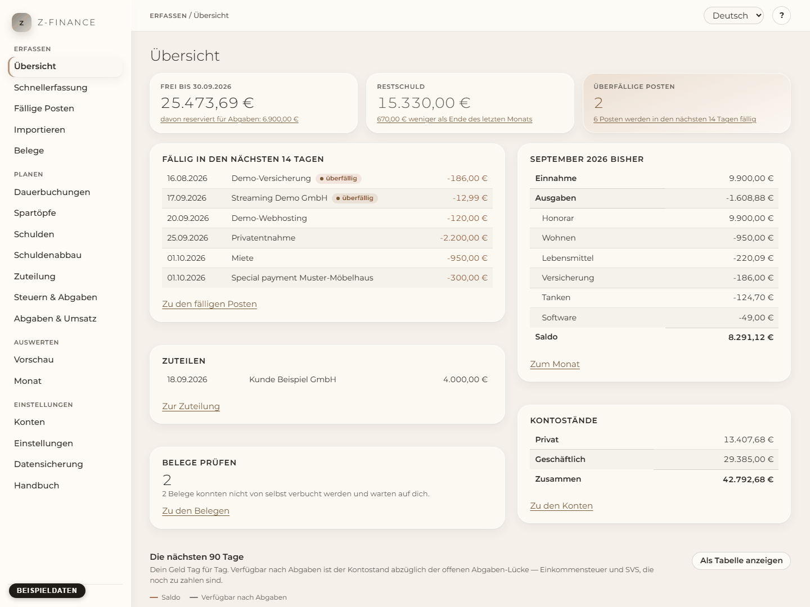
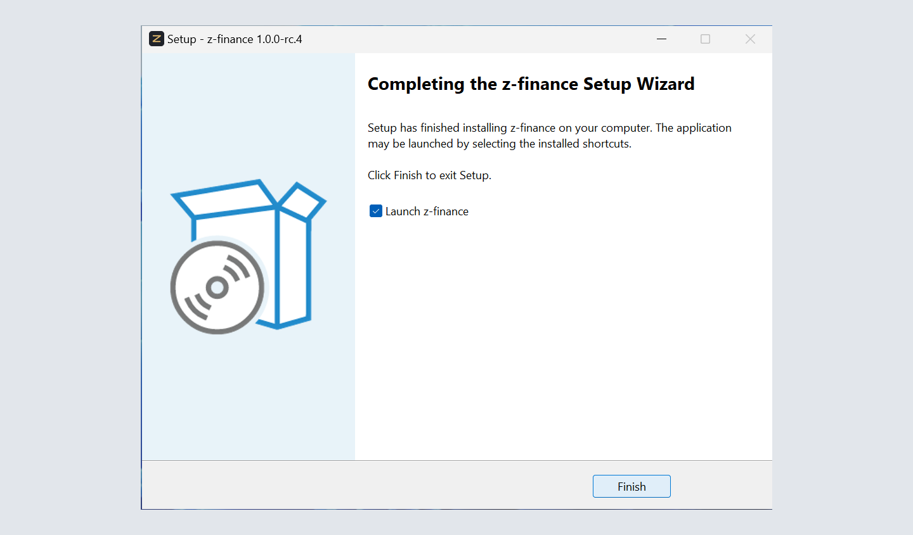
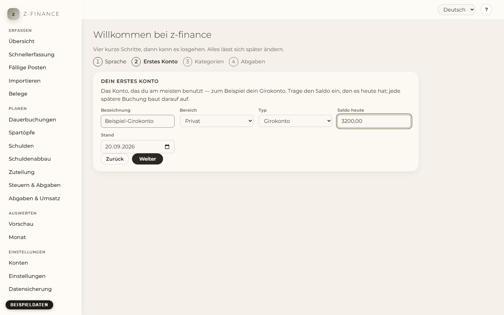
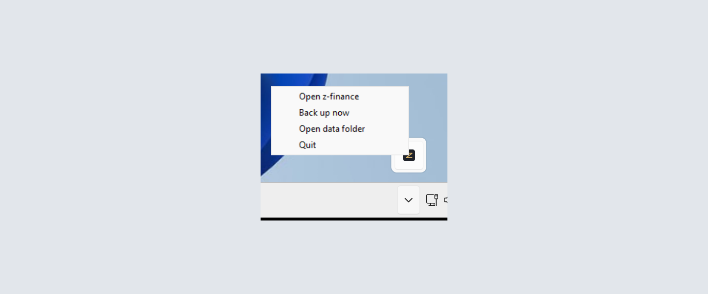
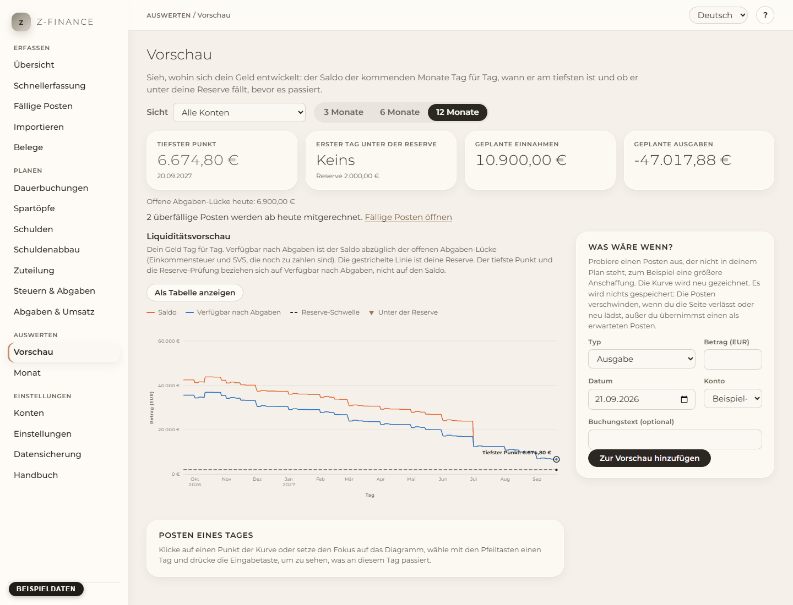
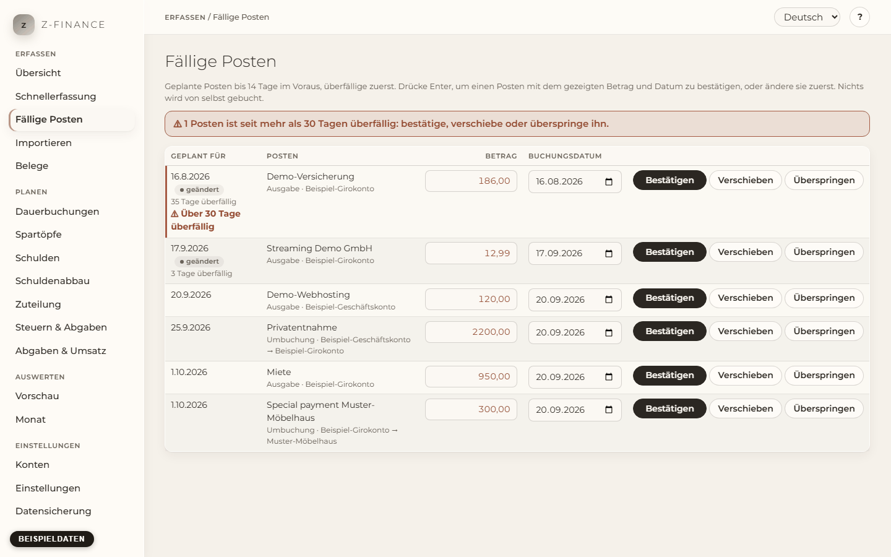
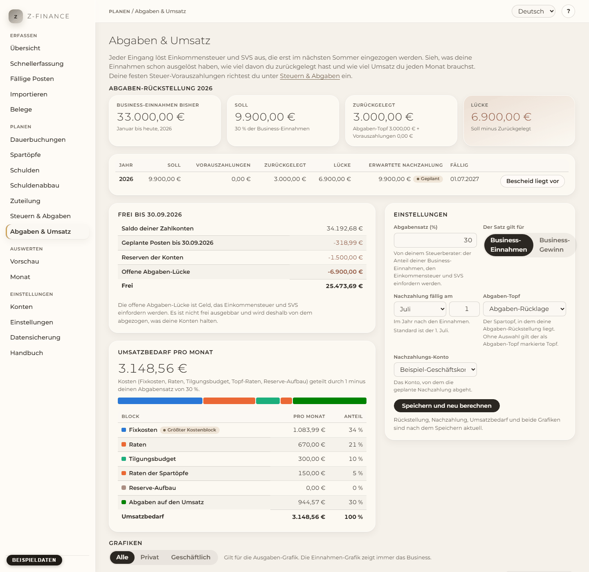
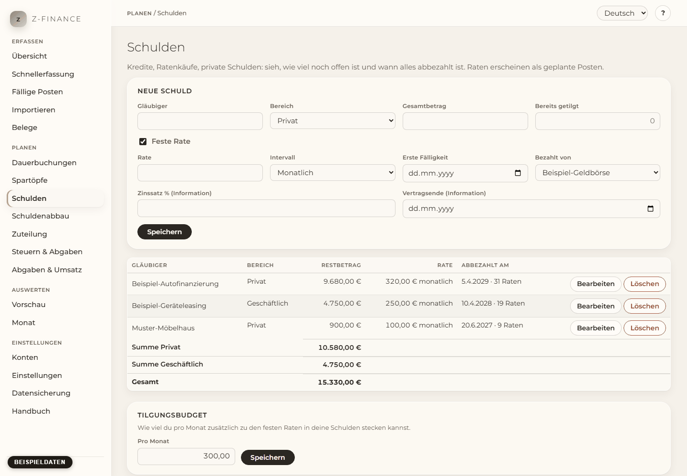
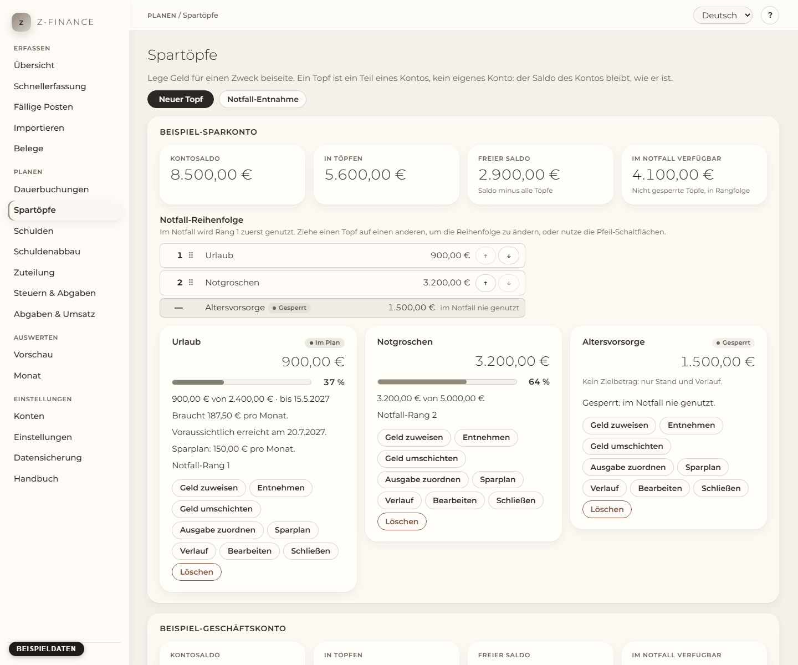
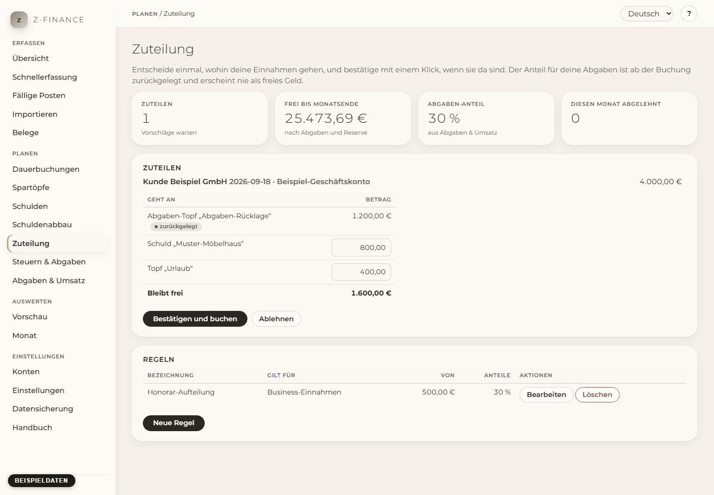

[English](README.md) | Deutsch

# z-finance

**Wisse heute, wie viel Geld wirklich frei ist. Ein lokaler Finanz- und Liquiditätsplaner für
Selbstständige und Haushalte, auf Deutsch und Englisch, für Windows.**

Dein Einkommen steigt und fällt. Steuern, SVS und Kreditraten kommen später. Oft kommen sie Monate
nach dem Geld. Darum ist der Stand deines Bankkontos nicht das Geld, das du ausgeben kannst.

Dieses Programm zeigt dir den Betrag, der nach Steuer- und SVS-Rücklage und deiner Reserve frei ist. Es
zeigt dir auch deinen Kontostand für die nächsten 3, 6 oder 12 Monate. Du siehst eine Lücke Wochen
vorher, nicht erst am Fälligkeitstag.

Wir bauten es für eine Person mit Haushalt und kleinem Unternehmen. Nur eines von beiden geht
auch. Alles läuft auf deinem eigenen Computer. Es gibt kein Konto und keine Cloud.



_Alle Screenshots in diesem Repository zeigen Beispieldaten (im Bild markiert), nie echte Zahlen._

**Du brauchst es vielleicht nicht,** wenn dein Einkommen jeden Monat gleich ist. Du brauchst es
vielleicht auch nicht, wenn deine Bank die Daten von selbst schicken soll. z-finance hat keine
Bankanbindung. Du tippst Buchungen ein oder importierst eine CSV-Datei aus deinem Online-Banking.

## Installieren (für alle)

Windows 11, drei Schritte. Du brauchst sonst nichts: kein Python, kein Node, keine Datenbank.
Windows fragt nicht nach einem Administrator-Kennwort.

1. **Herunterladen.** Öffne die [Download-Seite](https://github.com/ziagl888/z-finance/releases).
   Lade die Datei `z-finance-setup-...` der neuesten Version herunter.
2. **Einrichten.** Doppelklicke auf die Datei und klicke auf **Weiter** bis **Fertigstellen**. Beim
   ersten Start zeigt Windows SmartScreen „Der Computer wurde durch Windows geschützt“. Der Grund:
   Der Installer trägt keine Signatur mit einem kostenpflichtigen Zertifikat. Klicke auf
   **Weitere Informationen**, dann auf **Trotzdem ausführen**. Das Fenster zeigt „Herausgeber:
   unbekannt“. Das ist bei einem Programm ohne Signatur normal.

   

3. **Erster Start.** Starte **z-finance** über das Startmenü. Es öffnet sich in deinem Browser. Es
   fragt nach der Sprache, einem Konto, Kategorien und deinem Abgabensatz.
   z-finance speichert nichts, bis du auf **Fertig** klickst.

   

Solange z-finance läuft, bietet ein **z**-Symbol im Infobereich _z-finance öffnen_, _Jetzt
sichern_, _Datenordner öffnen_ und _Beenden_.



Das Handbuch hat die ganze Anleitung, auch für Aktualisieren und Entfernen:
[`docs/manual/de/install.md`](docs/manual/de/install.md). Die Bilder oben stammen aus einer
Test-Installation auf einem frischen Windows und zeigen deshalb Setup auf Englisch:
[`docs/install-test.md`](docs/install-test.md).

Nur Windows hat einen Installer. Unter macOS und Linux startest du es aus dem Quellcode (siehe
_Einrichtung für Entwickler_ unten).

## Was es kann

- **Eine Zahlung in Sekunden erfassen.** Einnahmen, Ausgaben und Umbuchungen, nur mit der Tastatur
  (Alt+N auf jedem Bildschirm). [Handbuch](docs/manual/de/entry.md)
- **Miete, Abos und erwartete Rechnungen einmal eintragen.** z-finance plant sie für die nächsten
  12 Monate. [Handbuch](docs/manual/de/recurring.md)
- **Jede Woche sehen, was fällig ist.** Bestätige, verschiebe oder überspringe jeden Posten.
  Überfällige Posten stehen zuerst. [Handbuch](docs/manual/de/due.md)
- **Den Kontoauszug einspielen.** Importiere CSV-Dateien mit einem Profil je Bank. Du siehst jede
  Zeile vorher. z-finance importiert keine Zeile zweimal. Es erkennt einen geplanten Posten und
  verdoppelt ihn nicht. [Handbuch](docs/manual/de/import.md)
- **Den Kontostand Monate im Voraus sehen.** Tag für Tag für 3, 6 oder 12 Monate, je Konto, je
  Bereich oder gesamt. Du siehst den tiefsten Punkt und den ersten Tag unter deiner Reserve.
  [Handbuch](docs/manual/de/forecast.md)
- **Nie aus Versehen das Steuergeld ausgeben.** Ein Teil jeder geschäftlichen Einnahme gehört ab
  dem ersten Tag der Einkommensteuer und der SVS. „Frei“ ist immer der Betrag nach diesem Teil.
  z-finance sagt dir auch, wie viel Umsatz du pro Monat brauchst.
  [Handbuch](docs/manual/de/levy.md)
- **Schulden mit Plan abbauen.** Sieh, was du noch schuldest und in welcher Reihenfolge du am besten
  zahlst. Sieh den Tag, an dem du schuldenfrei bist. [Schulden](docs/manual/de/debts.md) ·
  [Schuldenabbau](docs/manual/de/payoff.md)
- **Jede Einnahme nach deinen eigenen Regeln aufteilen.** Zum Beispiel: 20 % zu den Schulden und
  5 % in den Notgroschen. Leg Geld für Ziele in Spartöpfe.
  [Spartöpfe](docs/manual/de/pots.md) · [Zuteilung](docs/manual/de/allocation.md)
- **Sehen, wohin das Geld gegangen ist.** Einnahmen und Ausgaben je Monat und Kategorie. Regeln
  ordnen neue Buchungen für dich zu. [Monat](docs/manual/de/month.md)
- **Nie deine Daten verlieren.** Eine Sicherung bei jedem Start und ein Klick für eine `.zip`, die du
  woanders aufbewahrst. [Sichern](docs/manual/de/backup.md)
- **Kassenbons per E-Mail buchen (optional).** Schick ein Foto an ein eigenes Postfach. Der
  Bon-Agent bucht es. [Belege](docs/manual/de/receipts.md)

Fang mit dem Wochenritual an: zehn Minuten, immer in derselben Reihenfolge.
[`docs/manual/de/weekly-routine.md`](docs/manual/de/weekly-routine.md)

## Ein Blick hinein

|                                                                                |                                                                                  |
| ------------------------------------------------------------------------------ | -------------------------------------------------------------------------------- |
|     |     |
| **Vorschau.** Dein Kontostand für die nächsten Monate, mit dem tiefsten Punkt. | **Fällige Posten.** Was in den nächsten 14 Tagen fällig ist. Ein Klick bucht es. |
|   |          |
| **Abgaben & Umsatz.** Wie viel deiner Einnahmen der Steuer und der SVS gehört. | **Schulden.** Was du noch schuldest und wann jede Schuld abbezahlt ist.          |
|        |    |
| **Spartöpfe.** Welcher Teil eines Kontos für welches Ziel ist.                 | **Zuteilung.** Wohin jede Einnahme geht, im Voraus festgelegt.                   |

## Deine Daten bleiben bei dir

- z-finance läuft auf deinem eigenen Computer. Nur dieser Computer kann es öffnen, außer du startest
  es mit `--allow-network`.
- Alle deine Daten liegen in einem Ordner in deinem Benutzerprofil (siehe _Wo deine Daten liegen_
  unten).
- Du brauchst kein Konto. Nichts geht in eine Cloud. Es gibt keine Telemetrie.
- z-finance stellt genau eine Art von Verbindung ins Internet her: die Suche nach neuen Versionen.
  Sie ist aus, bis du sie einschaltest. Dann fragt z-finance bei GitHub nach der Nummer der neuesten
  Version. Es sendet keine deiner Finanzdaten. Es lädt nichts herunter.
- Der Bon-Agent ist eine optionale Erweiterung. Der Installer enthält ihn nicht. Wenn du ihn
  einrichtest, liest er dein Postfach für Belege. Er schickt jedes Bon-Foto an Claude, das die Werte
  ausliest. Siehe [agent/README.md](agent/README.md).

## Stand

Version 1.1.0, veröffentlicht am 2026-11-04, für Windows 11 x64. Wir testeten den Installer von 1.0.0
auf einem frischen Windows. Das Testprotokoll nennt auch die Schritte, die noch einen echten Computer
brauchen: [`docs/install-test.md`](docs/install-test.md). Die Änderungen stehen in
[CHANGELOG.md](CHANGELOG.md).

## Wo deine Daten liegen

| System  | Ordner                                     |
| ------- | ------------------------------------------ |
| Windows | `%LOCALAPPDATA%\z-finance\`                |
| Linux   | `~/.local/share/z-finance/`                |
| macOS   | `~/Library/Application Support/z-finance/` |

Setz die Umgebungsvariable `ZFINANCE_DATA_DIR`, um einen anderen Ordner zu verwenden.

## Sicherungen

z-finance speichert bei jedem Start eine Kopie all deiner Daten, Bon-Fotos inklusive. Es behält die
neuesten 10 im Ordner `backups` im Datenordner. Die Seite **Datensicherung** speichert eine, wenn du
willst. Sie gibt dir eine `.zip` (Daten und Fotos) oder die reine Exportdatei und stellt beides in
einem leeren z-finance wieder her. Kopiere die `.zip` ab und zu an einen Ort außerhalb dieses
Computers. Details: [`docs/manual/de/backup.md`](docs/manual/de/backup.md).

## Belege per E-Mail (optional)

Der Bon-Agent bucht Fotos von Kassenbons, die du an ein eigenes Postfach schickst. Er läuft dreimal
am Tag. Einrichtung, Kosten und Sicherheit: [agent/README.md](agent/README.md).

## Hilfe und Handbuch

Jeder Bildschirm hat einen **?**-Knopf, der diesen Bildschirm erklärt. Das ganze Handbuch steht unter
**Handbuch** in der Navigation. Es ist auf Deutsch und Englisch und funktioniert offline. Es hat ein
Wochenritual, Fragen und Antworten und ein Glossar. Seine Quelle ist
[`docs/manual/`](docs/manual/). GitHub Pages zeigt denselben Text als Website.

## Aktualisieren

Die [Download-Seite](https://github.com/ziagl888/z-finance/releases) zeigt jede neue Version. Für
einen Hinweis in z-finance schalte unter _Einstellungen_ **Nach neuen Versionen suchen** ein.
z-finance zeigt dann einen Link zu einer neueren Version. Es lädt nichts herunter und installiert
nichts. Eine neue Version behält deine Daten.

## Einrichtung für Entwickler

Du brauchst [uv](https://docs.astral.sh/uv/), Node.js 20+ mit npm und [just](https://just.systems).
Unter Windows brauchst du auch Git for Windows. Starte `just` aus Git Bash, oder nimm
`C:\Program Files\Git\usr\bin` in den `PATH` auf, damit PowerShell `sh` findet.

```sh
just setup     # uv sync + npm ci
just build     # build the web interface into backend/zfinance/web/
uv run z-finance              # http://127.0.0.1:8765, opens the browser
just dev       # backend with reload on :8765 + Vite on http://127.0.0.1:5173 (data in ./data)
just test      # pytest
just lint      # ruff + TypeScript type check
```

Um z-finance von einem anderen Computer zu erreichen, nimm `--host <Adresse> --allow-network`. Es
gibt keine Anmeldung. Das [Handbuch](docs/manual/de/install.md) hat die Regeln für die Adresse.

Wie du den Windows-Installer baust, steht in [`packaging/README.md`](packaging/README.md).

### Screenshots

Ein Skript macht die Screenshots, kein Mensch. `tools/screenshots.py` startet z-finance mit einem
temporären Datenordner. Es füllt den Ordner mit den Beispieldaten aus `tools/demo_data.py`. Dann
fotografiert es jeden Bildschirm in beiden Sprachen.

```sh
just build
uv run --group docs playwright install chromium   # once per machine
uv run --group docs python tools/screenshots.py   # writes docs/assets/screenshots/<lang>/
```

Aufbau des Codes und wohin ein neues Feature gehört: [ARCHITECTURE.md](ARCHITECTURE.md).
Wie du beiträgst: [CONTRIBUTING.md](CONTRIBUTING.md). Die Änderungen stehen in
[CHANGELOG.md](CHANGELOG.md). Diese Dokumente sind auf Englisch.

## Lizenz

[Apache License 2.0](LICENSE)
