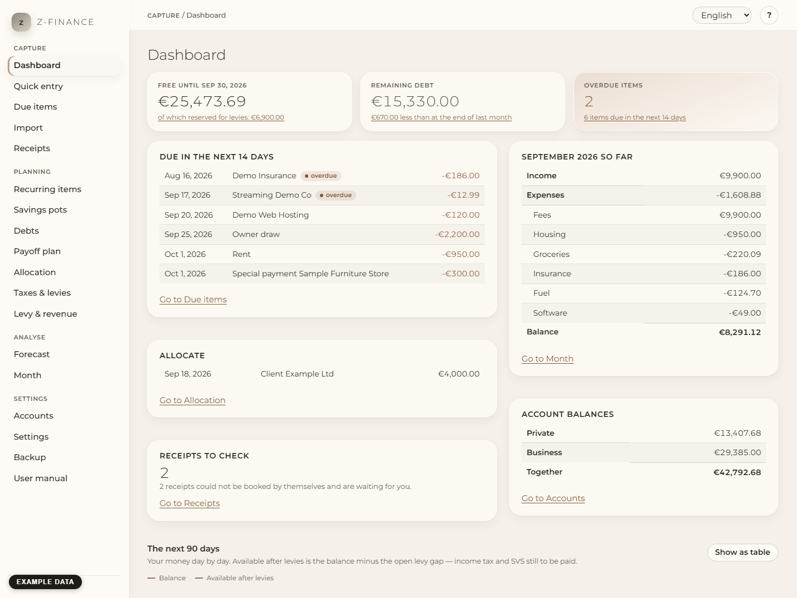
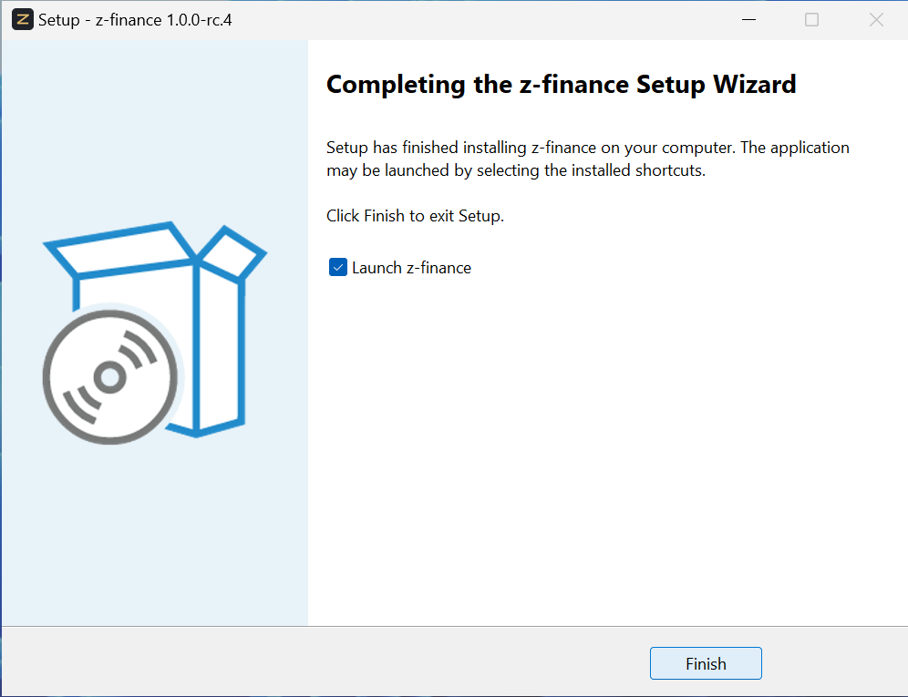
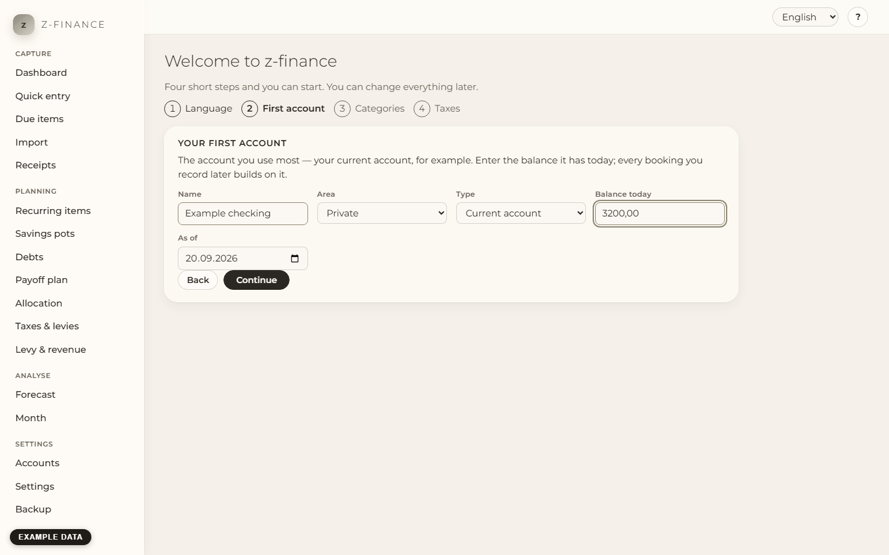
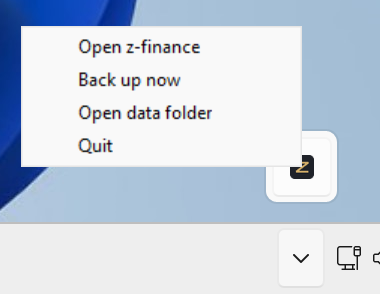
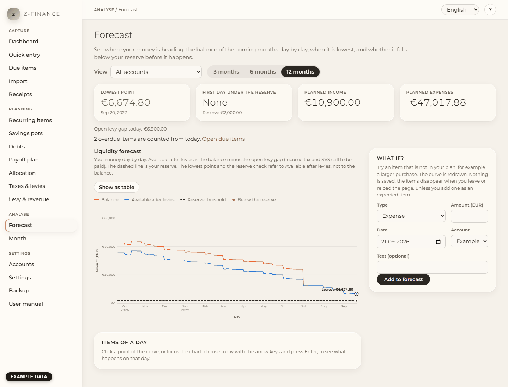
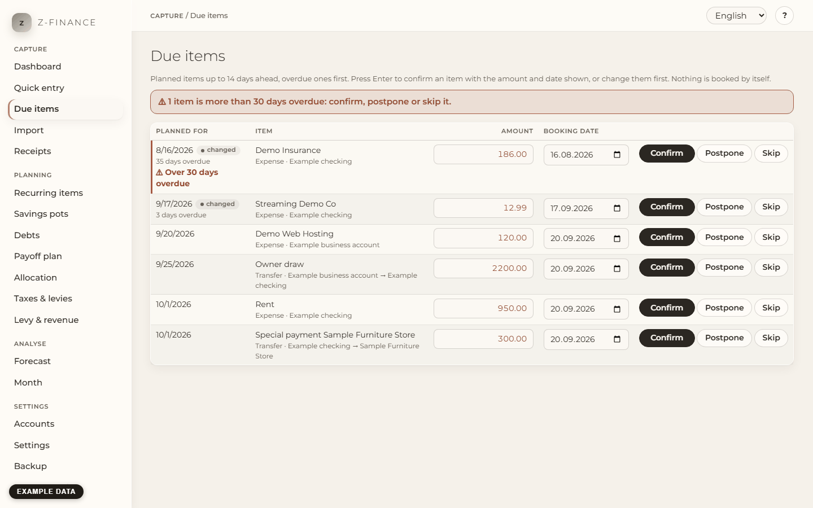
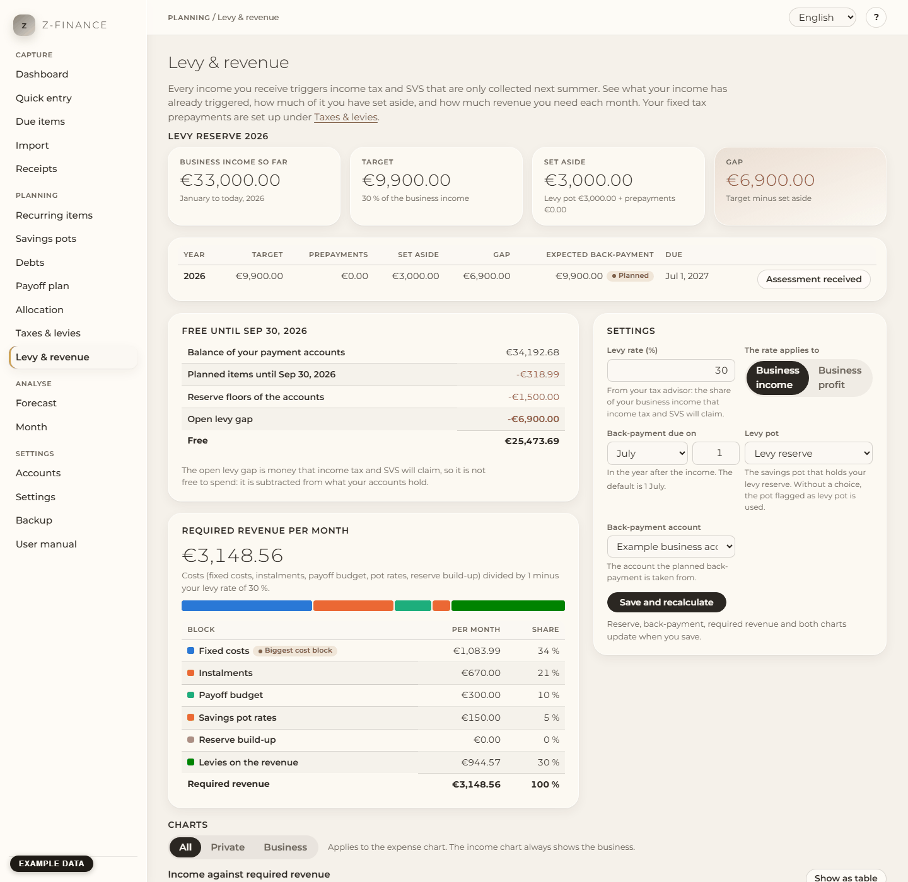
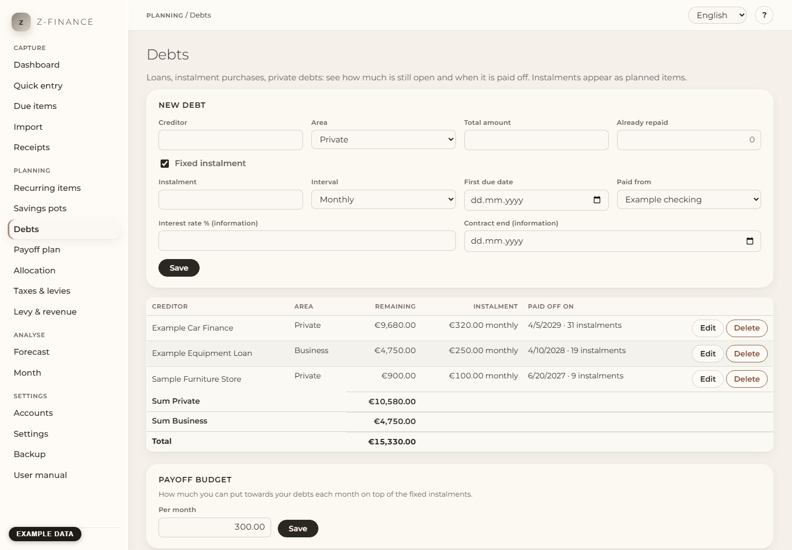
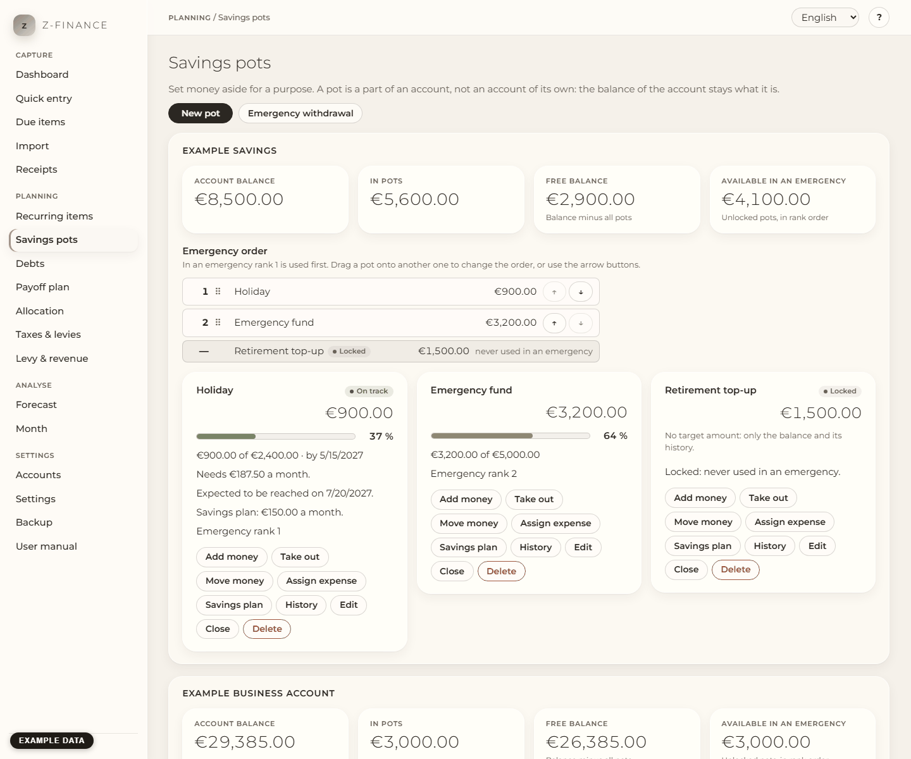
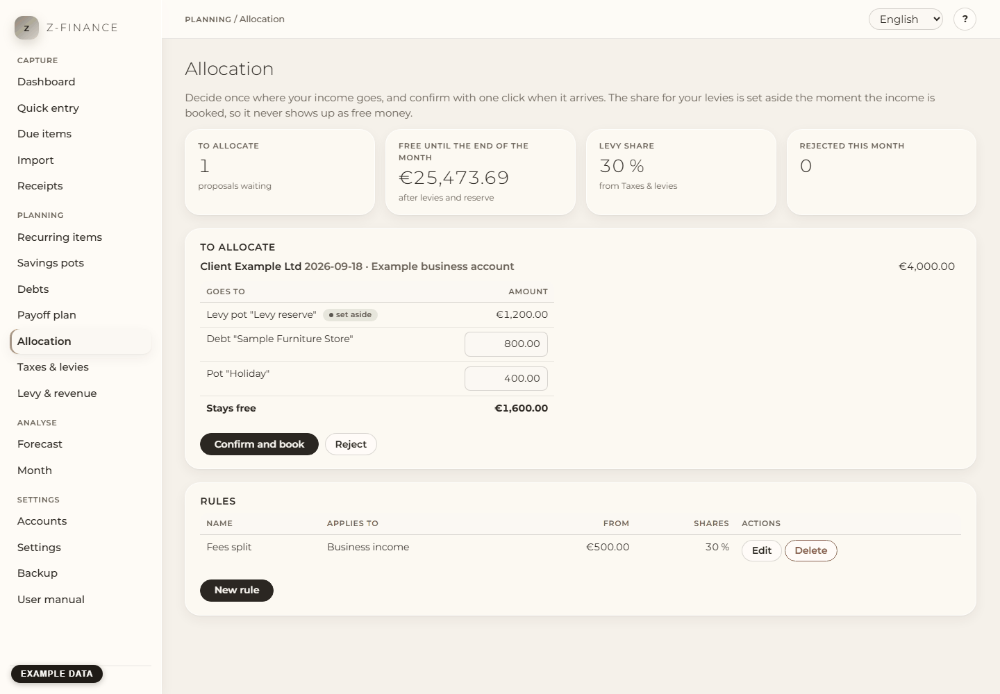

# z-finance

**Know today what money is really free. A local finance and liquidity planner for freelancers and
households, in English and German, for Windows.**

Your income goes up and down. Taxes, social insurance and loan payments come later. Often they come
months after the money arrived. Thus the balance on your bank account is not the money you can spend.
This tool shows the amount that is free after the tax and social-insurance provisions and your reserve. It also shows
your balance for the next 3, 6 or 12 months. You see a shortfall weeks ahead, not on the due date.

We made it for one person with a household and a small business. One of the two is also fine.
Everything runs on your own computer. There is no account and no cloud.



_All screenshots in this repository show example data (marked in the picture), never real figures._

**Auf Deutsch.** z-finance zeigt dir, wie viel Geld wirklich frei ist: nach Steuer- und
SVS-Rücklage und Reserve. Es plant deinen Kontostand für die nächsten Monate und läuft nur
auf deinem eigenen PC, ohne Konto und ohne Cloud. Programm und Handbuch gibt es auf Deutsch. Du
wählst die Sprache beim ersten Start. Das Handbuch beginnt bei
[`docs/manual/de/index.md`](docs/manual/de/index.md), die Installation steht in
[`docs/manual/de/install.md`](docs/manual/de/install.md).

**You may not need it** if your income is the same every month. You also may not need it if your
bank must send the data by itself. z-finance has no bank connection. You type entries, or you
import a CSV file from your online bank.

## Install (for everyone)

Windows 11, three steps. You need nothing else: no Python, no Node, no database. Windows does not
ask for an administrator password.

1. **Download.** Open the [Releases page](https://github.com/ziagl888/z-finance/releases). Download
   the file `z-finance-setup-...` from the newest release.
2. **Set up.** Double-click the file and click **Next** until **Finish**. On the first start,
   Windows SmartScreen shows "Windows protected your PC". The reason: we did not sign the installer
   with a paid certificate. Click **More info**, then **Run anyway**. The window shows "Publisher:
   Unknown". This is normal for a program without a signature.

   

3. **First start.** Start **z-finance** from the Start menu. It opens in your browser. It asks
   for the language, an account, categories and your tax share.
   z-finance saves nothing until you click **Finish**.

   

While z-finance runs, a **z** icon in the notification area offers _Open z-finance_, _Back up now_,
_Open data folder_ and _Quit_.



The manual has the full guide, also for update and removal:
[`docs/manual/en/install.md`](docs/manual/en/install.md). The pictures above come from a test
install on a clean Windows machine: [`docs/install-test.md`](docs/install-test.md).

Only Windows has an installer. On macOS and Linux, start it from source (see _Developer setup_
below).

## What it does

- **Write down a payment in seconds.** Income, expenses and transfers, with the keyboard only
  (Alt+N on every screen). [Manual](docs/manual/en/entry.md)
- **Enter rent, subscriptions and expected invoices once.** z-finance plans them for the next 12
  months. [Manual](docs/manual/en/recurring.md)
- **See every week what is due.** Confirm, postpone or skip each item. Overdue items come first.
  [Manual](docs/manual/en/due.md)
- **Bring in your bank statement.** Import CSV files with a profile per bank. You see a preview of
  every line. z-finance does not import a line twice. It matches a planned item and does not
  double it. [Manual](docs/manual/en/import.md)
- **See your balance months ahead.** Day by day for 3, 6 or 12 months, per account, per area or in
  total. You see the lowest point and the first day under your reserve.
  [Manual](docs/manual/en/forecast.md)
- **Never spend your tax money by mistake.** A share of every business income belongs to income tax
  and social insurance from the day it arrives. "Free" is always the amount after this share.
  z-finance also tells you how much revenue you need each month.
  [Manual](docs/manual/en/levy.md)
- **Pay off your debts with a plan.** See what you still owe and the best order to pay. See the
  date when you are free of debt. [Debts](docs/manual/en/debts.md) ·
  [Payoff](docs/manual/en/payoff.md)
- **Split each income by your own rules.** For example: 20 % to the debts and 5 % to the emergency
  fund. Keep money for goals in savings pots.
  [Pots](docs/manual/en/pots.md) · [Allocation](docs/manual/en/allocation.md)
- **See where the money went.** Income and expenses per month and category. Rules sort new entries
  for you. [Month](docs/manual/en/month.md)
- **Never lose your data.** A backup on every start, and one click for a `.zip` to keep elsewhere.
  [Backup](docs/manual/en/backup.md)
- **Book shop receipts by e-mail (optional).** Mail a photo to a mailbox of your own. The receipt
  agent books it. [Receipts](docs/manual/en/receipts.md)

Start with the weekly routine: ten minutes, always in the same order.
[`docs/manual/en/weekly-routine.md`](docs/manual/en/weekly-routine.md)

## A look inside

|                                                                                             |                                                                                            |
| ------------------------------------------------------------------------------------------- | ------------------------------------------------------------------------------------------ |
|  |          |
| **Forecast.** Your balance for the next months, with the lowest point.                      | **Due items.** What is due in the next 14 days. One click books it.                        |
|   |            |
| **Levy and revenue.** How much of your income belongs to tax and social insurance.          | **Debts.** What you still owe and when each debt is paid off.                              |
|       |  |
| **Savings pots.** Which part of an account is for which goal.                               | **Allocation.** Where each income goes, set in advance.                                    |

## Your data stays with you

- z-finance runs on your own computer. Only this computer can open it, unless you start it with
  `--allow-network`.
- All your data is in one folder in your user profile (see _Where your data lives_ below).
- You need no account. Nothing goes to a cloud. There is no telemetry.
- z-finance makes one kind of connection to the internet: the update check. It is off until you
  switch it on. Then it asks GitHub for the number of the newest version. It sends none of your
  finance data. It downloads nothing.
- The receipt agent is an optional add-on. The installer does not include it. If you set it up, it
  reads your receipts mailbox. It sends each receipt photo to Claude, which reads the values. See
  [agent/README.md](agent/README.md).

## Status

Version 1.0.0, released on 2026-11-02, for Windows 11 x64. We tested the installer on a clean
Windows machine. The test protocol also names the steps that still need a real machine:
[`docs/install-test.md`](docs/install-test.md). What changed:
[CHANGELOG.md](CHANGELOG.md).

## Where your data lives

| System  | Folder                                     |
| ------- | ------------------------------------------ |
| Windows | `%LOCALAPPDATA%\z-finance\`                |
| Linux   | `~/.local/share/z-finance/`                |
| macOS   | `~/Library/Application Support/z-finance/` |

Set the environment variable `ZFINANCE_DATA_DIR` to use another folder.

## Backups

z-finance saves a copy of all your data at each start, receipt photos included. It keeps the newest
10 in the `backups` folder inside the data folder. The **Backup** page saves one when you ask. It
gives you a `.zip` (data and photos) or the bare export file, and restores either into an empty
z-finance. Copy the `.zip` to a place outside this computer from time to time. Details:
[`docs/manual/en/backup.md`](docs/manual/en/backup.md).

## Receipts by e-mail (optional)

The receipt agent books photos of shop receipts that you mail to a mailbox of your own. It runs
three times a day. Set-up, costs and security: [agent/README.md](agent/README.md).

## Help and manual

Every screen has a **?** button that explains that screen. The full manual is under **User manual**
in the navigation. It is in English and German and works offline. It has a weekly routine,
questions and answers, and a glossary. Its source is [`docs/manual/`](docs/manual/). GitHub Pages
shows the same text as a site.

## Updates

The [Releases page](https://github.com/ziagl888/z-finance/releases) shows each new version. For a
notice in z-finance, switch **Look for new versions** on under _Settings_. z-finance then shows a
link to a newer version. It downloads and installs nothing. A new version keeps your data.

## Developer setup

You need [uv](https://docs.astral.sh/uv/), Node.js 20+ with npm and [just](https://just.systems).
On Windows you also need Git for Windows. Run `just` from Git Bash, or add
`C:\Program Files\Git\usr\bin` to `PATH` so PowerShell finds `sh`.

```sh
just setup     # uv sync + npm ci
just build     # build the web interface into backend/zfinance/web/
uv run z-finance              # http://127.0.0.1:8765, opens the browser
just dev       # backend with reload on :8765 + Vite on http://127.0.0.1:5173 (data in ./data)
just test      # pytest
just lint      # ruff + TypeScript type check
```

To reach z-finance from another computer, use `--host <address> --allow-network`. There is no
login. The [manual](docs/manual/en/install.md) has the rules for the bind address.

To build the Windows installer, read [`packaging/README.md`](packaging/README.md).

### Screenshots

A script makes the screenshots, not a person. `tools/screenshots.py` starts z-finance on a
temporary data folder. It fills the folder with the example data of `tools/demo_data.py`. Then it
takes a picture of every screen in both languages.

```sh
just build
uv run --group docs playwright install chromium   # once per machine
uv run --group docs python tools/screenshots.py   # writes docs/assets/screenshots/<lang>/
```

Code structure and where a new feature goes: [ARCHITECTURE.md](ARCHITECTURE.md).
How to contribute: [CONTRIBUTING.md](CONTRIBUTING.md). What changed: [CHANGELOG.md](CHANGELOG.md).

## License

[Apache License 2.0](LICENSE)

<!-- ste-waiver: the two STE-04 hits are path names (docs/manual/en/recurring.md, packaging/README.md), not prose -->
