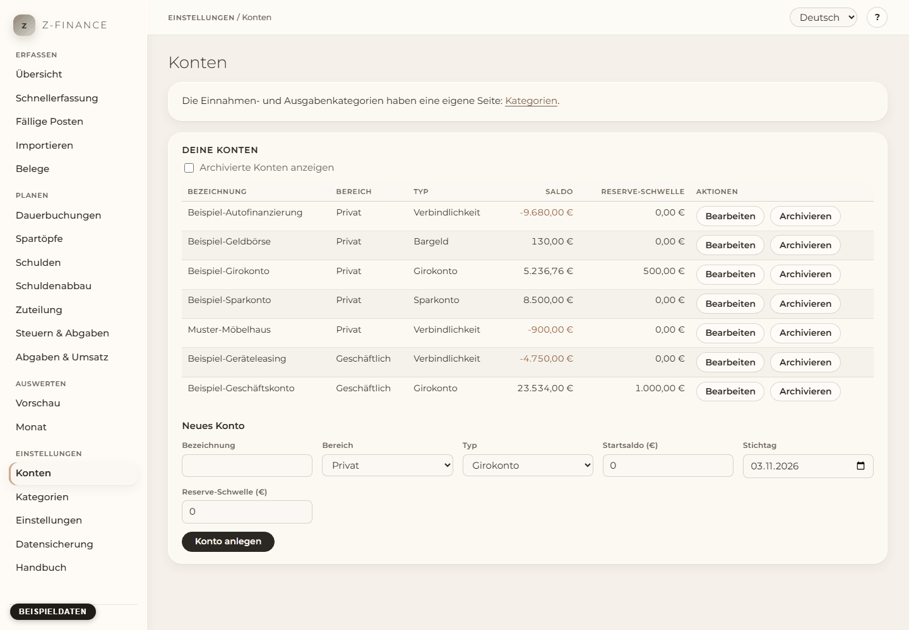

# Konten

## Was du siehst

Die Seite **Konten** listet deine Konten mit ihrem aktuellen Saldo. Richte deine Konten und deine
[Kategorien](categories.md) ein, bevor du die erste Zahlung erfasst: Jede Buchung gehört zu einem
Konto und einer Kategorie.

Du findest diesen Bildschirm in der Seitenleiste unter **Einstellungen**.

## Was ist ein Konto?

Ein Konto beantwortet eine Frage: Wo liegt dieses Geld? Lege in z-finance für jedes echte Konto
ein eigenes an — ein Girokonto bei der Bank, ein Sparkonto, das Bargeld in der Geldbörse, eine
Kreditkarte oder eine Schuld, die du abzahlst (eine Verbindlichkeit).

Jedes Konto hat:

- **Bezeichnung** — woran du es erkennst, z. B. „Girokonto privat“. Jede Bezeichnung kommt nur
  einmal vor.
- **Bereich** — **Privat** oder **Geschäftlich**. z-finance hält beides in den Auswertungen
  getrennt, damit deine Steuerberatung eine saubere Trennung bekommt.
- **Typ** — Girokonto, Sparkonto, Bargeld, Kreditkarte oder Verbindlichkeit. Eine Kreditkarte ist
  ein eigenes Konto; ihre Monatsabrechnung ist eine Umbuchung vom Girokonto.
- **Startsaldo** und **Stichtag** — der Kontostand an dem Tag, ab dem du in z-finance erfasst.
  Nimm ihn vom Kontoauszug dieses Tages. Eine Kreditkarte oder eine Schuld beginnt meist negativ
  (z. B. `-450,50`). Buchungen vor dem Stichtag lehnt z-finance ab.
- **Reserve-Schwelle** — der Betrag, der auf diesem Konto immer bleiben soll. Die
  [Vorschau](forecast.md) warnt dich, bevor der Saldo darunter fällt. Trage `0` ein, wenn du keine brauchst.

Der Saldo in der Liste ist der Startsaldo plus alle gebuchten Zahlungen bis heute.

## Konto anlegen oder ändern

1. Öffne **Konten** in der Navigation.
2. Fülle unter der Liste das Formular **Neues Konto** aus und klicke **Konto anlegen**. Beträge
   schreibst du wie `1250,00` oder `1250.00`, ohne Tausenderpunkte.
3. Zum Ändern klickst du in der Zeile des Kontos auf **Bearbeiten**, änderst die Felder und
   klickst **Änderungen speichern**.

## Archivieren statt löschen

Wenn du ein echtes Konto auflöst, klicke **Archivieren**. Das Konto verschwindet aus den Listen,
in die du buchst, seine Buchungen bleiben aber in allen Auswertungen. Mit **Archivierte Konten
anzeigen** siehst du es wieder; **Reaktivieren** macht es wieder aktiv. **Löschen** gibt es nur
für ein Konto ohne jede Buchung. z-finance lehnt das Löschen auch ab, wenn andere Daten das Konto
noch verwenden. Archiviere ein solches Konto stattdessen.

## Kategorien

Die Kategorien haben jetzt eine eigene Seite: Öffne **Kategorien** in der Seitenleiste unter
**Einstellungen**. Das Kapitel [Kategorien](categories.md) erklärt sie. Solange du keine
Kategorien hast, zeigt auch diese Seite das Angebot der Standard-Kategorien. Nachdem du sie übernommen hast, öffnet z-finance die Seite **Kategorien**.

## Typische Probleme

- **„Ein Konto mit dem Namen … gibt es bereits.“** Jedes Konto braucht einen anderen Namen.
- **„Buchungen vor dem Stichtag … sind nicht möglich.“** Die Buchung ist älter als der Stichtag
  des Kontos. Lege den Stichtag früher und passe den Startsaldo an diesen Tag an.
- **„Der Stichtag kann nicht nach der ersten Buchung liegen.“** Vor dem neuen Stichtag gibt es
  Buchungen; der Stichtag muss am oder vor dem Tag der ersten Buchung liegen.
- **„Dieses Konto hat … Buchungen und kann nicht gelöscht werden.“** Archiviere es stattdessen.
- **Eine ähnliche Meldung nennt Töpfe, Schulden oder andere Daten.** Andere Daten verwenden
  das Konto noch. Entferne diese Daten zuerst oder archiviere das Konto.
- **Die Gesamt-Reserve über alle Konten** stellst du auf der Seite
  [Einstellungen](settings.md) ein.

Sind Konten und ihre Reserve-Schwellen einmal richtig, lesen Vorschau und Dashboard Salden und
Reserve-Schwellen direkt von hier — die Gesamt-Reserve über alle Konten stellst du gesondert unter
Einstellungen ein.
