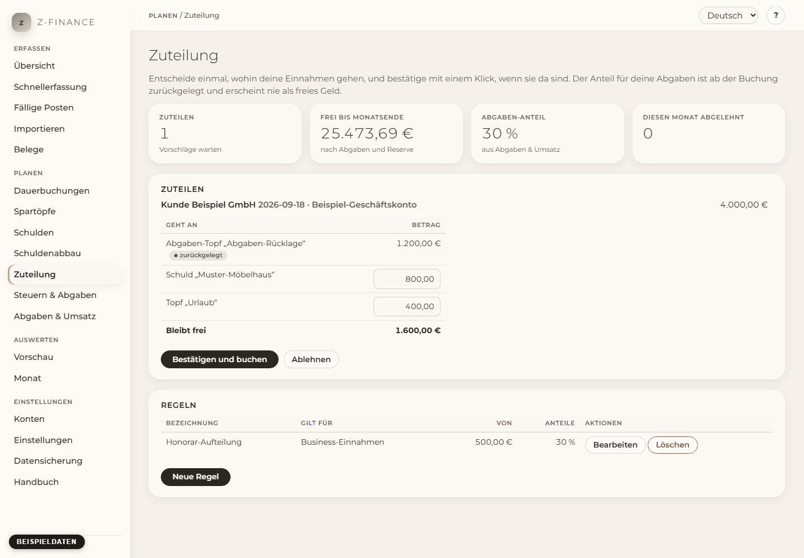

# Zuteilung

## Was du siehst

Die **Zuteilung** entscheidet vorab, wohin dein Geld geht, damit du es nicht in dem Moment
entscheiden musst, in dem eine Rechnung bezahlt wird. Du findest die Seite in der Seitenleiste unter
**Planen**.

Du legst eine Regel einmal an: „Von jeder Business-Einnahme ab 500 € gehen 20 % an meine Schulden
und 5 % in den Notgroschen.“ Ab dann bekommt jede passende Einnahme oben auf dieser Seite einen
**Vorschlag**. Du schaust ihn an, änderst einzelne Beträge wenn du willst, und bestätigst.
z-finance bucht dann die Umbuchungen zwischen deinen Konten.

Oben stehen vier Zahlen: wie viele Vorschläge warten, wie viel **frei bis Monatsende** ist, der
**Abgaben-Anteil** aus **Abgaben & Umsatz**, und wie viele Vorschläge du diesen Monat abgelehnt hast.

## Der Abgaben-Anteil ist schon zurückgelegt

Jede Business-Einnahme löst Einkommensteuer und SVS aus, die du im nächsten Sommer zahlst. Dieser
Anteil ist kein Vorschlag — das Geld ist schon weg. z-finance behandelt ihn ab dem Moment der
Buchung so:

Eine Einnahme von 4.000 € bei einem Abgabensatz von 30 % erhöht „frei bis Monatsende“ um 2.800 €,
nicht um 4.000 €. Die 1.200 € für die Abgaben sind sofort draussen, bevor du irgendetwas bestätigt
hast. Deshalb hat die Abgaben-Zeile eines Vorschlags kein Eingabefeld: du siehst sie, aber du kannst
sie nicht senken. Der Klick bestätigt nur, dass du das Geld wirklich umgebucht hast — er entscheidet
nicht über die Höhe.

Die anderen Zeilen gehören dir. Mit der Beispielregel sieht der Vorschlag für 4.000 € so aus:

| Geht an                     | Betrag  |
| --------------------------- | ------- |
| Abgaben-Topf (zurückgelegt) | 1.200 € |
| Schuld an erster Stelle     | 800 €   |
| Topf „Notgroschen“          | 200 €   |
| **Bleibt frei**             | 1.800 € |

## Was du tun kannst

- **Bestätigen und buchen.** z-finance bucht je Zeile eine Umbuchung: vom Konto, auf dem die
  Einnahme gelandet ist, auf das Konto des Topfs, und für den Schulden-Anteil auf das Konto der
  Schuld. Dein Gesamtvermögen ändert sich dabei nicht — das Geld liegt nur dort, wo du es haben
  wolltest. Der [Schuldenabbau](payoff.md) und die Töpfe zeigen den neuen Stand sofort.
- **Einzelne Beträge ändern**, bevor du bestätigst. Jede Zeile ausser dem Abgaben-Anteil lässt sich
  senken oder erhöhen, solange die Zeilen zusammen die Einnahme nicht überschreiten.
- **Ablehnen.** Der Vorschlag wird als abgelehnt protokolliert und für den Monat gezählt, gebucht
  wird nichts. Nichts verschwindet still.
- **Regel anlegen, ändern oder löschen.** Eine Regel hat einen Namen, die Konten, die sie beobachtet
  (Business, privat oder alle), den Betrag ab dem sie greift, und ihre Anteile. Löschst du eine
  Regel, bleiben die Vorschläge erhalten, die sie schon erzeugt hat.

Wichtig: z-finance bucht eine Zuteilung nie von selbst. Es kann bei deiner Bank kein Geld bewegen,
also ist der Klick deine Erinnerung, die echte Umbuchung zu machen.

## Der Schulden-Anteil

Der Schulden-Anteil geht immer an die Schuld, die in deinem [Schuldenabbau](payoff.md) an erster
Stelle steht — an die, die der Plan als nächste zahlt. Du musst in der Regel keine Schuld auswählen,
und du musst die Regel nicht ändern, wenn eine Schuld abbezahlt ist.

Hast du keine offene Schuld mehr, geht der Anteil dorthin, wo die Regel es sagt: in einen Topf, den
du gewählt hast, in den Topf mit dem höchsten Rang des Kontos, oder er bleibt einfach als Teil deiner
Gesamt-Reserve auf dem Konto.

## Typische Probleme

**Es erscheint kein Vorschlag.** Drei Dinge lohnt es zu prüfen: die Einnahme muss **gebucht** sein
(ein geplanter Posten reicht nicht), sie muss den Mindestbetrag der Regel erreichen, und sie muss auf
einem Konto des Bereichs liegen, den die Regel beobachtet. Eine Regel greift ausserdem nur bei
Einnahmen, die _nach_ ihrer Anlage gebucht wurden — sie arbeitet deine Vergangenheit nicht nach.

**„Nur … ist frei bis Monatsende.“** Der Vorschlag würde mehr nehmen, als nach Reserve und Abgaben
übrig ist. z-finance zeigt dir den Betrag, der passt, und lässt dich entscheiden; es senkt die
Anteile nie stillschweigend.

**Ein Vorschlag ist hervorgehoben.** Er wartet seit sieben Tagen. Gebucht wurde nichts — genau
dafür ist die Hervorhebung da.

**„Einnahme entfernt“.** Du hast eine Einnahme gelöscht, nachdem du ihre Zuteilung bestätigt hattest.
Die Umbuchungen stehen noch, weil das Geld wahrscheinlich wirklich geflossen ist. Prüfe das, und
nimm die Umbuchungen in der [Schnellerfassung](entry.md) zurück, wenn nicht.

**Es wird kein Abgaben-Anteil vorgeschlagen.** Entweder ist kein Abgabensatz gesetzt, oder kein Topf
ist als Abgaben-Topf markiert. Beides steht unter [Abgaben & Umsatz](tax.md).

Jede Umbuchung eines Vorschlags braucht immer noch deinen Klick — nur der Abgaben-Anteil ist schon
ab der Buchung der Einnahme zurückgelegt, bevor du irgendetwas siehst.
