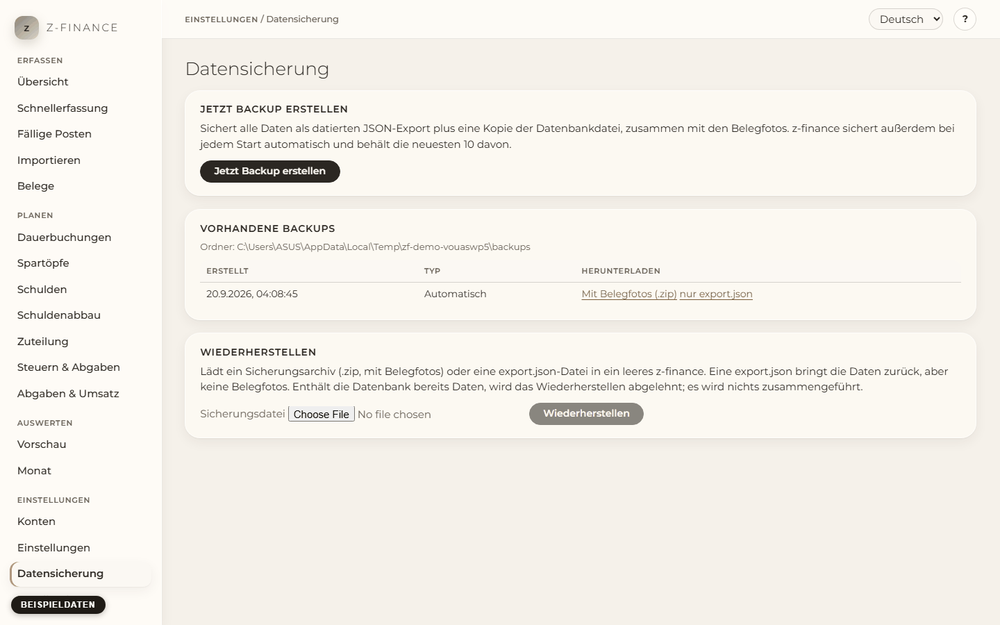

# Sichern und Wiederherstellen

## Wofür

Deine Daten liegen in einer einzigen Datei auf deinem Computer. Ein Festplattendefekt oder ein
missglücktes Update darf dich nicht Monate an Erfassung kosten. Deshalb speichert z-finance eine
Kopie von allem und kann sie in ein leeres z-finance zurückspielen.

Du findest diesen Bildschirm in der Seitenleiste unter **Einstellungen**.

## Was eine Sicherung enthält

- Alle deine Daten: Konten, Buchungen, Dauerbuchungen, Regeln, Schulden, Belege und Einstellungen.
- Die Fotos deiner Belege (die Fotos des Beleg-Agenten), damit ein wiederhergestelltes z-finance sie
  wieder anzeigt.

Nicht enthalten: alles, was außerhalb des Datenordners von z-finance liegt, und das Programm selbst
(das installierst du neu über den Installer).

## Jetzt sichern

1. Öffne **Datensicherung** in der Navigation.
2. Klicke **Jetzt Backup erstellen**. Die Seite zeigt den Ordner, in den gesichert wurde.
3. Kopiere die Sicherung an einen Ort außerhalb dieses Computers (Cloud-Ordner, NAS, USB-Stick):
   klicke in der Liste neben der Sicherung auf **Mit Belegfotos (.zip)**. Diese eine Datei enthält
   deine Daten und alle Belegfotos. **nur export.json** lädt die Daten ohne Fotos herunter.

z-finance sichert außerdem bei jedem Start von selbst und behält die neuesten 10 dieser
automatischen Sicherungen. Sicherungen, die du selbst auslöst, werden nie automatisch gelöscht.

Jede Sicherung ist ein Ordner mit Datum und Uhrzeit im Namen. Er enthält `export.json` (alle Daten
als Text), eine Kopie der Datenbankdatei und, falls du Belege hast, einen Ordner `receipts` mit den
Fotos. Die Fotos in diesem Ordner teilen sich den Speicherplatz mit den echten Fotos (sie werden
nicht noch einmal kopiert), eine Sicherung braucht also kaum zusätzlichen Platz. Das schützt dich
vor einem gelöschten Beleg oder einem missglückten Update, **nicht** vor einer kaputten Festplatte:
lade die `.zip` herunter und bewahre sie woanders auf.

## Wiederherstellen

1. Starte z-finance mit einer leeren Datenbank (frische Installation oder neuer Datenordner).
2. Öffne **Datensicherung**, wähle die gesicherte `.zip` (oder eine `export.json`) und klicke
   **Wiederherstellen**.
3. Die Seite meldet, wie viele Zeilen und Belegfotos wiederhergestellt wurden. Prüfe auf den anderen
   Seiten deine Kontostände und die Belege.

Eine `export.json` stellt nur deine Daten wieder her: die Belege stehen in der Liste, ihre Fotos
fehlen aber. Mit der `.zip` bekommst du auch die Fotos zurück. Eine `.zip`, die verändert oder
beschädigt ist oder etwas anderes als eine `export.json` und Belegfotos enthält, wird als Ganzes
abgelehnt; es wird nichts verändert.

Wiederherstellen funktioniert nur in eine leere Datenbank. Enthält z-finance bereits Daten, wird
das Wiederherstellen abgelehnt und nichts verändert — z-finance führt nie zwei Datenbestände
zusammen. Zum Neustart z-finance schließen und die Datenbankdatei im Datenordner löschen (Ort
siehe README); deine Sicherungen bleiben unberührt.

Das Wiederherstellen kann fehlschlagen. Dann nennt die Seite den Grund und das betroffene Feld. Der
Text zu einem Feld kommt vom Server und ist auf Englisch.
Sie nennt das Feld, das z-finance nicht annimmt. Sie zeigt nicht nur eine Statusnummer.

Ein Export aus einer älteren z-finance-Version wird beim Einlesen aktualisiert. Ein Export aus
einer neueren Version als deiner wird mit den Versionsnummern abgelehnt; aktualisiere dann zuerst
z-finance.

Eine Sicherung, die nur auf diesem Computer liegt, schützt dich vor einem missglückten Update,
aber nicht vor einer kaputten Festplatte — erst eine `.zip`, die du auf eine andere Festplatte oder
einen anderen Computer bringst, schützt vor beidem.
