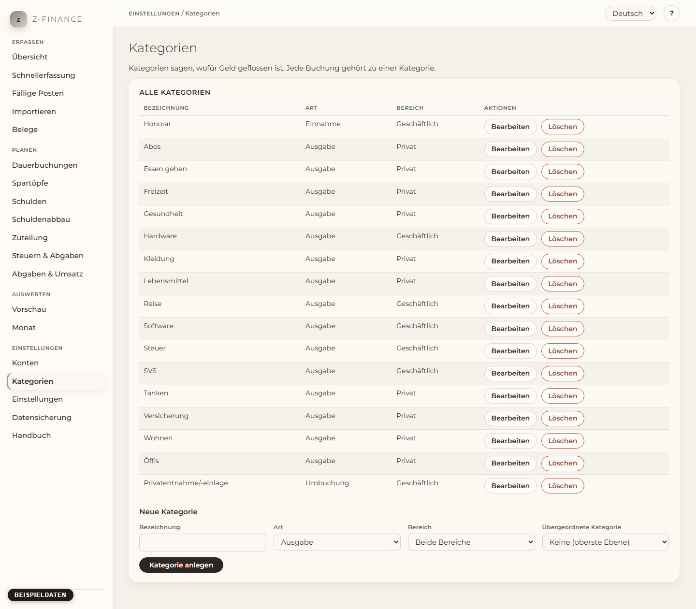

# Kategorien

## Was du siehst

Die Seite **Kategorien** listet deine Kategorien für Einnahmen, Ausgaben und Umbuchungen. Eine
Kategorie sagt, wofür Geld geflossen ist. Jede Zahlung gehört zu einem Konto und einer Kategorie.
Richte darum beides ein, bevor du die erste Zahlung erfasst. Die Konten stehen unter
[Konten](accounts.md).

Du findest diesen Bildschirm in der Seitenleiste unter **Einstellungen**, direkt unter **Konten**.

## Was ist eine Kategorie?

Jede Kategorie hat eine **Art**: **Einnahme**, **Ausgabe** oder **Umbuchung**. Eine Umbuchung ist
Geld zwischen deinen eigenen Konten, z. B. von geschäftlich nach privat. Eine Kategorie kann auch
einen **Bereich** (**Privat** oder **Geschäftlich**) und eine **übergeordnete Kategorie** haben.

Es gibt eine Ebene Unterkategorien. „Auto“ kann „Tanken“ enthalten, „Tanken“ aber keine weiteren
Kategorien. Eine Unterkategorie hat dieselbe Art wie ihre übergeordnete Kategorie. In der Liste
steht eine Unterkategorie eingerückt unter ihrer übergeordneten Kategorie.

## Kategorie anlegen oder ändern

1. Öffne **Kategorien** in der Navigation.
2. Fülle unter der Liste das Formular **Neue Kategorie** aus. Wähle die Art. Wähle einen Bereich
   oder lass **Beide Bereiche** stehen. Wähle eine übergeordnete Kategorie oder lass
   **Keine (oberste Ebene)** stehen.
3. Klicke **Kategorie anlegen**.
4. Zum Ändern klickst du in der Zeile der Kategorie auf **Bearbeiten**. Ändere die Felder und
   klicke **Änderungen speichern**.

## Kategorie löschen

Klicke **Löschen** in der Zeile der Kategorie. Eine Kategorie ohne Zahlungen verschwindet, sobald
du bestätigst.

Eine Kategorie kann schon Zahlungen haben. Dann fragt z-finance nach einer anderen Kategorie und
bucht die Zahlungen zuerst dorthin um. Wähle sie aus und klicke **Umbuchen und löschen**. Eine
Kategorie mit Unterkategorien lässt sich erst löschen, wenn sie keine Unterkategorien mehr hat.
Verschiebe oder lösche diese zuerst.

## Die Standard-Kategorien

Solange du noch keine Kategorien hast, schlägt z-finance Kategorien für privat und geschäftlich
vor. Der Vorschlag ist in der Sprache der Oberfläche. Benenne sie um, ändere oder entferne
sie und ergänze eigene. Dann klicke **Kategorien übernehmen** oder **Überspringen**, um mit einer
leeren Liste zu beginnen.

Der Vorschlag kommt nur einmal. Die übernommenen Kategorien gehören ab dann dir; ein späterer
Sprachwechsel benennt sie nicht um. Der Assistent beim ersten Start zeigt denselben Vorschlag
(siehe [Der erste Start](first-run.md)).

Willst du eine Datensicherung in ein neues z-finance zurückspielen? Dann tu das, bevor du die
Standard-Kategorien übernimmst. Eine Wiederherstellung klappt nur in ein leeres z-finance (siehe
[Sichern und Wiederherstellen](backup.md)).
