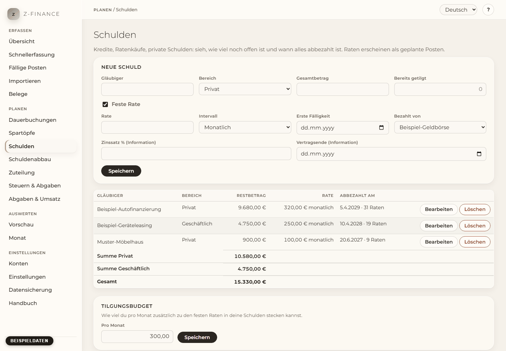

# Schulden

## Was du siehst

**Schulden** beantwortet eine Frage: Was schulde ich noch, und wann ist es weg? Ob Bankkredit,
Ratenkauf, geliehenes Geld oder eine Steuernachzahlung in Raten — zu jeder Schuld siehst du auf
einen Blick, wie viel noch offen ist, wie hoch die Rate ist und wann sie abbezahlt ist. Unter der
Liste steht die Summe dessen, was du noch schuldest — getrennt nach privat und geschäftlich und
gesamt.

Die Seite hat vier Teile: das Formular oben, die Liste deiner Schulden, die Details der Schuld, die
du anklickst, und das **Tilgungsbudget** ganz unten. Du findest diesen Bildschirm in der
Seitenleiste unter **Planen**.

## So funktioniert es

Jede Schuld bekommt ein eigenes Konto vom Typ **Verbindlichkeit**, benannt nach dem Gläubiger. Sein
Saldo ist negativ: Er ist genau der Betrag, den du noch schuldest. Zahlst du eine Rate, fließt Geld
von deinem Girokonto auf dieses Verbindlichkeitskonto — dein Girokonto sinkt, und die Schuld auch.
Dein Gesamtvermögen ändert sich durch das Zahlen nicht, weil du um denselben Betrag weniger
schuldest.

Eine feste Rate wird zu einer Dauerbuchung als Umbuchung. Die Raten erscheinen deshalb wie jede
andere Dauerbuchung als geplante Posten für die nächsten 12 Monate (siehe
[Dauerbuchungen](recurring.md)). Du musst sie nicht ein zweites Mal erfassen.

## Schuld erfassen

1. Gib den **Gläubiger** ein (zum Beispiel „Bankkredit“ oder den Namen des Geschäfts) und wähle
   den **Bereich**: privat oder geschäftlich.
2. Gib den **Gesamtbetrag** der Schuld ein und, falls du schon einen Teil zurückgezahlt hast,
   **Bereits getilgt**. Die Differenz ist der offene Restbetrag.
3. Zahlst du regelmäßig einen festen Betrag, lass **Feste Rate** angehakt und fülle **Rate**,
   **Intervall** (monatlich, quartalsweise oder jährlich), **Erste Fälligkeit** und das Konto
   unter **Bezahlt von** aus. Die Rate ist jeweils am selben Tag fällig wie die erste Fälligkeit —
   in jedem Monat, Quartal oder Jahr.
4. Optional kannst du **Zinssatz** und **Vertragsende** notieren. Beides dient nur deiner
   Information; z-finance rechnet keine Zinsen.
5. Klicke auf **Speichern**.

Beispiel: ein Kredit über 5.000 €, davon 1.000 € bereits getilgt, mit 250 € am 1. jedes Monats ab

1. Oktober. Offen sind 4.000 €, das sind 16 Raten — die Schuld ist also am 1. Jänner in 16 Monaten
   abbezahlt. Die nächsten 12 Raten erscheinen als geplante Posten.

## Schuld ohne feste Rate

Für Geld, das du „zahlst, wenn es geht“, nimm den Haken bei **Feste Rate** weg. Es entstehen keine
geplanten Posten. Unter **Abbezahlt bis** kannst du ein Datum eintragen: z-finance zeigt dann, wie
viel du pro Monat zahlen müsstest, um bis dahin fertig zu sein.

## Wenn eine Rate bezahlt ist

Bestätige die Rate, wenn sie fällig ist, oder lass sie beim Import des Kontoauszugs zuordnen.
Restbetrag und Girokonto sinken beide um die Rate. Hat die Bank einen etwas anderen Betrag
abgebucht, korrigiere den Betrag beim Bestätigen.

Die letzte Rate ist meist kleiner: z-finance plant genau den Rest. Bei 600 € offen und 250 € Rate
siehst du 250 €, 250 € und 100 €.

## Sondertilgung

Klicke eine Schuld in der Liste an. Unter **Sondertilgung** gibst du **Betrag**, **Datum** (heute
oder früher) und das Konto unter **Vom Konto** ein und klickst auf **Sondertilgung buchen**. Der
Restbetrag sinkt, und das Enddatum rückt nach vorne.

Gibst du mehr ein, als noch offen ist, bucht z-finance nur den Rest und sagt dir das. Die Differenz
bleibt auf deinem Konto.

## Abbezahlt

Ist nichts mehr offen, steht bei der Schuld **abbezahlt**. Ihre restlichen geplanten Raten werden
entfernt — sie tauchen nirgends mehr auf. Die Schuld bleibt mit ihrem Verlauf (ausgegraut) in der
Liste.

## Schuld ändern

Klicke neben einer Schuld auf **Bearbeiten**, ändere die Werte und klicke auf **Änderungen
speichern**.

- **Die Schuld wird größer** (zum Beispiel eine Aufstockung des Kredits): Erhöhe den
  **Gesamtbetrag**. Die Differenz wird mit heutigem Datum auf das Verbindlichkeitskonto gebucht,
  der Verlauf bleibt erhalten, und das Enddatum wird neu berechnet.
- **Die Rate ändert sich**: Ändere die **Rate**. Geplante Raten ab heute folgen; bereits bezahlte
  Raten bleiben.

Verwalte die Raten einer Schuld hier, nicht auf der Seite Dauerbuchungen: z-finance hält die
Dauerbuchung passend zur Schuld und macht Änderungen dort wieder rückgängig.

## Verlauf

Die Details einer Schuld zeigen jede Buchung auf ihrem Verbindlichkeitskonto: Raten,
Sondertilgungen und Erhöhungen. Geplante Raten sind mit **geplant** markiert.

## Tilgungsbudget

Ganz unten kannst du eintragen, wie viel du pro Monat zusätzlich zu den festen Raten in deine
Schulden stecken kannst. Der [Schuldenabbau](payoff.md) und die Regeln der [Zuteilung](allocation.md) nutzen es.

## Schuld löschen

**Löschen** entfernt die Schuld und ihre geplanten Raten. Bereits gebuchte Zahlungen bleiben; das
Verbindlichkeitskonto wird dann mit seinem Verlauf archiviert (siehe [Konten](accounts.md)). Eine
Schuld ganz ohne Buchung verschwindet vollständig.

## Typische Probleme

- **„Ein Konto mit dem Namen … gibt es bereits.“** Jede Schuld bekommt ein Konto mit dem Namen des
  Gläubigers. Nimm einen leicht anderen Namen, zum Beispiel „Bankkredit Auto“.
- **„Eine Rate braucht Betrag, Intervall und erste Fälligkeit.“** Fülle alle drei aus, oder nimm
  den Haken bei **Feste Rate** weg.
- **„Der bereits getilgte Betrag muss mindestens 0 und kleiner als der Gesamtbetrag sein.“** Eine
  bereits vollständig getilgte Schuld musst du nicht erfassen.
- **Der Knopf „Sondertilgung buchen“ ist grau.** Das Formular braucht ein aktives Konto zum Zahlen, lege zuerst eines an.
- **„Eine Sondertilgung kann nicht in der Zukunft liegen.“** Buche sie an dem Tag, an dem du
  wirklich zahlst.
- **„Der Gesamtbetrag muss höher sein als der bereits getilgte Betrag.“** Der Gesamtbetrag kann
  nicht unter das sinken, was du schon zurückgezahlt hast.

Ist eine Schuld einmal so erfasst, nutzen Schuldenabbau und Zuteilung sie, ohne dass du irgendetwas
ein zweites Mal sagen musst.
