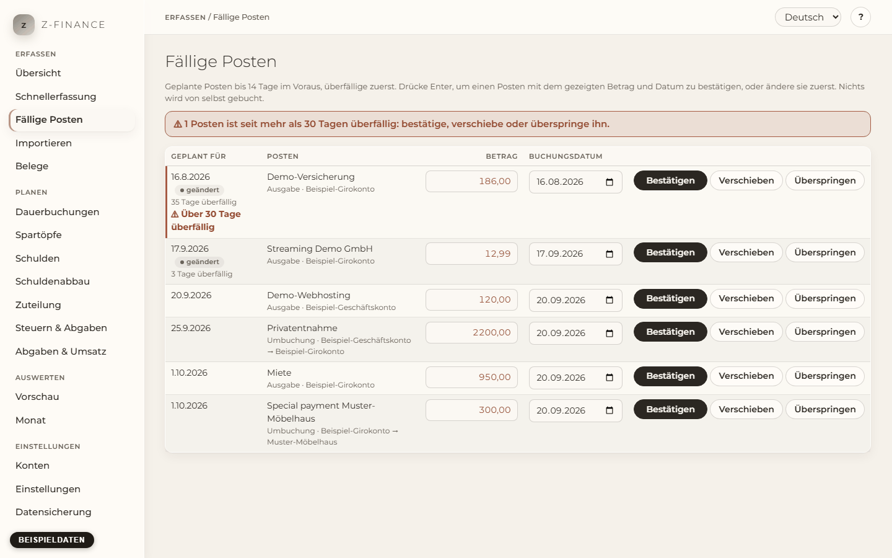

# Fällige Posten

## Was du siehst

Unter **Fällige Posten** machst du deine wöchentliche Durchsicht. Die Liste zeigt jeden **geplanten
Posten** — eine Zahlung aus einer [Dauerbuchung](recurring.md) oder einen erwarteten Einmalposten
—, der bis 14 Tage ab heute fällig ist. Überfällige Posten stehen oben.

Geplante Posten verändern keinen Kontostand. Erst wenn du einen Posten **bestätigst**, wird er zu
einer echten Buchung und der Kontostand ändert sich. z-finance bestätigt nie etwas von selbst: Ein
Posten, mit dem du nichts machst, bleibt in der Liste.

Jede Zeile zeigt das geplante Datum, den Text mit dem Konto (bei einer Umbuchung: von → nach), den
**Betrag** und das **Buchungsdatum**. Beides ist mit dem Geplanten vorbelegt und lässt sich direkt
in der Zeile ändern.

Du findest diesen Bildschirm in der Seitenleiste unter **Erfassen**.

## Einen Posten bestätigen

1. Ändere **Betrag** oder **Buchungsdatum**, wenn die echte Zahlung anders war. Lass beides
   unverändert, wenn sie wie geplant lief.
2. Drücke **Enter** — oder klicke auf **Bestätigen**. Enter funktioniert in beiden Feldern und auch,
   wenn die Zeile selbst ausgewählt ist.

Der Posten wird zur Buchung und verschwindet aus der Liste; der Cursor springt in die nächste
Zeile, sodass du gleich wieder Enter drücken kannst. In der Buchungsliste erkennst du, dass er aus
einer Dauerbuchung stammt.

- **Ein anderer Betrag ändert die Dauerbuchung nicht.** Bestätigst du die Miete mit 850 € statt 800
  €, bleibt die geplante Miete des nächsten Monats bei 800 €. Um sie dauerhaft zu ändern, siehe
  [Dauerbuchungen](recurring.md).
- **Der Betrag wird ohne Vorzeichen eingegeben.** Eine Ausgabe bleibt eine Ausgabe, eine Einnahme
  eine Einnahme.
- **Eine Umbuchung** wird auf beiden Konten zugleich gebucht; ein geänderter Betrag gilt für
  beide.
- **Ein Posten, der noch nicht fällig ist** (bis 14 Tage im Voraus), wird **heute** gebucht, weil
  eine Buchung nicht in der Zukunft liegen kann. Ändere das **Buchungsdatum** auf einen früheren
  Tag, wenn du früher gezahlt hast.

## Einen Posten verschieben

Klicke auf **Verschieben**, wähle ein neues Datum **nach heute** und klicke noch einmal auf
**Verschieben** (oder drücke Enter). Der Posten bleibt geplant, wird als „geändert“ markiert und
kommt in diese Liste zurück, sobald sein neues Datum innerhalb von 14 Tagen liegt. Ein verschobener
Posten einer Dauerbuchung wird nicht zurückgesetzt, wenn z-finance die nächsten 12 Monate auffüllt.

Ist eine Zahlung schon passiert, bestätige sie stattdessen — Verschieben ist nur für Zahlungen, die
noch nicht stattgefunden haben.

## Überfällige Posten

Ein Posten zeigt, wie viele Tage er überfällig ist. Ein Posten, der **mehr als 30 Tage überfällig**
ist, wird hervorgehoben: roter Rand, der Hinweis „Über 30 Tage überfällig“ und ein Hinweis über der
Liste. Er verschwindet nie von selbst — entscheide für jeden einzeln: bestätigen, verschieben oder
überspringen.

## Einen Posten überspringen

Klicke auf **Überspringen** bei einer Zahlung, die nicht stattfindet, zum Beispiel bei einem
pausierten Abo, und beantworte die Rückfrage mit OK. Der Posten zählt weder für den Kontostand noch
für die Vorschau und verschwindet aus der Liste. Die Dauerbuchung läuft weiter: ihre anderen
geplanten Posten bleiben, und der übersprungene Termin wird nicht neu angelegt. Eine übersprungene
Rate einer Schuld gilt für diese Schuld als erledigt, das Ende der Schuld rückt deshalb einen
Termin nach hinten (siehe [Schulden](debts.md)).

Ein übersprungener Posten lässt sich auf dieser Seite nicht zurückholen. Hast du den falschen
übersprungen, erfasse die Zahlung in der [Schnellerfassung](entry.md).

## Typische Probleme

- **Ein erwarteter Posten fehlt.** Es werden nur geplante Posten bis 14 Tage im Voraus gezeigt.
  Auch Posten, die dein Kontoauszugs-Import schon zugeordnet hat, fehlen — sie sind gebucht.
- **„Ein bestätigter Posten braucht ein Datum von heute oder früher.“** Das **Buchungsdatum** liegt
  in der Zukunft. Wähle heute oder einen früheren Tag, oder verschiebe den Posten.
- **„Wähle zum Verschieben ein Datum nach heute.“** Das neue Datum muss morgen oder später sein.
  Ist die Zahlung schon passiert, bestätige sie.
- **„Das Konto … ist archiviert.“** Auf archivierte Konten lässt sich nichts buchen. Hebe die
  Archivierung des Kontos zuerst auf (siehe [Konten](accounts.md)).
- **Mein Betrag steht in einem anderen Format.** Die Zeile liest „12.5“ und „12,50“ als gleichen Betrag.
- **Ich habe den falschen Posten bestätigt.** Öffne ihn in der [Schnellerfassung](entry.md) und
  ändere oder lösche die Buchung.

Diese Liste jede Woche durchzugehen hält die Vorschau ehrlich — ein geplanter Posten, den niemand
bestätigt, liegt einfach da und wird älter.
