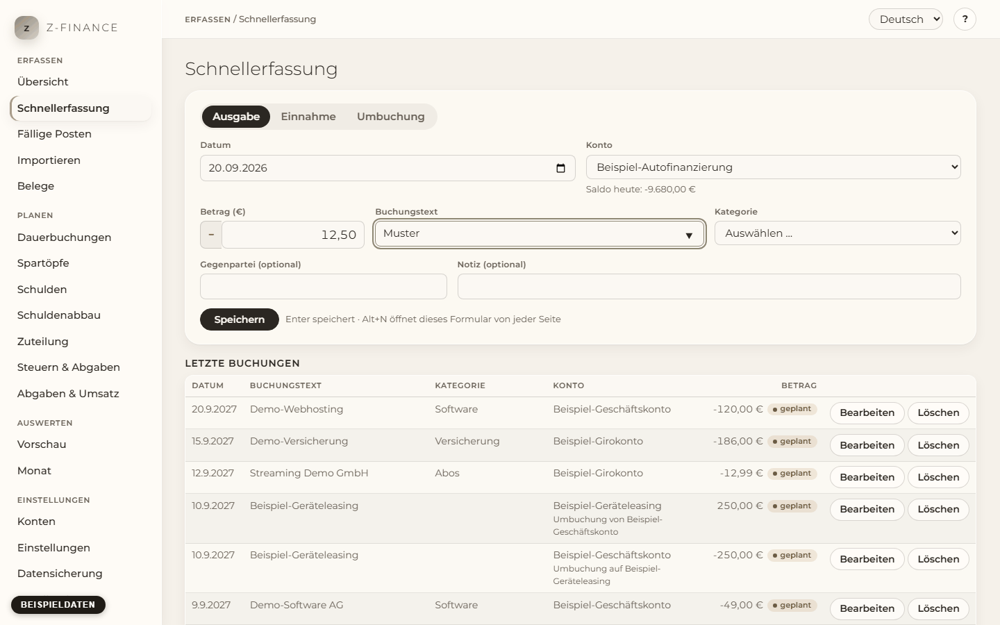

# Schnellerfassung

## Was du siehst

Die **Schnellerfassung** beantwortet eine Frage: **Wo erfasst du Geld, das hereinkommt, Geld, das
hinausgeht, oder Geld, das zwischen deinen eigenen Konten wandert?** Oben steht das Formular,
darunter deine letzten Buchungen. Alles ist auf Tempo ausgelegt: Eine Buchung dauert ein paar
Sekunden und braucht keine Maus.

Du öffnest sie von jeder Seite mit **Alt+N** (Alt halten, N drücken). Der Cursor steht sofort im
Feld **Betrag**. Du findest diesen Bildschirm in der Seitenleiste unter **Erfassen**.

## Eine Ausgabe oder Einnahme erfassen

1. Wähle oben im Formular **Ausgabe** oder **Einnahme** (Ausgabe ist vorausgewählt). Alternativ
   tippst du ein Minus vor den Betrag: `-12,50` ist immer eine Ausgabe.
2. **Datum** ist heute, **Konto** das zuletzt verwendete Konto. Ändere beides nur bei Bedarf.
3. Tippe den **Betrag**, z. B. `12,50` oder `12.50` — ohne Tausenderpunkte.
4. Drücke **Tab** und tippe den **Buchungstext**, z. B. den Namen des Geschäfts.
5. Drücke **Tab** und wähle die **Kategorie**: Tippe die ersten Buchstaben ihres Namens, um zu ihr
   zu springen.
6. **Gegenpartei** und **Notiz** sind optional.
7. Drücke **Enter**. Die Buchung ist gespeichert und erscheint unten in der Liste.

Nach dem Speichern bleiben Datum und Konto stehen, alle anderen Felder sind leer und der Cursor
steht wieder im **Betrag** — bereit für die nächste Buchung. Fünf Belege hintereinander dauern
deutlich unter einer Minute. Auch das allererste Speichern direkt nach **Alt+N** ist sicher: Hat
z-finance deine Konten noch nicht ganz geladen, wartet das Speichern kurz und geht dann durch —
nichts geht verloren. Das Formular sperrt sich kurz, während eine Buchung gespeichert wird, damit
schnelles Tippen nie in der falschen Buchung landet; es entsperrt sich sofort wieder, sobald das
Speichern fertig ist.

Passt die Art der Kategorie nicht zum Betrag (eine Einnahme-Kategorie bei einer Ausgabe), zeigt das
Formular eine Warnung; speichern kannst du trotzdem — etwa für eine Gutschrift.

## Vorschläge aus früheren Buchungen

Tippst du einen Text, den du schon einmal verwendet hast, übernimmt z-finance Kategorie und
Gegenpartei der letzten Buchung mit diesem Text. Beim ersten Mal „Bäckerei“ wählst du die Kategorie
selbst; ab dem zweiten Mal wird sie vorgeschlagen. Die Vorschlagsliste unter dem Textfeld zeigt
passende Texte aus deinem Verlauf — wähle mit den Pfeiltasten. Wählst du selbst eine Kategorie,
lässt z-finance sie unverändert.

## Umbuchungen zwischen deinen Konten

Eine Umbuchung verschiebt Geld von einem deiner Konten auf ein anderes: vom Girokonto aufs
Sparkonto, die Kreditkartenabrechnung, oder Geld aus dem Geschäft für privat entnehmen
(Privatentnahme) und wieder einlegen (Privateinlage).

1. Wähle **Umbuchung**.
2. Wähle **Vom Konto** und **Auf Konto**, tippe den Betrag (immer positiv) und auf Wunsch einen
   Text und eine Umbuchungs-Kategorie wie „Privatentnahme/-einlage“.
3. Drücke **Enter**.

z-finance legt zwei Buchungen an: minus auf dem ersten Konto, plus auf dem zweiten. Die Summe über
alle Konten bleibt gleich. Die beiden Buchungen gehören zusammen: Änderst oder löschst du eine,
ändert oder löscht sich die andere mit.

## Geplant statt gebucht

Liegt das Datum in der Zukunft, sagt das Formular das, und die Buchung wird als **geplanter**
Posten gespeichert. Geplante Posten stehen mit dem Vermerk „geplant“ in der Liste, ändern aber noch
keinen Saldo; die [Vorschau](forecast.md) berücksichtigt sie. Ist der
Posten tatsächlich eingetreten, öffne ihn, setze das Datum auf den Tag der Zahlung und speichere.

## Buchungen aus einer Dauerbuchung

Eine Buchung, die du unter [Fällige Posten](due.md) bestätigt hast, trägt neben ihrem Betrag die
Markierung „Dauerbuchung“ — so erkennst du sie von einer, die du selbst eingetippt hast.

## Eine Buchung korrigieren oder löschen

Klicke eine Buchung in der Liste an (oder ihren Knopf **Bearbeiten**). Sie öffnet sich im
Formular; korrigiere das Falsche und klicke **Änderungen speichern**, oder brich mit **Esc** ab.
**Löschen** fragt nach, bevor etwas entfernt wird; eine Umbuchung wird mit beiden Buchungen
gelöscht.

<!-- ste-waiver: Passiv in der Zeile davor ist bestehender Text und unveraendert -->

Du kannst auch eine Buchung auf einem archivierten Konto bearbeiten. Sie bleibt auf diesem Konto;
die Kontoauswahl zeigt es mit dem Zusatz „archiviert“. Neue Buchungen bieten nur aktive Konten an.

## Typische Probleme

- **„Gib einen Betrag ungleich 0 ein.“** Der Betrag ist leer oder 0; das Feld ist rot markiert.
- **„Wähle eine Kategorie.“** Jede Einnahme und Ausgabe braucht eine Kategorie.
- **„Buchungen vor dem Stichtag … sind nicht möglich.“** Das Datum liegt vor dem Stichtag des
  Kontos (siehe [Konten](accounts.md)).
- **„Das Konto … ist archiviert.“** Archivierte Konten nehmen keine Buchungen an; das Formular
  bietet sie nicht an.
- **Speichern schlägt fehl.** Alles, was du getippt hast, bleibt im Formular; lies die Meldung,
  behebe die Ursache und drücke erneut Enter.
- **Alt+N reagiert nicht.** Klicke einmal in die Seite, damit sie den Tastaturfokus hat. Auf dem
  Mac ist das Kürzel Wahltaste+N.

Eine Buchung ändert immer nur den Saldo des einen Kontos, auf dem sie gebucht ist; eine Umbuchung
ändert zwei, im selben Schritt.
