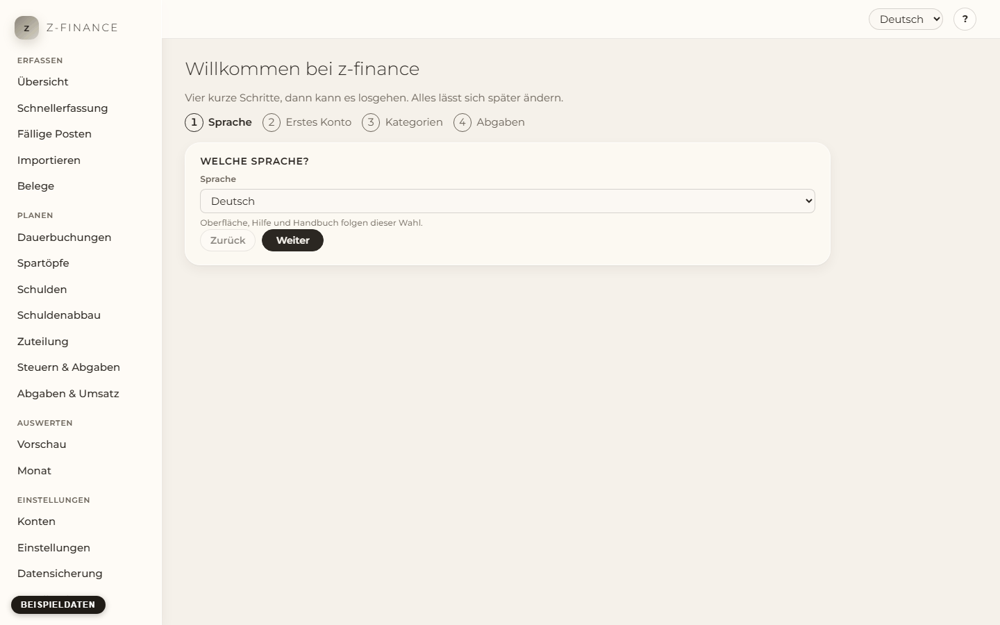
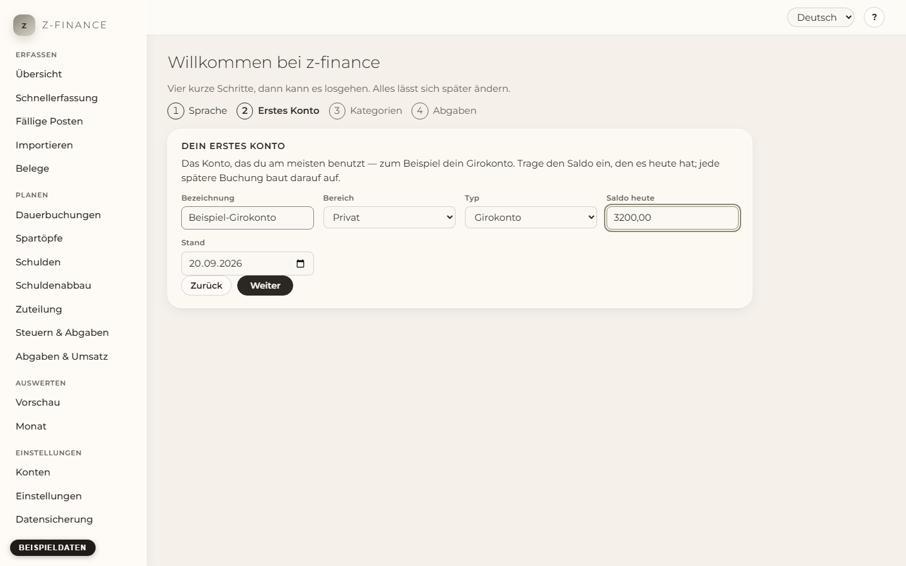
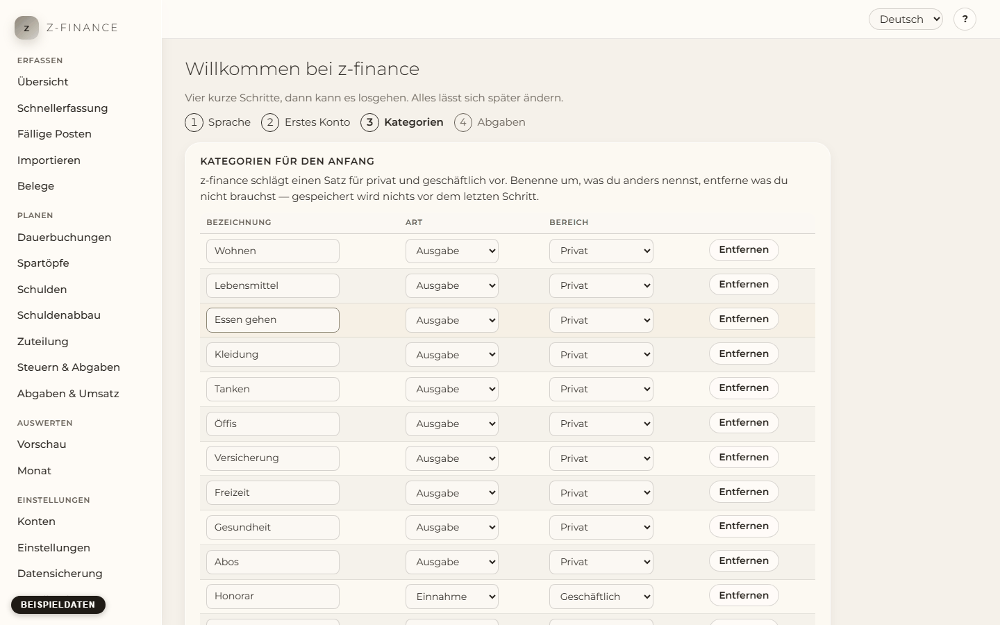
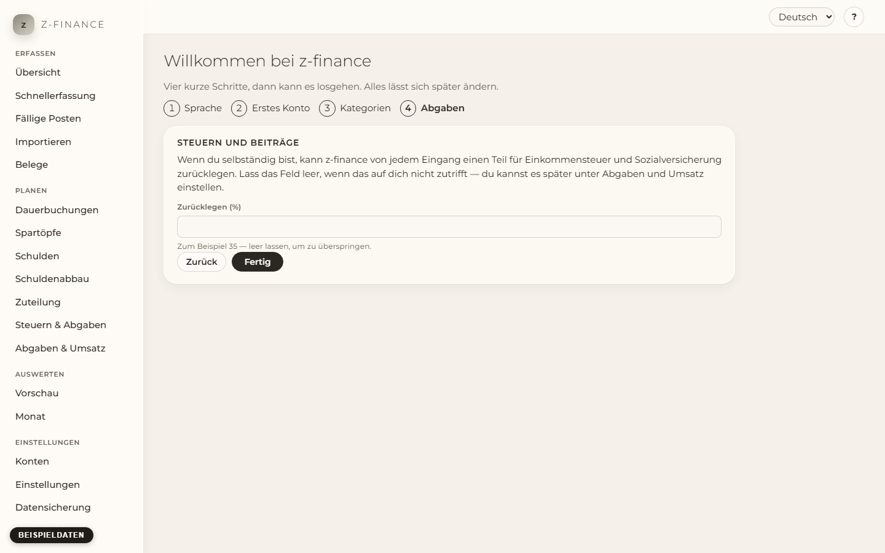

# Der erste Start

## Was du siehst

Wenn du z-finance zum allerersten Mal öffnest, fragt es vier Dinge, bevor es die Startseite zeigt.
Gespeichert wird nichts, bis du im letzten Schritt auf **Fertig** klickst, und **Zurück** bringt
dich jederzeit einen Schritt zurück. Jede dieser Antworten kannst du später ändern.

## Die vier Schritte

1. **Sprache.** Englisch oder Deutsch. Die Oberfläche, diese Hilfe und das Handbuch folgen deiner
   Wahl sofort. Unter [Einstellungen](settings.md) kannst du jederzeit umschalten.

   

2. **Dein erstes Konto.** Das Konto, das du am meisten benutzt — meist dein Girokonto. Gib ihm einen
   Namen, den du wiedererkennst, sag ob es privat oder geschäftlich ist, wähle die Art, und trage
   den Saldo ein, den es heute hat, samt dem Datum, auf das sich dieser Saldo bezieht. Alles, was du
   später buchst, wird auf diesen Startpunkt aufgeschlagen — es muss also nicht der Eröffnungstag
   des Kontos sein, heute genügt. Weitere Konten und die Reserve, die auf jedem liegen bleiben soll,
   stehen unter [Konten und Kategorien](accounts.md). Gibt es schon ein Konto mit diesem Namen,
   verwendet der Assistent dieses Konto. Das gilt auch für archivierte Konten und für eine andere
   Schreibweise des Namens.

   

3. **Kategorien für den Anfang.** z-finance schlägt einen Satz für privat und geschäftlich in der
   gewählten Sprache vor. Benenne um, was du anders nennst, entferne was du nicht brauchst, und
   behalte den Rest. Das ist nur ein Startpunkt — Kategorien ergänzt, benennst und löschst du
   später unter [Konten und Kategorien](accounts.md).

   

4. **Abgaben.** Wenn du selbständig bist, kann z-finance von jedem Eingang einen Teil für
   Einkommensteuer und Sozialversicherung zurücklegen, damit das Geld, das du als „frei“ siehst,
   auch wirklich ausgegeben werden darf. Trage den Prozentsatz ein, den du reservieren willst, zum
   Beispiel `35`. Lass das Feld leer, wenn das auf dich nicht zutrifft. Die ganze Rechnung, und wie
   du den Satz änderst, steht unter [Abgaben und Umsatz](levy.md).

   

Dann **Fertig**. z-finance legt das Konto an, speichert den Satz falls du einen eingetragen hast,
übernimmt die Kategorien und öffnet die Startseite.

## Typische Probleme

- **„Trage einen Betrag wie 1234,56 ein.“** Der Saldo muss eine schlichte Zahl sein. Schreibe
  `1234,56` oder `1234.56`, ohne Tausenderpunkt und ohne Eurozeichen. Ein negativer Saldo (ein
  überzogenes Konto) bekommt ein Minus davor: `-250`.
- **„Trage einen Satz zwischen 0 und 90 ein, zum Beispiel 35.“** Der Abgabensatz ist ein Prozentsatz,
  kein Betrag. Wenn du unsicher bist, was dort hingehört, lass das Feld leer und trage ihn später
  nach.
- **Du landest wieder hier.** Der Assistent erscheint, solange die Kategorien nicht eingerichtet
  sind. Wenn du auf **Fertig** geklickt hast und ihn trotzdem siehst, ist der letzte Schritt nicht
  bei z-finance angekommen — die Zeile unten in der Seitenleiste sagt, ob es noch läuft.
- **Beim Abschluss erscheint ein Fehler.** Geht am Ende etwas schief — etwa weil die Verbindung
  abbricht, nachdem das Konto angelegt wurde —, wird der Assistent nicht zurückgesetzt. Klicke
  einfach erneut auf **Fertig**: Das bereits angelegte Konto wird weiterverwendet und nicht ein
  zweites Mal angelegt.
- **Du willst neu anfangen.** Nichts hiervon ist endgültig: Konten, Kategorien und Abgabensatz
  änderst du danach auf ihren eigenen Bildschirmen.

## Wie geht es weiter

Die zehn Minuten, die z-finance nützlich halten, stehen unter [Das Wochenritual](weekly-routine.md).
