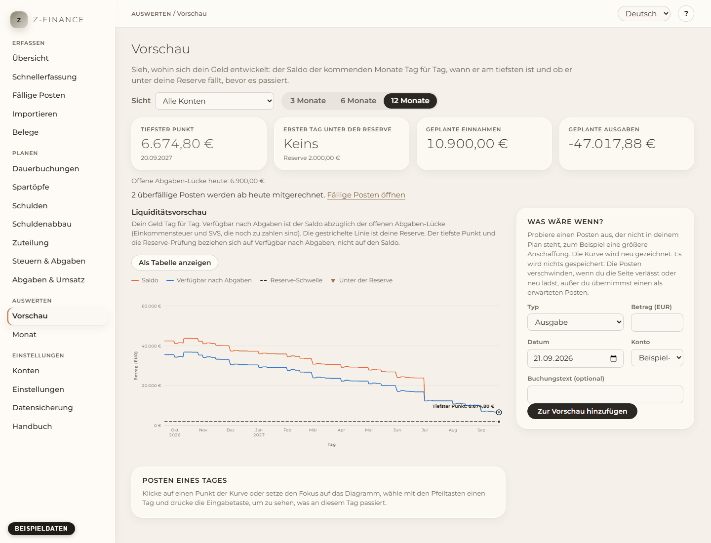

# Vorschau

## Was du siehst

Die Vorschau beantwortet eine Frage: **Reicht mein Geld?** Sie zeigt Tag für Tag, wohin sich dein
Saldo in den nächsten 3, 6 oder 12 Monaten entwickelt, wann er am tiefsten ist und ob er unter
deine Reserve fällt, _bevor_ es passiert. Du findest sie in der Seitenleiste unter **Auswerten**.

Links steht das Diagramm. Rechts findest du die Kennzahlen, das Feld **Was wäre wenn?** und, wenn
das Geld knapp wird, einen Vorschlag, welche Töpfe helfen könnten.

## Auswählen, was du ansehen willst

- **Sicht**: alle Konten, nur die privaten oder nur die geschäftlichen Konten oder ein einzelnes
  Konto. Kreditkonten werden nie angeboten: Sie sind Schulden, kein Geld, das du ausgeben kannst.
- **Zeitraum**: 3, 6 oder 12 Monate.

Umbuchungen zwischen deinen eigenen Konten heben sich in den Sichten auf, die beide Konten
enthalten. In der Sicht auf ein einzelnes Konto zählen sie.

## Das Diagramm lesen

Das Diagramm hat drei Linien:

- **Saldo**: was deine Konten enthalten, plus alles, was für die Zukunft noch geplant oder
  gebucht ist.
- **Verfügbar nach Abgaben**: der Saldo abzüglich der offenen Abgaben-Lücke, also der
  Einkommensteuer und SVS, die deine Einnahmen schon ausgelöst haben, die du aber noch nicht
  zurückgelegt hast. Diese Linie zählt.
- **Reserve-Schwelle** (gestrichelt): die Reserve, die du behalten willst. Sie ergibt sich aus der
  Reserve je Konto und der Gesamt-Reserve unter [Konten](accounts.md).

Der **tiefste Punkt** ist umringt und beschriftet. Tage, an denen _Verfügbar nach Abgaben_ unter
der Reserve liegt, sind mit einem roten Band und einem Dreieck markiert.

Wichtig: Die Reserve-Prüfung bezieht sich auf **Verfügbar nach Abgaben**, nicht auf den Saldo. Der
Saldo kann bequem aussehen, obwohl das Geld dem Finanzamt schon gehört. Beispiel: Saldo 12.000 €,
offene Abgaben-Lücke 3.000 €, Reserve 10.000 € — die Linie „verfügbar“ liegt bei 9.000 €, und die
Reserve gilt als unterschritten.

Überfällige Posten, die du noch nicht bestätigt hast, werden ab heute mitgerechnet und nicht
ignoriert. Die Anzahl steht rechts, mit einem Link zu [Fälligen Posten](due.md).

## Einen Tag ansehen

Klicke auf einen Punkt der Kurve. Unter dem Diagramm siehst du genau die Posten, die an diesem
Tag wirken (geplante und gebuchte), was der Tag verändert und wie hoch der Saldo an seinem Ende
ist.

Mit der Tastatur: Setze den Fokus auf das Diagramm (Tab), wähle mit den Pfeiltasten links und
rechts einen Tag (mit der Umschalttaste springst du eine Woche, Pos1 und Ende gehen an die Enden)
und drücke die Eingabetaste. **Als Tabelle anzeigen** listet jeden Tag als Tabelle auf.

## Was wäre wenn?

Du willst wissen, ob du dir etwas leisten kannst? Gib eine **Ausgabe** oder **Einnahme**, einen
Betrag, einen Tag und ein Konto ein und drücke **Zur Vorschau hinzufügen**. Die Kurve wird sofort
neu gezeichnet.

**Es wird nichts gespeichert.** Was-wäre-wenn-Posten gibt es nur auf dieser Seite; sie
verschwinden, wenn du die Seite verlässt oder neu lädst. Ist der Posten echt, drücke in seiner
Zeile **Als erwarteten Posten übernehmen**: Er wird dann als erwarteter Posten gespeichert (auch
unter [Dauerbuchungen](recurring.md) sichtbar) und Teil deines Plans. Das geht für Tage nach
heute. **Entfernen** löscht einen Was-wäre-wenn-Posten, **Alle Was-wäre-wenn-Posten entfernen**
leert die Liste.

## Wenn die Reserve unterschritten wird

Fällt _Verfügbar nach Abgaben_ unter die Reserve, nennt eine rote Meldung den ersten Tag und wie
weit der tiefste Punkt unter der Reserve liegt. Wenn du Spartöpfe hast, zeigt das Feld
**Fehlbetrag aus deinen Töpfen decken**, welche Töpfe den Fehlbetrag in der von dir festgelegten
Notfall-Reihenfolge decken würden und was in jedem Topf übrig bliebe. Gesperrte Töpfe werden nie
vorgeschlagen. Mit einem Klick auf **… aus diesen Töpfen entnehmen** führst du die Entnahme aus.

Gut zu wissen: Das Geld wandert in den freien Betrag des Kontos, und das Zieldatum eines Topfs
kann sich nach hinten verschieben. Der Saldo des Kontos ändert sich nicht. Der Vorschlag betrachtet
nur deinen gespeicherten Plan, nicht die Was-wäre-wenn-Posten.

## Keine Reserve festgelegt

Ohne Reserve gibt es keinen Alarm, und die Seite sagt das. Lege unter [Konten](accounts.md) eine
Reserve je Konto oder eine Gesamt-Reserve fest.

## Typische Probleme

- **Die Kurve ist flach.** Es ist noch nichts geplant. Lege [Dauerbuchungen](recurring.md) oder
  erwartete Posten an, dann kommt Leben hinein.
- **Der tiefste Punkt liegt unter dem Saldo.** Das ist die offene Abgaben-Lücke — siehe
  [Abgaben & Umsatz](levy.md).
- **Ein Was-wäre-wenn-Posten verändert die Kurve nicht.** Er liegt auf einem Konto außerhalb der
  gewählten Sicht (markiert mit _nicht in dieser Sicht_) oder nach dem Zeitraum.

Die Kurve ist nur so gut wie das, was sie speist — halte fällige Posten bestätigt und
Dauerbuchungen aktuell, dann bleibt die Vorschau eine echte Antwort und keine Vermutung.
