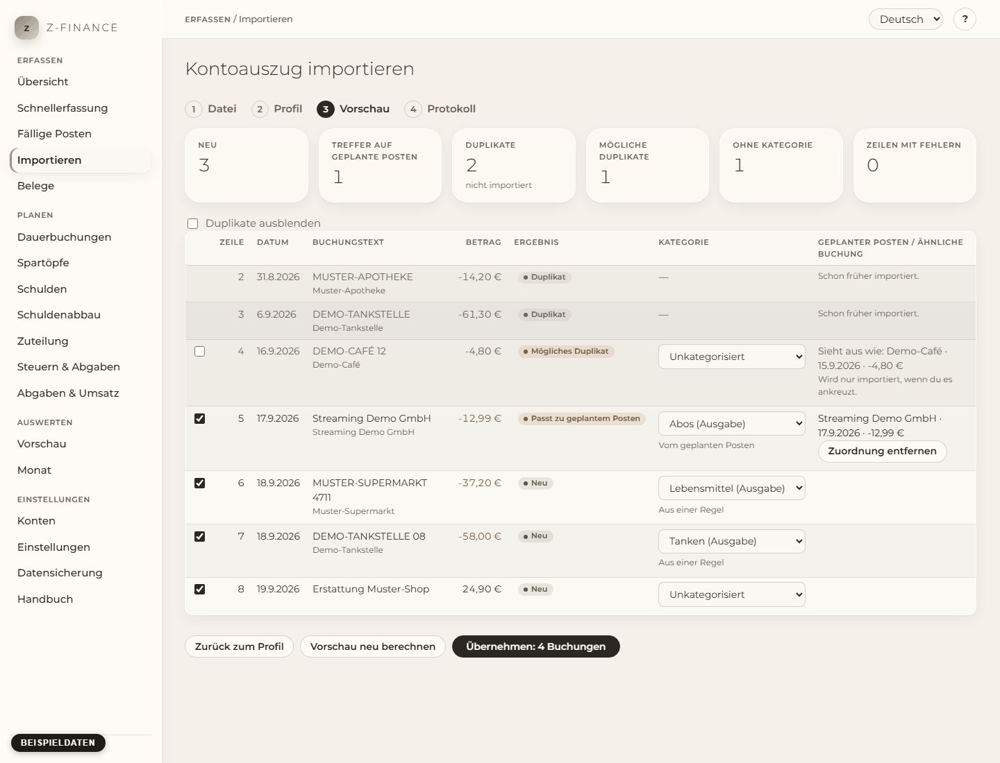

# Import

## Was du siehst

Auf der Seite **Import** holst du die Bewegungen deines Bankkontos aus einer CSV-Datei, die du im
Online-Banking exportierst, in z-finance. Du findest sie in der Seitenleiste unter **Erfassen**. Sie
führt dich in vier Schritten durch den Import, oben angezeigt: **Datei**, **Profil**, **Vorschau**,
**Protokoll**. Gespeichert wird erst, wenn du in Schritt 3 auf **Übernehmen** drückst, und du kannst
dieselbe Datei jederzeit erneut importieren: Zeilen, die schon importiert wurden, werden erkannt und
übersprungen.

## Eine Beispiel-CSV besorgen

1. Melde dich im Online-Banking an und öffne das Konto.
2. Suche neben der Liste der Umsätze nach **Export**, **Download** oder **CSV**, wähle einen Zeitraum
   (zum Beispiel den letzten Monat) und lade die Datei herunter.
3. Speichere sie an einem Ort, an dem du sie wiederfindest. Öffne und speichere sie nicht vorher in
   einem Tabellenprogramm; das kann das Format verändern.

Eine CSV-Datei ist reiner Text, eine Bewegung pro Zeile, die Spalten sind durch `;` oder `,`
getrennt. Wenn du nicht sicher bist, was deine Bank liefert, öffne die Datei in einem Texteditor:
Die erste Zeile enthält die Spaltennamen.

## Schritt 1: Konto und Datei wählen

1. Wähle das **Konto**, zu dem die Bewegungen gehören.
2. Wähle die **CSV-Datei**. z-finance erkennt Zeichenkodierung und Spaltentrenner und zeigt die
   ersten Zeilen der Datei.
3. Prüfe die Zeilen: Sind die Spalten sauber getrennt, sehen Umlaute (ä, ö, ü, ß) und das
   Euro-Zeichen richtig aus? Wenn nicht, wähle die **Zeichenkodierung** oder den **Spaltentrenner**
   von Hand; die Zeilen aktualisieren sich sofort. Eine Datei, deren Format sich nicht sicher
   erkennen lässt, wird nicht geraten: Du wählst es selbst.

Drücke dann **Weiter zum Profil**.

## Schritt 2: Profil wählen oder anlegen

Ein **Profil** sagt z-finance, welche Spalte der Datei was enthält. Du legst es einmal pro Bank an
und verwendest es für jeden späteren Auszug wieder.

- Wähle ein gespeichertes Profil oder **Neues Profil**. Für ein neues schlägt z-finance die Spalten
  anhand der Spaltennamen vor; prüfe jede davon.
- Ordne die Spalten **Datum**, **Text** (der Verwendungszweck) und **Betrag** aus den Listen zu.
  Manche Banken führen Geld raus und Geld rein in zwei Spalten: Wähle dann **Spalten Soll und
  Haben**. Die Spalte **Gegenpartei** ist optional.
- Stelle das **Datumsformat** ein (zum Beispiel `%d.%m.%Y` für 31.12.2026) und den
  **Dezimaltrenner** (Komma für 1.234,56). Beginnt die Datei mit einem Titel vor den Spaltennamen,
  gib bei **Zeilen vor der Kopfzeile** an, wie viele es sind.
- Die Zeilen darunter zeigen deine Datei mit der Rolle jeder Spalte, so siehst du sofort, ob die
  Zuordnung passt.

Drücke **Vorschau anzeigen**. Ein neues oder geändertes Profil wird vorher gespeichert. Hat deine
Bank den Export geändert und fehlt eine Spalte, lehnt z-finance die ganze Datei ab und nennt die
Spalte. Wähle die neue Spalte in der Liste und drücke erneut **Vorschau anzeigen**; frühere
Importe bleiben unberührt.

## Schritt 3: Vorschau prüfen

Die Vorschau listet jede Zeile der Datei und was z-finance damit tun würde:

- **Neu**: wird als neue Buchung erfasst.
- **Duplikat** (grau): wurde schon importiert und wird übersprungen.
- **Passt zu geplantem Posten**: passt zu einem geplanten Posten (zum Beispiel deiner Miete) und
  ersetzt ihn, statt doppelt zu buchen. Der geplante Posten steht neben der Zeile. Passen mehrere,
  wird der mit dem nächsten Datum gewählt und die Zeile ist mit **Zuordnung prüfen** markiert; wähle
  in der Liste einen anderen, wenn er falsch ist.
- **Mögliches Duplikat**: sieht aus wie eine Buchung, die du von Hand erfasst oder früher bestätigt
  hast (gleicher Betrag, fast gleiches Datum). Sie bleibt draußen, außer du kreuzt sie an.

Du kannst die Zeilen korrigieren, bevor etwas geschrieben wird:

- **Kategorie**: ändere sie in der Liste. Der kleine Hinweis sagt, woher der Vorschlag stammt (eine
  Regel, der geplante Posten oder du).
- **Zuordnung entfernen** erfasst die Zeile stattdessen als neue Buchung; **Zuordnung
  wiederherstellen** macht das rückgängig.
- Das Kästchen am Zeilenanfang lässt die Zeile aus (oder importiert ein mögliches Duplikat).
- **Als Regel speichern** erscheint, sobald du eine Kategorie geändert hast. Die Regel „Text enthält
  … → diese Kategorie“ kategorisiert dann gleiche Zahlungen künftig automatisch; andere Zeilen
  dieser Datei, die dazu passen, werden in der Vorschau aktualisiert.

Die Kacheln über der Tabelle zählen, was passieren wird, einschließlich deiner Korrekturen. Zeilen,
die sich nicht lesen lassen, stehen getrennt mit dem Grund; sie werden übersprungen, der Rest wird
importiert.

Sieht alles richtig aus, drücke **Übernehmen**. Der Knopf ist gesperrt, solange die Buchungen
geschrieben werden, ein Doppelklick kann also nicht zweimal importieren. Alles wird in einem Schritt
geschrieben: Schlägt eine Zeile fehl, wird nichts geschrieben, du siehst, welche Zeile, und kannst
es korrigieren und erneut versuchen.

## Schritt 4: Protokoll

Das Protokoll zeigt, wie viele Buchungen **Neu** sind, wie viele geplanten Posten **zugeordnet**
wurden, wie viele **Duplikate** übersprungen wurden und wie viele der neuen Buchungen noch
**unkategorisiert** sind. Die Zahlen stimmen mit der Buchungsliste überein. Den Rest kategorisierst
du im [Monatsbericht](month.md). Unter **Frühere Importe** im ersten Schritt findest du das Protokoll
jedes Imports.

## Typische Probleme

- **„Die Zeichenkodierung der Datei konnte nicht erkannt werden“**: Wähle die Kodierung in Schritt
  1 (ältere Windows-Exporte sind oft Windows-1252, neuere UTF-8). Dasselbe gilt für den
  Spaltentrenner.
- **Alles ist ein Duplikat**: Du hast diese Datei schon importiert. Das ist gewollt.
- **Eine Spalte fehlt**: Deine Bank hat den Export geändert; siehe Schritt 2.
- **Eine Zeile wird abgelehnt, weil sie älter als das Konto ist**: Das Konto beginnt später als die
  Zeile. Verschiebe das Eröffnungsdatum des Kontos (siehe [Konten](accounts.md)) oder lass die Zeile
  aus.

Weil jede Zeile beim Abschluss noch einmal gegen das Kontobuch eingeordnet wird, ist es genauso
sicher, die Vorschau ein paar Minuten lang zu korrigieren, bevor du sie übernimmst, wie sie sofort
zu übernehmen — die gespeicherte Vorschau selbst übersteht aber weder einen Neustart noch deutlich
mehr als eine Stunde.
