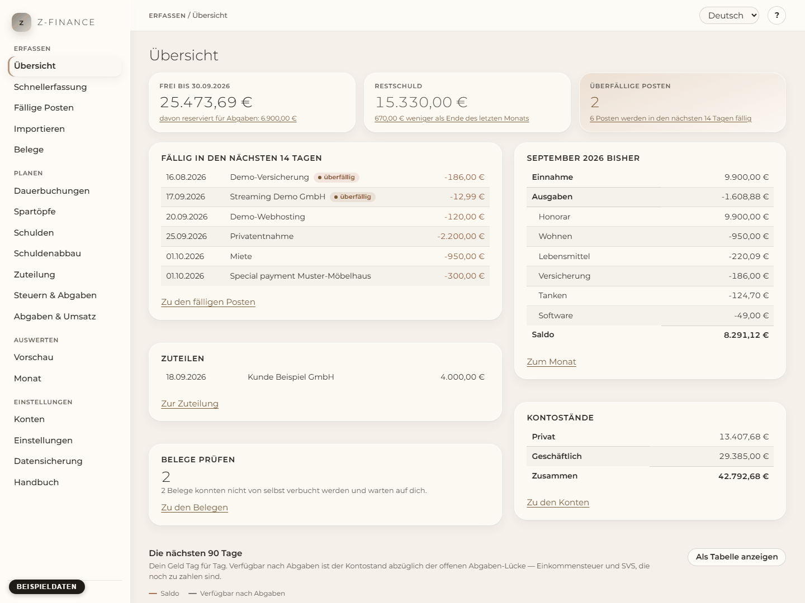

# Übersicht

Die Übersicht ist die Startseite: der Bildschirm, den du öffnest, zwei Minuten anschaust und wieder
schließt. Ganz oben beantwortet er drei Fragen, ohne dass du scrollen musst, darunter zeigt er,
was auf dich wartet. Er ändert von sich aus nichts — jede Karte führt zu dem Bildschirm, auf dem du
handelst.

## Die drei Zahlen

**Frei bis Monatsende.** Was du diesen Monat noch ausgeben kannst: das Geld auf deinen Zahlkonten,
abzüglich der schon geplanten Posten bis Monatsende, abzüglich der Reserve, die du auf deinen
Konten festgelegt hast, abzüglich der Abgaben, die du noch schuldest. Die kleine Zeile darunter
benennt genau diesen letzten Teil: _davon reserviert für Abgaben_.

Das ist die eine Zahl von z-finance, und sie ist bewusst kleiner als dein Kontostand. Wenn du
10.000 € einnimmst und dein Abgabensatz 30 % beträgt, steigt sie um 7.000 €, nie um 10.000 € — die
3.000 € gehören dem Finanzamt und der SVS, ab dem Tag, an dem das Geld da ist. Wie sich die Zahl im
Detail zusammensetzt, steht unter [Abgaben & Umsatz](levy.md).

**Restschuld.** Alles, was du noch schuldest, über alle Schulden zusammen, mit der Veränderung seit
Ende des letzten Monats. Weniger als im Vormonat steht in Grün, mehr in Rot. Die Einzelheiten
stehen unter [Schulden](debts.md) und [Tilgungsplan](payoff.md).

**Überfällige Posten.** Geplante Posten, deren Datum vorbei ist und die du noch nicht bestätigt
hast. Die Zeile darunter sagt, wie viele Posten in den nächsten 14 Tagen fällig werden. Beides
führt zu [Fällige Posten](due.md).

## Das Wochenritual

Zehn Minuten einmal pro Woche halten z-finance aktuell, immer in derselben Reihenfolge: die drei Zahlen anschauen, fällige Posten bestätigen, Fehlendes einspielen, über neue Eingänge entscheiden, Belege prüfen, einen Blick auf die Kurve werfen. Die Schritte stehen unter [Das Wochenritual](weekly-routine.md).

## Die Karten

- **Fällig in den nächsten 14 Tagen** — die geplanten Posten der kommenden zwei Wochen, überfällige
  zuerst und markiert.
- **Der laufende Monat** (im Titel mit Namen, z.B. „September 2026 bisher“) — Einnahmen, Ausgaben
  und der Saldo mit den größten Kategorien. Die ganze Auswertung steht unter [Monat](month.md).
- **Zuteilen** — Eingänge, die auf eine Entscheidung warten (siehe Wochenritual oben).
- **Kontostände** — privat, business und beides zusammen. Schulden gehören nicht dazu; sie sind die
  zweite Zahl ganz oben.
- **Belege prüfen** — wie viele Bon-Fotos in der Prüfliste gelandet sind.
- **Die nächsten 90 Tage** — dein Kontostand Tag für Tag, darunter die Linie _verfügbar nach
  Abgaben_, also dasselbe Geld abzüglich der offenen Abgaben-Lücke.

## Hinweise

- **„Abgaben nicht gedeckt“** erscheint, wenn die noch offenen Abgaben mehr sind als das Geld auf
  allen deinen Konten. Das ist eine Aufforderung zu handeln, kein Fehler: leg Geld zurück oder
  besprich den Satz mit deinem Steuerberater. [Abgaben & Umsatz](levy.md) zeigt die Lücke.
- **„Steuern und Abgaben sind nicht hinterlegt“** erscheint, solange du keine Vorauszahlung
  eingetragen hast. Ohne sie wird zu den Terminen nichts eingeplant, und die Vorschau ist zu
  optimistisch. Trag die Beträge unter [Steuern & Abgaben](tax.md) ein.

## Wenn etwas komisch aussieht

- **Die Zahl oben ist kleiner als dein Bankguthaben.** Das ist Absicht: geplante Posten, Reserve
  und der Abgaben-Anteil sind schon abgezogen. Die Aufstellung steht unter
  [Abgaben & Umsatz](levy.md).
- **Eine Zahl ist veraltet.** Die Übersicht liest alles beim Öffnen; lade die Seite nach einer
  Änderung auf einem anderen Bildschirm neu (F5).
- **„Backend nicht erreichbar“ unten in der Seitenleiste.** z-finance läuft nicht; starte es neu.
  Es geht nichts verloren, deine Daten liegen in einer Datei auf diesem Computer.

## Zurechtfinden

Die Seitenleiste links listet die Bildschirme in vier Gruppen:

- **Erfassen** — Geldbewegungen eintragen: diese Übersicht, Schnellerfassung, fällige Posten,
  Import, Belege.
- **Planen** — was ansteht: Dauerbuchungen, Spartöpfe, Schulden, Tilgungsplan, Zuteilung, Steuern
  und Abgaben.
- **Auswerten** — zurück- und vorausschauen: Vorschau und Monatsübersicht.
- **Einstellungen** — Konten, Kategorien, die Sprache der Oberfläche, Datensicherung und dieses
  Handbuch.

Die Zeile oben zeigt, wo du gerade bist. Daneben wechselst du die Sprache (dieselbe Einstellung wie
im Bildschirm Einstellungen). Unten in der Seitenleiste zeigt z-finance, ob es läuft, und seine
Version. Jeder Bildschirm hat eine **?**-Schaltfläche, die die Hilfe genau zu diesem Bildschirm
öffnet; das vollständige Handbuch mit Suchfeld steht unter **Handbuch**, siehe
[Hilfe und Handbuch benutzen](manual.md).

z-finance ist für den Computerbildschirm gemacht; auf dem Handy wird die Darstellung nicht
unterstützt.

Fragen und Antworten stehen unter [Fragen und Antworten](faq.md), die Wörter, die z-finance benutzt, im [Glossar](glossary.md).
