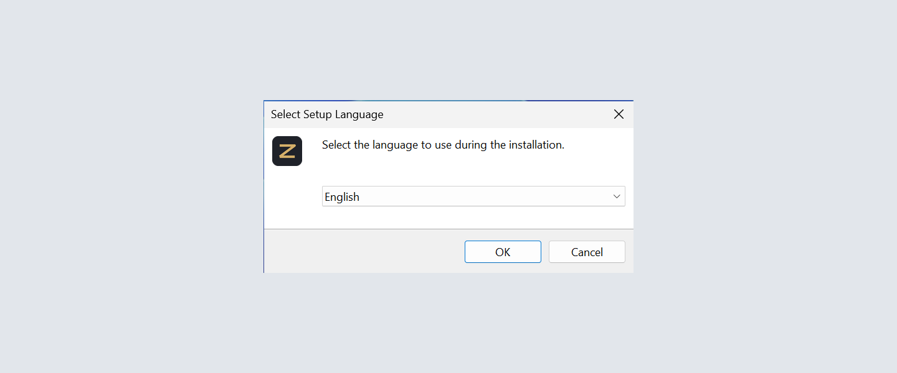
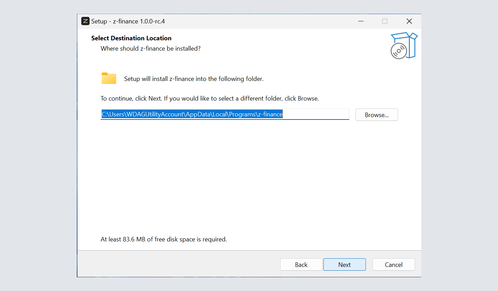
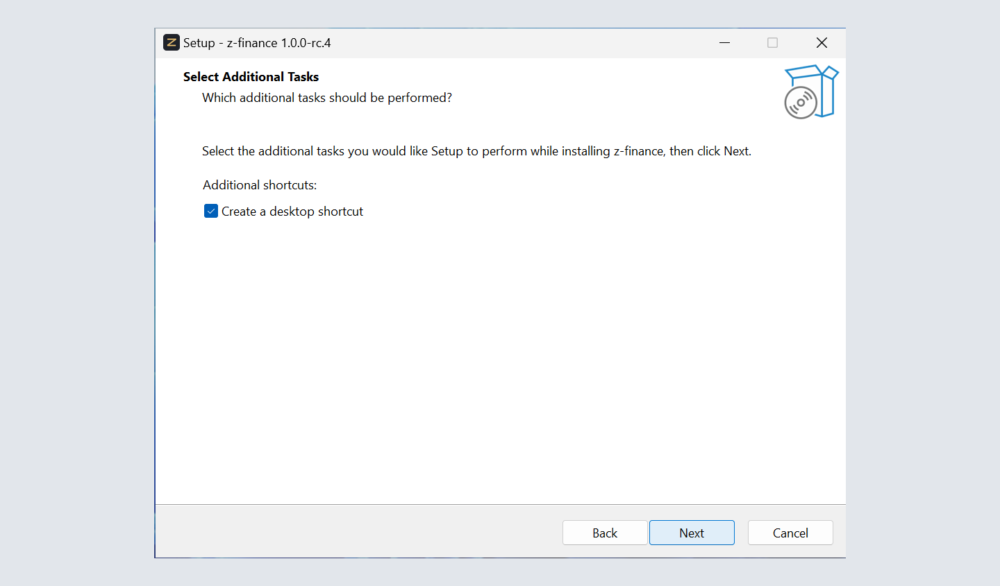
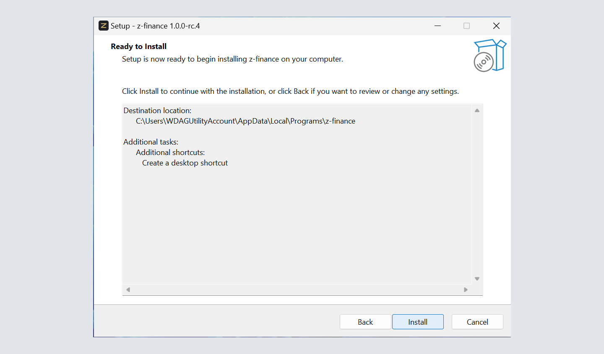
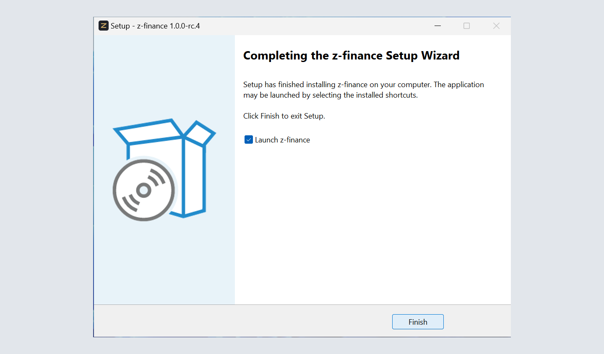
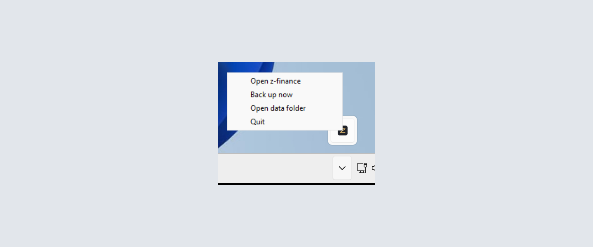
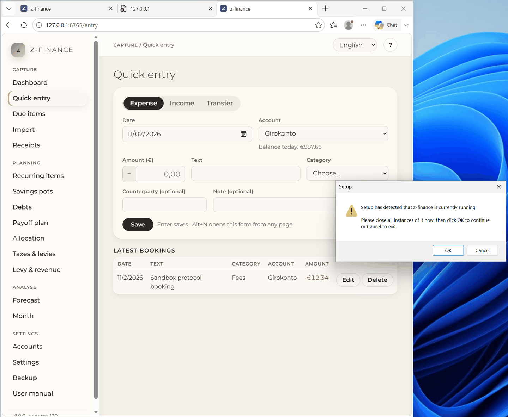
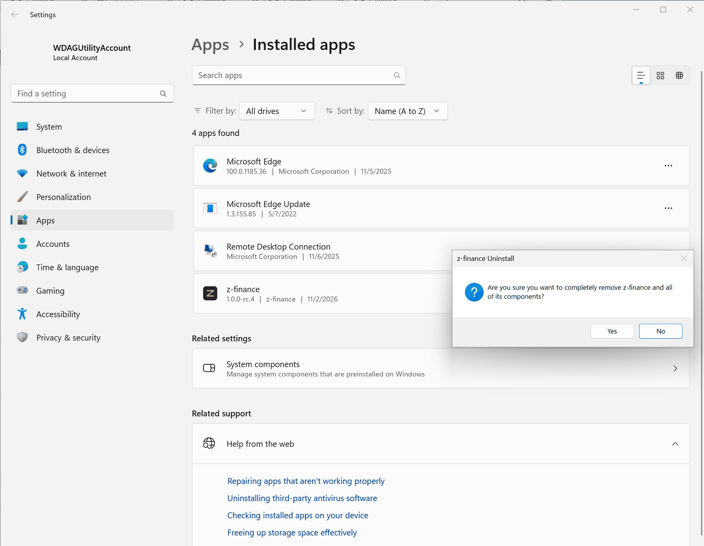
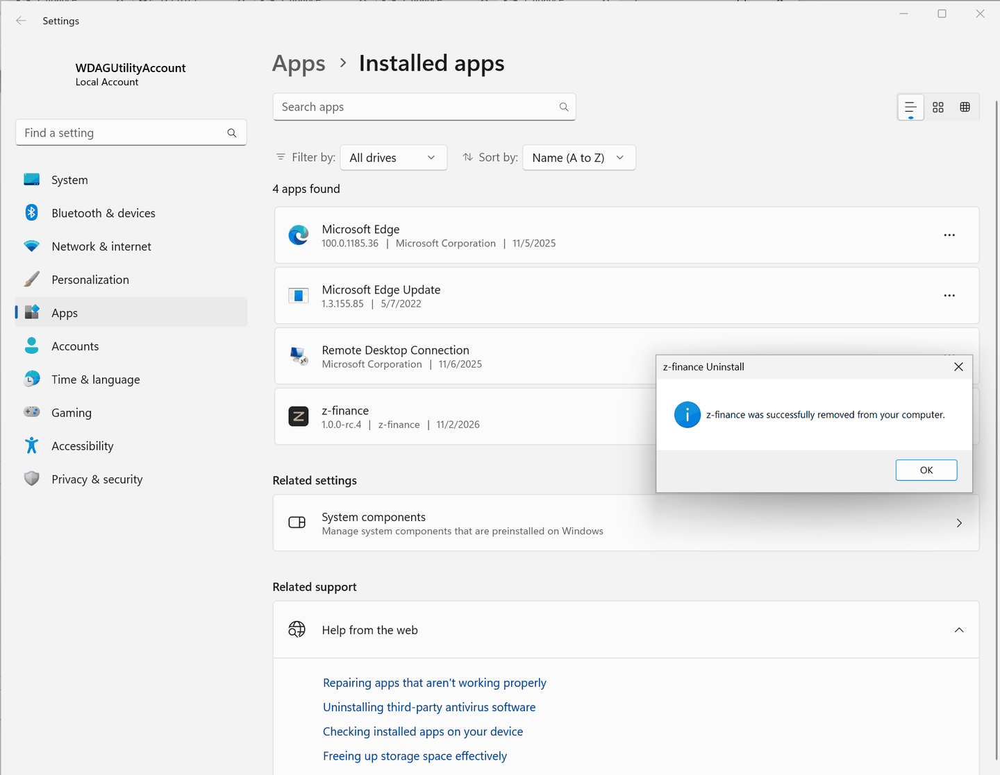

# z-finance installieren

Drei Schritte und ein paar Minuten — kein Konto, kein Passwort, nichts einzurichten — und
z-finance läuft auf deinem eigenen Computer.

## In drei Schritten

1. Öffne die [Download-Seite](https://github.com/ziagl888/z-finance/releases) und klicke unter der
   neuesten Version auf die Datei, deren Name mit `z-finance-setup` beginnt.
2. Doppelklick auf die heruntergeladene Datei, dann **Weiter** bis **Fertigstellen**. z-finance
   installiert sich nur für dich, deshalb fragt Windows nicht nach einem Administrator-Kennwort.
3. Starte **z-finance** über das Startmenü (oder über das Symbol auf dem Desktop, falls du es
   behalten hast). z-finance öffnet sich im Browser, und der erste Start führt dich durch
   [die vier Fragen](first-run.md), die es beantwortet haben will.

Mehr ist nicht nötig. Du brauchst nichts weiter installiert — kein Python, keine Datenbank, kein
Konto irgendwo.

Das sind die Seiten von Setup, der Reihe nach. Setup fragt zuerst nach der Sprache. Dann zeigt es
den Ordner unter deinen eigenen Windows-Ordnern, das Angebot eines Desktop-Symbols und die
Zusammenfassung. Die letzte Seite hat das Feld **Launch z-finance**. Die Bilder stammen aus einem
Test auf einem frischen Windows und zeigen deshalb Setup auf Englisch.











## „Der Computer wurde durch Windows geschützt“

Beim ersten Start einer neuen Version kann ein blaues Fenster mit diesem Text erscheinen. Es kommt,
weil dieses Programm nicht mit einem kostenpflichtigen Zertifikat signiert ist — nicht, weil mit
der Datei etwas nicht stimmt.

Klicke auf **Weitere Informationen**. Das Fenster zeigt dann „Herausgeber: unbekannt“. Das ist bei
einem Programm ohne Signatur normal. Klicke auf **Trotzdem ausführen**. Wenn du sicher sein willst,
lade die Datei noch einmal über den Link oben herunter. Die Download-Seite des Projekts ist der
einzige Ort, an dem sie veröffentlicht wird.

## Während z-finance läuft

z-finance ist ein kleines Programm auf deinem eigenen Computer, das du über den Browser bedienst.
Solange es läuft, sitzt rechts unten im Infobereich ein **z**-Symbol (eventuell musst du auf den
kleinen Pfeil klicken, um es zu sehen). Rechtsklick darauf bietet:

- **z-finance öffnen** — holt den Browser-Tab zurück, wenn du ihn geschlossen hast.
- **Jetzt sichern** — schreibt eine Kopie all deiner Daten, wie der Bildschirm
  [Sichern und Wiederherstellen](backup.md).
- **Datenordner öffnen** — zeigt den Ordner mit deiner Datenbank und deinen Sicherungen im Explorer.
- **Beenden** — stoppt z-finance. Nur den Browser-Tab zu schließen beendet es nicht.



Ein zweiter Start startet keine zweite Kopie: er holt die laufende einfach wieder nach vorn.

## z-finance von einem anderen Computer erreichen

Standardmäßig erreicht nur dieser Computer z-finance.

Du kannst z-finance für dein Netzwerk öffnen. Starte es in einem Terminal mit
`--host <Adresse> --allow-network`. Dann erreichen andere Computer in deinem Netzwerk es auch.
z-finance hat keine Anmeldung. Jeder in diesem Netzwerk kann deine Daten lesen und ändern. Tu das
nur in einem Netzwerk, dem du vertraust.

z-finance nimmt nur Anfragen an, die genau die Adresse nennen, an die du es gebunden hast. Es nimmt
auch `localhost` und `127.0.0.1` an. Binde es an eine Adresse dieses Computers. Tippe auf dem
anderen Computer genau diese Adresse:

```sh
z-finance --host 192.168.1.5 --allow-network     # anderer Computer: http://192.168.1.5:8765
```

`--host 0.0.0.0` (alle Adressen) funktioniert dafür nicht. Der andere Computer ruft
`http://192.168.1.5:8765` auf. Das ist nicht `0.0.0.0`, darum weist z-finance die Anfrage mit
„host not allowed“ ab. Der Browser auf diesem Computer öffnet dann `http://127.0.0.1:8765`.
Das Startprotokoll sagt es.

## Wo deine Daten liegen

Alles, was du erfasst, liegt in einem Ordner, der zu deinem Windows-Konto gehört:

    C:\Users\<dein Name>\AppData\Local\z-finance

Der Installer fasst diesen Ordner nie an. Eine neue Version über die alte zu installieren behält
deine Daten, und eine Deinstallation lässt sie liegen — wenn du deine Daten wirklich löschen
willst, lösche den Ordner danach selbst. Kopiere trotzdem ab und zu eine Sicherung an einen anderen
Ort, siehe [Sichern und Wiederherstellen](backup.md).

## Aktualisieren

Neue Versionen werden auf der Download-Seite angekündigt. z-finance kann dich darauf hinweisen:
schalte unter [Einstellungen](settings.md) **Nach neuen Versionen suchen** ein. Dann fragt es bei
GitHub nach, welche Version die neueste ist — heruntergeladen und installiert wird nichts. Gibt es
eine neuere, folge dem Link, installiere sie wie beim ersten Mal, und deine Daten bleiben, wo sie
sind.

Läuft z-finance noch, während du installierst, bittet Setup dich, es zu schließen. Klicke mit der
rechten Maustaste auf das **z**-Symbol, dann auf **Beenden**, dann in Setup auf **OK**.



## z-finance entfernen

Windows **Einstellungen → Apps → Installierte Apps → z-finance → Deinstallieren**. Dein Datenordner
bleibt erhalten, siehe oben.

Das Deinstallationsprogramm fragt einmal. Klicke auf **Yes** (Ja). Danach ist z-finance aus dem
Startmenü verschwunden.





Nichts davon — Installieren, Aktualisieren, Deinstallieren — rührt je den Datenordner an; nur du
selbst, wenn du ihn löschst.
