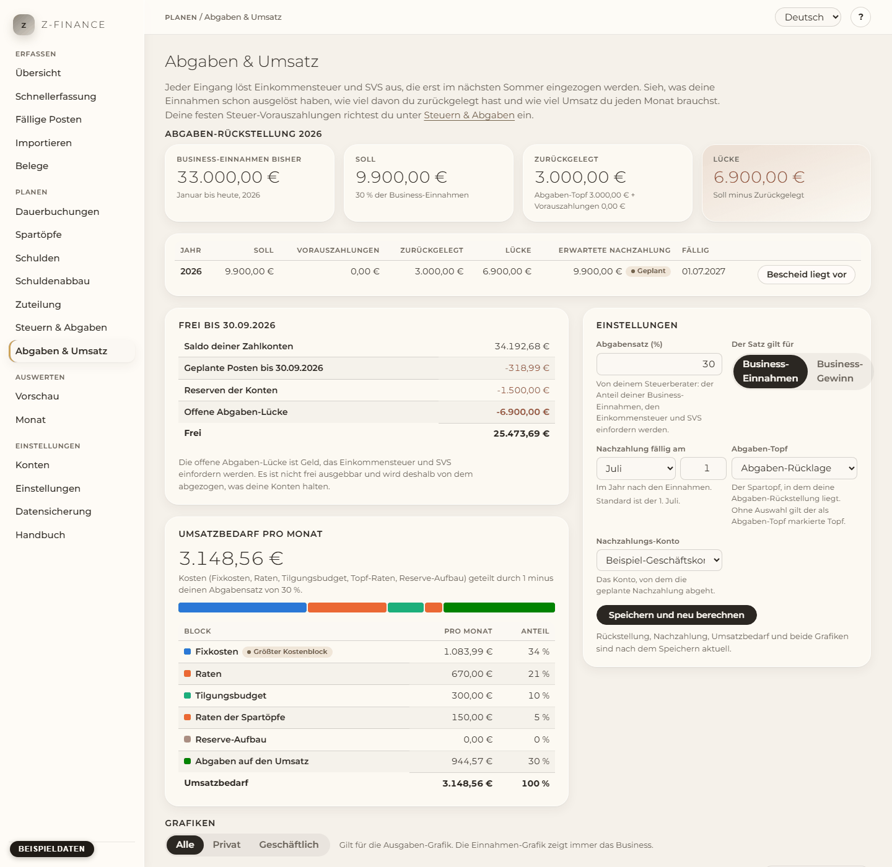

# Abgaben & Umsatz

## Was du siehst

Jeder Eingang löst Einkommensteuer und SVS aus, kassiert werden sie aber erst im nächsten Sommer.
Wer das übersieht, gibt Geld aus, das schon dem Finanzamt gehört. **Abgaben & Umsatz** zeigt dir
jederzeit, wie viel Abgaben deine bisherigen Eingänge ausgelöst haben, wie viel davon du
zurückgelegt hast und wie viel Umsatz du in den kommenden Monaten brauchst. Du findest den
Bildschirm in der Seitenleiste unter **Planen**.

Die Seite hat fünf Teile:

1. **Abgaben-Rückstellung** für das laufende Jahr: vier Kennzahlen und eine Tabelle der offenen
   Jahre.
2. **Einstellungen** rechts: dein Abgabensatz und wo die Rückstellung liegt.
3. **Frei** — der Betrag, den du wirklich ausgeben kannst.
4. **Umsatzbedarf pro Monat**.
5. **Grafiken**: Einnahmen gegen Umsatzbedarf, Ausgaben gegen Schuldenzahlungen und die
   Restschuld.

## Die vier Kennzahlen

- **Business-Einnahmen bisher** — was seit Januar auf deinen Business-Konten eingegangen ist.
- **Soll** — dein Abgabensatz mal diese Einnahmen. Das ist das Geld, das Finanzamt und SVS
  einfordern werden.
- **Zurückgelegt** — was du schon zurückhältst: der Spartopf für Abgaben plus die
  Vorauszahlungen, die du dieses Jahr geleistet hast.
- **Lücke** — Soll minus Zurückgelegt. Grün heißt gedeckt. Ist die Lücke rot, gehört ein Teil
  des Geldes auf deinen Konten nicht dir.

Ist die Lücke größer als das, was auf deinen Zahlkonten frei ist, erscheint oben die rote Warnung
**Abgaben nicht gedeckt**.

## Erwartete Nachzahlung

Für jedes offene Jahr zeigt die Tabelle die **erwartete Nachzahlung**: Soll minus
Vorauszahlungen, geplant zum Fälligkeitsdatum des Folgejahres (1. Juli, solange du es nicht
geändert hast). Sie steht als geplanter Posten in deiner Vorschau, du siehst sie also kommen.

Wenn der Bescheid da ist, drücke in dieser Zeile auf **Bescheid liegt vor**. Die Schätzung
bleibt in der Tabelle als _Archiviert_ stehen und der geplante Posten verschwindet. Trage danach
den echten Betrag des Bescheids als erwarteten Posten unter [Dauerbuchungen](recurring.md) ein.

## Einstellungen

1. Trage den **Abgabensatz (%)** ein, den dir dein Steuerberater genannt hat, zum Beispiel `35`
   oder `35,5`. Es ist eine Schätzung für Einkommensteuer und SVS zusammen.
2. Wähle, ob er auf deine **Business-Einnahmen** (Standard) oder deinen **Business-Gewinn**
   (Einnahmen minus Business-Ausgaben) gilt.
3. Lege das **Fälligkeitsdatum** der Nachzahlung fest: Monat und Tag im Jahr nach den Einnahmen.
4. Wähle den **Abgaben-Topf**: den Spartopf, in dem du die Rückstellung sammelst. Ohne Auswahl
   gilt der Topf, der als Abgaben-Topf markiert ist. Gibt es keinen, zählen nur deine
   Vorauszahlungen als zurückgelegt, und die Seite weist darauf hin.
5. Wähle das **Nachzahlungs-Konto**, von dem die geplante Nachzahlung abgeht.
6. Drücke **Speichern und neu berechnen**. Soll, Lücke, Nachzahlung, Umsatzbedarf und beide
   Grafiken sind sofort aktuell. Änderst du den Satz um mehr als 10 Prozentpunkte, erklärt ein
   Hinweis, dass deine bisherige Rückstellung mit dem alten Satz aufgebaut wurde, und schlägt vor,
   die Zuteilungsregel anzupassen.

Deine festen Steuer-Vorauszahlungen trägst du unter [Steuern & Abgaben](tax.md) ein; diese Seite
verwendet sie.

## Frei

Die Karte **Frei bis** (das Datum ist das Ende des laufenden Monats) zeigt, wie der Betrag
zustande kommt: der Saldo deiner Zahlkonten, plus die geplanten Posten bis dahin, minus die
Reserven der Konten, minus die **offene Abgaben-Lücke**. Die Lücke wird abgezogen, weil dieses
Geld von Finanzamt und SVS eingefordert wird — es ist nicht frei ausgebbar, auch wenn es noch auf
dem Konto liegt.

Beispiel: Du erhältst 10.000 € und dein Satz beträgt 30 %. Direkt nach der Buchung steigt das
Soll um 3.000 €, die Lücke steigt um 3.000 € (bis du sie in den Abgaben-Topf verschiebst), und
der freie Betrag steigt nur um 7.000 €.

## Umsatzbedarf pro Monat

Die Zahl ist der Umsatz, den du jeden Monat brauchst, damit alles gedeckt ist: Fixkosten, Raten,
dein Tilgungsbudget, die Raten deiner Spartöpfe und der Aufbau von Reserven — geteilt durch 1
minus deinen Abgabensatz, weil ein Teil jedes Euro Umsatz in die Abgaben geht.

Beispiel: Kosten von 3.000 € pro Monat und ein Satz von 35 % ergeben 3.000 ÷ 0,65 ≈ 4.615 €.

Der Balken und die Tabelle teilen die Zahl in ihre Blöcke auf. Das Kennzeichen **Größter
Kostenblock** zeigt, was deinen Bedarf am meisten treibt. Ist der Bedarf unerreichbar, schau
zuerst dorthin.

## Grafiken

- **Einnahmen gegen Umsatzbedarf** zeigt 24 Monate: die 11 Monate davor, den laufenden und die 12
  Monate danach. Volle Balken sind gebuchte Einnahmen, helle Balken geplante, die Linie ist der
  Umsatzbedarf. Ein Monat, dessen Einnahmen unter der Linie liegen, bekommt ein rotes Band und ein
  Dreieck oben — und Tooltip und Tabelle sagen _Unter Umsatzbedarf_.
- **Ausgaben und Verbindlichkeiten** stapelt deine Ausgaben pro Monat nach Kategorie, die größte
  Kategorie unten; die Legende benennt die Farben, die kleinsten Kategorien sind als _Übrige
  Kategorien_ zusammengefasst. Die Linie ist das, was du in diesem Monat auf Schulden zahlst
  (Raten und Sondertilgungen). Mit **Alle / Privat / Business** über den Grafiken schaust du auf
  einen Bereich; eine Kategorie behält beim Umschalten ihre Farbe.
- **Restschuld** zeigt, was du am Ende jedes Monats noch schuldest. Sie hat eine eigene Achse,
  weil sie ein Bestand ist und kein Monatsbetrag.

Alles ist ohne Maus lesbar: Klicke in eine Grafik oder gehe mit Tab hin, dann lest ihr mit den
Pfeiltasten links und rechts Monat für Monat. **Als Tabelle anzeigen** listet jede Zahl einer
Grafik. Monate nach dem laufenden Monat sind Planwerte und durch eine Linie abgetrennt.

## Typische Probleme

- **Alles steht auf 0 oder die Seite fragt nach dem Satz.** Speichere zuerst deinen Abgabensatz.
- **Die Lücke ist groß, obwohl ich Geld zurückgelegt habe.** Prüfe den Abgaben-Topf: Geld in einem
  anderen Topf oder Konto zählt nicht. Die Einstellungen zeigen, welcher Topf verwendet wird.
- **Die Nachzahlung fehlt in der Vorschau.** Wähle in den Einstellungen ein Nachzahlungs-Konto.
- **Ein Monat ist markiert, obwohl ich Einnahmen erwarte.** Geplante Einnahmen zählen nur, wenn
  sie als erwarteter Posten eingetragen sind; lege sie unter [Dauerbuchungen](recurring.md) an.

Die Zahl, um die dieses Kapitel kreist — der freie Betrag — ist dieselbe, die Dashboard und
Schuldenabbau lesen; die Vorschau folgt für ihre eigene Kurve derselben Regel, sodass nichts hier
von dem abweicht, was du anderswo siehst.
