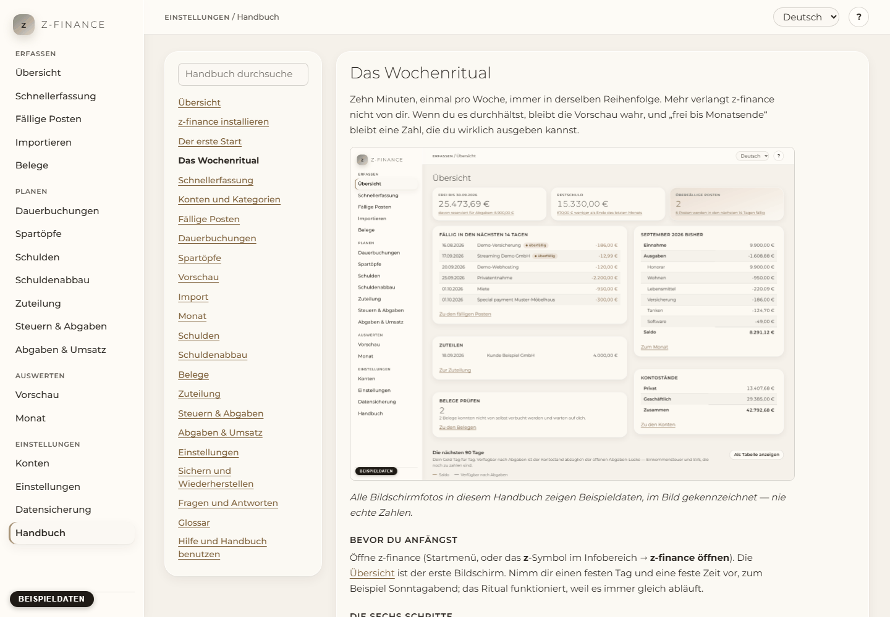

# Hilfe und Handbuch benutzen

Jeder Bildschirm erklärt sich selbst, an denselben zwei Stellen: im Hilfe-Bereich während der
Arbeit und in diesem Handbuch, wenn du das große Bild willst.

## Hilfe zum aktuellen Bildschirm

Klicke oben rechts auf die **?**-Schaltfläche. Ein Bereich öffnet sich mit dem Kapitel zu dem
Bildschirm, auf dem du bist. Er geht mit: Öffnest du einen anderen Bildschirm, zeigt er dessen
Kapitel. Schließe ihn mit **Schließen** oder der Escape-Taste. **Im Handbuch öffnen** zeigt dasselbe
Kapitel im vollständigen Handbuch.

Du findest diesen Bildschirm in der Seitenleiste unter **Einstellungen**.

## Das Handbuch

**Handbuch** in der Navigation öffnet dieses Handbuch. Die Liste links enthält alle Kapitel; klicke
eines an, um es zu lesen. Links in einem Kapitel führen zu anderen Kapiteln.

## Suche

Tippe in das Suchfeld über der Kapitelliste. Die Liste zeigt dann jedes Kapitel, das alle
eingegebenen Wörter enthält, mit der Stelle, an der sie vorkommen. Groß- und Kleinschreibung und
Akzente spielen keine Rolle: „Konten“ findet „konten“, „ubersicht“ findet „Übersicht“. Leere das
Feld, um wieder alle Kapitel zu sehen.

## Sprache

Hilfe und Handbuch verwenden die unter **Einstellungen** gewählte Sprache. Ein Sprachwechsel
wechselt sofort das Kapitel, das du liest, die Kapitelliste und die Suche.

Das Handbuch gibt es mit demselben Inhalt auch als Webseite, zum Lesen ohne laufendes z-finance.
