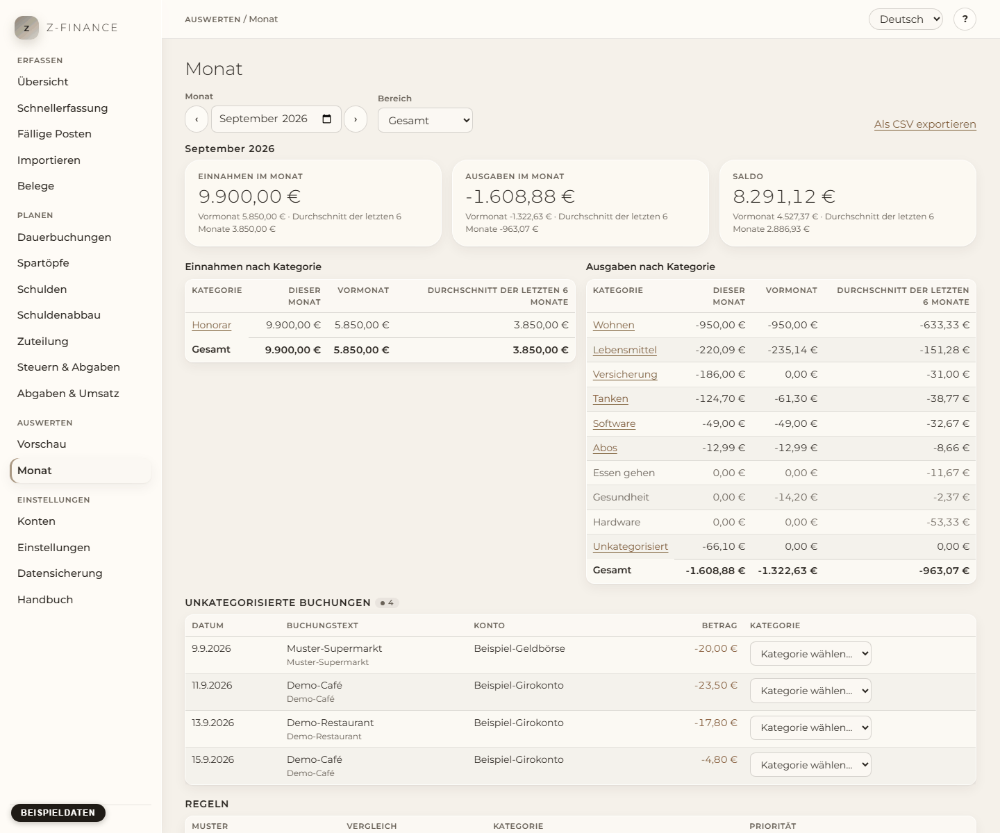

# Monat

## Was du siehst

**Monat** beantwortet die Frage „Wohin ist das Geld gegangen?“ für einen Monat. Wähle den
**Monat** (mit den Pfeilen gehst du einen Monat zurück oder vor) und den **Bereich**:
**Privat**, **Geschäftlich** oder **Gesamt** (beides zusammen). Es zählen nur Buchungen, die
wirklich stattgefunden haben; geplante Posten zählen nie.

Oben stehen drei Zahlen: **Einnahmen im Monat**, **Ausgaben im Monat** und der **Saldo**
(Einnahmen minus Ausgaben). Darunter siehst du jeweils dieselbe Zahl für den **Vormonat** und den
**Durchschnitt der letzten 6 Monate** vor dem gewählten Monat. Weiter unten listen zwei Tabellen
Einnahmen und Ausgaben nach Kategorie, jeweils mit denselben drei Spalten: dieser Monat, Vormonat,
Durchschnitt der letzten 6 Monate.

Der Durchschnitt teilt immer durch 6, auch wenn du z-finance erst seit Kurzem nutzt; in den ersten
Monaten wirkt er deshalb niedrig. Eine Kategorie, die in früheren Monaten Buchungen hatte, in
diesem aber keine, steht trotzdem in der Liste (grau, 0,00 in diesem Monat) — so siehst du, was
fehlt.

Wechselst du den Monat oder den **Bereich**, verschwinden die Zahlen, und **Lade…** steht da, bis
die neuen angekommen sind. So siehst du nie die Zahlen eines Monats unter dem Namen eines anderen.
Lässt sich der neue Monat nicht laden, siehst du statt der Zahlen die Fehlermeldung.

Du findest diesen Bildschirm in der Seitenleiste unter **Auswerten**.

## Privat und geschäftlich getrennt

**Privat** zeigt nur Buchungen auf deinen privaten Konten, **Geschäftlich** nur Buchungen auf
deinen Geschäftskonten, **Gesamt** beides. Zu welcher Seite eine Buchung gehört, bestimmt ihr Konto
(siehe [Konten](accounts.md)).

## Privatentnahme und Privateinlage

Geld, das du zwischen einem Geschäfts- und einem Privatkonto verschiebst (Privatentnahme,
Privateinlage), ist eine **Umbuchung**, weder Einnahme noch Ausgabe. Sie taucht nie in den Tabellen
auf und ändert den Saldo nicht. In **Gesamt** hebt sie sich vollständig auf. In **Privat** oder
**Geschäftlich** zeigt eine Zeile unter den Zahlen, wie viel vom anderen Bereich hereingekommen
und dorthin hinausgegangen ist — die Bewegung bleibt also sichtbar.

## Die Buchungen hinter einer Kategorie ansehen

Klicke auf den Namen einer Kategorie. Darunter erscheinen die Buchungen dahinter; ihre **Summe**
ist genau der Betrag der Kategorie. **Schließen** blendet sie wieder aus. Eine Kategorie mit einer
Gutschrift steht in beiden Tabellen (eine Gutschrift ist eine Einnahme): Jede Tabelle zeigt ihre
eigenen Buchungen.

## Lücken schließen: unkategorisierte Buchungen

Unter **Unkategorisierte Buchungen** stehen die Buchungen des Monats, die noch keine Kategorie
haben — zum Beispiel Zeilen aus einem Bankimport. Die Zahl neben der Überschrift sagt, wie viele
es sind. Wähle neben einer Buchung eine Kategorie: Sie wird sofort gespeichert und die Buchung
verschwindet aus der Liste. Die Zahlen oben aktualisieren sich.

## Aus einer Buchung eine Regel machen

Nachdem du einer Buchung eine Kategorie gegeben hast, bietet z-finance an: **Aus dieser Buchung
eine Regel machen?** Eine Regel sagt: „Immer wenn der Text _dies_ enthält, nimm _jene_
Kategorie.“ So brauchen die nächsten „Bäckerei“-Zeilen deine Aufmerksamkeit nicht mehr.

1. Prüfe den **Gesuchten Text**; er beginnt mit dem Text der Buchung. Kürze ihn, wenn er mehr
   treffen soll („Bäckerei“ statt „Bäckerei Hauptstraße 12“).
2. z-finance zeigt, wie viele weitere unkategorisierte Buchungen der Text trifft (die gerade
   kategorisierte Buchung zählt nicht mit). Noch wird nichts geändert.
3. Klicke **Regel speichern**. Die Regel wird sofort auf alle unkategorisierten Buchungen
   angewendet, und du siehst, wie viele sie kategorisiert hat. **Jetzt nicht** überspringt die
   Regel; die Buchung behält ihre Kategorie trotzdem.

Gut zu wissen:

- Buchungen, die schon eine Kategorie haben, ändert eine Regel **nie**.
- Groß- und Kleinschreibung spielen keine Rolle (auch nicht bei Umlauten). Die Regel prüft den
  Buchungstext und die Gegenpartei.
- Passen zwei Regeln auf dieselbe Buchung, gewinnt die Regel mit der höheren **Priorität**; bei
  gleicher Priorität die ältere. Die meisten Regeln können Priorität 0 behalten.
- **Gegenpartei** ist optional: Hat eine passende Buchung keine Gegenpartei, wird sie eingetragen.
- Bei **Vergleich** gibt es auch **Regulärer Ausdruck** für Muster wie `^tankstelle \d+$`. Das ist
  für Fortgeschrittene; im Zweifel bleib bei „Text enthält das Muster“.

Der Abschnitt **Regeln** listet alle Regeln in der Reihenfolge, in der z-finance sie prüft.
**Löschen** entfernt eine Regel; Buchungen, die sie kategorisiert hat, behalten ihre Kategorie.
**Regeln auf unkategorisierte Buchungen anwenden** lässt alle Regeln noch einmal laufen, zum
Beispiel nachdem du eine Regel korrigiert hast.

## Regeln, die nicht laufen können

Ein regulärer Ausdruck, der ungültig ist oder viel zu lange zum Auswerten braucht, wird beim
Speichern abgelehnt. Stellt sich eine gespeicherte Regel beim Ausführen als kaputt oder zu langsam
heraus, markiert z-finance sie mit **Ungültiges Muster, übersprungen** oder **Zu langsam,
übersprungen**, überspringt sie und macht mit den anderen Regeln weiter. Die Regel wird nicht
gelöscht: Lösche sie oder lege eine korrigierte an.

## Als CSV exportieren

**Als CSV exportieren** lädt den Monat und Bereich herunter, den du gerade ansiehst, zum Beispiel
für deinen Steuerberater. Die Datei enthält eine Zeile je Kategorie und Richtung (`income` oder
`expense`), danach Summen, Saldo und die Bewegungen. Sie ist für Programme und Tabellenkalkulation
gedacht:

- Beträge haben einen **Dezimalpunkt** (`-12.30`), keinen Tausendertrenner und kein Währungszeichen.
- Die Spalten sind durch Kommas getrennt und die Datei ist UTF-8. Die Kopfzeile ist englisch:
  `month`, `area`, `row_type`, `category_id`, `category`, `parent_category`, `amount`,
  `previous_month`, `average_6_months`, `bookings`.
- Ausgaben sind negativ.
- Ein Text, der mit `=`, `+`, `-` oder `@` beginnt, bekommt ein vorangestelltes `'`, damit eine
  Tabellenkalkulation ihn nie als Formel behandelt.

In deutschem oder österreichischem Excel zeigt ein Doppelklick eventuell alles in einer Spalte. Öffne
die Datei dann über **Daten → Aus Text/CSV** und wähle **UTF-8** und das **Komma** als Trennzeichen.

## Typische Probleme

- **Der Monat ist leer.** Es zählen nur gebuchte Buchungen; prüfe Monat und Bereich und ob die
  Buchungen nicht noch geplant sind (Datum in der Zukunft).
- **Eine Buchung fehlt in der Summe.** Umbuchungen zwischen deinen Konten sind weder Einnahmen noch
  Ausgaben. Siehe „Privatentnahme und Privateinlage“.
- **„Der reguläre Ausdruck ist zu langsam …“** Vereinfache das Muster (weniger verschachtelte
  Wiederholungen wie `(a+)+`) oder nimm „Text enthält das Muster“.
- **„Gib den Monat als JJJJ-MM ein.“** Tippe den Monat wie `2026-08` oder nutze die Pfeile am
  Monatsfeld.

Eine Kategorie muss jeden Monat zugeordnet werden, bis eine Regel das übernimmt — fünf Minuten
jetzt sparen dieselben fünf Minuten im nächsten Monat.
