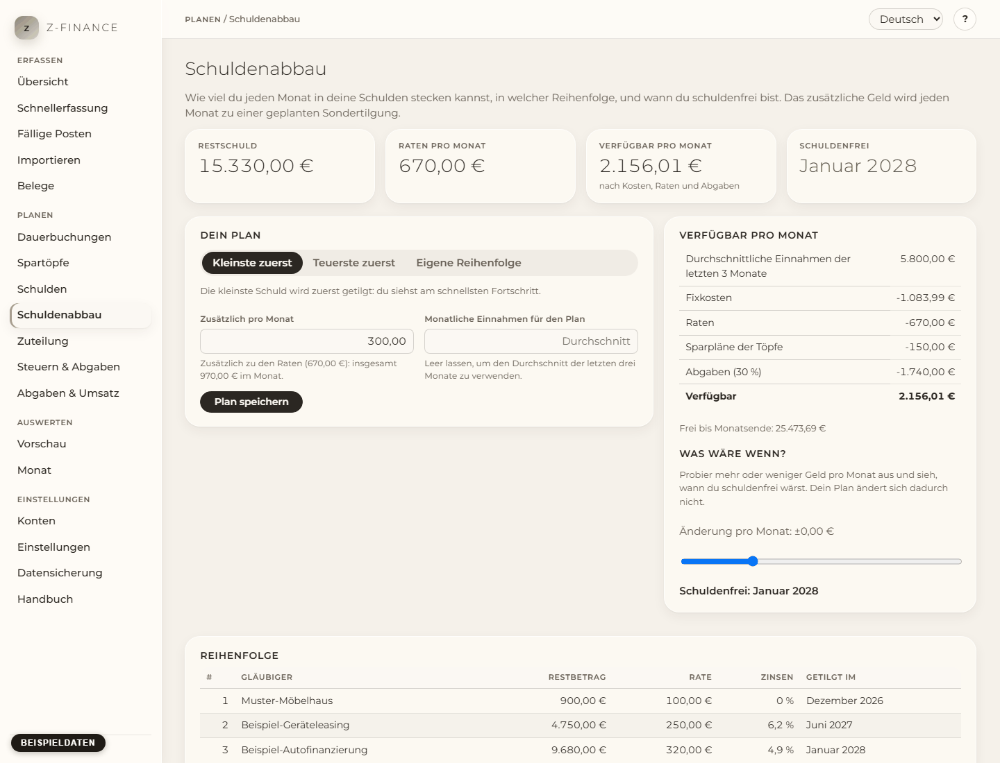

# Schuldenabbau

## Was du siehst

Der **Schuldenabbau** beantwortet vier Fragen: Wie viel kannst du jeden Monat wirklich in deine
Schulden stecken, in welcher Reihenfolge zahlst du sie ab, wann bist du schuldenfrei, und liegst du
im Plan? Du findest die Seite in der Seitenleiste unter **Planen**, direkt unter
[Schulden](debts.md). Erfasse dort zuerst deine Schulden; der Plan verwendet sie so, wie sie sind.

Oben stehen vier Zahlen: was du insgesamt noch schuldest, deine Raten pro Monat, was pro Monat
**verfügbar** ist, und der Monat, in dem du **schuldenfrei** bist.

## Was jeden Monat verfügbar ist

z-finance rechnet aus, was jeden Monat übrig bleibt, nachdem alles bezahlt ist, was bezahlt werden
muss:

- deine **durchschnittlichen Einnahmen der letzten drei vollen Monate**,
- minus deine **Fixkosten** (die Dauerbuchungen für Ausgaben, z. B. Miete),
- minus deine **Raten**,
- minus die **Sparpläne** deiner Töpfe,
- minus die **Abgaben** (Einkommensteuer und Sozialversicherung), die deine betrieblichen Einnahmen
  auslösen, mit dem Satz aus **Steuern & Abgaben**.

Die Abgaben werden bewusst abgezogen: Geld, das du dem Finanzamt schulden wirst, erscheint nie als
Geld, über das du verfügen kannst. Verdienst du in einem Monat 3.000 € mehr und liegt dein Satz bei
30 %, steigt der verfügbare Betrag im Durchschnitt um 700 €, nicht um 1.000 €.

Schwanken deine Einnahmen stark, trag den Betrag, mit dem du planen willst, in **Monatliche
Einnahmen für den Plan** ein. Lässt du das Feld leer, gilt wieder der Durchschnitt.

## Den Plan einrichten

1. Trag bei **Zusätzlich pro Monat** ein, was du _zusätzlich_ zu den Raten in deine Schulden
   steckst. Der Hinweis unter dem Feld zeigt die Summe pro Monat. Ein guter Start ist der
   verfügbare Betrag.
2. Wähle die Reihenfolge:
   - **Kleinste zuerst** — die kleinste Schuld kommt zuerst dran. Du siehst am schnellsten eine
     Schuld verschwinden, das motiviert.
   - **Teuerste zuerst** — die Schuld mit dem höchsten Zinssatz kommt zuerst. Das kostet am
     wenigsten Zinsen. Den Zinssatz trägst du auf der Seite [Schulden](debts.md) ein.
   - **Eigene Reihenfolge** — für eine Schuld, die drängt (eine Mahnung, das Finanzamt). Zieh die
     Schulden in die gewünschte Reihenfolge, oder nimm die Knöpfe **↑** und **↓** (sie gehen auch
     mit der Tastatur: mit Tab zum Knopf, dann Enter).
3. Klick auf **Plan speichern**.

Das zusätzliche Geld geht jeden Monat als **Sondertilgung** auf die erste Schuld der Reihenfolge.
Ist diese Schuld getilgt, wandern ihr Geld und ihre Rate zur nächsten Schuld weiter — die Summe pro
Monat bleibt gleich, und jede Schuld ist schneller weg als die vorige.

Beispiel: Schuld A 2.000 € mit 100 € Rate, Schuld B 4.000 € mit 200 €, 300 € zusätzlich pro Monat
(600 € insgesamt). A bekommt 400 € im Monat und ist nach 5 Monaten getilgt. Danach bekommt B die
ganzen 600 € und ist nach 10 Monaten getilgt. Du bist in 10 Monaten schuldenfrei.

Die Tabelle **Reihenfolge** zeigt jede Schuld mit dem Monat, in dem sie getilgt ist, **Monat für
Monat** zeigt, wohin das Geld jeden Monat geht.

## Sondertilgungen in deiner Planung

z-finance plant jede Sondertilgung als Umbuchung vom Zahlungskonto der Schuld auf die Schuld, für
die nächsten 12 Monate. Sie erscheinen unter [Fällige Posten](due.md) wie die Raten: Bestätige
eine, wenn du sie bezahlt hast. Es wird nichts automatisch bezahlt — z-finance nimmt keinen Kontakt
zu deiner Bank auf.

Ändert sich etwas (eine Schuld ist getilgt, du änderst Reihenfolge oder Betrag), werden die
geplanten Sondertilgungen angepasst. Schon bestätigte oder ausgelassene Sondertilgungen bleiben, wie
sie sind.

## Geplant und bezahlt

Nach dem Speichern merkt sich z-finance den Plan. Jeden Monat vergleicht **Geplant und bezahlt**,
was in deine Schulden hätte fließen sollen, mit dem, was du tatsächlich gezahlt hast (Raten und
Sondertilgungen zusammen).

Lässt du eine Sondertilgung aus, zeigt der Plan **hinter Plan**, sagt dir, wie viel du im nächsten
Monat zusätzlich zahlen müsstest, um im Zeitplan zu bleiben, und der Monat der Schuldenfreiheit
rückt nach hinten — die Zahl oben zeigt dann darunter den ursprünglich geplanten Monat. Speicherst
du den Plan erneut, wird der neue Stand dein Plan.

## Was wäre wenn?

Verschieb den Regler **Was wäre wenn?**, um mehr (oder weniger) Geld pro Monat auszuprobieren. Du
siehst sofort, wann du dann schuldenfrei wärst. Das ist nur eine Rechnung; dein Plan bleibt, wie er
ist, bis du den zusätzlichen Betrag änderst und speicherst.

## Typische Probleme

- **„Kein Plan möglich“**: Deine Fixkosten, Raten und Abgaben sind höher als deine Einnahmen. Die
  Seite zeigt, um wie viel pro Monat. Such in der Ansicht [Monat](month.md) nach Ausgaben, die du
  senken kannst, oder verhandle eine Rate neu und ändere sie auf der Seite [Schulden](debts.md).
- **Warnung: Budget höher als verfügbar**: Der Plan funktioniert trotzdem, aber du zahlst jeden
  Monat mehr, als du verdienst; die Vorschau zeigt, wie deine Reserve aufgebraucht wird.
- **„Deine Einnahmen sind gestiegen“**: Deine durchschnittlichen Einnahmen sind höher als beim
  Speichern des Plans. z-finance schlägt einen höheren Betrag vor, verwendet ihn aber erst, wenn du
  auf **Diesen Betrag verwenden** klickst und speicherst.
- **Eine Schuld bekommt keine Sondertilgung**: Sie hat kein Zahlungskonto. Trag eines auf der Seite
  [Schulden](debts.md) ein.
- **Die Schuldenfreiheit liegt weit weg**: Eine Schuld ohne feste Rate bekommt nur das zusätzliche
  Geld. Ohne zusätzliches Geld wird sie nie getilgt.

Der Plan ist ein gespeicherter Stand, keine laufende Formel: Nach einer ausgelassenen Sondertilgung
oder einer Einkommensänderung öffne die Seite und speichere erneut, um ihn an das anzupassen, was
wirklich passiert ist.
