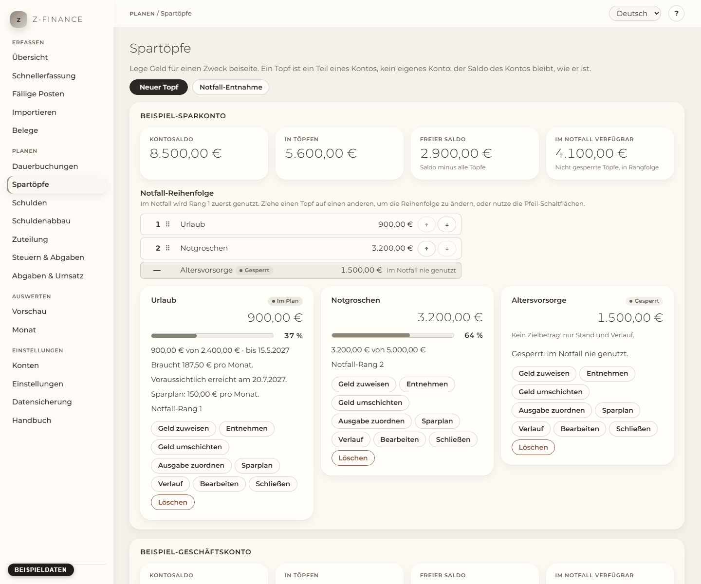

# Spartöpfe

## Was du siehst

**Spartöpfe** beantwortet eine Frage: Wie viel von diesem Konto ist schon verplant? Lege Geld für
einen Zweck beiseite — ein Auto, neue Hardware, einen Urlaub, die Steuer-Rücklage, einen
Notgroschen. Ein Topf ist kein eigenes Konto, sondern ein Teil eines echten Kontos: Der Saldo des
Kontos bleibt genau das, was deine Bank anzeigt, die Töpfe sagen nur, welcher Teil wofür gedacht
ist. Du findest diesen Bildschirm in der Seitenleiste unter **Planen**.

Zu jedem Konto mit Töpfen zeigt die Seite:

- vier Zahlen: den **Kontosaldo**, das Geld **In Töpfen**, den **Freien Saldo** (Kontosaldo minus alle
  Töpfe) und was **Im Notfall verfügbar** ist (die Töpfe, die genutzt werden dürfen, siehe unten);
- die **Notfall-Reihenfolge**: die Töpfe in der Reihenfolge, in der sie im Notfall genutzt werden;
- pro Topf eine Karte mit Stand, Ziel, Fortschritt, Status und den Aktionen.

## Die Karte eines Topfs

- Der **Fortschritt** ist ein Balken mit der Prozentzahl daneben und „500 € von 3.000 € bis 19.7.“.
- **Braucht … pro Monat** ist der Monatsbetrag, der das Ziel zum Zieldatum erreicht: (Ziel − Stand)
  ÷ verbleibende Monate. Bei 3.000 € Ziel, 500 € Stand und zehn Monaten sind das 250 €.
- Der **Status** ist **Im Plan**, **Hinter Plan** oder **Erreicht**. Ein Topf liegt hinter Plan,
  wenn sein Stand unter dem liegt, was ein gleichmäßiges Sparen bis heute erreicht hätte. Dann steht
  dort der neue Monatsbetrag, den du ab jetzt brauchst. Der Status steht immer als Text da, nicht
  nur als Farbe.
- **Voraussichtlich erreicht am** erscheint, wenn ein Sparplan eingerichtet ist.
- **Notfall-Rang 2** oder **Gesperrt** zeigt den Platz des Topfs in der Notfall-Reihenfolge.
- Ohne Zielbetrag zeigt die Karte nur Stand und Verlauf. Ohne Zieldatum gibt es keinen Monatsbetrag.

## Einen Topf anlegen

Klicke auf **Neuer Topf** und fülle aus:

1. **Bezeichnung**, **Konto** (das Konto, auf dem das Geld liegt) und **Bereich** (privat oder
   geschäftlich; vorbelegt mit dem Bereich des Kontos).
2. **Zielbetrag** und **Zieldatum**. Beides ist optional: ein Notgroschen hat kein Datum, offenes
   Sparen kein Ziel.
3. **Ausgabe am Zieldatum einplanen**: Der Zielbetrag erscheint dann als geplante Ausgabe am
   Zieldatum und in der Vorschau. Dafür brauchst du Zielbetrag und Zieldatum.
4. **Notfall-Rang**: der Platz in der Notfall-Reihenfolge (Rang 1 wird zuerst genutzt) oder
   **Gesperrt** für einen Topf, der im Notfall nie genutzt werden darf, etwa Notgroschen oder
   Steuer-Rücklage.
5. **Abgaben-Rücklage-Topf** markiert den Topf, in dem die Rücklage für Steuern und Abgaben liegt.
   Setze die Markierung nur auf einen Topf.

Klicke auf **Speichern**. Das Konto eines Topfs lässt sich später nicht mehr ändern.

## Geld zuweisen

**Geld zuweisen** legt Geld in den Topf. Gib den **Betrag** ein und wähle, woher das Geld kommt:

- **Freier Saldo dieses Kontos** (Voreinstellung): Das Geld liegt schon auf dem Konto. Der Topf
  bekommt höchstens, was frei ist. Gibst du mehr ein, nennt das Feld den freien Betrag und nichts
  ändert sich.
- **Ein anderes Konto**: z-finance bucht eine Umbuchung von diesem Konto auf das Konto des Topfs,
  und das Geld kommt in den Topf.

## Geld entnehmen

**Entnehmen** gibt Geld aus dem Topf an den freien Saldo des Kontos zurück. Der Topf gibt nicht
mehr her, als er enthält. Bei einem **gesperrten** Topf musst du zuerst eine Bestätigung ankreuzen;
die Bewegung steht dann im Verlauf des Topfs als **Notfall**.

## Geld zwischen Töpfen umschichten

**Geld umschichten** verschiebt einen Betrag von diesem Topf in einen anderen Topf **desselben
Kontos**. Es wird nichts gebucht, der Saldo des Kontos bleibt gleich.

## Eine Ausgabe zuordnen

Hast du bezahlt, wofür der Topf gedacht war, erfasst du die Ausgabe wie gewohnt in der
Schnellerfassung. Dann klickst du beim Topf auf **Ausgabe zuordnen** und wählst sie aus der Liste
der letzten Ausgaben des Kontos. Der Topf zahlt sie bis zu seinem Stand; ist die Ausgabe größer,
kommt der Rest aus dem freien Saldo, und z-finance sagt dir, wie sie aufgeteilt wurde. Bei einem
gesperrten Topf brauchst du auch hier die Bestätigung.

## Sparplan

Der **Sparplan** richtet eine monatliche Umbuchung von einem anderen Konto auf das Konto des Topfs
ein. Der Monatsbetrag wird aus dem Plan des Topfs vorgeschlagen, du kannst ihn ändern. Die erste
Überweisung ist im nächsten Monat, der Plan endet am Zieldatum. Die Überweisungen erscheinen wie
jeder Dauerposten als geplante Posten; sobald sie gebucht sind, zählen sie zum Topf. **Sparplan
beenden** stoppt ihn; was schon gebucht ist, bleibt im Topf.

## Verlauf, Bearbeiten, Schließen, Löschen

- **Verlauf** listet jede Bewegung des Topfs: zugewiesen, entnommen, umgeschichtet, Notfall.
- **Bearbeiten** ändert die Angaben des Topfs. Ein geändertes Ziel startet den Plan ab heute neu.
- **Schließen** ist für einen Topf, der seinen Zweck erfüllt hat. Nach einer Rückfrage geht der Rest
  zurück in den freien Saldo, und der Topf wandert unten bei seinem Konto zu **Geschlossene Töpfe**.
- **Löschen** entfernt den Topf mit seinem Verlauf; sein Geld geht zurück in den freien Saldo.

## Notfall-Reihenfolge

Die Liste **Notfall-Reihenfolge** zeigt die nicht gesperrten Töpfe eines Kontos, Rang 1 oben. Im
Notfall wird Rang 1 zuerst geleert, dann Rang 2 und so weiter. Gesperrte Töpfe stehen darunter, sie
werden nie genutzt und lassen sich nicht verschieben.

Um die Reihenfolge zu ändern, **ziehe einen Topf auf einen anderen**: Er nimmt dessen Platz ein.
Ohne Maus nutzt du die Schaltflächen **↑** und **↓** neben jedem Topf. Die Reihenfolge wird sofort
gespeichert, und der nächste Notfall-Vorschlag folgt ihr.

## Notfall-Entnahme

Du brauchst plötzlich Geld, zum Beispiel 500 €. Klicke auf **Notfall-Entnahme**, wähle das Konto,
gib den **Benötigten Betrag** ein und klicke auf **Vorschlag anzeigen**.

- Der Vorschlag nimmt den Betrag aus den Töpfen in Notfall-Reihenfolge: zuerst Rang 1, dann Rang 2.
  Gesperrte Töpfe sind nie dabei.
- Die Tabelle zeigt pro Topf, wie viel entnommen wird, den neuen Stand und, wenn er ein Zieldatum
  hat, das neue Zieldatum: Ein Datum rückt für jeden entnommenen Monatsbetrag um einen Monat nach
  hinten.
- Du kannst die Beträge von Hand ändern, auch bei Töpfen, die der Vorschlag nicht genutzt hat. Neue
  Daten werden beim Bestätigen berechnet.
- Enthalten die nicht gesperrten Töpfe weniger, als du brauchst, sagt der Dialog, wie viel fehlt.

Mit **Entnahme bestätigen** wird das Geld entnommen. Willst du zusätzlich einen gesperrten Topf
nutzen, wähle bei diesem Topf **Entnehmen**; das fragt nach einer Bestätigung.

## Typische Probleme

- **„Nur … € des Kontos sind frei; …“** Du wolltest mehr zuweisen, als auf dem Konto frei ist. Weise
  weniger zu oder zahle von einem anderen Konto ein.
- **„Der Topf … enthält nur … €.“** Du wolltest mehr entnehmen, als der Topf enthält.
- **„Der Topf … ist gesperrt. …“** Kreuze im Dialog die Bestätigung an.
- **„Diese Ausgabe ist bereits einem Topf zugeordnet.“** Jede Ausgabe gehört zu höchstens einem Topf.
- **Der freie Saldo ist negativ.** Vom Konto wurde etwas bezahlt, das kein Topf gedeckt hat. Ordne
  die Ausgabe dem passenden Topf zu oder verkleinere die Töpfe.
- **Ziehen geht auf einem Touchscreen nicht.** Nutze die Schaltflächen ↑ und ↓.

Ein Topf verfolgt immer nur einen Anteil eines echten Kontos — die Bank kennt keine Töpfe, der
Kontosaldo selbst ist also immer die Zahl, die auch dein Kontoauszug zeigt.
