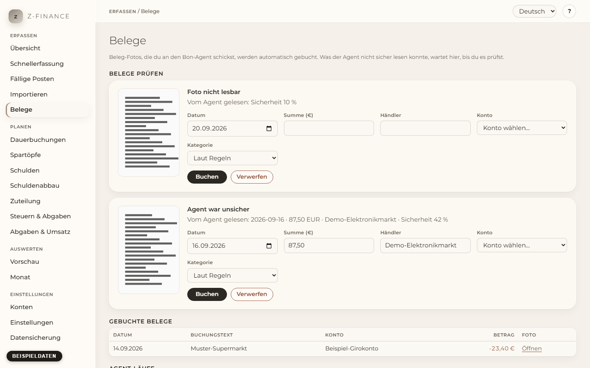

# Belege

## Wie Belege hineinkommen

Du fotografierst einen Kassenbon und schickst ihn an das Postfach des Bon-Agents, auf Wunsch mit
ein paar Worten in der Nachricht. Zu festen Zeiten liest der Agent Datum, Summe und Händler aus
jedem Foto und übergibt Foto und Werte an z-finance. Auf dieser Seite lädst du nichts hoch: Sie
zeigt, was angekommen ist und was dich braucht.

Du findest diesen Bildschirm in der Seitenleiste unter **Erfassen**.

Was z-finance mit einem Beleg macht:

- **Lesbar und sicher** → er wird als Ausgabe gebucht (Summe als Minusbetrag, Datum des Bons,
  Händler als Text) und das Foto hängt an der Buchung.
- **Mit Karte bezahlt und schon in deinen Buchungen** (zum Beispiel aus einem Bank-Import): Eine
  Buchung mit gleichem Betrag bis zu 3 Tage davor oder danach bekommt das Foto; es entsteht keine
  zweite Buchung.
- **Dasselbe Foto noch einmal** → es passiert nichts Neues; der Beleg ist schon erfasst.
- **Unsicher** → der Beleg wartet unter **Belege prüfen** mit Foto und Grund.

## Worte in der Nachricht

Was du zum Foto schreibst, hat Vorrang vor dem, was der Agent vermutet:

- **business** (oder _geschäftlich_) → die Buchung kommt in deinen Business-Bereich; **privat**
  ist der Standard.
- **bar** oder **cash** → sie geht auf dein Bargeld-Konto; **Karte** (oder _card_) → auf dein
  Kartenkonto, oder dein Girokonto, wenn du kein Kartenkonto hast.
- Der **Name einer Kategorie** (zum Beispiel „Lebensmittel“) → diese Kategorie. Ohne
  Kategorie-Wort gilt der Vorschlag des Agents, sonst entscheiden deine [Regeln](month.md).

## Belege prüfen

Jeder Eintrag zeigt das Foto (anklicken für die volle Größe), den Grund und was der Agent gelesen
hat. Gründe:

- **Agent war unsicher** — die Sicherheit des Agents lag unter deiner Schwelle (siehe
  Einstellungen unten).
- **Datum, Summe oder Händler fehlt** — der Agent konnte eines davon nicht lesen.
- **Foto nicht lesbar** — unscharf, dunkel oder gar kein Bon.
- **Fremdwährung** — z-finance bucht nur in Euro; trage den Betrag ein, den du in Euro bezahlt
  hast.
- **Kein Konto für diese Zahlung** — z-finance weiß nicht, welches Konto gemeint ist (siehe
  Einstellungen).
- **Konto nimmt dieses Datum nicht an** — das Konto ist archiviert oder das Datum liegt vor seinem
  Eröffnungsdatum.
- **Mögliches Duplikat** — ein anderer Beleg hat dasselbe Datum, dieselbe Summe und denselben
  Händler. Hast du wirklich zweimal dasselbe gekauft, buche ihn; sonst verwirf ihn.

Zum Korrigieren passt du bei Bedarf **Datum**, **Summe (€)** und **Händler** an, wählst das
**Konto** und auf Wunsch eine **Kategorie** („Laut Regeln“ lässt deine Regeln wählen) und klickst
**Buchen**. Die Buchung erscheint in der [Schnellerfassung](entry.md) und der Eintrag verschwindet
aus der Liste. **Verwerfen** löscht den Beleg samt Foto endgültig.

## Gebuchte Belege und Agent-Läufe

**Gebuchte Belege** listet die letzten Belege mit ihrer Buchung und einem Link zum Foto. Wurde eine
Buchung später gelöscht, steht in der Zeile **Buchung gelöscht**; das Foto bleibt.

**Agent-Läufe** zeigt, wann der Agent gelaufen ist und wie viele Belege je Lauf gebucht wurden, zur
Prüfung warten oder Duplikate waren. Ein Lauf mit **nicht beendet** hat früh aufgehört; der nächste
Lauf holt die verpassten Nachrichten nach.

## Einstellungen

- **Belege prüfen, die mit weniger gelesen wurden als (%)**: Belege, die der Agent mit weniger
  Sicherheit gelesen hat, kommen auf die Prüfliste. Standard ist 80.
- **Barzahlungen, privat** (ebenso für Kartenzahlungen und für Business): das Konto für jeden Fall. **Automatisch**
  nimmt dein einziges Bargeld-Konto (bar) bzw. dein einziges Kartenkonto, sonst dein einziges
  Girokonto (Karte). Hast du mehrere von einer Art, wähle hier eines, sonst warten solche Belege
  unter **Belege prüfen**.

## Typische Probleme

- **Ein Beleg fehlt.** Schau unter **Agent-Läufe**: Ist der letzte Lauf älter als erwartet, ist
  der Agent nicht gelaufen. Die Belege einer Nachricht werden erst verarbeitet, wenn der Agent
  z-finance erreicht.
- **Eine Kartenzahlung ist doppelt gebucht.** Der Beleg kam vor dem Bank-Import; lösche die
  importierte Zeile oder die Buchung des Belegs in der [Schnellerfassung](entry.md).
- **Sicherung:** Die Fotos liegen im Ordner `receipts` deines Datenverzeichnisses und sind Teil der
  [Sicherung](backup.md): lade die `.zip` einer Sicherung herunter, um sie aufzuheben, und stelle
  aus dieser `.zip` wieder her, um sie zurückzubekommen.

Ein lesbarer, sicherer Beleg bucht sich selbst; alles andere wartet unter Belege prüfen auf deine
Entscheidung — der Agent rät nie über diese Grenze hinaus.
