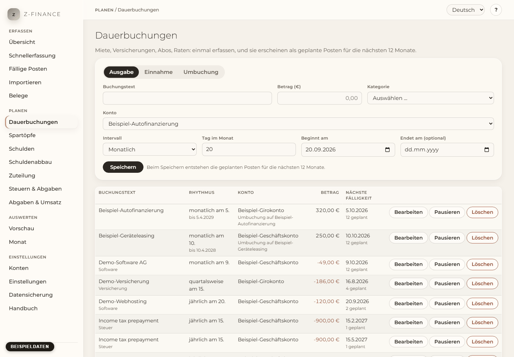

# Dauerbuchungen

## Was du siehst

**Dauerbuchungen** beantwortet eine Frage: Was kommt, und wann? Erfasse Zahlungen, die regelmäßig
wiederkommen — Miete, Versicherungen, Abos, eine Kreditrate, eine monatliche Überweisung aufs
Sparkonto, ein regelmäßiges Einkommen — und Zahlungen, von denen du weißt, dass sie einmal kommen,
etwa eine Steuernachzahlung oder eine Rechnung, deren Bezahlung du erwartest.

Du erfasst jede davon nur einmal. z-finance legt dann **geplante Posten** für die nächsten 12
Monate an. Geplante Posten verändern noch keinen Kontostand; sie zeigen, was kommt. Wenn das Geld
tatsächlich fließt, wird der geplante Posten als Buchung bestätigt oder durch die Zeile aus deinem
Kontoauszug ersetzt (siehe [Fällige Posten](due.md) und [Import](import.md)).

Die Seite hat drei Teile: oben das Formular, darunter die Liste deiner Dauerbuchungen und ganz
unten **Erwartete Einmalposten**. Klicke eine Dauerbuchung in der Liste an, um ihre geplanten
Posten zu sehen. Du findest diesen Bildschirm in der Seitenleiste unter **Planen**.

## Dauerbuchung oder erwarteter Einmalposten?

- Eine **Dauerbuchung** wiederholt sich: jede Woche, jeden Monat, jedes Quartal oder jedes Jahr.
  Beispiel: Miete von 800 € am 1. jedes Monats.
- Ein **erwarteter Einmalposten** passiert einmal an einem bekannten Datum. Beispiel: eine
  Rechnung über 3.000 €, deren Bezahlung du am 20. November erwartest.

## Dauerbuchung anlegen

1. Wähle **Ausgabe**, **Einnahme** oder **Umbuchung**. Eine Umbuchung verschiebt Geld zwischen
   zwei deiner eigenen Konten, zum Beispiel eine Sparrate oder eine Kreditrate auf ein
   Verbindlichkeitskonto.
2. Gib den **Text** ein (zum Beispiel „Miete“), den **Betrag** (immer ohne Vorzeichen) und wähle
   die **Kategorie**.
3. Wähle das **Konto** — bei einer Umbuchung **Vom Konto** und **Auf Konto**.
4. Wähle das **Intervall**: monatlich, quartalsweise, jährlich oder wöchentlich.
5. Bei monatlichen, quartalsweisen und jährlichen Posten gibst du den **Tag im Monat** ein (1 bis
   31). Bei wöchentlichen Posten wählst du den **Wochentag**.
6. **Beginnt am** ist das früheste mögliche Datum. **Endet am** ist optional — lass es leer, wenn
   die Zahlung kein Ende hat.
7. Klicke **Speichern**. Die geplanten Posten der nächsten 12 Monate erscheinen sofort.

Quartalsweise und jährliche Posten wiederholen sich im Monat des Beginndatums: Ein
quartalsweiser Posten mit Beginn im Februar ist im Februar, Mai, August und November fällig.

## Tag 29, 30 oder 31

Nicht jeder Monat hat 31 Tage. Ein Posten am 31. fällt in kürzeren Monaten auf den **letzten Tag**
des Monats: 30. April, 30. Juni und 28. Februar (29. Februar im Schaltjahr). Dasselbe gilt für den 29. und 30.

## Jeder Start füllt die nächsten 12 Monate auf

Bei jedem Start von z-finance werden die fehlenden geplanten Posten bis 12 Monate im Voraus
angelegt. Nichts entsteht doppelt. Du kannst die App also beliebig oft schließen und starten.

Posten, die vor dem Anlegen der Dauerbuchung fällig waren, werden nicht nachträglich angelegt —
erst ab heute.

## Einen einzelnen geplanten Posten verschieben

Manchmal ist eine Zahlung anders: Die Miete wird ein paar Tage später abgebucht, oder ein Monat
kostet mehr. Klicke die Dauerbuchung in der Liste an, dann **Verschieben** neben dem geplanten
Posten. Ändere Datum oder Betrag und klicke **Speichern**. Der Posten ist dann als „geändert“
markiert und bleibt genau so — z-finance überschreibt ihn nie, wenn es die nächsten 12 Monate
auffüllt.

## Wenn sich der Betrag ändert (Mieterhöhung)

Setze **Endet am** der alten Dauerbuchung auf den Tag vor dem neuen Betrag und lege eine neue
Dauerbuchung mit dem neuen Betrag ab diesem Datum an. Bereits gebuchte Posten bleiben, wie sie
sind.

Wenn du nur einen Tippfehler korrigierst, klicke **Bearbeiten**, ändere die Werte und klicke
**Änderungen speichern**. Die geplanten Posten ab heute übernehmen die neuen Werte; von Hand
verschobene und bereits gebuchte Posten bleiben unverändert.

## Pausieren, fortsetzen, löschen

- **Pausieren** entfernt alle geplanten Posten der Dauerbuchung. Bereits gebuchte Posten bleiben.
  Solange sie pausiert ist, entstehen keine neuen geplanten Posten.
- **Fortsetzen** legt die geplanten Posten der nächsten 12 Monate wieder an.
- **Löschen** entfernt die Dauerbuchung und ihre geplanten Posten. Gebuchte Posten bleiben als
  normale Buchungen erhalten. Die Einkommensteuer- und SVS-Posten des Steuerplans lassen sich hier
  nicht löschen; ändere oder leere sie unter [Steuern & Abgaben](tax.md).

## Erwartete Einmalposten

Wähle ganz unten auf der Seite **Ausgabe** oder **Einnahme**, ein **Datum nach heute**, gib den
**Betrag** ein, wähle **Konto** und **Kategorie**, ergänze einen **Text** und klicke **Erwarteten
Posten hinzufügen**. Der Posten erscheint in der Liste darunter. **Löschen** entfernt ihn wieder.

Für eine Zahlung, die schon passiert ist, nimm stattdessen die [Schnellerfassung](entry.md).

## Typische Probleme

- **„Wähle einen Tag im Monat zwischen 1 und 31.“** Der Tag ist leer oder liegt außerhalb von 1
  bis 31.
- **„Das Enddatum darf nicht vor dem Beginn liegen.“** Korrigiere eines der beiden Daten.
- **„Das Konto … ist archiviert.“** Archivierte Konten bekommen keine geplanten Posten; wähle ein
  anderes Konto (siehe [Konten](accounts.md)).
- **„Ein erwarteter Posten braucht ein Datum nach heute.“** Für heute oder früher erfasst du eine
  Buchung in der [Schnellerfassung](entry.md).
- **Ein gelöschter geplanter Posten steht als übersprungen da.** Löschst du einen geplanten Posten
  einer Reihe in der Buchungsliste, überspringt z-finance diesen einen Termin. Die Reihe läuft
  weiter. Der Termin kommt nicht wieder. Um die Reihe zu beenden, pausiere oder lösche sie hier.
- **„Diese Dauerbuchung gehört zum Steuerplan. …“** Ihre Zahlungen zählen als
  Steuer-Vorauszahlungen. Ändere oder leere den Betrag unter [Steuern & Abgaben](tax.md).

Was eine Dauerbuchung auch plant, sie wird erst zur echten Buchung, wenn du sie bei Fällige Posten
bestätigst oder ein Import sie einer Kontoauszugszeile zuordnet — hier allein ändert sich kein
Kontostand.
