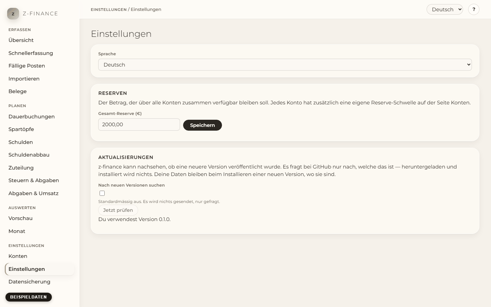

# Einstellungen

## Was du siehst

**Einstellungen** beantwortet eine Frage: Wie passt sich z-finance an dich an? Die **Sprache** der
Oberfläche, die **Gesamt-Reserve** über alle Konten und der Hinweis auf neue **Versionen**.

Du findest diesen Bildschirm in der Seitenleiste unter **Einstellungen**.

## Sprache ändern

1. Öffne **Einstellungen** in der Navigation.
2. Wähle unter **Sprache** **English** oder **Deutsch**.

Die ganze Oberfläche wechselt sofort, auch diese Hilfe und das Handbuch. z-finance merkt sich die
Wahl, auch nach einem Neustart und in einem anderen Browser auf demselben Computer.

## Gesamt-Reserve einstellen

Die Gesamt-Reserve ist der Betrag, der über alle deine Konten zusammen verfügbar bleiben soll —
ein Sicherheitspolster zusätzlich zur Reserve-Schwelle jedes einzelnen Kontos (siehe
[Konten](accounts.md)).

1. Öffne **Einstellungen** in der Navigation.
2. Trage unter **Reserven** den Betrag ein, z. B. `3000` oder `3000,00`, und klicke **Speichern**.

Die Seite bestätigt den gespeicherten Betrag. Trage `0` ein, wenn du keine Gesamt-Reserve willst.
Die [Vorschau](forecast.md) markiert die Tage, an denen deine Konten zusammen darunter fallen.

## Nach neuen Versionen suchen

z-finance baut von sich aus keine Verbindung ins Internet auf. Wenn du willst, dass es dich auf
neue Versionen hinweist, musst du das einschalten:

1. Öffne **Einstellungen** in der Navigation.
2. Setze unter **Aktualisierungen** das Häkchen bei **Nach neuen Versionen suchen**.
3. Klicke **Jetzt prüfen**.

z-finance fragt dann bei GitHub nach, welche Version die neueste ist, und zeigt sie an —
**heruntergeladen und installiert wird nichts**. Gibt es eine neuere, führt ein Link auf die
Download-Seite; installiere sie wie beim ersten Mal, deine Daten bleiben erhalten (siehe
[z-finance installieren](install.md)). Das Häkchen wieder zu entfernen vergisst auch das Ergebnis
der letzten Prüfung.

## Typische Probleme

- **„Die Sprache konnte nicht auf dem Server gespeichert werden.“** Die Sprache gilt in diesem
  Browser, aber z-finance konnte sie nicht speichern. Prüfe, ob z-finance noch läuft (die Zeile
  unten auf der Seite meldet sonst „Backend nicht erreichbar“), und wähle die Sprache erneut.
- **Manche Texte bleiben englisch.** Ein Text, der noch keine Übersetzung hat, erscheint auf
  Englisch.
- **„z-finance konnte GitHub nicht erreichen.“** Die Versionsprüfung braucht eine
  Internetverbindung. Ohne sie funktioniert z-finance unverändert weiter — nur dieser Hinweis
  bleibt aus.

Diese drei Einstellungen sind die einzigen globalen in z-finance — alles andere zu einem Bildschirm
lebt in dessen eigenem Kapitel und wird dort erklärt.
