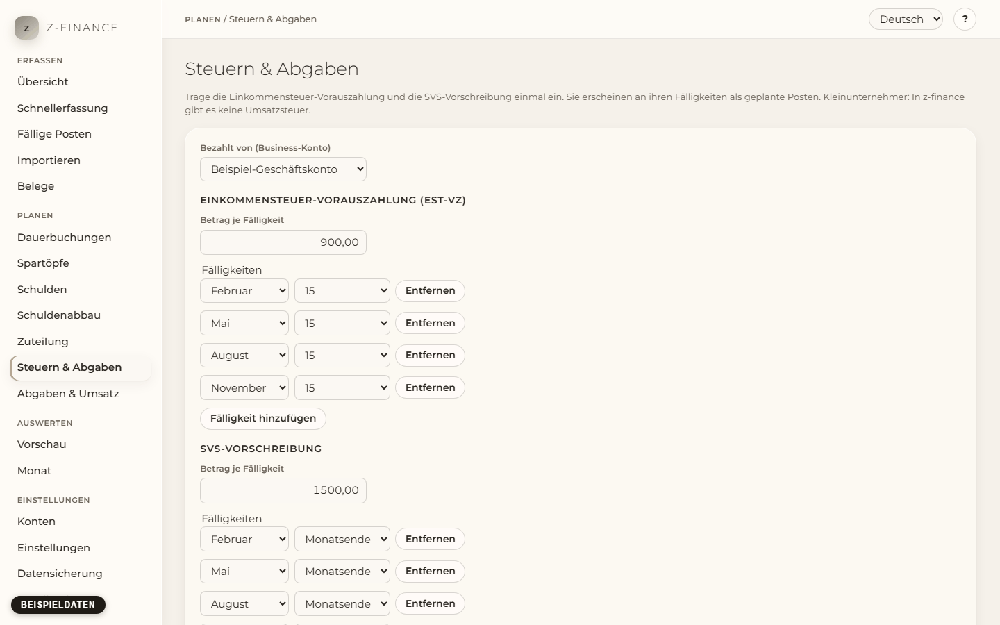

# Steuern & Abgaben

## Was du siehst

**Steuern & Abgaben** beantwortet eine Frage: Ist das Geld fürs Finanzamt noch da, wenn es fällig
wird? Trage einmal die zwei großen Zahlungen ein, die nur wenige Male im Jahr anfallen und leicht
vergessen werden: die **Einkommensteuer-Vorauszahlung** (ESt-VZ) und die **SVS-Vorschreibung**.
Nach dem Speichern erscheinen beide an ihren Fälligkeitsterminen als geplante Posten — in der
Vorschau und in der Liste „Fällig“. So siehst du sie kommen und lässt das Geld auf dem Konto.

z-finance geht von einem Kleinunternehmer ohne Umsatzsteuer aus: Im ganzen Programm gibt es kein
USt-Feld und keine USt-Berechnung.

Die Seite hat drei Teile: das Formular, einen Hinweis, solange noch nichts eingetragen ist, und den
**Planung** — eine Zeile je Fälligkeitstermin mit dem nächsten geplanten Posten.

Du findest diesen Bildschirm in der Seitenleiste unter **Planen**.

## Vorauszahlungen eintragen

1. Wähle unter **Bezahlt von (Business-Konto)** das Konto, von dem die Zahlungen abgehen (normalerweise
   dein Business-Konto).
2. Trage unter **Einkommensteuer-Vorauszahlung (ESt-VZ)** den **Betrag je Fälligkeit** ein, zum
   Beispiel 1500 für 1.500 € je Quartal. Lass das Feld leer, wenn du den Betrag noch nicht kennst.
3. Mach dasselbe unter **SVS-Vorschreibung**.
4. Prüfe die **Fälligkeiten**. Sie sind mit den üblichen Terminen vorbelegt: Einkommensteuer am 15. Februar, 15. Mai, 15. August und 15. November; SVS jeweils zum Monatsende von Februar, Mai,
   August und November.
5. Klicke auf **Speichern**.

Beispiel: Bei 1.500 € Einkommensteuer-Vorauszahlung entstehen für die nächsten 12 Monate genau vier
geplante Posten über −1.500 €, je einer an den vier Terminen. Fällt ein Termin auf ein Wochenende
oder einen Feiertag, bleibt der Posten auf diesem Datum — die Zahlung muss ja vorher raus.

## Fälligkeiten

Jede Fälligkeit besteht aus Monat und Tag. Mit **Monatsende** meinst du „den letzten Tag des
Monats“: Das ist im Februar der 28. (bzw. 29.), in den anderen Monaten der 30. oder 31. Mit
**Fälligkeit hinzufügen** und **Entfernen** passt du die Liste an, wenn dein Bescheid andere Termine
nennt. Du kannst bis zu 12 Termine je Zahlung eintragen, jeden nur einmal.

## Neuer Bescheid: Betrag ändern

Schickt das Finanzamt oder die SVS einen neuen Vorauszahlungsbetrag, trage den neuen **Betrag je
Fälligkeit** ein und klicke auf **Speichern**.

- Der neue Betrag gilt ab dem **nächsten offenen Termin**. Geplante Posten ab diesem Termin ändern
  sich auf den neuen Betrag.
- Quartale, die du **schon bestätigt** hast, behalten den gezahlten Betrag — ebenso Quartale, die
  schon fällig, aber noch nicht bestätigt sind. Ändert ein Bescheid rückwirkend, erfasst du die
  Differenz als Nachzahlung oder Gutschrift (siehe unten).
- Ein Quartal, das du ein paar Tage vor dem Termin bezahlt hast, gilt als bestätigt.

Hast du einen zukünftigen geplanten Posten auf der Seite [Dauerbuchungen](recurring.md) von Hand
verschoben, setzt die Betragsänderung ihn wieder auf den Fälligkeitstermin zurück.

## Nachzahlungen

Eine Nachzahlung nach einem Bescheid ist ein einmaliger Betrag mit Datum. Erfasse sie auf der Seite
[Dauerbuchungen](recurring.md) unter **Erwartete Einmalposten**, mit der Kategorie **Steuer** (oder
**SVS**). Sie erscheint dann wie jeder andere geplante Posten in der Vorschau und in der Liste
„Fällig“. Als Vorauszahlung zählt sie nicht.

## Noch nichts eingetragen

Solange beide Betragsfelder leer sind, wird nichts geplant und die Seite zeigt **Steuern & Abgaben
sind noch nicht hinterlegt**. Trage die Beträge ein, sobald du sie kennst. Leerst du einen Betrag
später wieder, verschwinden seine geplanten Posten; bestätigte Zahlungen bleiben.

## Gut zu wissen

- Die geplanten Posten verwenden die Kategorien **Steuer** und **SVS**. Gibt es sie noch nicht,
  legt z-finance sie an.
- Die Beträge, die du hier einträgst, sind die Quelle: Änderst du eine dieser geplanten Reihen auf
  der Seite Dauerbuchungen, stellt das nächste **Speichern** hier sie wieder her. Dort kannst du
  eine solche Reihe nicht löschen. So zählen deine schon gebuchten Zahlungen als Vorauszahlungen.
- Als Vorauszahlungen des Jahres (für die spätere Abgaben-Planung) zählen nur Zahlungen, die hier
  eingeplant waren. Eine Zahlung, die du als gewöhnliche Buchung erfasst, zählt nicht.

Halte die Beträge hier mit dem tatsächlichen Bescheid in Deckung: Nur aus diesem Plan gebuchte
Zahlungen zählen als Vorauszahlung des Jahres für die Abgaben-Rücklage — eine gewöhnliche Buchung
oder ein nur geplanter Betrag nicht.
