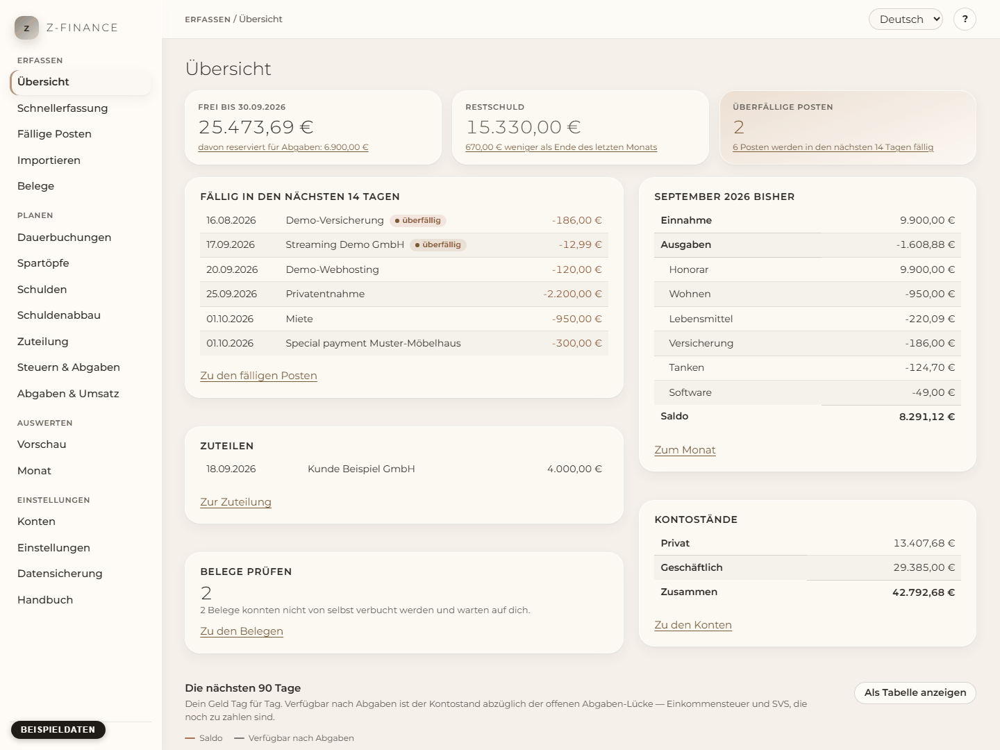

# Das Wochenritual

Zehn Minuten, einmal pro Woche, immer in derselben Reihenfolge. Mehr verlangt z-finance nicht von
dir. Wenn du es durchhältst, bleibt die Vorschau wahr, und „frei bis Monatsende“ bleibt eine Zahl,
die du wirklich ausgeben kannst.

_Alle Bildschirmfotos in diesem Handbuch zeigen Beispieldaten, im Bild gekennzeichnet — nie echte
Zahlen._

## Bevor du anfängst

Öffne z-finance (Startmenü, oder das **z**-Symbol im Infobereich → **z-finance öffnen**). Die
[Übersicht](index.md) ist der erste Bildschirm. Nimm dir einen festen Tag und eine feste Zeit vor,
zum Beispiel Sonntagabend; das Ritual funktioniert, weil es immer gleich abläuft.

## Die sechs Schritte

1. **Die drei Zahlen ganz oben anschauen.** Ist _frei bis Monatsende_ so, wie du es erwartet hast?
   Sinkt die Restschuld? Ist etwas überfällig? Noch nichts zu entscheiden — du siehst nur, wo du
   stehst. Was die Zahlen bedeuten: [Übersicht](index.md).
2. **Bestätigen, was passiert ist.** Öffne [Fällige Posten](due.md). Bestätige jeden geplanten
   Posten, der stattgefunden hat (ändere Betrag oder Datum in der Zeile, wenn die Bank anders
   gebucht hat), verschiebe, was sich verspätet, überspringe, was nicht kommt. Danach stimmt die
   Vorschau wieder mit der Wirklichkeit überein.
3. **Fehlendes einspielen.** Lade den Kontoauszug aus deinem Online-Banking und spiele ihn mit
   [Import](import.md) ein; Bargeld und Sonstiges trägst du mit der [Schnellerfassung](entry.md)
   ein (Alt+N auf jedem Bildschirm).
4. **Über neue Eingänge entscheiden.** Steht auf der Karte **Zuteilen** etwas, öffne
   [Zuteilung](allocation.md) und bestätige oder verwirf jeden Vorschlag. Ein Vorschlag, der sieben
   Tage oder länger wartet, wird hervorgehoben; z-finance bucht ihn nie von selbst.
5. **Belege prüfen.** Zeigt **Belege prüfen** eine Zahl, öffne [Belege](receipts.md) und korrigiere
   oder verwirf, was der Bon-Agent nicht lesen konnte. Ohne Agent entfällt dieser Schritt.
6. **Einen Blick auf die Kurve.** Die nächsten 90 Tage unten auf der Übersicht. Sackt die Linie
   unter deine Reserve, öffne die [Vorschau](forecast.md) und sieh nach, wann und warum.

Fertig bist du, wenn die Übersicht keine überfälligen Posten zeigt und unter **Zuteilen** und
**Belege prüfen** nichts wartet.

## Einmal im Monat

- Schau dir den gerade beendeten Monat unter [Monat](month.md) an und gib den Buchungen ohne
  Kategorie eine Kategorie — mit einer Regel machst du es nicht zweimal.
- Prüfe in der 12-Monats-[Vorschau](forecast.md) den tiefsten Punkt und den ersten Tag unter der
  Reserve.
- Kopiere ein Backup an einen Ort außerhalb dieses Computers (siehe
  [Sichern und Wiederherstellen](backup.md)).

## Einmal im Jahr

- Ein neuer Bescheid kommt: Trage die neue Vorauszahlung unter [Steuern & Abgaben](tax.md) ein; sie
  gilt ab dem nächsten offenen Fälligkeitstermin.
- Liegt der Bescheid für ein Jahr vor, markiere ihn unter [Abgaben & Umsatz](levy.md) mit
  **Bescheid liegt vor**, damit die erwartete Nachzahlung dieses Jahres abgeschlossen ist.
- Wirf einen Blick auf den [Schuldenabbau](payoff.md): Passt das Budget noch zu dem, was du dir
  leisten kannst?

## Wenn du eine Woche auslässt

Nichts geht kaputt. Geplante Posten bleiben geplant und erscheinen als überfällig; die Vorschau
rechnet sie ab heute mit. Posten, die mehr als 30 Tage überfällig sind, sind in Worten und mit einem
Rand markiert, damit du sie nicht übersiehst. Mach das Ritual, sobald du Zeit hast — beginne mit
Schritt 2, er repariert am meisten.
