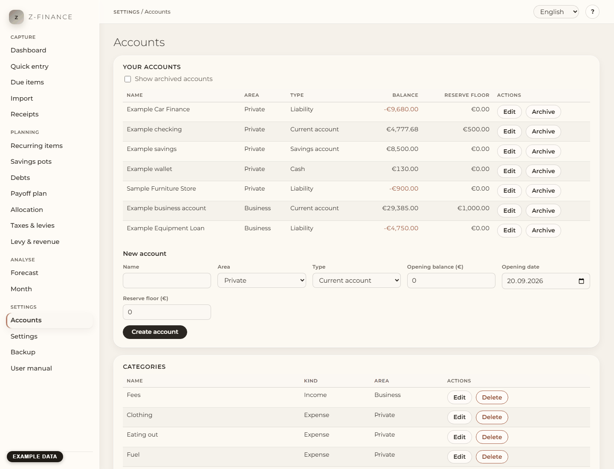

# Accounts and categories

## What you see

The **Accounts** page lists your accounts with their current balance and holds your categories.
Set both up before you record your first payment: every booking belongs to one account and one
category.

You find this screen in the sidebar under **Settings**.

## What is an account?

An account answers one question: where is this money? Create one in z-finance for every real one
you have — a current account at the bank, a savings account, the cash in your wallet, a credit
card, or a debt you pay off (a liability).

Each account has:

- **Name** — how you recognise it, for example "Current account private". Each name exists only
  once.
- **Area** — **Private** or **Business**. z-finance keeps both apart in the evaluations, so your
  tax adviser gets a clean separation.
- **Type** — current account, savings account, cash, credit card or liability. A credit card is
  an account of its own; its monthly settlement is a transfer from the current account.
- **Opening balance** and **opening date** — the balance on the day you start recording in
  z-finance. Take it from your bank statement for that day. A credit card or a debt usually starts
  negative (for example `-450.50`). z-finance refuses bookings dated before the opening date.
- **Reserve floor** — the amount that should always stay on this account. The [Forecast](forecast.md)
  warns you before the balance falls below it. Enter `0` if you do
  not need one.

The balance shown in the list is the opening balance plus all booked payments up to today.

## Create or change an account

1. Open **Accounts** in the navigation.
2. Fill in the form **New account** below the list and click **Create account**. Amounts are
   written like `1250.00` or `1250,00`; do not type thousands separators.
3. To change an account, click **Edit** in its row, change the fields and click **Save changes**.

## Archive instead of delete

When you close a real account, click **Archive**. The account disappears from the lists you book
into, but its bookings stay in all evaluations. Tick **Show archived accounts** to see it again;
**Unarchive** makes it active again. **Delete** is only offered for an account without any
bookings. z-finance also refuses to delete an account that other data still uses. Archive such an
account instead.

## Categories

Categories describe what money was for. Each category has a **kind** — **Income**, **Expense** or
**Transfer** (money moving between your own accounts, for example from business to private) — and
optionally an **area** and a **parent category**. There is one level of subcategories: "Car" can
contain "Fuel", but "Fuel" cannot contain anything. A subcategory has the same kind as its parent.

When you delete a category that already has bookings, z-finance asks for another category and
moves the bookings there first. A category with subcategories can only be deleted once its
subcategories are moved or deleted.

## The default categories

The first time you open this page, z-finance suggests a set of categories for private and business
use in the language you have chosen. Rename, change or remove any of them and add your own, then
click **Adopt categories** — or **Skip** to start with an empty list. The suggestion appears only
once, and only while you have no categories. The adopted categories are your own from then on;
switching the language later does not rename them.

If you want to restore a backup into a fresh z-finance, do it before adopting the default
categories: a restore only works into an empty z-finance (see [Backup](backup.md)).

## Typical problems

- **"An account named … already exists."** Every account needs a different name.
- **"Bookings before the opening date … are not possible."** The booking is older than the
  account's opening date. Move the opening date back and adjust the opening balance to that day.
- **"The opening date cannot be later than the first booking."** There are bookings before the
  new opening date; keep the date on or before the first booking.
- **"This account has … bookings and cannot be deleted."** Archive it instead.
- **A similar message names pots, debts or other data.** The account is still in use. Remove
  that data first, or archive the account.
- **The total reserve across all accounts** is set on the [Settings](settings.md) page.

Get the accounts and their reserve floors right once — the forecast and the dashboard read
balances and reserve floors straight from here; the total reserve across all accounts is a
separate setting, under Settings.
