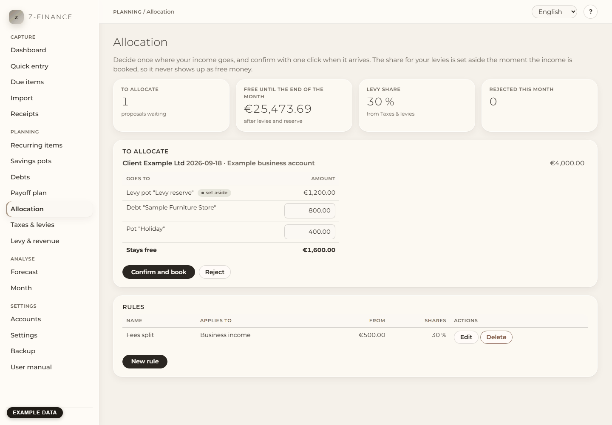

# Allocation

## What you see

**Allocation** decides in advance where your money goes, so you do not have to decide it in the
moment an invoice is paid. You find the page in the sidebar under **Planning**.

You set up a rule once: "from every business income of 500 € or more, 20 % go to my debts and 5 %
into my emergency fund". From then on, every income that fits the rule gets a **proposal** at the
top of this page. You look at it, change single amounts if you want, and confirm. z-finance then
books the transfers between your accounts.

Four figures are at the top: how many proposals are waiting, how much is **free until the end of
the month**, the **levy share** from **Taxes & levies**, and how many proposals you rejected this
month.

## The levy share is already set aside

Every business income triggers income tax and social insurance that you will pay next summer. That
share is not a suggestion — it is money that is already gone. z-finance treats it that way from the
moment the income is booked:

An income of 4,000 € at a levy rate of 30 % raises "free until the end of the month" by 2,800 €,
not by 4,000 €. The 1,200 € for the levies are out straight away, before you confirm anything. That
is why the levy line of a proposal has no input field: you can see it, but you cannot lower it. The
click only confirms that you really moved the money — it does not decide the amount.

The other lines are yours. With the example rule, the proposal for 4,000 € looks like this:

| Goes to                | Amount  |
| ---------------------- | ------- |
| Levy pot (set aside)   | 1,200 € |
| Debt with the top spot | 800 €   |
| Pot "Emergency fund"   | 200 €   |
| **Stays free**         | 1,800 € |

## What you can do

- **Confirm and book.** z-finance books one transfer per line: from the account the income landed on
  into the pot's account, and to the debt's account for the debt share. Your total money does not
  change — it only moves to where you decided it should be. The [payoff plan](payoff.md) and the
  pots show the new state right away.
- **Change single amounts** before confirming. Every line except the levy share can be lowered or
  raised, as long as the lines together stay within the income.
- **Reject.** The proposal is logged as rejected and counted for the month, and nothing is booked.
  Nothing disappears silently.
- **Add, change or delete a rule.** A rule has a name, the accounts it watches (business, private or
  all), the amount from which it applies, and its shares. Deleting a rule keeps the proposals it
  already made.

Important: z-finance never books an allocation by itself. It cannot move money at your bank, so the
click is your reminder to do the real transfer.

## The debt share

The debt share always goes to the debt that is first in your [payoff plan](payoff.md) — the one the
plan pays next. You do not have to pick a debt in the rule, and you do not have to change the rule
when a debt is paid off.

If you have no open debt left, the share goes where the rule says: into a pot you chose, into the
highest-ranked pot of the account, or it simply stays on the account as part of your total reserve.

## Typical problems

**No proposal appears.** Three things are worth checking: the income has to be **booked** (a planned
item is not enough), it has to reach the rule's minimum amount, and it has to be on an account of
the area the rule watches. A rule also only acts on incomes booked _after_ you created it — it does
not go through your past.

**"Only … is free until the end of the month."** The proposal would take more than you have left
after your reserve and your levies. z-finance shows you the amount that fits and lets you decide;
it never quietly reduces the shares.

**A proposal is highlighted.** It has been waiting for seven days. Nothing was booked — that is the
point of the highlight.

**"Income removed".** You deleted an income after you had confirmed its allocation. The transfers
are still booked, because the money probably really moved. Check it, and undo the transfers in the
[quick entry](entry.md) if it did not.

**No levy share is proposed.** Either no levy rate is set, or no pot is marked as your levy pot.
Both live under [Taxes & levies](tax.md).

Every transfer of a proposal still needs your click — only the levy share is already set aside the
moment the income is booked, before you see anything.
