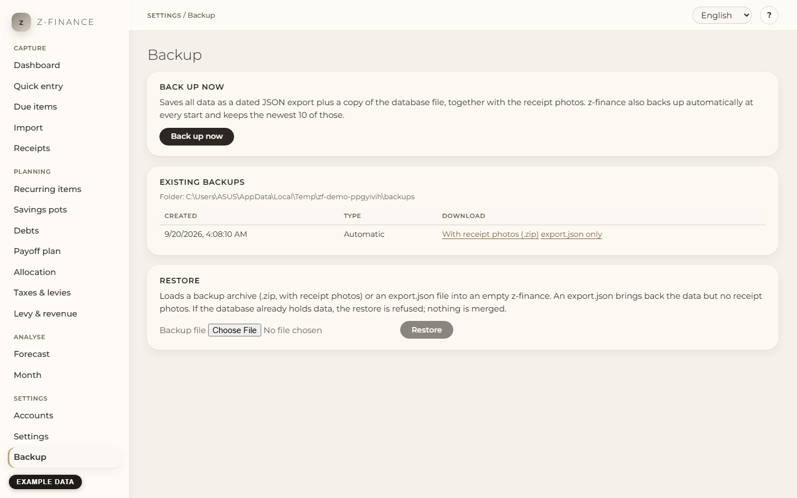

# Backup and restore

## What it is for

Your data lives in one file on your computer. A disk failure or a botched update must not cost
you months of entries, so z-finance saves a copy of everything and can load it back into an empty
z-finance.

You find this screen in the sidebar under **Settings**.

## What a backup contains

- All your data: accounts, bookings, recurring items, rules, debts, receipts and settings.
- The photos of your receipts (the receipt agent's photos), so a restored z-finance shows them again.

Not included: anything that lives outside z-finance's data folder, and the program itself (reinstall
it from the installer).

## Back up now

1. Open **Backup** in the navigation.
2. Click **Back up now**. The page shows the folder the backup was written to.
3. Copy the backup to a place outside this computer (cloud drive, NAS, USB stick): click
   **With receipt photos (.zip)** next to the backup in the list. That one file holds your data
   and all receipt photos. **export.json only** downloads the data without photos.

z-finance also backs up by itself every time it starts and keeps the newest 10 of these automatic
backups. Backups you start yourself are never deleted automatically.

Each backup is a folder named after the date and time. It contains `export.json` (all your data as
text), a copy of the database file and, if you have receipts, a `receipts` folder with the photos.
The photos in that folder share their disk space with the live photos (they are not copied again),
so a backup costs almost no extra space. That protects you from a deleted receipt or a botched
update, **not** from a broken disk: download the `.zip` and keep it somewhere else.

## Restore

1. Start z-finance with an empty database (a fresh installation, or a new data folder).
2. Open **Backup**, choose the `.zip` you saved (or an `export.json`), and click **Restore**.
3. The page reports how many rows and receipt photos were restored. Open the other pages to check
   your balances and the receipts.

An `export.json` restores your data only: the receipts are listed, but their photos are missing.
Use the `.zip` to get the photos back too. A `.zip` that was changed, is damaged or contains
anything other than an `export.json` and receipt photos is refused as a whole; nothing is changed.

A restore only works into an empty database. If z-finance already holds data, the restore is
refused and nothing is changed — z-finance never merges two sets of data. To start over, close
z-finance and delete the database file in your data folder (see the README for its location);
your backups are not affected.

If a restore fails, the page shows the reason. It names the field that z-finance did not accept.
The text for a field comes from the server and is in English. It does not show only a status number.

An export from an older version of z-finance is upgraded while it is loaded. An export from a
newer version than the one you run is refused with the version numbers; update z-finance first.

A backup that only lives on this computer protects you from a botched update, not from a broken
disk — only a `.zip` you move to another disk or machine protects you from both.
