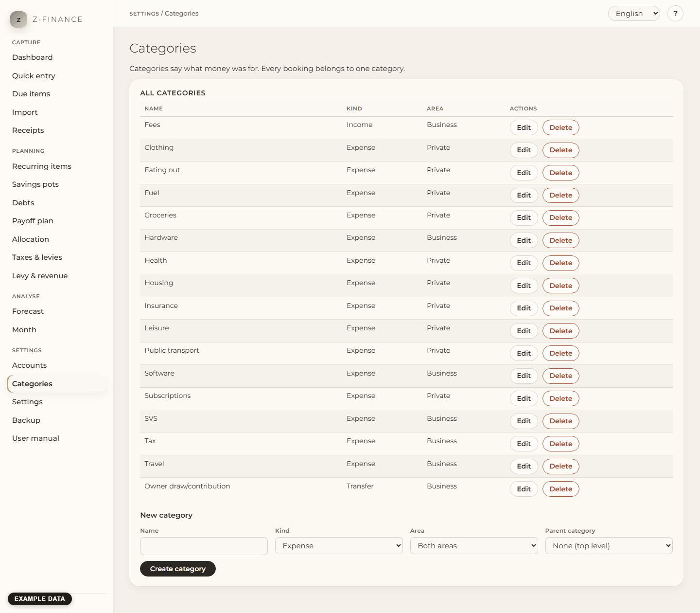

# Categories

## What you see

The **Categories** page lists your income, expense and transfer categories. A category says what
money was for. Each payment belongs to one account and one category, so set up both before you
record your first payment. The accounts are on [Accounts](accounts.md).

You find this screen in the sidebar under **Settings**, directly below **Accounts**.

## What is a category?

Each category has a **kind**: **Income**, **Expense** or **Transfer**. A transfer is money that
moves between your own accounts, for example from business to private. A category can also have
an **area** (**Private** or **Business**) and a **parent category**.

There is one level of subcategories. "Car" can contain "Fuel", but "Fuel" cannot contain more
categories. A subcategory has the same kind as its parent. In the list, a subcategory is below its
parent and indented.

## Create or change a category

1. Open **Categories** in the navigation.
2. Fill in the form **New category** below the list. Choose the kind. Choose an area, or keep
   **Both areas**. Choose a parent category, or keep **None (top level)**.
3. Click **Create category**.
4. To change a category, click **Edit** in its row. Change the fields and click
   **Save changes**.

## Delete a category

Click **Delete** in the row of the category. A category without payments goes after you confirm.

A category can already have payments. Then z-finance asks for another category and moves the
payments there first. Choose it and click **Move and delete**. A category with subcategories goes
only after you move or delete its subcategories.

## The default categories

When you have no categories yet, z-finance suggests a set of categories for private and business
use. The set is in the language of the interface. Rename, change or remove any of them and add your
own. Then click **Adopt categories**, or click **Skip** to start with an empty list.

The suggestion comes only once. The adopted categories are your own from then on; a later change of
the language does not rename them. The first-run assistant shows the same suggestion (see
[The first start](first-run.md)).

Do you want to restore a backup into a new z-finance? Then do it before you adopt the default
categories. A restore works only into an empty z-finance (see [Backup](backup.md)).
