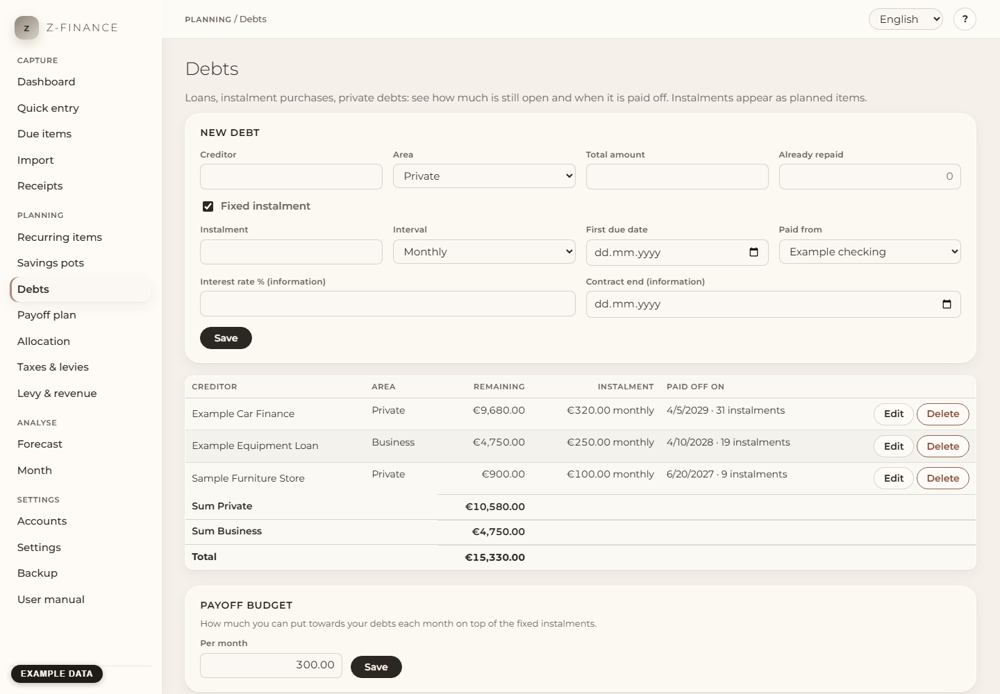

# Debts

## What you see

**Debts** answers one question: what do I still owe, and when is it gone? Track a bank loan, an
instalment purchase, money a friend lent you, a tax back-payment you pay in instalments — for each
one you see at a glance how much is still open, the instalment and when it will be paid off. Below
the list you find the sum of what you still owe — for private and business separately and in
total.

The page has four parts: the form at the top, the list of your debts, the details of the debt you
click, and the **Payoff budget** at the bottom. You find this screen in the sidebar under
**Planning**.

## How it works

Every debt gets its own account of the type **Liability**, named after the creditor. Its balance is
negative: it is exactly the amount you still owe. When you pay an instalment, money moves from your
current account to this liability account — your current account goes down, and so does the debt.
Your total wealth does not change by paying, because you owe less by the same amount.

A fixed instalment becomes a recurring transfer, so the instalments appear as planned items for the
next 12 months, like every other recurring item (see [Recurring items](recurring.md)). You do not
need to enter them a second time.

## Enter a debt

1. Type the **Creditor** (for example "Bank loan" or the name of the shop) and pick the **Area**:
   private or business.
2. Type the **Total amount** of the debt and, if you have already paid part of it back, **Already
   repaid**. The difference is what is still open.
3. If you pay a fixed amount regularly, leave **Fixed instalment** ticked and fill in the
   **Instalment**, the **Interval** (monthly, quarterly or yearly), the **First due date** and the
   account it is **Paid from**. The instalment is due on the same day as the first due date — in
   every month, quarter or year.
4. Optionally note the **Interest rate** and the **Contract end**. Both are for your information
   only; z-finance does not calculate interest.
5. Click **Save**.

Example: a loan of 5,000 €, of which 1,000 € are already repaid, with 250 € on the 1st of every
month from 1 October. 4,000 € are open, that is 16 instalments, so the debt is paid off on 1
January in 16 months. The next 12 instalments appear as planned items.

## A debt without a fixed instalment

For money you pay back "whenever possible", untick **Fixed instalment**. No planned items are
created. You can enter a date in **Paid off by**: z-finance then shows how much you would have to
pay each month to be done by then.

## When an instalment is paid

Confirm the instalment when it is due, or let the bank statement import match it. The remaining
amount and your current account both go down by the instalment. If the bank collected a slightly
different amount, correct the amount when you confirm it.

The last instalment is usually smaller: z-finance plans exactly the rest. With 600 € open and
250 € instalments you see 250 €, 250 € and 100 €.

## Special payment

Click a debt in the list. Under **Special payment**, type the **Amount**, the **Date** (today or
earlier) and the account it comes **From**, then click **Book special payment**. The remaining
amount goes down and the end date moves forward.

If you type more than is still open, z-finance only books the rest and tells you so. The difference
stays on your account.

## Paid off

When nothing is open any more, the debt shows **paid off**. Its remaining planned instalments are
removed — they no longer appear anywhere. The debt stays in the list (greyed out) with its
history.

## Change a debt

Click **Edit** next to a debt, change the values and click **Save changes**.

- **The debt grows** (for example a top-up of the loan): raise the **Total amount**. The difference
  is booked on the liability account with today's date, the history stays, and the end date is
  calculated again.
- **The instalment changes**: change the **Instalment**. Planned instalments from today on follow;
  instalments already paid stay.

Manage the instalments of a debt here, not on the Recurring items page: z-finance keeps the
recurring item in line with the debt and undoes changes made there.

## History

The details of a debt list every booking on its liability account: instalments, special payments
and increases. Planned instalments are marked **planned**.

## Payoff budget

At the bottom of the page you can enter how much you can put towards your debts each month on top
of the fixed instalments. The [Payoff plan](payoff.md) and the [Allocation](allocation.md) rules use it.

## Delete a debt

**Delete** removes the debt and its planned instalments. Payments already booked stay; the
liability account is then archived with its history (see [Accounts](accounts.md)). A debt without
any booking disappears completely.

## Typical problems

- **"An account named … already exists."** Each debt gets an account named after the creditor.
  Use a slightly different name, for example "Bank loan car".
- **"An instalment needs an amount, an interval and a first due date."** Fill in all three, or
  untick **Fixed instalment**.
- **"The amount already repaid must be at least 0 and less than the total."** A debt that is
  already fully repaid does not need to be entered.
- **The button "Book special payment" is grey.** The form needs an active account to pay from, so create one first.
- **"A special payment cannot be dated in the future."** Book it on the day you actually pay.
- **"The total must be more than the amount already repaid."** The total cannot be lowered below
  what you have already paid back.

Once a debt is entered this way, the payoff plan and the allocation rules use it without you
telling them anything a second time.

<!-- ste-waiver: the quoted special-payment error is the literal message of the app -->
