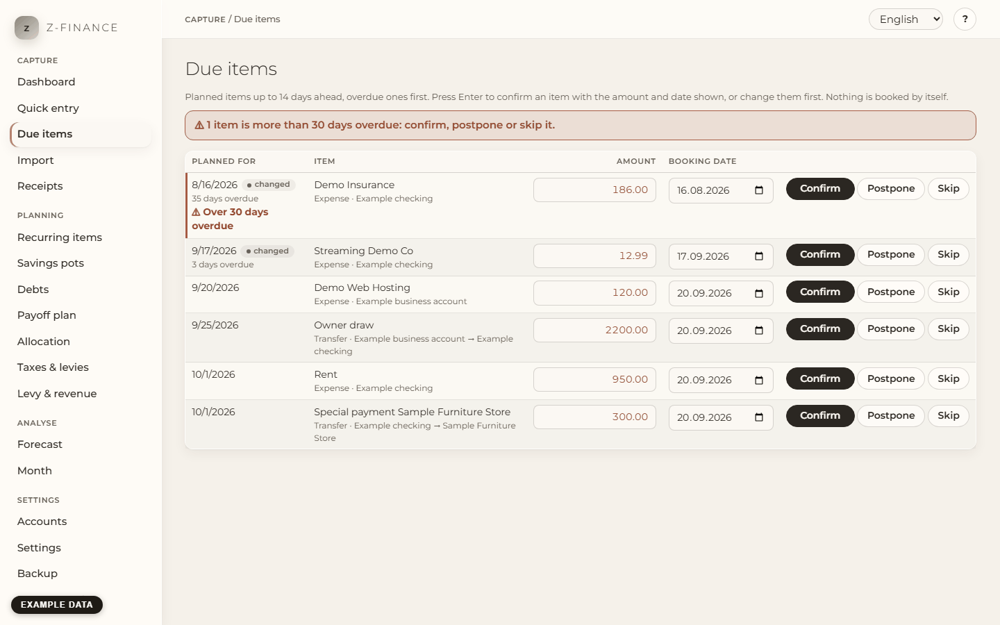

# Due items

## What you see

**Due items** is your weekly review. It lists every **planned item** — a payment from a
[recurring item](recurring.md) or an expected one-off item — that is due up to 14 days from today.
Overdue items come first.

Planned items do not change any balance. Only when you **confirm** an item does it become a real
booking, and the account balance changes. z-finance never confirms anything by itself: an item you
do nothing with stays in the list.

Each row shows the planned date, the text with the account (for a transfer: from → to), the
**Amount** and the **Booking date**. Both are filled in with what was planned, and you can change
them right in the row.

You find this screen in the sidebar under **Capture**.

## Confirm an item

1. Change the **Amount** or the **Booking date** if the real payment was different. Leave them as
   they are if it went as planned.
2. Press **Enter** — or click **Confirm**. Enter works in either field and also when the row itself
   is selected.

The item becomes a booking and leaves the list; the cursor moves to the next row, so you can press
Enter again. In the booking list you can recognise it as coming from a recurring item.

- **A different amount does not change the recurring item.** If you confirm the rent with 850 €
  instead of 800 €, next month's planned rent is still 800 €. To change it for good, see
  [Recurring items](recurring.md).
- **The amount is entered without a sign.** An expense stays an expense, an income stays an income.
- **A transfer** is booked on both accounts at once; a changed amount applies to both.
- **An item that is not due yet** (up to 14 days ahead) is booked **today**, because a booking
  cannot be dated in the future. Change the **Booking date** to an earlier day if you paid earlier.

## Postpone an item

Click **Postpone**, pick a new date **after today** and click **Postpone** again (or press Enter).
The item stays planned, is marked "changed", and comes back in this list once its new date is within
14 days. A recurring item that is postponed is not moved back when z-finance fills up the next 12
months.

If a payment has already happened, confirm it instead — postponing is only for payments that have
not happened yet.

## Overdue items

An item shows how many days it is overdue. An item that is **more than 30 days overdue** is
highlighted: a red edge, the words "Over 30 days overdue" and a notice above the list. It never
disappears by itself — decide for each one: confirm, postpone or skip it.

## Skip an item

Click **Skip** for a payment that will not happen, for example a subscription you paused, and
answer the question with OK. The item counts neither towards the balance nor towards the forecast,
and it leaves the list. The recurring item goes on: its other planned items stay, and the skipped
date is not created again. A skipped instalment of a debt counts as done for that debt, so the
debt's end moves one due date later (see [Debts](debts.md)).

A skipped item cannot be brought back from this screen. If you skipped the wrong one, enter the
payment in [Quick entry](entry.md).

## Typical problems

- **An item I expected is missing.** Only planned items up to 14 days ahead are listed. Items that
  your bank statement import already matched are gone as well — they are booked.
- **"A confirmed item needs a date of today or earlier."** The **Booking date** is in the future.
  Pick today or an earlier day, or postpone the item.
- **"Choose a date after today to postpone an item."** The new date must be tomorrow or later. If
  the payment already happened, confirm it.
- **"The account … is archived."** Archived accounts cannot receive bookings. Unarchive the account
  first (see [Accounts](accounts.md)).
- **I typed the same amount in another format.** The row treats "12.5" and "12,50" as one amount and keeps the plan.
- **I confirmed the wrong item.** Open it in [Quick entry](entry.md) and edit or delete the booking.

Working through this list every week is what keeps the forecast honest — a planned item nobody
confirms just sits there getting older.
