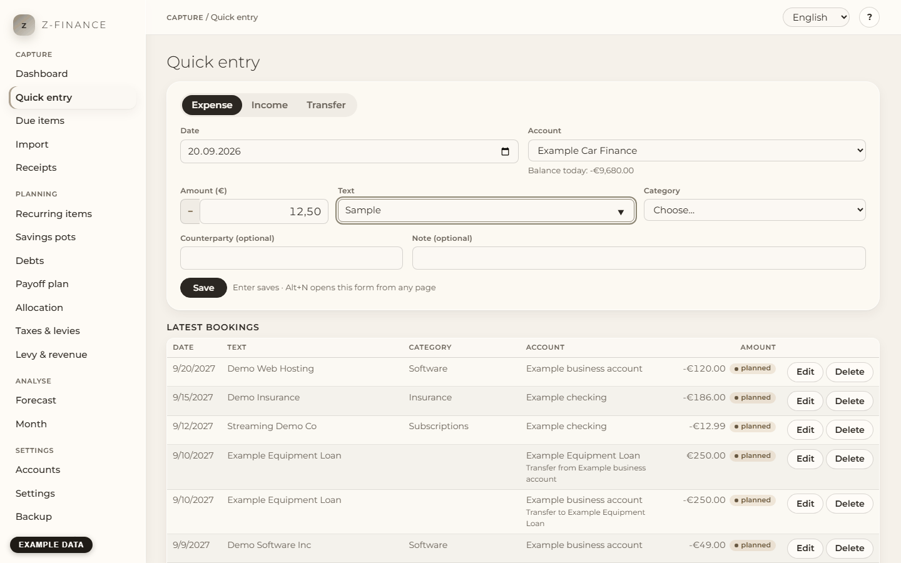

# Quick entry

## What you see

**Quick entry** answers one question: **where do you record money coming in, money going out or
money moving between your own accounts?** The form is at the top, your latest bookings are listed
below it. It is built for speed: a booking takes a few seconds and needs no mouse.

Open it from any page with **Alt+N** (hold Alt, press N). The cursor is in the **Amount** field
straight away. You find this screen in the sidebar under **Capture**.

## Record an expense or an income

1. Choose **Expense** or **Income** at the top of the form (Expense is preselected). Instead, you
   can also type a minus in front of the amount: `-12,50` is always an expense.
2. **Date** is today and **Account** is the account you used last. Change them only when needed.
3. Type the **Amount**, for example `12,50` or `12.50` — without thousands separators.
4. Press **Tab** and type the **Text**, for example the shop's name.
5. Press **Tab** and pick the **Category**: type the first letters of its name to jump to it.
6. **Counterparty** and **Note** are optional.
7. Press **Enter**. The booking is saved and appears in the list below.

After saving, the date and the account stay as they were and every other field is empty, with the
cursor back in **Amount** — ready for the next booking. Five receipts in a row take well under a
minute. Even the very first save right after **Alt+N** is safe: if z-finance has not quite finished
loading your accounts yet, saving simply waits a moment and then goes through — nothing is lost.
The form briefly locks while a booking is being saved, so a moment of fast typing never lands in
the wrong booking; it unlocks again the instant the save finishes.

A category whose kind does not match the amount (an income category on an expense) shows a
warning, but you can still save — for example for a refund.

## Suggestions from earlier bookings

When you type a text you have used before, z-finance fills in the category and the counterparty of
the last booking with that text. The first time you book "Bakery" you choose the category
yourself; from the second time on it is suggested. The suggestion list under the text field shows
matching texts from your history — pick one with the arrow keys. If you choose a category
yourself, z-finance leaves it alone.

## Transfers between your own accounts

A transfer moves money from one of your accounts to another: from the current account to savings,
paying off the credit card, or taking money out of the business for private use (owner draw) and
putting it back (owner contribution).

1. Choose **Transfer**.
2. Pick **From account** and **To account**, type the amount (always positive) and, if you like,
   a text and a transfer category such as "Owner draw/contribution".
3. Press **Enter**.

z-finance records two bookings: minus on the first account, plus on the second. Your total over
all accounts stays the same. The two bookings belong together: changing or deleting one changes
or deletes the other as well.

## Planned instead of booked

If the date lies in the future, the form says so, and the booking is saved as a **planned** item.
Planned items are shown in the list with the mark "planned" but do not change any balance yet; the
[Forecast](forecast.md) takes them into account. To book a planned item
once it has happened, open it, set the date to the day it happened and save.

## Bookings from a recurring item

A booking confirmed from [Due items](due.md) carries a "recurring" badge next to its amount, so
you can tell it apart from one you typed by hand.

## Correct or delete a booking

Click a booking in the list (or its **Edit** button). It opens in the form; change what is wrong
and click **Save changes**, or press **Esc** to cancel. **Delete** asks before removing anything; a
transfer is removed with both of its bookings.

<!-- ste-waiver: "booking" is the product noun used on every page, not an -ing verb form -->

You can also edit a booking on an archived account. The booking stays on that account, and the
account list shows the account with the mark "archived". New entries offer only active accounts.

## Typical problems

- **"Enter an amount other than 0."** The amount is empty or 0; the field is marked in red.
- **"Choose a category."** Every income and expense needs a category.
- **"Bookings before the opening date … are not possible."** The date is older than the account's
  opening date (see [Accounts](accounts.md)).
- **"The account … is archived."** Archived accounts cannot receive bookings; they are not offered
  in the form.
- **Saving failed.** Everything you typed stays in the form; read the message, fix the cause and
  press Enter again.
- **Alt+N does nothing.** Click into the page once so it has the keyboard focus. On a Mac the
  shortcut is Option+N.

A booking only ever changes the balance of the one account it is booked on; a transfer changes two,
in the same step.
