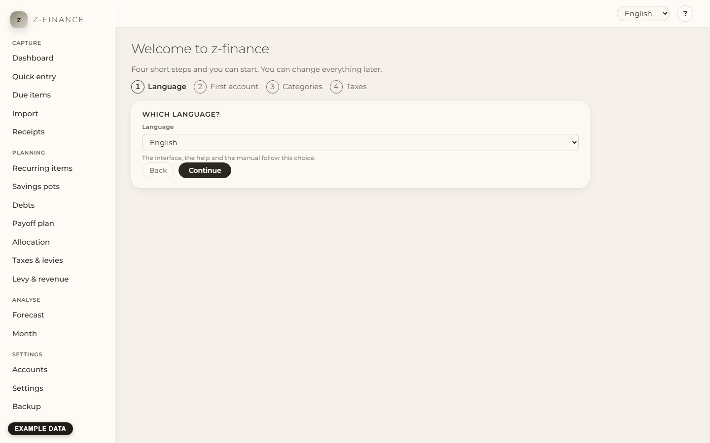
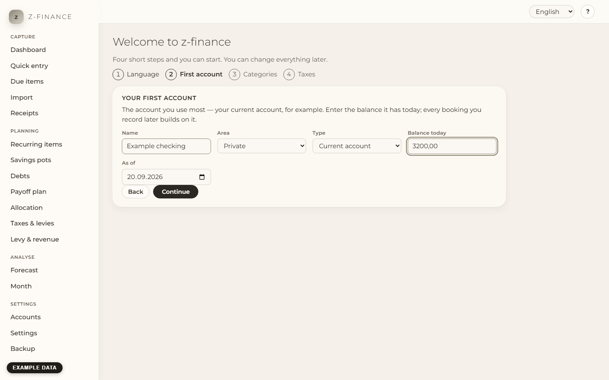
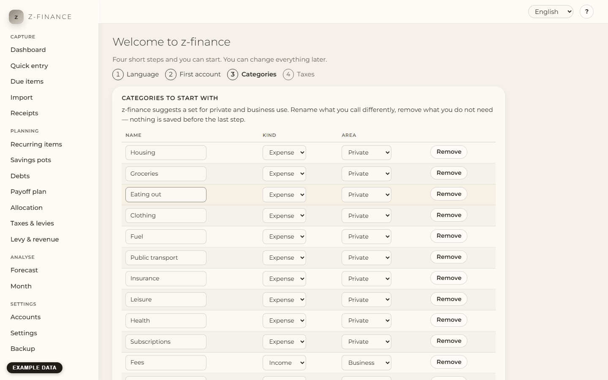
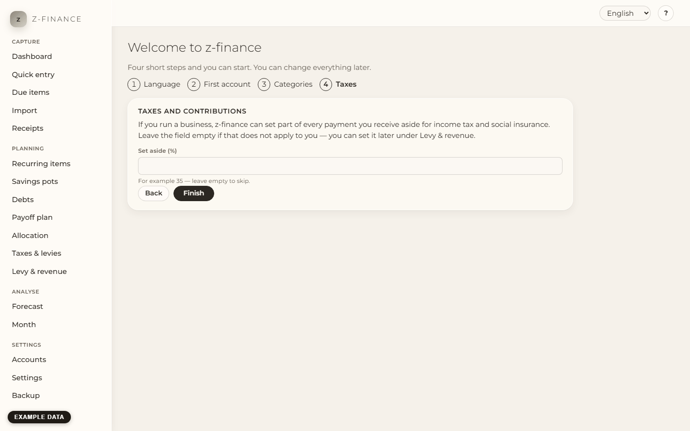

# The first start

## What you see

The very first time you open z-finance, it asks you four things before showing the start page.
Nothing is saved until you click **Finish** on the last step, and **Back** takes you to the
previous one at any time. You can change every one of these answers later.

## The four steps

1. **Language.** English or German. The interface, this help and the manual follow your choice
   immediately. You can switch it again at any time under [Settings](settings.md).

   

2. **Your first account.** The account you use most — usually your current account. Give it a name
   you recognise, say whether it is private or business, pick the type, and enter the balance it
   has today together with the date that balance is from. Everything you book later is added to
   that starting point, so it does not have to be the day you opened the account: today is fine.
   More accounts, and the reserve you want to keep on each, are on
   [Accounts](accounts.md). If an account with that name exists, the assistant uses
   it. This includes archived accounts and names in a different case.

   

3. **Categories to start with.** z-finance suggests a set for private and business use in the
   language you chose. Rename what you call differently, remove what you do not need, and keep the
   rest. This is only a starting point — you add, rename and delete categories later on
   [Categories](categories.md).

   

4. **Taxes and contributions.** If you run a business, z-finance can set part of every payment you
   receive aside for income tax and social insurance, so the money you see as "free" is money you
   may really spend. Enter the percentage you want to reserve, for example `35`. Leave the field
   empty if this does not apply to you. The whole calculation, and how to change the rate, is on
   [Levy & revenue](levy.md).

   

Then click **Finish**. z-finance creates the account, stores the rate if you entered one, adopts
the categories and opens the start page.

## Typical problems

- **"Enter an amount such as 1234,56."** The balance has to be a plain number. Write `1234,56` or
  `1234.56`, without a thousands separator and without the euro sign. A negative balance (an
  overdrawn account) is written with a leading minus: `-250`.
- **"Enter a rate between 0 and 90, such as 35."** The levy rate is a percentage, not an amount.
  If you are not sure what belongs there, leave it empty and set it later.
- **You ended up here again.** The wizard appears as long as the categories have not been set up.
  If you clicked **Finish** and still see it, the last step did not reach z-finance — the line at
  the bottom of the sidebar says whether it is still running.
- **Finish shows an error.** The wizard is not reset when something goes wrong at the end — for
  example the connection drops after the account was created. Click **Finish** again: the account
  that already exists is reused, not created a second time.
- **You want to start over.** Nothing here is final: accounts, categories and the levy rate can all
  be changed on their own screens afterwards.

## What next

The ten minutes that keep z-finance useful are described in [The weekly routine](weekly-routine.md).
