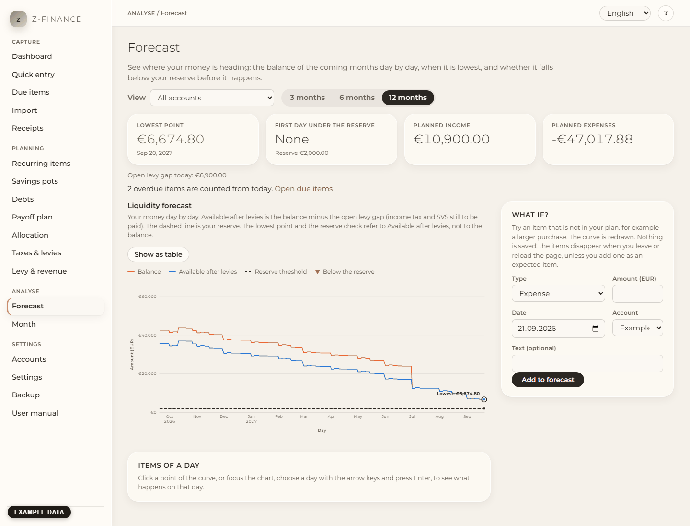

# Forecast

## What you see

The forecast answers one question: **will my money last?** It shows, day by day, where your
balance is heading in the next 3, 6 or 12 months, when it is lowest, and whether it falls below
your reserve _before_ it happens. You find it in the sidebar under **Analyse**.

The page has a chart on the left. On the right are the key figures, a **What if?** box and, when
money runs short, a suggestion which pots could help.

## Choosing what to look at

- **View**: all accounts, only the private or only the business accounts, or one account. Loan
  accounts are never offered: they are debts, not money you can spend.
- **Horizon**: 3, 6 or 12 months.

Transfers between your own accounts cancel each other out in the views that contain both
accounts. In the view of a single account they count.

## Reading the chart

The chart has three lines:

- **Balance**: what your accounts hold, plus everything that is still planned or booked for the
  future.
- **Available after levies**: the balance minus the open levy gap, that is the income tax and SVS
  that your income has already triggered but that you have not set aside yet. This is the line
  that counts.
- **Reserve threshold** (dashed): the reserve you want to keep. It comes from the reserve you set
  per account and the total reserve under [Accounts](accounts.md).

The **lowest point** is ringed and labelled. Days on which _Available after levies_ is under the
reserve are marked with a red band and a triangle.

Important: the reserve check refers to **Available after levies**, not to the balance. The balance
can look comfortable while the money is already owed to the tax office. Example: balance 12,000 €,
open levy gap 3,000 €, reserve 10,000 € — the available line is at 9,000 € and the reserve counts
as breached.

Overdue items that you have not confirmed yet are counted from today, not ignored. The number is
shown on the right with a link to [Due items](due.md).

## Looking at one day

Click a point of the curve. Below the chart you see exactly the items that act on that day
(planned and booked items), what the day changes, and the balance at the end of it.

With the keyboard: focus the chart (Tab), choose a day with the left and right arrow keys
(Shift jumps a week, Home and End go to the ends) and press Enter. **Show as table** lists every
day as a table.

## What if?

Want to know whether you can afford something? Enter an **expense** or **income**, an amount, a
day and an account, and press **Add to forecast**. The curve is redrawn at once.

**Nothing is saved.** What-if items exist only on this page; they disappear when you leave or
reload it. If the item is real, press **Add as expected item** in its row: it is then stored as
an expected item (also visible under [Recurring items](recurring.md)) and becomes part of your
plan. That works for days after today. **Remove** deletes a what-if item, **Remove all what-if
items** clears the list.

## When the reserve is breached

If _Available after levies_ falls below the reserve, a red message names the first day and how
far the lowest point is below the reserve. If you have savings pots, the box **Cover the
shortfall from your pots** shows which pots would cover it, in the emergency order you set, and
what would remain in each pot. Locked pots are never suggested. One click on **Take … from these
pots** makes the withdrawal.

Good to know: the money moves to the free balance of the account, and the target date of a pot can
move back. The balance of the account does not change. The suggestion looks at your saved plan
only, not at what-if items.

## No reserve set

Without a reserve there is no alarm, and the page says so. Set a reserve per account, or a total
reserve, under [Accounts](accounts.md).

## Typical problems

- **The curve is flat.** Nothing is planned yet. Add [Recurring items](recurring.md) or expected
  items and it comes alive.
- **The lowest point is lower than the balance.** That is the open levy gap at work — see
  [Levy & revenue](levy.md).
- **A what-if item does not change the curve.** It lies on an account outside the chosen view
  (marked _not in this view_) or after the horizon.

The curve is only as good as what feeds it — keep due items confirmed and recurring items
current, and the forecast stays a real answer, not a guess.
