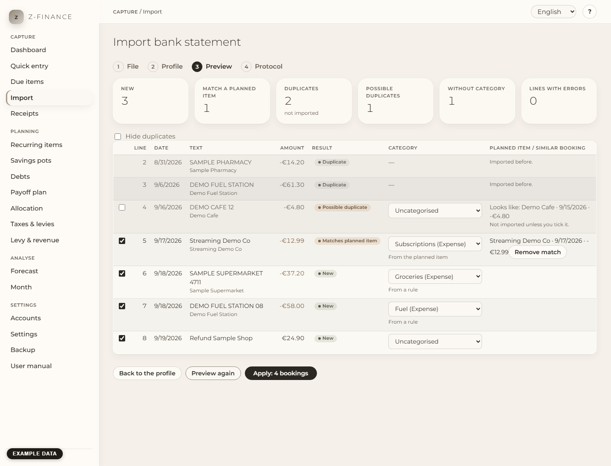

# Import

## What you see

The **Import** page brings the movements of your bank account into z-finance from a CSV file that
you export from your online banking. You find it in the sidebar under **Capture**. It walks you
through four steps, shown at the top: **File**, **Profile**, **Preview**, **Protocol**. Nothing is
saved before you press **Apply** in step 3, and you can import the same file again at any time:
lines that were imported before are recognised and skipped.

## Getting a sample CSV

1. Log in to your online banking and open the account.
2. Look for **Export**, **Download** or **CSV** next to the list of movements, choose a period
   (for example the last month) and download the file.
3. Save it somewhere you find it again. Do not open and save it in a spreadsheet program first;
   that can change the format.

A CSV file is plain text, one movement per line, with the columns separated by `;` or `,`. If you
are unsure what your bank produces, open the file in a text editor: the first line holds the column
names.

## Step 1: choose account and file

1. Choose the **Account** the movements belong to.
2. Choose the **CSV file**. z-finance recognises the encoding and the column separator and shows the
   first rows of the file.
3. Check the rows: are the columns separated properly, do umlauts (ä, ö, ü, ß) and the euro sign
   look right? If not, choose the **Encoding** or the **Column separator** by hand; the rows update
   at once. A file whose format cannot be recognised safely is not guessed: you choose it.

Then press **Continue to the profile**.

## Step 2: choose or create the profile

A **profile** tells z-finance which column of the file holds what. You create it once per bank and
reuse it for every later statement.

- Choose a stored profile, or **New profile**. For a new one, z-finance proposes the columns from
  the column names; check each of them.
- Assign the **Date**, **Text** (the purpose of the payment) and **Amount** columns from the lists.
  Some banks keep money out and money in in two columns: choose **Debit and credit columns** then.
  The **Counterparty** column is optional.
- Set the **Date format** (for example `%d.%m.%Y` for 31.12.2026) and the **Decimal separator**
  (comma for 1.234,56). If the file starts with a title before the column names, enter how many
  **Lines before the header** there are.
- The rows below show your file with the role of each column marked, so you can see at once whether
  the mapping fits.

Press **Show the preview**. A new or changed profile is saved first. If your bank changed its
export and a column is missing, z-finance refuses the whole file and names the column. Choose the
new column in the list and press **Show the preview** again; earlier imports stay untouched.

## Step 3: check the preview

The preview lists every line of the file and what z-finance would do with it:

- **New**: will be booked as a new entry.
- **Duplicate** (grey): was imported before and is skipped.
- **Matches planned item**: fits a planned item (for example your rent) and replaces it instead of
  booking twice. The planned item is shown next to the line. If several planned items fit, the
  nearest date is chosen and the line is marked **Check the match**; choose another one in the list
  if it is the wrong one.
- **Possible duplicate**: looks like a booking you entered by hand or confirmed earlier (same
  amount, nearly the same date). It is left out unless you tick it.

You can correct the lines before anything is written:

- **Category**: change it in the list. The small note says where the proposal came from (a rule, the
  planned item, or you).
- **Remove match** books the line as a new entry instead; **Restore match** undoes that.
- The tick box at the start of a line leaves the line out (or imports a possible duplicate).
- **Save as rule** appears once you changed a category. The rule "text contains … → this category"
  then categorises the same kind of payment automatically in the future; other lines of this file
  that fit it are updated in the preview.

The tiles above the table count what will happen, including corrections. Lines that cannot be read
are listed separately with the reason; they are skipped, the rest is imported.

When it looks right, press **Apply**. The button is locked while the bookings are written, so a
double click cannot import twice. Everything is written in one step: if any line fails, nothing is
written, you see which line, and you can fix it and try again.

## Step 4: protocol

The protocol shows how many bookings are **New**, how many were **Matched** to planned items, how
many **Duplicates** were skipped and how many of the new bookings are still **Uncategorised**. The
numbers equal what you find in the booking list. Categorise the rest in the [Month](month.md)
report. Under **Earlier imports** on the first step you find the protocol of every import.

## Typical problems

- **"The encoding of the file could not be detected"**: choose the encoding in step 1 (older
  Windows exports are often Windows-1252, newer ones UTF-8). The same goes for the column separator.
- **Everything is a duplicate**: you imported this file before. That is intended.
- **A column is missing**: your bank changed its export; see step 2.
- **A line is refused because it is older than the account**: the account starts later than the
  line. Move the opening date of the account (see [Accounts](accounts.md)) or leave the line out.

Because every line is classified again against the ledger at commit, correcting the preview for a
few minutes before applying it is exactly as safe as applying it right away — the staged preview
itself does not survive a restart or much more than an hour, though.
