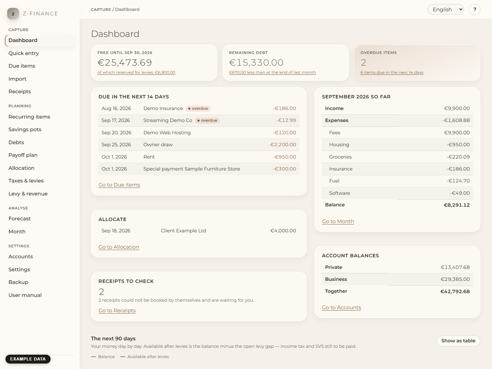

# Dashboard

The dashboard is the start page: the screen you open, look at for two minutes and close again. It
answers three questions at the top, without scrolling, and shows underneath what is waiting for
you. It changes nothing by itself — every card links to the screen where you act.

## The three figures

**Free until the end of the month.** What you can still spend this month: the money on your
payment accounts, minus the items already planned until the end of the month, minus the reserve
you set on your accounts, minus the levies you still owe. The small line underneath names that
last part: _of which reserved for levies_.

This is the one number of z-finance, and it is deliberately smaller than your balance. If you
receive 10,000 € and your levy rate is 30 %, this figure rises by 7,000 €, never by 10,000 € — the
3,000 € belong to the tax office and to SVS, from the day the money arrives. How the figure is
made up in detail is on [Levy & revenue](levy.md).

**Remaining debt.** Everything you still owe, over all your debts, with the change since the end
of last month. Less than last month is shown in green, more in red. Details are on
[Debts](debts.md) and [Payoff plan](payoff.md).

**Overdue items.** Planned items whose date has passed and that you have not confirmed yet. The
line underneath says how many items are due in the next 14 days. Both lead to
[Due items](due.md).

## The weekly routine

Ten minutes once a week keep z-finance up to date, always in the same order: look at the three figures, confirm the due items, import what is missing, decide about new income, check the receipts, glance at the curve. The steps are in [The weekly routine](weekly-routine.md).

## The cards

- **Due in the next 14 days** — the planned items of the coming two weeks, overdue ones first and
  marked.
- **The running month** (titled with its name, e.g. "September 2026 so far") — income, expenses
  and the balance with the largest categories. The whole report is on [Month](month.md).
- **Allocate** — income waiting for a decision (see the weekly routine above).
- **Account balances** — private, business and both together. Debts are not part of this; they are
  the second figure at the top.
- **Receipts to check** — how many receipt photos ended up in the review list.
- **The next 90 days** — your balance day by day, and beneath it the line _available after levies_,
  which is the same money minus the open levy gap.

## Hints

- **"Levies not covered"** appears when the levies you still owe are more than the money on all
  your accounts. That is a warning to act, not an error: put money aside, or discuss the rate with
  your tax adviser. [Levy & revenue](levy.md) shows the gap.
- **"Taxes and levies are not set"** appears while you have not entered a prepayment. Without it
  nothing is planned for the due dates, so the forecast is too optimistic. Enter the amounts under
  [Taxes & levies](tax.md).

## If something looks wrong

- **The figure at the top is lower than your bank balance.** That is intended: planned items,
  reserve and the levy share are already subtracted. The breakdown is on [Levy & revenue](levy.md).
- **A figure is out of date.** The dashboard reads everything when you open it; reload the page
  (F5) after a change on another screen.
- **"Backend not reachable" at the foot of the sidebar.** z-finance is not running; start it again.
  Nothing is lost, your data is in a file on this computer.

## Getting around

The sidebar on the left lists the screens in four groups:

- **Capture** — put money movements in: this dashboard, quick entry, due items, import, receipts.
- **Planning** — what is coming: recurring items, savings pots, debts, payoff plan, allocation,
  taxes and levies.
- **Analyse** — look back and ahead: forecast and the month overview.
- **Settings** — accounts and categories, the language of the interface, backups and this manual.

The line at the top shows where you are. Next to it you switch the language (the same setting as on
the Settings screen). At the foot of the sidebar z-finance shows whether it is running and its
version. Every screen has a **?** button that opens the help for exactly that screen; the full
manual with its search box is under **User manual**, see
[Using the help and the manual](manual.md).

z-finance is made for a computer screen; on a phone the layout is not supported.

Questions and answers are in [Questions and answers](faq.md), the words z-finance uses in the [Glossary](glossary.md).
