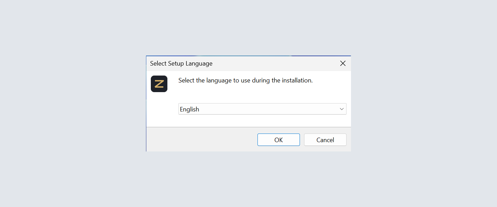
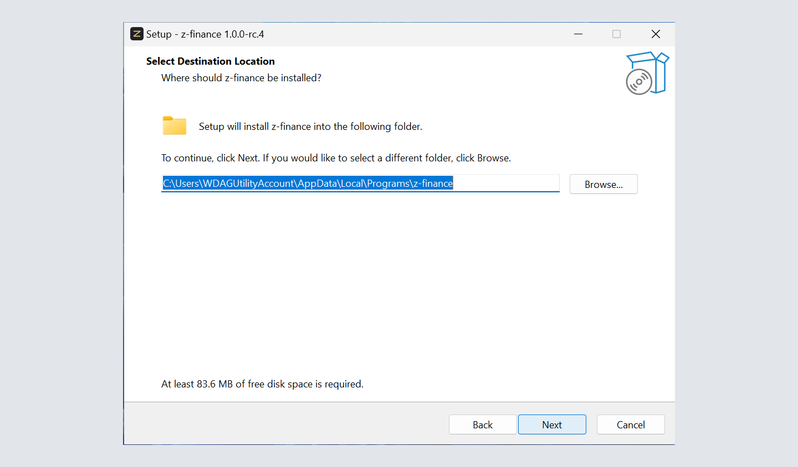
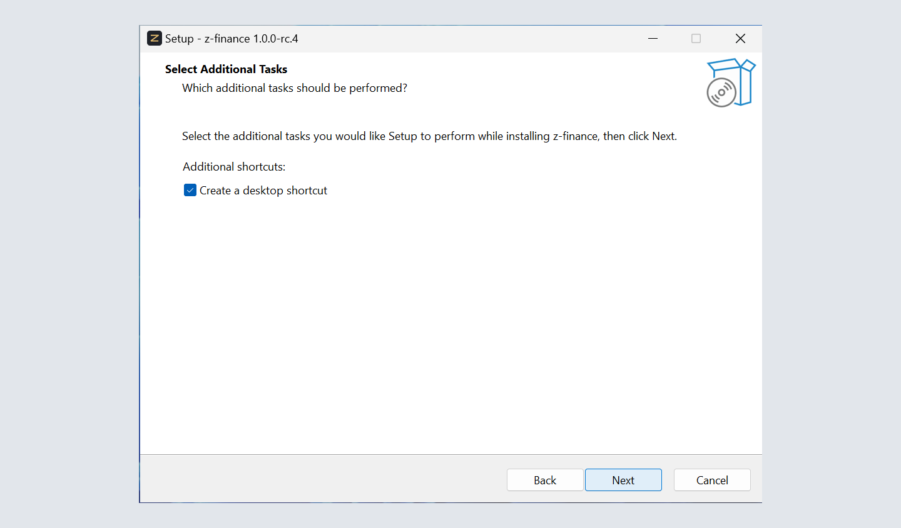
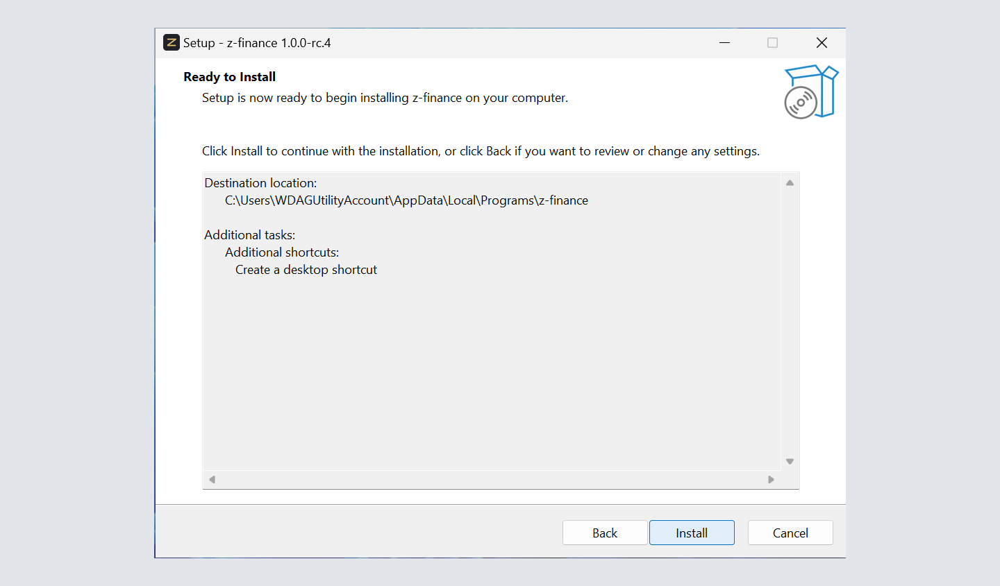
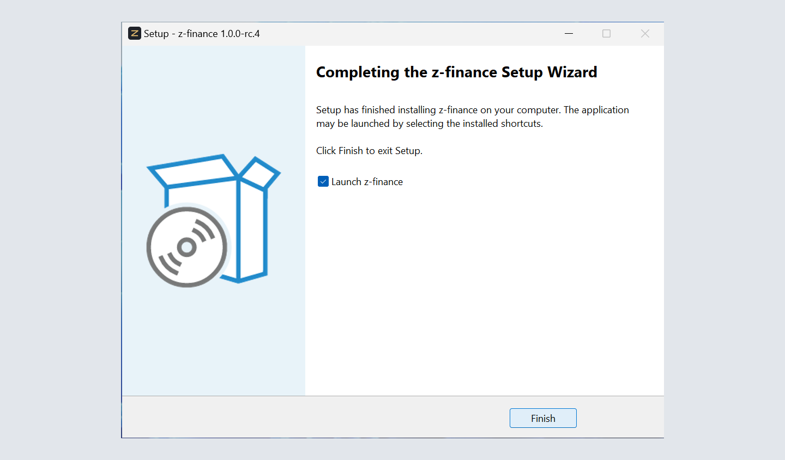
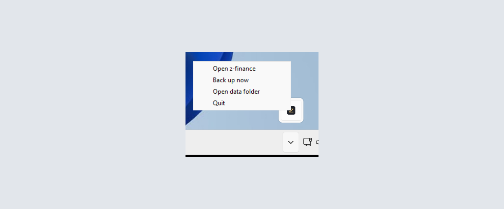
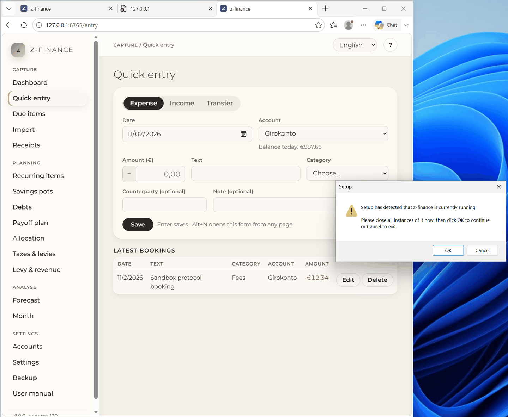
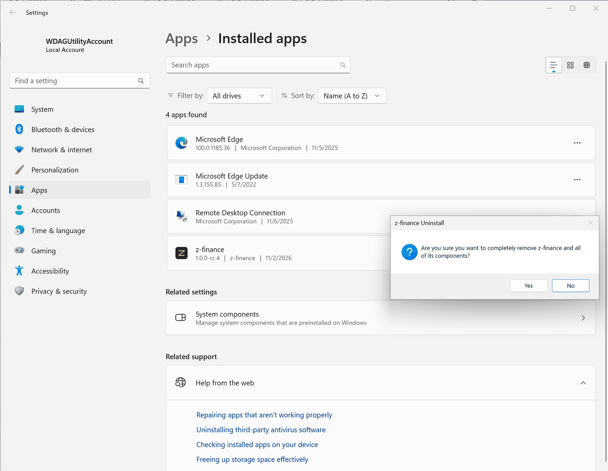
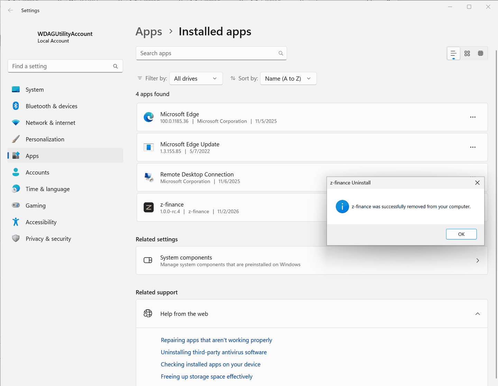

# Installing z-finance

Three steps and a few minutes — no account, no password, nothing to configure — and z-finance runs
on your own computer.

## In three steps

1. Open the [download page](https://github.com/ziagl888/z-finance/releases) and click the file
   whose name starts with `z-finance-setup` under the newest release.
2. Double-click the downloaded file and click **Next** until **Finish**. z-finance installs for you
   alone, so Windows does not ask for an administrator password.
3. Start **z-finance** from the Start menu (or from the icon on the desktop, if you kept it).
   z-finance opens in your browser, and the first start walks you through
   [the four questions](first-run.md) it needs answered.

That is all. You need nothing else installed — no Python, no database, no account anywhere.

These are the pages of Setup, in order. Setup asks for the language first. Then it shows the folder
below your own Windows folders, the offer of a desktop icon, and the summary. The last page has the
box **Launch z-finance**.











## "Windows protected your PC"

The first start of a new version may show a blue window with that text. It appears because this
program is not signed with a paid certificate, not because anything is wrong with the file.

Click **More info**. The window then shows "Publisher: Unknown". This is normal for a program
without a signature. Click **Run anyway**. If you want to be sure, download the file again from the
link above. The project publishes the file only on its download page.

## While z-finance runs

z-finance is a small program on your own computer that you use through the browser. While it runs,
a **z** icon sits in the notification area at the bottom right of the screen (you may have to click
the small arrow to see it). Right-click it for:

- **Open z-finance** — bring the browser tab back if you closed it.
- **Back up now** — write a copy of all your data, as the [Backup](backup.md) screen does.
- **Open data folder** — show the folder with your database and your backups in Explorer.
- **Quit** — stop z-finance. Closing the browser tab alone does not stop it.



Starting z-finance a second time does not start a second copy: it just brings the open one back.

## Reaching z-finance from another computer

Only this computer can reach z-finance. This is the default.

You can open z-finance to your network. Start it in a terminal with `--host <address> --allow-network`.
Then other computers on your network can reach it. z-finance has no login. Everyone on that network
can read and change your data. Do this only on a network you trust.

z-finance accepts a request only if it names the exact address you bound it to. It also accepts
`localhost` and `127.0.0.1`. Bind it to one address of this computer. On the other computer, type
exactly that address:

```sh
z-finance --host 192.168.1.5 --allow-network     # other computer: http://192.168.1.5:8765
```

`--host 0.0.0.0` (all addresses) does not work for this. The other computer calls
`http://192.168.1.5:8765`. That is not `0.0.0.0`, so z-finance refuses it with "host not allowed".
The browser on this computer opens `http://127.0.0.1:8765` in that case. The start log says so.

## Where your data is

Everything you enter lives in one folder that belongs to your Windows account:

    C:\Users\<your name>\AppData\Local\z-finance

The installer never touches that folder. Installing a new version over the old one keeps your data,
and uninstalling z-finance leaves it in place — if you really want your data gone, delete that
folder yourself afterwards. Copy a backup somewhere else now and then anyway; see
[Backup and restore](backup.md).

## Updating

New versions are announced on the download page. z-finance can tell you about them: switch
**Look for new versions** on under [Settings](settings.md). It then asks GitHub which version is
the newest — it downloads and installs nothing. When a newer one exists, follow the link, install
it the same way as the first time, and your data stays where it is.

If z-finance runs while you install, Setup tells you to close it. Right-click the **z** icon, click
**Quit**, and then click **OK** in Setup.



## Removing z-finance

Windows **Settings → Apps → Installed apps → z-finance → Uninstall**. Your data folder stays; see
above.

The uninstaller asks once. Click **Yes**. Then z-finance has no entry in the Start menu.





None of this — installing, updating, uninstalling — ever touches the data folder; only deleting it
yourself does.
