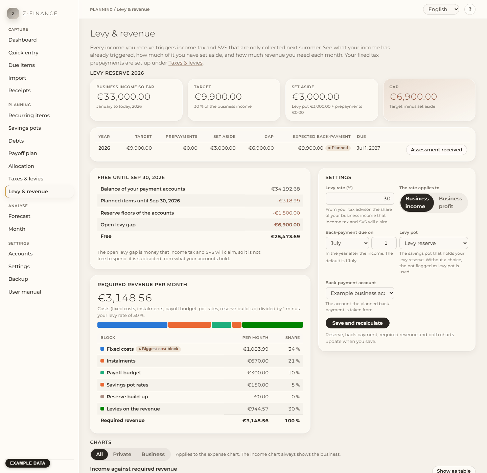

# Levy & revenue

## What you see

Every income you receive triggers income tax and SVS, but they are only collected next summer.
Whoever ignores this spends money that already belongs to the tax office. **Levy & revenue** shows
you, at any time, how much your income so far has triggered, how much of it you have set aside,
and how much revenue you need in the coming months. You find it in the sidebar under
**Planning**.

The page has five parts:

1. **Levy reserve** for the current year: four figures and a table of the open years.
2. **Settings** on the right: your levy rate and where the reserve is kept.
3. **Free** — the amount you can really spend.
4. **Required revenue per month**.
5. **Charts**: income against the required revenue, expenses against your debt payments, and the
   remaining debt.

## The four figures

- **Business income so far** — what you have received in your business accounts since January.
- **Target** — your levy rate times that income. This is the money the tax office and SVS will
  claim.
- **Set aside** — what you already hold back: the savings pot for levies plus the prepayments you
  have paid this year.
- **Gap** — target minus set aside. Green means covered. If the gap is red, part of the money in
  your accounts is not yours to spend.

If the gap is larger than what is free on your payment accounts, a red warning **Levies not
covered** appears at the top.

## Expected back-payment

For every open year the table shows the **expected back-payment**: the target minus the
prepayments, planned for the due date of the following year (1 July unless you changed it). It
appears as a planned item in your forecast, so you see it coming.

When the tax assessment arrives, press **Assessment received** in that row. The estimate is kept
in the table as _Archived_ and the planned item is removed. Then enter the real amount of the
assessment as an expected item under [Recurring items](recurring.md).

## Settings

1. Enter the **Levy rate (%)** your tax advisor gave you, for example `35` or `35,5`. It is an
   estimate for income tax and SVS together.
2. Choose whether it applies to your **business income** (the default) or your **business
   profit** (income minus business expenses).
3. Set the **due date** of the back-payment: month and day in the year after the income.
4. Pick the **levy pot**: the savings pot where you collect the reserve. Without a choice the pot
   flagged as levy pot is used. If there is none, only your prepayments count as set aside, and
   the page tells you so.
5. Pick the **back-payment account** the planned back-payment is taken from.
6. Press **Save and recalculate**. Target, gap, back-payment, required revenue and both charts
   update at once. If you change the rate by more than 10 percentage points, a hint explains
   that your reserve so far was built with the old rate and suggests adjusting your allocation
   rule.

Your fixed tax prepayments are entered under [Taxes & levies](tax.md); this page uses them.

## Free

The card **Free until** (the date is the end of the current month) shows how the amount is calculated: the balance of
your payment accounts, plus the planned items until then, minus the reserve floors, minus the
**open levy gap**. The gap is subtracted because that money will be claimed by the tax office
and SVS — it is not free to spend, even though it is still on your account.

Example: you receive 10,000 € and your rate is 30 %. Right after the booking the target rises by
3,000 €, the gap rises by 3,000 € (until you move it into the levy pot), and the free amount
rises by only 7,000 €.

## Required revenue per month

The figure is the revenue you need each month so that everything is covered: fixed costs,
instalments, your payoff budget, the rates of your savings pots and the build-up of reserves —
divided by 1 minus your levy rate, because a part of every euro of revenue goes to levies.

Example: costs of 3,000 € per month and a rate of 35 % give 3,000 ÷ 0.65 ≈ 4,615 €.

The bar and the table split the figure into its blocks. The badge **Biggest cost block** shows
what drives your need most. If the need is out of reach, this is where to look first.

## Charts

- **Income against required revenue** shows 24 months: the 11 months before, this month and the
  12 months after. Solid bars are booked income, light bars are planned income, the line is the
  required revenue. A month whose income is below the line gets a red band and a triangle marker at
  the top — and the tooltip and the table say _Below required revenue_.
- **Expenses and liabilities** stacks your expenses per month by category, the largest category
  at the bottom; the legend names the colours, and the smallest categories are grouped as
  _Other categories_. The line is what you pay towards debts (instalments and special payments)
  in that month. Use **All / Private / Business** above the charts to look at one area; a
  category keeps its colour when you switch.
- **Remaining debt** shows what you still owe at the end of each month. It has its own axis,
  because it is a total and not a monthly amount.

Everything is readable without a mouse: click into a chart or press Tab to it, then use the left
and right arrow keys to read month by month. **Show as table** lists every number of a chart.
Months after this month are planned values, marked with a line.

## Typical problems

- **Everything is 0 or the page asks for the rate.** Save your levy rate first.
- **The gap is big although I set money aside.** Check the levy pot: money in a different pot or
  account does not count. The settings show which pot is used.
- **The back-payment is missing in the forecast.** Choose a back-payment account in the settings.
- **A month is marked although I expect income.** Planned income counts only when it is entered
  as an expected item; add it under [Recurring items](recurring.md).

The number this chapter is built around — the free amount — is the same one the dashboard and the
payoff plan read; the forecast follows the same rule for its own curve, so nothing here disagrees
with what you see elsewhere.
