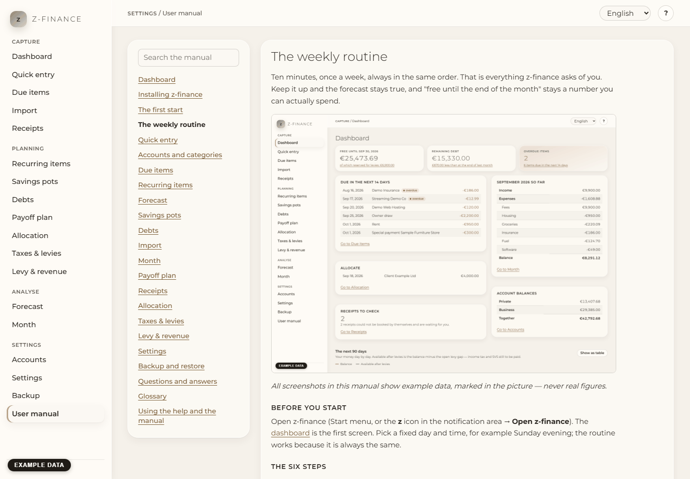

# Using the help and the manual

Every screen explains itself, in the same two places: the help panel while you work, and this
manual when you want the full picture.

## Help for the current screen

Click the **?** button at the top right. A panel opens with the chapter for the screen you are on.
It follows you: open another screen and the panel shows that screen's chapter. Close it with
**Close** or the Escape key. **Open in the manual** shows the same chapter in the full manual.

You find this screen in the sidebar under **Settings**.

## The manual

**User manual** in the navigation opens this manual. The list on the left holds all chapters; click
one to read it. Links inside a chapter lead to other chapters.

## Search

Type into the search box above the chapter list. The list then shows every chapter that contains
all the words you typed, with the passage where they occur. Upper and lower case and accents do
not matter: "Konten" finds "konten", "ubersicht" finds "Übersicht". Clear the box to see all
chapters again.

## Language

The help and the manual use the language chosen under **Settings**. Switching the language
switches the chapter you are reading, the chapter list and the search at once.

The manual also exists as a website with the same content, for reading without z-finance running.
