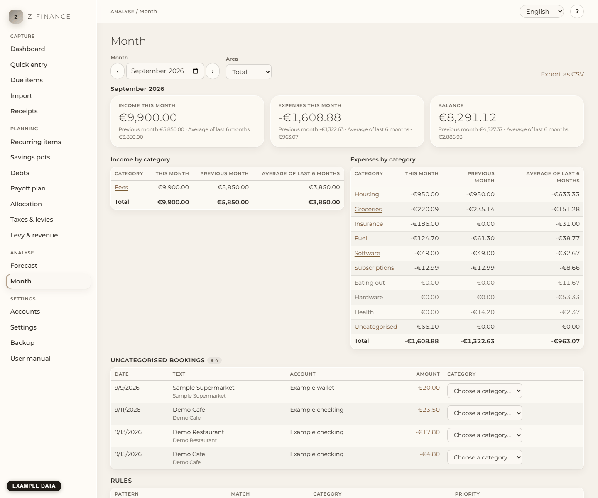

# Month

## What you see

**Month** answers "where did the money go?" for one month. Choose the **Month** (the arrows step
one month back or forward) and the **Area**: **Private**, **Business** or **Total** (both
together). Only bookings that have really happened count; planned items never do.

At the top are three figures: **Income this month**, **Expenses this month** and the **Balance**
(income minus expenses). Under each you see the same figure for the **previous month** and the
**average of the last 6 months** before the chosen month. Below, two tables list income and
expenses by category, each with the same three columns: this month, previous month, average of
the last 6 months.

The average always divides by 6, also when you started using z-finance recently, so it looks low
in the first months. A category that had bookings in earlier months but none this month is still
listed (greyed out, 0.00 this month), so you can see what is missing.

When you change the month or the **Area**, the old figures go away. The screen shows **Loading…**
until the new figures arrive. So you never see the figures of one month under the name of another.
If z-finance cannot load the new month, you see the error message and no figures.

You find this screen in the sidebar under **Analyse**.

## Private and business apart

**Private** shows only bookings on your private accounts, **Business** only bookings on your
business accounts, **Total** both. Which side a booking belongs to depends on its account (see
[Accounts](accounts.md)).

## Owner draw and contribution

Money you move between a business and a private account (owner draw, owner contribution) is a
**transfer**, not income and not an expense. It never appears in the tables and does not change
the balance. In **Total** it cancels out completely. In **Private** or **Business** a line under
the figures shows how much came in from and went out to the other area, so you still see the
movement.

## See the bookings behind a category

Click a category name. The bookings behind it appear below the tables; their **Sum** is exactly
the amount of the category. **Close** hides them. A category with a refund appears in both tables
(a refund is income): each table shows its own bookings.

## Close the gaps: uncategorised bookings

Under **Uncategorised bookings** are the bookings of the month that have no category yet — for
example lines from a bank import. The number next to the heading says how many. Choose a category
in the list next to a booking: it is saved at once and the booking leaves the list. The figures
above update.

## Make a rule from a booking

After you have given a booking a category, z-finance offers **Make a rule from this booking?**.
A rule says: "whenever the text contains _this_, use _that_ category." So the next "Bakery"
lines do not need your attention.

1. Check the **Text to look for**; it starts with the booking's text. Shorten it if it should
   match more ("Bakery" instead of "Bakery Main Street 12").
2. z-finance shows how many other uncategorised bookings the text matches (the booking you just
   categorised is not counted). Nothing is changed yet.
3. Click **Save rule**. The rule is applied to all uncategorised bookings at once, and you see how
   many it categorised. **Not now** skips the rule; the booking keeps its category anyway.

Good to know:

- Bookings that already have a category are **never** changed by a rule.
- Upper and lower case do not matter (also not for umlauts). The rule looks at the booking text
  and at the counterparty.
- If two rules match the same booking, the rule with the higher **Priority** wins; with equal
  priority the older rule. Most rules can keep priority 0.
- **Counterparty** is optional: where a matching booking has no counterparty, it is filled in.
- **Match** can also be **Regular expression** for patterns like `^gas station \d+$`. That is for
  advanced use; if in doubt keep "Text contains the pattern".

The **Rules** section lists all rules in the order z-finance tries them. **Delete** removes a
rule; bookings it categorised keep their category. **Apply rules to uncategorised bookings**
runs all rules again, for example after you fixed a rule.

## Rules that cannot run

A regular expression that is not valid, or one that takes far too long to evaluate, is refused
when you save it. If a stored rule turns out to be broken or too slow while running, z-finance
marks it **Invalid pattern, skipped** or **Too slow, skipped**, skips it, and carries on with the
other rules. The rule is not deleted: delete it, or create a corrected one.

## Export as CSV

**Export as CSV** downloads the month and area you are looking at, for example for your tax
advisor. The file has one row per category and flow (`income` or `expense`), then totals, balance
and the movements. It is meant for programs and spreadsheets:

- Amounts use a **decimal point** (`-12.30`), have no thousands separator and no currency sign.
- The columns are separated by commas and the file is UTF-8. The header is in English: `month`,
  `area`, `row_type`, `category_id`, `category`, `parent_category`, `amount`, `previous_month`,
  `average_6_months`, `bookings`.
- Expenses are negative.
- A text that starts with `=`, `+`, `-` or `@` gets a leading `'` so a spreadsheet never treats it
  as a formula.

In German or Austrian Excel double-clicking may show everything in one column. Open Excel's
**Data → From Text/CSV** instead and choose **UTF-8** and the **comma** as delimiter.

## Typical problems

- **The month is empty.** Only booked bookings count; check the month and the area, and that the
  bookings are not still planned (future dated).
- **A booking is missing from the total.** Transfers between your accounts are not income or
  expenses. See "Owner draw and contribution".
- **"The regular expression is too slow…"** Simplify the pattern (fewer nested repeats such as
  `(a+)+`), or use "Text contains the pattern".
- **"Enter the month as YYYY-MM."** Type the month like `2026-08`, or use the month field's arrows.

A category still needs classifying every month until a rule takes over — five minutes now saves
the same five minutes next month.
