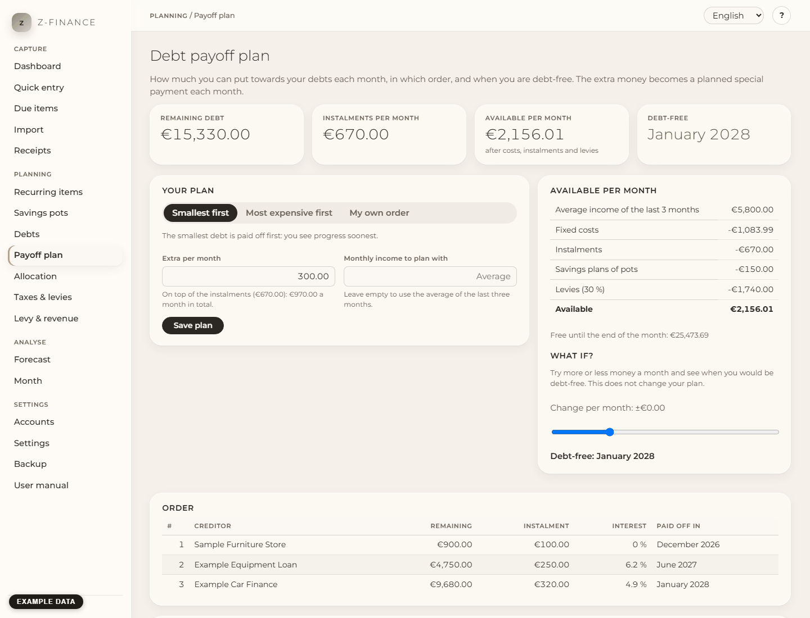

# Payoff plan

## What you see

The **Payoff plan** answers four questions: how much can you really put towards your debts each
month, in which order should you pay them off, when will you be debt-free, and are you on track?
You find it in the sidebar under **Planning**, right below [Debts](debts.md). Enter your debts
there first; the plan uses them as they are.

At the top are four figures: what you still owe in total, your instalments per month, what is
**available** per month, and the month you will be **debt-free**.

## What is available each month

z-finance works out what is left each month after everything that has to be paid:

- your **average income of the last three complete months**,
- minus your **fixed costs** (the recurring expenses, e.g. rent),
- minus your **instalments**,
- minus the **savings plans** of your pots,
- minus the **levies** (income tax and social insurance) that your business income triggers, at
  the rate from **Taxes & levies**.

The levies are taken off on purpose: money you will owe the tax office is never shown as money you
can use. If you earn 3,000 € more in a month and your rate is 30 %, the available amount rises by
700 € in the average, not by 1,000 €.

If your income goes up and down a lot, type the amount you want to plan with into **Monthly income
to plan with**. Leave the field empty to go back to the average.

## Set up your plan

1. Type the **Extra per month**: what you put towards your debts _on top of_ the instalments. The
   hint below the field shows the total per month. A good start is the available amount.
2. Choose the order:
   - **Smallest first** — the smallest debt goes first. You see a debt disappear soonest, which
     keeps you going.
   - **Most expensive first** — the debt with the highest interest rate goes first. This costs the
     least interest. Enter the interest rate on the [Debts](debts.md) page.
   - **My own order** — for a debt that presses (a reminder, the tax office). Drag the debts into
     the order you want, or use the **↑** and **↓** buttons (they also work with the keyboard: Tab
     to the button, then Enter).
3. Click **Save plan**.

The extra money goes to the first debt of the order each month as a **special payment**. When that
debt is paid off, its money and its instalment move on to the next debt — the monthly total stays
the same, and each debt goes faster than the one before.

Example: debt A 2,000 € with 100 € instalments, debt B 4,000 € with 200 €, 300 € extra per month
(600 € in total). A gets 400 € a month and is paid off after 5 months. From then on B gets all
600 € and is paid off after 10 months. You are debt-free in 10 months.

The table **Order** shows each debt with the month it will be paid off, **Month by month** shows
where the money goes every month.

## Special payments in your plan

z-finance plans each special payment as a transfer from the debt's paying account to the debt, for
the next 12 months. They appear in the [Due items](due.md) like instalments: confirm one when you
have paid it. Nothing is paid automatically — z-finance never contacts your bank.

When anything changes (a debt is paid off, you change the order or the amount), the planned
special payments are adjusted. Special payments you have already confirmed or skipped stay as they
are.

## Planned and paid

After saving, z-finance remembers the plan. Each month, **Planned and paid** compares what should
have gone to your debts with what you actually paid (instalments and special payments together).

If you skip a special payment, the plan shows **behind plan**, tells you how much extra you would
have to pay next month to stay on schedule, and the debt-free month moves later — the figure at the
top then shows the originally planned month below it. Save the plan again to make the new state
your plan.

## What if?

Move the **What if?** slider to try more (or less) money per month. You immediately see the
debt-free month you would reach. This only calculates; your plan stays as it is until you change
the extra amount and save.

## Typical problems

- **"No plan possible"**: your fixed costs, instalments and levies are higher than your income. The
  page shows by how much per month. Look for expenses to cut in the [Month](month.md) view, or
  renegotiate an instalment and change it on the [Debts](debts.md) page.
- **Warning: budget higher than available**: the plan still works, but you would be paying more
  than you earn each month; the forecast shows your reserve being used up.
- **"Your income has risen"**: your average income is higher than when you saved the plan.
  z-finance suggests a higher amount, but only uses it when you click **Use this amount** and save.
- **A debt gets no special payment**: it has no paying account. Set one on the [Debts](debts.md)
  page.
- **The debt-free date is far away**: a debt without a fixed instalment only gets the extra money.
  With no extra money, it is never paid off.

The plan is a snapshot you save, not a live formula: after a skipped special payment or a change in
your income, open the page and save again to bring it in line with what actually happened.
