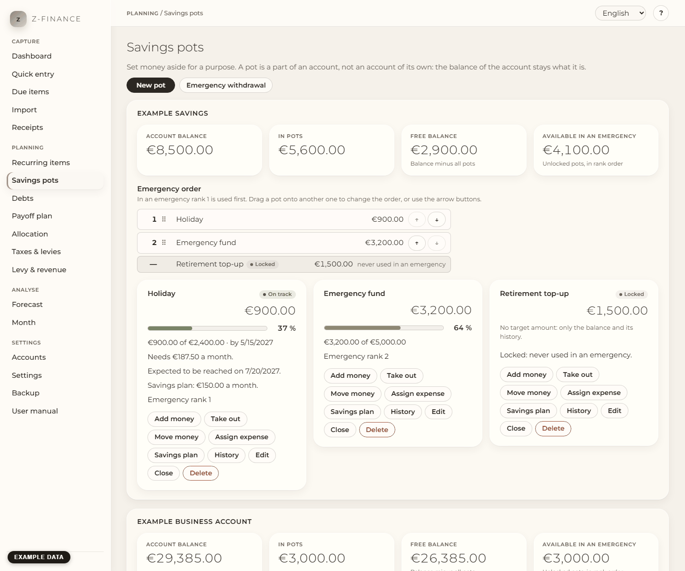

# Savings pots

## What you see

**Savings pots** answers one question: how much of this account's money is already spoken for? Set
money aside for a purpose — a car, new hardware, a holiday, the tax reserve, an emergency fund. A
pot is not an account of its own: it is a part of one real account, whose balance stays exactly
what your bank shows, while the pots say which part of it is meant for what. You find this screen
in the sidebar under **Planning**.

For every account that has pots, the screen shows:

- four figures: the **Account balance**, the money **In pots**, the **Free balance** (account
  balance minus all pots) and what is **Available in an emergency** (the pots that may be used,
  see below);
- the **Emergency order**: the pots in the order in which they are used in an emergency;
- one card per pot with its balance, target, progress, status and the actions.

## A pot card

- **Progress** is a bar with the percentage next to it, and "500 € of 3,000 € by 19 July".
- **Needs … a month** is the monthly amount that reaches the target on the target date: (target −
  balance) ÷ months left. With a target of 3,000 €, a balance of 500 € and ten months to go that is
  250 €.
- The **status** is one of **On track**, **Behind plan** or **Reached**. A pot is behind plan when
  its balance is below what a steady saving plan would have reached by today. It then shows the new
  monthly amount you would need from now on. The status is always written out, not only coloured.
- **Expected to be reached on** appears when a savings plan is set up.
- **Emergency rank 2** or **Locked** shows the pot's place in the emergency order.
- Without a target amount the card shows only the balance and its history. Without a target date
  there is no monthly amount.

## Create a pot

Click **New pot** and fill in:

1. **Name**, **Account** (the account the money is on) and **Area** (private or business; it starts
   with the area of the account).
2. **Target amount** and **Target date**. Both are optional: an emergency fund has no date, open
   saving has no target.
3. **Plan the expense on the target date**: the target amount then appears as a planned expense on
   the target date and shows up in the forecast. It needs target amount and date.
4. **Emergency rank**: the place in the emergency order (rank 1 is used first), or **Locked** for a
   pot that must never be used in an emergency, such as an emergency fund or a tax reserve.
5. **Levy reserve pot** marks the pot that holds the reserve for taxes and levies. Set it on one pot
   only.

Click **Save**. The account of a pot cannot be changed later.

## Assign money

**Add money** puts money into the pot. Type the **Amount** and choose where it comes from:

- **Free balance of this account** (default): the money is already on the account. The pot can only
  get what is free. If you type more, the field says how much is free and nothing changes.
- **Another account**: z-finance books a transfer from that account to the pot's account, and the
  money goes into the pot.

## Take money out

**Take out** returns money from the pot to the free balance of the account. The pot cannot give more
than it holds. A **locked** pot asks you to tick a confirmation first; the movement is then logged
as **Emergency** in the pot's history.

## Move money between pots

**Move money** moves an amount from this pot to another pot of the **same account**. Nothing is
booked and the balance of the account does not change.

## Assign an expense

When you have paid for the thing the pot was for, enter the expense under Quick entry as usual.
Then click **Assign expense** on the pot and choose it from the list of the latest expenses of the
account. The pot pays for it up to its balance; if the expense is larger, the rest comes from the
free balance, and z-finance tells you how it was split. A locked pot needs the confirmation here
too.

## Savings plan

**Savings plan** sets up a monthly transfer from another account into the pot's account. The
monthly amount is offered from the pot's plan, you can change it. The first transfer is next month
and the plan ends on the target date. The transfers appear as planned items like every recurring
item; once booked they count towards the pot. **End savings plan** stops it; what has been booked
stays in the pot.

## History, edit, close, delete

- **History** lists every movement of the pot: assigned, taken out, moved, emergency.
- **Edit** changes the fields of the pot. A changed target starts the plan from today.
- **Close** is for a pot that has done its job. After a question, the rest returns to the free
  balance and the pot moves to **Closed pots** at the bottom of its account.
- **Delete** removes the pot with its history; its money returns to the free balance.

## Emergency order

The **Emergency order** list shows the unlocked pots of an account, rank 1 on top. In an emergency
rank 1 is emptied first, then rank 2, and so on. Locked pots are listed below, are never used and
cannot be moved.

To change the order, **drag a pot onto another one**: it takes that pot's place. Without a mouse,
use the **↑** and **↓** buttons next to each pot. The order is saved at once and the next emergency
proposal follows it.

## Emergency withdrawal

You suddenly need money, for example 500 €. Click **Emergency withdrawal**, choose the account,
type the **Amount needed** and click **Show proposal**.

- The proposal takes the amount from the pots in emergency order: rank 1 first, then rank 2. Locked
  pots are never part of it.
- The table shows for every pot how much is taken, its new balance and, if it has a target date,
  the new target date: a date moves back by one month for each monthly amount that is taken.
- You can change the amounts by hand, also for pots the proposal did not use. New dates are
  calculated when you confirm.
- If the unlocked pots hold less than you need, the dialog says how much is missing.

Click **Confirm withdrawal** to take the money. If you also want to use a locked pot, use **Take
out** on that pot; it asks for a confirmation.

## Typical problems

- **"Only … € of the account are free; the pot cannot get more."** You tried to assign more than the
  free balance of the account. Assign less, or pay in from another account.
- **"The pot … holds only … €."** You tried to take out more than the pot holds.
- **"The pot … is locked. Confirm to take money from it."** Tick the confirmation in the dialog.
- **"This expense is already assigned to a pot."** Each expense belongs to at most one pot.
- **The free balance is negative.** Something was paid from the account that no pot covered. Assign
  the expense to the pot it belongs to, or reduce the pots.
- **Dragging does not work on a touch screen.** Use the ↑ and ↓ buttons.

A pot only ever tracks a share of one real account — the bank never sees pots, so the account's
own balance is always the number your bank statement agrees with.
