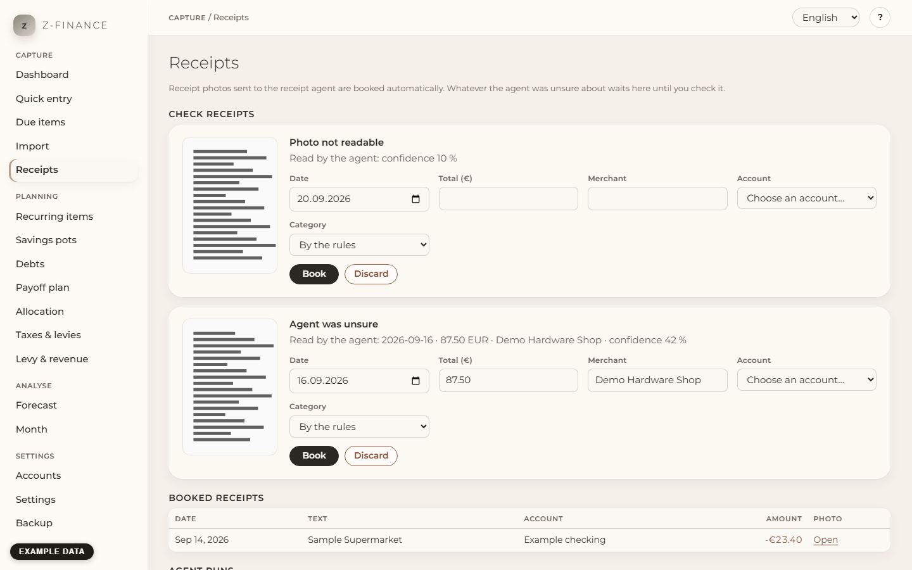

# Receipts

## How receipts get in

You take a photo of a till receipt and send it to the receipt agent's mailbox, optionally with a
few words in the message. At fixed times the agent reads date, total and merchant from each photo
and hands photo and values to z-finance. You do not upload anything on this page: it shows what
arrived and what needs you.

You find this screen in the sidebar under **Capture**.

What z-finance does with a receipt:

- **Readable and sure** → it is booked as an expense (total as a minus amount, the receipt's
  date, the merchant as text) and the photo is attached.
- **Paid by card and already in your bookings** (for example from a bank import): a booking with
  the same amount up to 3 days before or after gets the photo; no second booking is made.
- **The same photo again** → nothing new happens; the receipt is already recorded.
- **Unsure** → the receipt waits under **Check receipts** with its photo and the reason.

## Words in the message

The words you write with the photo take priority over what the agent guesses:

- **business** (or _geschäftlich_) → the booking goes to your business area; **private** is the
  default.
- **bar** or **cash** → it goes to your cash account; **card** (or _Karte_) → your card account,
  or your current account if you have no card account.
- The **name of a category** (for example "Groceries") → that category. Without a category word
  the agent's suggestion is used, and otherwise your [rules](month.md) decide.

## Check receipts

Every entry shows the photo (click it to see it full size), the reason and what the agent read.
Reasons:

- **Agent was unsure** — the agent's confidence was below your threshold (see Settings below).
- **Date, total or merchant missing** — the agent could not read one of them.
- **Photo not readable** — blurry, dark, or not a receipt at all.
- **Foreign currency** — z-finance books in euro only; enter the amount you actually paid in euro.
- **No account for this payment** — z-finance does not know which account to use (see Settings).
- **Account does not accept this date** — the account is archived or the date is before its
  opening date.
- **Possible duplicate** — another receipt has the same date, total and merchant. If you really
  bought the same thing twice, book it; otherwise discard it.

To fix an entry, correct **Date**, **Total (€)** and **Merchant** if needed, choose the
**Account** and, if you like, a **Category** ("By the rules" lets your rules choose), then click
**Book**. The booking appears in [Quick entry](entry.md) and the entry leaves the list. **Discard**
deletes the receipt and its photo for good.

## Booked receipts and agent runs

**Booked receipts** lists the latest receipts with their booking and a link to the photo. If a
booking was deleted later, the row says **Booking deleted**; the photo is kept.

**Agent runs** shows when the agent ran and how many receipts of each run were booked, are waiting
to be checked, or were duplicates. A run marked **not finished** stopped early; the next run picks
up the messages it missed.

## Settings

- **Check receipts read with less than (%)**: receipts the agent read with less confidence go to
  the check list. The default is 80.
- **Cash payments, private** (and the same for card payments and for business): the account for each case. **Automatic**
  uses your only cash account (cash) or your only card account, else your only current account
  (card). If you have several of one kind, choose one here, otherwise such receipts wait under
  **Check receipts**.

## Typical problems

- **A receipt is missing.** Look at **Agent runs**: if the last run is older than expected, the
  agent did not run. Receipts of a message are only processed once the agent reaches z-finance.
- **A card payment was booked twice.** The receipt came in before the bank import; delete the
  imported line or the receipt's booking in [Quick entry](entry.md).
- **Backup:** the photos are stored in the `receipts` folder of your data directory and are part of
  the [Backup](backup.md): download the `.zip` of a backup to keep them safe, and restore from that
  `.zip` to get them back.

A readable, sure receipt books itself; everything else waits under Check receipts for your
decision — the agent never guesses past that line.
