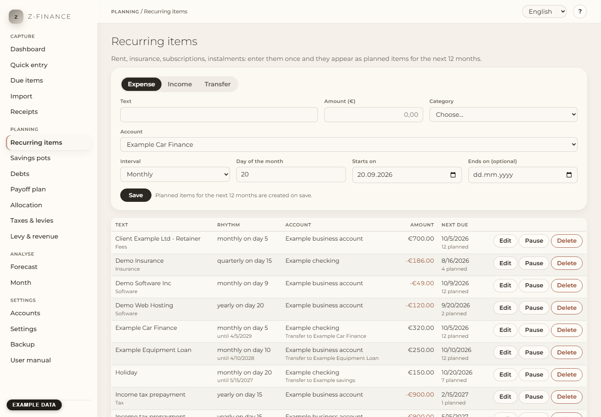

# Recurring items

## What you see

**Recurring items** answers one question: what is coming, and when? Enter payments that come back
regularly — rent, insurance, subscriptions, a loan instalment, a monthly transfer to savings, a
regular income — and payments you know are coming once, such as a tax back-payment or an invoice
you are waiting to be paid.

You enter each of them once. z-finance then creates **planned items** for the next 12 months.
Planned items do not change any balance yet; they show what is coming. When the money actually
moves, the planned item is confirmed as a booking or replaced by the line from your bank statement
(see [Due items](due.md) and [Import](import.md)).

The page has three parts: the form at the top, the list of your recurring items below it, and
**Expected one-off items** at the bottom. Click a recurring item in the list to see its planned
items. You find this screen in the sidebar under **Planning**.

## Recurring item or expected one-off item?

- A **recurring item** repeats: every week, month, quarter or year. Example: rent of 800 € on the
  1st of every month.
- An **expected one-off item** happens once on a known date. Example: an invoice of 3,000 € you
  expect to be paid on 20 November.

## Create a recurring item

1. Choose **Expense**, **Income** or **Transfer**. A transfer moves money between two of your own
   accounts, for example a savings instalment or a loan instalment paid to a liability account.
2. Type the **Text** (for example "Rent"), the **Amount** (always without a sign) and pick the
   **Category**.
3. Pick the **Account** — for a transfer the **From account** and the **To account**.
4. Pick the **Interval**: monthly, quarterly, yearly or weekly.
5. For monthly, quarterly and yearly items type the **Day of the month** (1 to 31). For weekly
   items pick the **Weekday**.
6. **Starts on** is the first possible date. **Ends on** is optional — leave it empty if the
   payment has no end.
7. Click **Save**. The planned items for the next 12 months appear right away.

Quarterly and yearly items repeat in the month of the start date: a quarterly item starting in
February is due in February, May, August and November.

## Day 29, 30 or 31

Not every month has 31 days. An item on day 31 falls on the **last day** of shorter months: 30
April, 30 June, and 28 February (29 February in a leap year). The same applies to days 29 and 30.

## Every start fills up the next 12 months

Each time you start z-finance, it creates the planned items that are missing up to 12 months
ahead. Nothing is created twice. You can therefore close and start the app as often as you like.

Items that were due before you created the recurring item are not created afterwards — only from
today on.

## Move a single planned item

Sometimes one payment is different: the rent is collected a few days later, or one month costs
more. Click the recurring item in the list, then **Move** next to the planned item. Change the
date or the amount and click **Save**. The item is marked "changed" and stays exactly like that —
z-finance never overwrites it when it fills up the next 12 months.

## When the amount changes (rent increase)

Set **Ends on** of the old recurring item to the day before the new amount applies, then create a
new recurring item with the new amount from that date. Items you already booked stay as they
were.

If you only correct a typo, click **Edit**, change the values and click **Save changes**. The
planned items from today on follow the new values; items you moved by hand and items already
booked stay unchanged.

## Pause, resume, delete

- **Pause** removes all planned items of the recurring item. Items already booked stay. No new
  planned items are created while it is paused.
- **Resume** creates the planned items for the next 12 months again.
- **Delete** removes the recurring item and its planned items. Booked items stay as ordinary
  bookings. You cannot delete the income-tax and SVS items of the tax plan here. Change or clear
  them under [Taxes & levies](tax.md).

## Expected one-off items

At the bottom of the page, choose **Expense** or **Income**, pick a **Date after today**, type the
**Amount**, pick **Account** and **Category**, add a **Text** and click **Add expected item**. The
item appears in the list below. **Delete** removes it again.

For a payment that has already happened, use [Quick entry](entry.md) instead.

## Typical problems

- **"Choose a day of the month between 1 and 31."** The day is empty or outside 1 to 31.
- **"The end date must not be before the start date."** Fix one of the two dates.
- **"The account … is archived."** Archived accounts receive no planned items; pick another
  account (see [Accounts](accounts.md)).
- **"An expected item needs a date after today."** For today or earlier, record a booking in
  [Quick entry](entry.md).
- **A planned item that I deleted shows as skipped.** When you delete a planned item of a
  series in the booking list, z-finance skips that one date. The series goes on. That date does
  not come back. To stop the series, pause or delete it here.
- **"This recurring item belongs to the tax plan. …"** Its payments count as tax prepayments of
  the year. Change or clear the amount under [Taxes & levies](tax.md).

Whatever a recurring item plans, it only becomes a real booking once you confirm it under Due
items or an import matches it to a bank statement line — nothing here changes a balance by itself.
