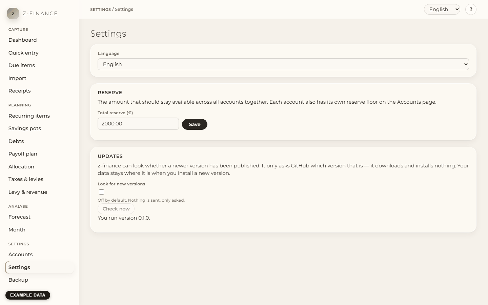

# Settings

## What you see

**Settings** answers one question: how does z-finance fit the way you work? The **Language** of the
interface, the **Total reserve** across all accounts, and the notice about new **versions**.

You find this screen in the sidebar under **Settings**.

## Change the language

1. Open **Settings** in the navigation.
2. Choose **English** or **Deutsch** under **Language**.

The whole interface switches at once, including this help and the manual. z-finance remembers the
choice, also after a restart and in another browser on the same computer.

## Set the total reserve

The total reserve is the amount that should stay available across all your accounts together — a
safety cushion on top of the reserve floor of each single account (see
[Accounts](accounts.md)).

1. Open **Settings** in the navigation.
2. Enter the amount under **Reserve**, for example `3000` or `3000,00`, and click **Save**.

The page confirms the saved amount. Enter `0` if you do not want a total reserve. The
[Forecast](forecast.md) marks the days on which your accounts together fall below it.

## Look for new versions

z-finance never connects to the internet by itself. If you want it to tell you about new versions,
you have to switch that on:

1. Open **Settings** in the navigation.
2. Tick **Look for new versions** under **Updates**.
3. Click **Check now**.

z-finance then asks GitHub which version is the newest and shows it — **it downloads and installs
nothing**. If a newer one exists, a link leads to the download page; install it the same way as the
first time, and your data stays where it is (see [Installing z-finance](install.md)). Removing the
tick also forgets the result of the last check.

## Typical problems

- **"The language could not be saved on the server."** The language applies in this browser, but
  z-finance could not store it. Check that z-finance is still running (the line at the bottom of
  the page says "Backend not reachable" if not) and choose the language again.
- **Some text stays in English.** A text that has no translation yet is shown in English.
- **"z-finance could not reach GitHub to look for updates."** The version check needs an internet
  connection. Without one z-finance works exactly as before — only this notice stays away.

These three settings are the only global ones in z-finance — everything else about a screen lives,
and is explained, in that screen's own chapter.
