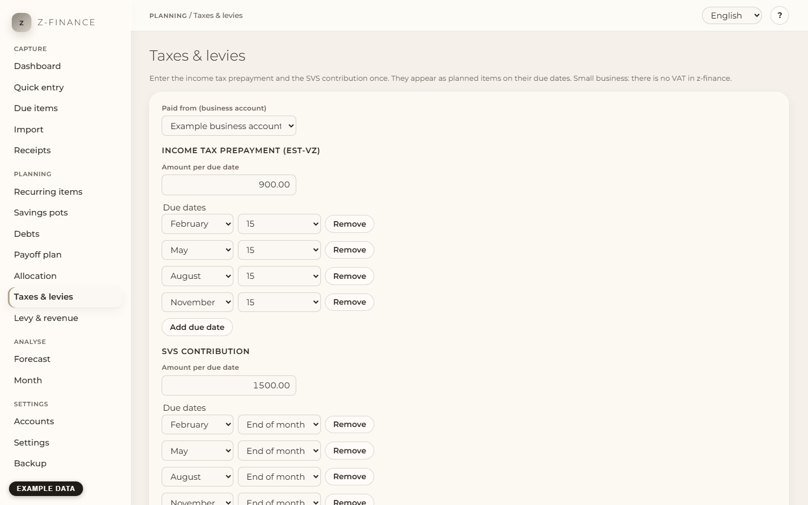

# Taxes & levies

## What you see

**Taxes & levies** answers one question: is the money for the tax office still there when it is
due? Enter, once, the two big payments that come up only a few times a year and are easy to
forget: the **income tax prepayment** (ESt-VZ) and the **SVS contribution**. After you save, both
appear as planned items on their due dates — in the forecast and in the list of what is due — so
you can see them coming and keep the money on your account.

z-finance assumes a small business without VAT: there is no VAT field and no VAT calculation
anywhere in the tool.

The page has three parts: the form, a hint while nothing is entered yet, and the **Plan** — one row
per due date with the next planned item.

You find this screen in the sidebar under **Planning**.

## Enter your prepayments

1. Pick the account the payments are made **Paid from** (normally your business account).
2. Under **Income tax prepayment (ESt-VZ)** type the **Amount per due date**, for example 1500 for
   1,500 € per quarter. Leave the field empty if you do not know the amount yet.
3. Do the same under **SVS contribution**.
4. Check the **Due dates**. They are preset to the usual dates: income tax on 15 February,
   15 May, 15 August and 15 November; SVS at the end of February, May, August and November.
5. Click **Save**.

Example: with 1,500 € income tax prepayment you get exactly four planned items of −1,500 € in the
next 12 months, one on each of the four due dates. A due date that falls on a weekend or a public
holiday stays on that date — the payment has to leave your account before it.

## Due dates

Each due date is a month and a day. Choose **End of month** for "the last day of the month" — it
means the 28th (or 29th) in February and the 30th or 31st in the other months. Use **Add due date**
and **Remove** if your notice lists other dates. You can enter up to 12 dates per payment; each
date only once.

## A new assessment notice: change the amount

When the tax office or the SVS sends a new prepayment amount, type the new **Amount per due date**
and click **Save**.

- The new amount applies from the **next open due date** on. Planned items after that date change
  to the new amount.
- Quarters you have **already confirmed** keep the amount you paid, and so do quarters that are
  already due but not confirmed yet. If the notice changes an amount retroactively, enter the
  difference as a back-payment or a credit (see below).
- A quarter you paid a few days before its due date counts as confirmed.

If you moved a future planned item by hand on the [Recurring items](recurring.md) page, the change of
amount resets it to its due date.

## Back-payments

A back-payment after an assessment notice is a one-off amount with a date. Enter it on the
[Recurring items](recurring.md) page under **Expected one-off items**, with the category **Tax**
(or **SVS**). It then shows up in the forecast and in the list of what is due like every other
planned item. It does not count as a prepayment.

## Nothing entered yet

While both amount fields are empty, no items are planned and the page shows **Taxes & levies are
not set yet**. Enter the amounts as soon as you know them. If you clear an amount later, its planned
items disappear again; confirmed payments stay.

## Good to know

- The planned items use the categories **Tax** and **SVS**. If they do not exist yet, z-finance
  creates them.
- The amounts you enter here are the source: if you change one of these planned series on the
  Recurring items page, the next **Save** here puts it back. You cannot delete such a series there.
  So the payments you already booked still count as prepayments.
- Only payments that were planned here count as prepayments of the year (for the later levy
  planning). A payment you enter as a plain booking does not.

Keep the amounts here in sync with the actual notice: only payments booked from this plan count as
this year's prepayments toward the levy reserve — a plain booking or a planned amount does not.
