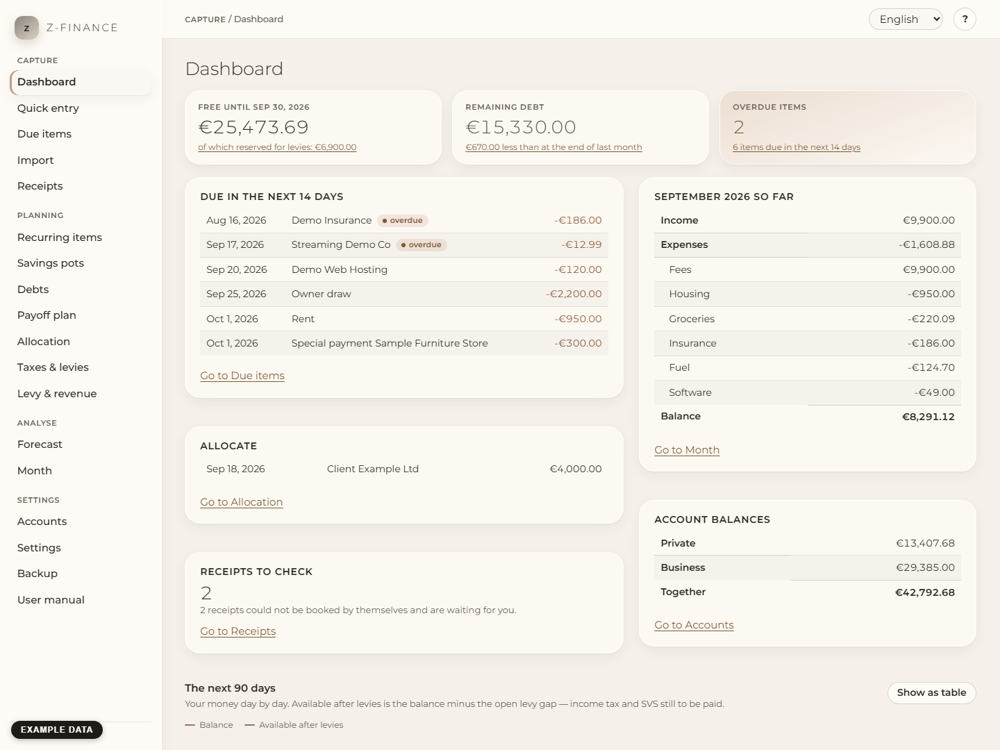

# The weekly routine

Ten minutes, once a week, always in the same order. That is everything z-finance asks of you. Keep
it up and the forecast stays true, and "free until the end of the month" stays a number you can
actually spend.

_All screenshots in this manual show example data, marked in the picture — never real figures._

## Before you start

Open z-finance (Start menu, or the **z** icon in the notification area → **Open z-finance**). The
[dashboard](index.md) is the first screen. Pick a fixed day and time, for example Sunday evening;
the routine works because it is always the same.

## The six steps

1. **Look at the three figures at the top.** Is _free until the end of the month_ what you
   expected? Is the remaining debt going down? Is anything overdue? Nothing to decide yet — just
   see where you stand. What the figures mean: [Dashboard](index.md).
2. **Confirm what has happened.** Open [Due items](due.md). Confirm every planned item that took
   place (change the amount or the date in the row if the bank booked it differently), postpone
   what is late, skip what will not happen. Afterwards the forecast matches reality again.
3. **Get in what is missing.** Download the statement from your online banking and load it with
   [Import](import.md); enter cash and other odd items with [Quick entry](entry.md) (Alt+N from
   any screen).
4. **Decide about new income.** If the dashboard card **Allocate** lists something, open
   [Allocation](allocation.md) and confirm or reject each proposal. A proposal that has waited
   seven days or more is highlighted; z-finance never books it by itself.
5. **Check the receipts.** If **Receipts to check** shows a number, open [Receipts](receipts.md)
   and correct or discard what the receipt agent could not read. Without the agent, skip this step.
6. **Glance at the curve.** The next 90 days at the bottom of the dashboard. If the line dips
   below your reserve, open the [Forecast](forecast.md) and see when and why.

You are done when the dashboard shows no overdue items and nothing waits under **Allocate** and
**Receipts to check**.

## Once a month

- Look at the [Month](month.md) screen for the month that just ended and give the bookings without
  a category a category — a rule saves you doing it twice.
- Check the 12-month [Forecast](forecast.md) for the lowest point and the first day under the
  reserve.
- Copy a backup outside this computer (see [Backup and restore](backup.md)).

## Once a year

- A new assessment notice arrives: enter the new prepayment under
  [Taxes & levies](tax.md); it applies from the next open due date on.
- When the assessment for a year is in, mark it under [Levy & revenue](levy.md) with
  **Assessment received** so the expected back-payment of that year is closed.
- Look at the [Payoff plan](payoff.md): is the budget still what you can afford?

## If you skip a week

Nothing breaks. Planned items stay planned and are shown as overdue; the forecast counts them from
today. Items more than 30 days overdue are marked in words and with an edge so you do not miss
them. Just do the routine when you have time — start with step 2, it repairs the most.
